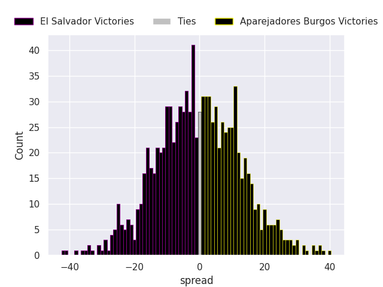
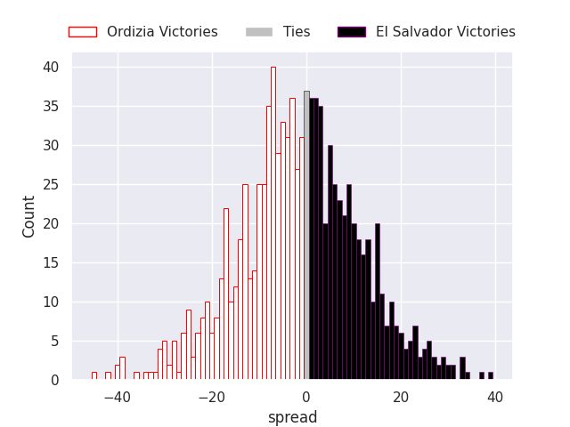
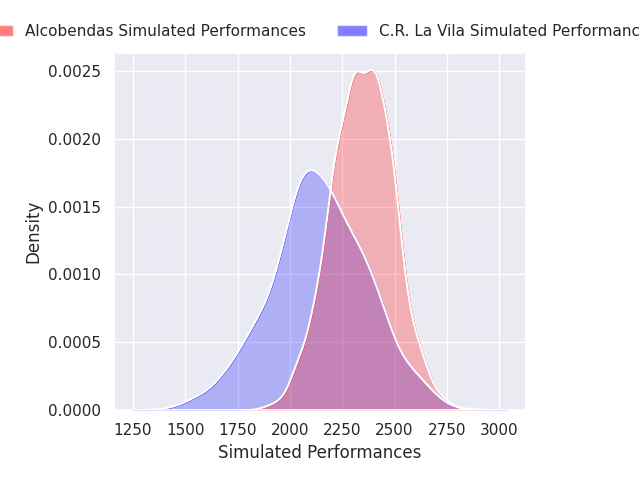
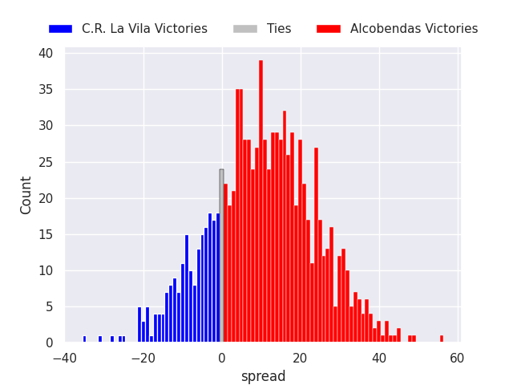

## Team Rankings

## Standings
### Current Standings

| Club                |   Played |   Wins |   Point Differential |   Losing Bonus Points | Try Bonus Points   |   Competition Points |
|:--------------------|---------:|-------:|---------------------:|----------------------:|:-------------------|---------------------:|
| Alcobendas          |        2 |      2 |                   57 |                     0 |                    |                    8 |
| Ordizia             |        2 |      2 |                   39 |                     0 |                    |                    8 |
| VRAC                |        2 |      2 |                   30 |                     0 |                    |                    8 |
| Aparejadores Burgos |        2 |      2 |                   24 |                     0 |                    |                    8 |
| El Salvador         |        2 |      1 |                    6 |                     1 |                    |                    5 |
| UE Santboiana       |        2 |      1 |                   -5 |                     0 |                    |                    4 |
| C.R. La Vila        |        2 |      0 |                  -13 |                     2 |                    |                    2 |
| CRC Pozuelo Rugby   |        2 |      0 |                  -24 |                     1 |                    |                    1 |
| Cisneros            |        2 |      0 |                  -48 |                     0 |                    |                    0 |
| Liceo Frances       |        2 |      0 |                  -66 |                     0 |                    |                    0 |

### Projected Remaining Table

| Club                |   To Play |   Projected Wins |   Projected Differential |   Projected Losing Bonus Points | Projected Try Bonus Points   |   Projected Competition Points |
|:--------------------|----------:|-----------------:|-------------------------:|--------------------------------:|:-----------------------------|-------------------------------:|
| Aparejadores Burgos |         3 |            2.285 |                   40.253 |                           0.319 |                              |                          9.569 |
| VRAC                |         3 |            2.187 |                   36.478 |                           0.318 |                              |                          9.156 |
| Alcobendas          |         3 |            1.904 |                   15.815 |                           0.471 |                              |                          8.267 |
| El Salvador         |         3 |            1.624 |                    5.393 |                           0.557 |                              |                          7.225 |
| Cisneros            |         3 |            1.431 |                   -1.12  |                           0.452 |                              |                          6.332 |
| C.R. La Vila        |         3 |            1.282 |                   -3.892 |                           0.524 |                              |                          5.792 |
| UE Santboiana       |         3 |            1.25  |                   -9.69  |                           0.493 |                              |                          5.617 |
| Ordizia             |         3 |            0.921 |                  -20.23  |                           0.587 |                              |                          4.389 |
| CRC Pozuelo Rugby   |         3 |            0.959 |                  -27.425 |                           0.414 |                              |                          4.352 |
| Liceo Frances       |         3 |            0.834 |                  -35.582 |                           0.335 |                              |                          3.771 |

### Projected Total Table

| Club                |   Played |   Wins |   Point Differential |   Losing Bonus Points | Try Bonus Points   |   Competition Points |
|:--------------------|---------:|-------:|---------------------:|----------------------:|:-------------------|---------------------:|
| Aparejadores Burgos |        5 |  4.285 |               64.253 |                 0.319 |                    |               17.569 |
| VRAC                |        5 |  4.187 |               66.478 |                 0.318 |                    |               17.156 |
| Alcobendas          |        5 |  3.904 |               72.815 |                 0.471 |                    |               16.267 |
| Ordizia             |        5 |  2.921 |               18.77  |                 0.587 |                    |               12.389 |
| El Salvador         |        5 |  2.624 |               11.393 |                 1.557 |                    |               12.225 |
| UE Santboiana       |        5 |  2.25  |              -14.69  |                 0.493 |                    |                9.617 |
| C.R. La Vila        |        5 |  1.282 |              -16.892 |                 2.524 |                    |                7.792 |
| Cisneros            |        5 |  1.431 |              -49.12  |                 0.452 |                    |                6.332 |
| CRC Pozuelo Rugby   |        5 |  0.959 |              -51.425 |                 1.414 |                    |                5.352 |
| Liceo Frances       |        5 |  0.834 |             -101.582 |                 0.335 |                    |                3.771 |

## Completed Match Review

| Model | Percent Correct Predictions | Spread Error |
| ------ | ------ | ------ |
| Club Level | 68.0% | 14.8 |
| Player Level: Lineup | nan% | nan |
| Player Level: Minutes | nan% | nan |

## Future Predictions
### Week 3
#### VRAC V CRC Pozuelo Rugby on 2026/12/12

Average Margin: VRAC by 25.0

#### C.R. La Vila V Liceo Frances on 2026/12/12

Average Margin: C.R. La Vila by 10.7

#### Cisneros V El Salvador on 2026/12/13

Average Margin: El Salvador by 6.6

#### Aparejadores Burgos V Ordizia on 2026/12/13

Average Margin: Aparejadores Burgos by 14.4

#### UE Santboiana V Alcobendas on 2026/12/13

Average Margin: Alcobendas by 0.9

### Week 4
#### Liceo Frances V Cisneros on 2026/12/19

Average Margin: Liceo Frances by 1.1

#### CRC Pozuelo Rugby V C.R. La Vila on 2026/12/19

Average Margin: CRC Pozuelo Rugby by 4.2

#### Alcobendas V VRAC on 2026/12/19

Average Margin: Alcobendas by 4.4

#### UE Santboiana V Ordizia on 2026/12/20

Average Margin: UE Santboiana by 7.1

#### El Salvador V Aparejadores Burgos on 2026/12/20

Average Margin: El Salvador by 0.1

### Week 5
#### Ordizia V El Salvador on 2027/01/16

Average Margin: Ordizia by 1.3

#### Cisneros V CRC Pozuelo Rugby on 2027/01/16

Average Margin: Cisneros by 6.5

#### C.R. La Vila V Alcobendas on 2027/01/16

Average Margin: Alcobendas by 10.4

#### Aparejadores Burgos V Liceo Frances on 2027/01/16

Average Margin: Aparejadores Burgos by 26.0

#### VRAC V UE Santboiana on 2027/01/16

Average Margin: VRAC by 15.9

