## Team Rankings

## Standings
### Current Standings

| Club                |   Played |   Wins |   Point Differential |   Losing Bonus Points |   Try Bonus Points |   Competition Points |
|:--------------------|---------:|-------:|---------------------:|----------------------:|-------------------:|---------------------:|
| Alcobendas          |        2 |      2 |                   57 |                     0 |                  1 |                    9 |
| Ordizia             |        2 |      2 |                   39 |                     0 |                  1 |                    9 |
| VRAC                |        2 |      2 |                   30 |                     0 |                  1 |                    9 |
| Aparejadores Burgos |        2 |      2 |                   24 |                     0 |                    |                    8 |
| El Salvador         |        2 |      1 |                    6 |                     1 |                  1 |                    6 |
| UE Santboiana       |        2 |      1 |                   -5 |                     0 |                    |                    4 |
| C.R. La Vila        |        2 |      0 |                  -13 |                     2 |                    |                    2 |
| CRC Pozuelo Rugby   |        2 |      0 |                  -24 |                     1 |                    |                    1 |
| Cisneros            |        2 |      0 |                  -48 |                     0 |                    |                    0 |
| Liceo Frances       |        2 |      0 |                  -66 |                     0 |                    |                    0 |

### Projected Remaining Table

| Club                |   To Play |   Projected Wins |   Projected Differential |   Projected Losing Bonus Points | Projected Try Bonus Points   |   Projected Competition Points |
|:--------------------|----------:|-----------------:|-------------------------:|--------------------------------:|:-----------------------------|-------------------------------:|
| Aparejadores Burgos |         4 |            3.227 |                   63.569 |                           0.337 |                              |                         13.375 |
| VRAC                |         4 |            2.977 |                   47.041 |                           0.416 |                              |                         12.46  |
| Alcobendas          |         4 |            2.681 |                   25.799 |                           0.604 |                              |                         11.564 |
| El Salvador         |         4 |            2.365 |                   14.33  |                           0.669 |                              |                         10.337 |
| Ordizia             |         4 |            1.729 |                   -4.76  |                           0.619 |                              |                          7.687 |
| Cisneros            |         4 |            1.654 |                   -9.564 |                           0.683 |                              |                          7.495 |
| UE Santboiana       |         4 |            1.507 |                  -17.876 |                           0.711 |                              |                          6.951 |
| C.R. La Vila        |         4 |            1.437 |                  -17.346 |                           0.674 |                              |                          6.608 |
| Liceo Frances       |         4 |            1.029 |                  -50.457 |                           0.469 |                              |                          4.727 |
| CRC Pozuelo Rugby   |         4 |            0.963 |                  -50.736 |                           0.485 |                              |                          4.463 |

### Projected Total Table

| Club                |   Played |   Wins |   Point Differential |   Losing Bonus Points |   Try Bonus Points |   Competition Points |
|:--------------------|---------:|-------:|---------------------:|----------------------:|-------------------:|---------------------:|
| VRAC                |        6 |  4.977 |               77.041 |                 0.416 |                  1 |               21.46  |
| Aparejadores Burgos |        6 |  5.227 |               87.569 |                 0.337 |                    |               21.375 |
| Alcobendas          |        6 |  4.681 |               82.799 |                 0.604 |                  1 |               20.564 |
| Ordizia             |        6 |  3.729 |               34.24  |                 0.619 |                  1 |               16.687 |
| El Salvador         |        6 |  3.365 |               20.33  |                 1.669 |                  1 |               16.337 |
| UE Santboiana       |        6 |  2.507 |              -22.876 |                 0.711 |                    |               10.951 |
| C.R. La Vila        |        6 |  1.437 |              -30.346 |                 2.674 |                    |                8.608 |
| Cisneros            |        6 |  1.654 |              -57.564 |                 0.683 |                    |                7.495 |
| CRC Pozuelo Rugby   |        6 |  0.963 |              -74.736 |                 1.485 |                    |                5.463 |
| Liceo Frances       |        6 |  1.029 |             -116.457 |                 0.469 |                    |                4.727 |

## Completed Match Review

| Model | Percent Correct Predictions | Spread Error |
| ------ | ------ | ------ |
| Club Level | 73.3% | 14.6 |
| Player Level: Lineup | nan% | nan |
| Player Level: Minutes | nan% | nan |

## Future Predictions
### Week 3
#### C.R. La Vila V Liceo Frances on 2026/12/12

Average Margin: C.R. La Vila by 9.7

#### VRAC V CRC Pozuelo Rugby on 2026/12/12

Average Margin: VRAC by 24.1

#### UE Santboiana V Alcobendas on 2026/12/12

Average Margin: Alcobendas by 0.8

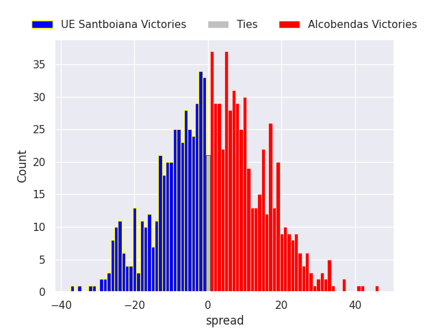

#### Cisneros V El Salvador on 2026/12/13

Average Margin: El Salvador by 6.6

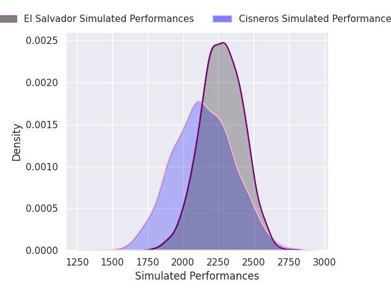

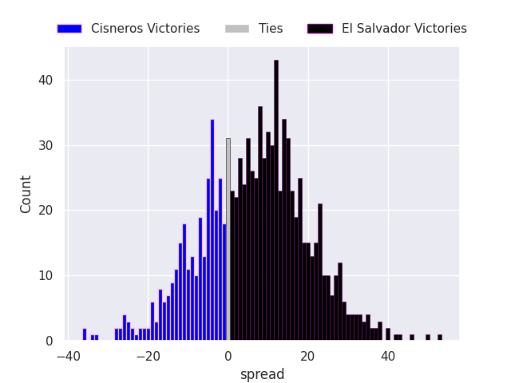

#### Aparejadores Burgos V Ordizia on 2026/12/13

Average Margin: Aparejadores Burgos by 14.9

### Week 4
#### El Salvador V Aparejadores Burgos on 2026/12/19

Average Margin: El Salvador by 0.1

#### Alcobendas V VRAC on 2026/12/19

Average Margin: Alcobendas by 4.3

#### Liceo Frances V Cisneros on 2026/12/19

Average Margin: Liceo Frances by 0.8

#### UE Santboiana V Ordizia on 2026/12/19

Average Margin: UE Santboiana by 7.7

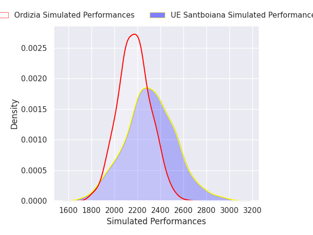

#### CRC Pozuelo Rugby V C.R. La Vila on 2026/12/19

Average Margin: CRC Pozuelo Rugby by 4.4

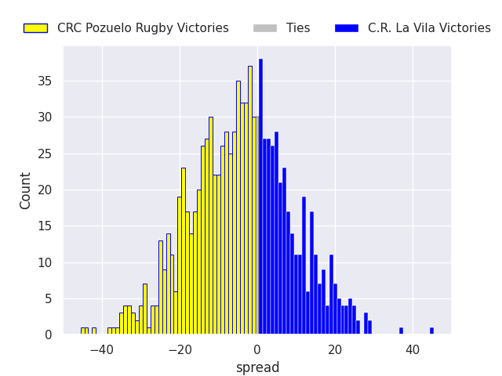

### Week 5
#### Ordizia V El Salvador on 2027/01/16

Average Margin: Ordizia by 1.7

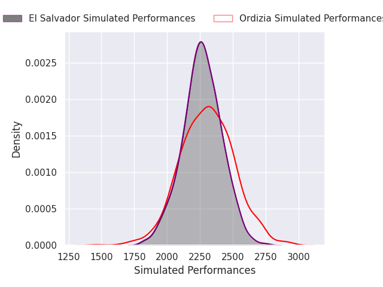

#### Aparejadores Burgos V Liceo Frances on 2027/01/16

Average Margin: Aparejadores Burgos by 25.5

#### VRAC V UE Santboiana on 2027/01/16

Average Margin: VRAC by 15.5

#### Cisneros V CRC Pozuelo Rugby on 2027/01/16

Average Margin: Cisneros by 7.7

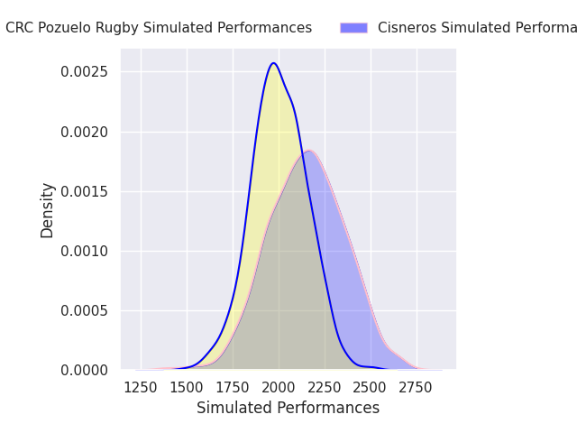

#### C.R. La Vila V Alcobendas on 2027/01/16

Average Margin: Alcobendas by 10.8

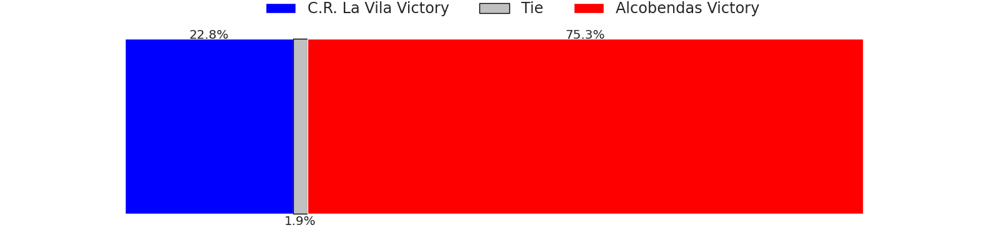

### Week 6
#### Aparejadores Burgos V CRC Pozuelo Rugby on 2027/01/23

Average Margin: Aparejadores Burgos by 23.3

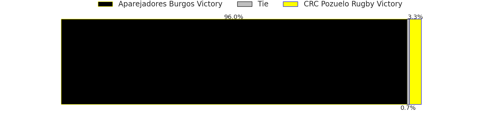
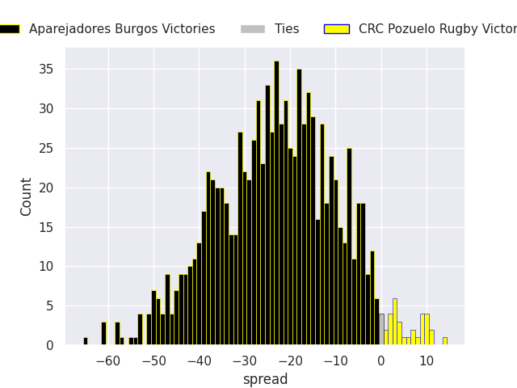

#### Ordizia V Liceo Frances on 2027/01/23

Average Margin: Ordizia by 16.1

#### Cisneros V Alcobendas on 2027/01/23

Average Margin: Alcobendas by 9.9

#### El Salvador V UE Santboiana on 2027/01/23

Average Margin: El Salvador by 9.4

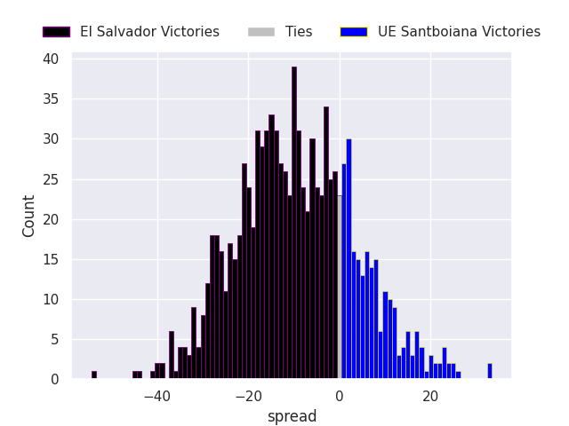

#### C.R. La Vila V VRAC on 2027/01/23

Average Margin: VRAC by 11.8

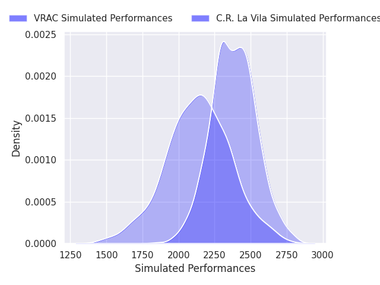

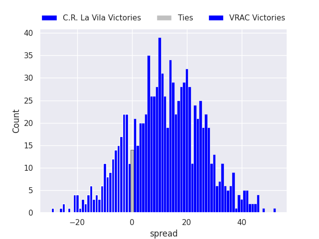

