## Team Rankings

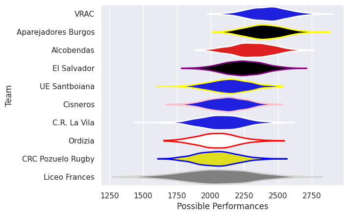
## Standings
### Current Standings

| Club                |   Played |   Wins |   Point Differential |   Losing Bonus Points |   Try Bonus Points |   Competition Points |
|:--------------------|---------:|-------:|---------------------:|----------------------:|-------------------:|---------------------:|
| Alcobendas          |        2 |      2 |                   57 |                     0 |                  1 |                    9 |
| Ordizia             |        2 |      2 |                   39 |                     0 |                  1 |                    9 |
| VRAC                |        2 |      2 |                   30 |                     0 |                  1 |                    9 |
| Aparejadores Burgos |        2 |      2 |                   24 |                     0 |                    |                    8 |
| El Salvador         |        2 |      1 |                    6 |                     1 |                  1 |                    6 |
| UE Santboiana       |        2 |      1 |                   -5 |                     0 |                    |                    4 |
| C.R. La Vila        |        2 |      0 |                  -13 |                     2 |                    |                    2 |
| CRC Pozuelo Rugby   |        2 |      0 |                  -24 |                     1 |                    |                    1 |
| Cisneros            |        2 |      0 |                  -48 |                     0 |                    |                    0 |
| Liceo Frances       |        2 |      0 |                  -66 |                     0 |                    |                    0 |

### Projected Remaining Table

| Club                |   To Play |   Projected Wins |   Projected Differential |   Projected Losing Bonus Points | Projected Try Bonus Points   |   Projected Competition Points |
|:--------------------|----------:|-----------------:|-------------------------:|--------------------------------:|:-----------------------------|-------------------------------:|
| Aparejadores Burgos |         4 |            3.22  |                   64.102 |                           0.346 |                              |                         13.34  |
| VRAC                |         4 |            2.978 |                   49.065 |                           0.426 |                              |                         12.492 |
| Alcobendas          |         4 |            2.612 |                   24.376 |                           0.633 |                              |                         11.291 |
| El Salvador         |         4 |            2.37  |                   13.867 |                           0.682 |                              |                         10.368 |
| Ordizia             |         4 |            1.795 |                   -2.934 |                           0.63  |                              |                          7.958 |
| Cisneros            |         4 |            1.725 |                   -9.596 |                           0.628 |                              |                          7.694 |
| UE Santboiana       |         4 |            1.499 |                  -19.274 |                           0.678 |                              |                          6.846 |
| C.R. La Vila        |         4 |            1.495 |                  -15.849 |                           0.643 |                              |                          6.825 |
| Liceo Frances       |         4 |            0.983 |                  -52.283 |                           0.503 |                              |                          4.537 |
| CRC Pozuelo Rugby   |         4 |            0.921 |                  -51.474 |                           0.518 |                              |                          4.336 |

### Projected Total Table

| Club                |   Played |   Wins |   Point Differential |   Losing Bonus Points |   Try Bonus Points |   Competition Points |
|:--------------------|---------:|-------:|---------------------:|----------------------:|-------------------:|---------------------:|
| VRAC                |        6 |  4.978 |               79.065 |                 0.426 |                  1 |               21.492 |
| Aparejadores Burgos |        6 |  5.22  |               88.102 |                 0.346 |                    |               21.34  |
| Alcobendas          |        6 |  4.612 |               81.376 |                 0.633 |                  1 |               20.291 |
| Ordizia             |        6 |  3.795 |               36.066 |                 0.63  |                  1 |               16.958 |
| El Salvador         |        6 |  3.37  |               19.867 |                 1.682 |                  1 |               16.368 |
| UE Santboiana       |        6 |  2.499 |              -24.274 |                 0.678 |                    |               10.846 |
| C.R. La Vila        |        6 |  1.495 |              -28.849 |                 2.643 |                    |                8.825 |
| Cisneros            |        6 |  1.725 |              -57.596 |                 0.628 |                    |                7.694 |
| CRC Pozuelo Rugby   |        6 |  0.921 |              -75.474 |                 1.518 |                    |                5.336 |
| Liceo Frances       |        6 |  0.983 |             -118.283 |                 0.503 |                    |                4.537 |

## Completed Match Review

| Model | Percent Correct Predictions | Spread Error |
| ------ | ------ | ------ |
| Club Level | 70.0% | 13.1 |
| Player Level: Lineup | nan% | nan |
| Player Level: Minutes | nan% | nan |

## Future Predictions
### Week 3
#### UE Santboiana V Alcobendas on 2026/12/12

Average Margin: Alcobendas by 1.5

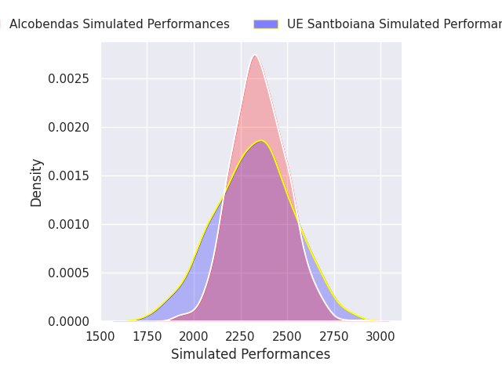

#### VRAC V CRC Pozuelo Rugby on 2026/12/12

Average Margin: VRAC by 24.5

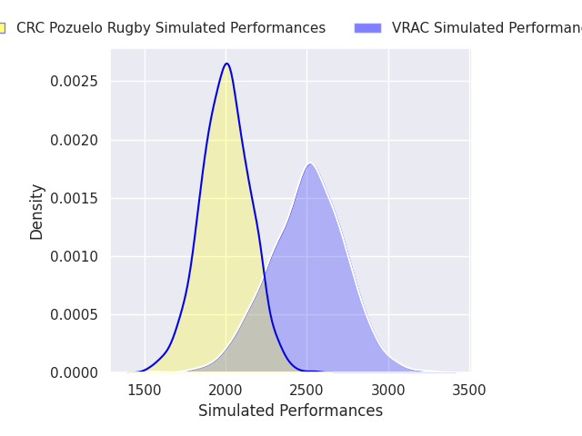

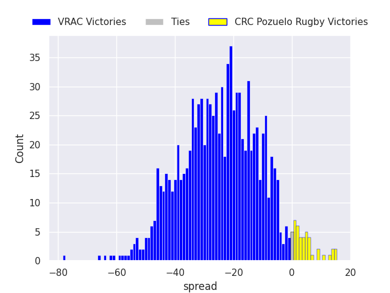

#### C.R. La Vila V Liceo Frances on 2026/12/12

Average Margin: C.R. La Vila by 10.2

#### Aparejadores Burgos V Ordizia on 2026/12/13

Average Margin: Aparejadores Burgos by 15.4

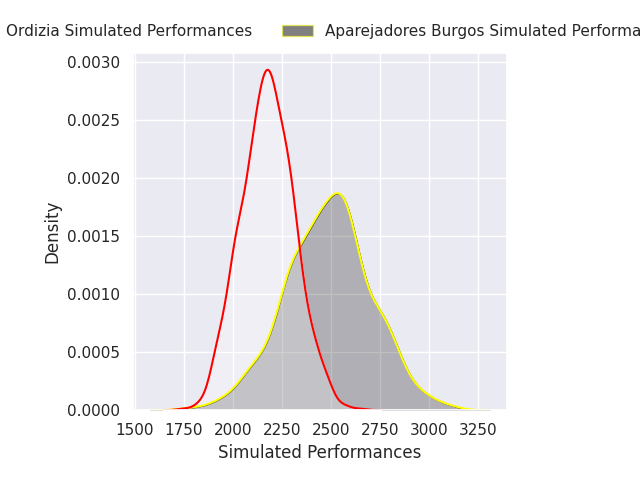

#### Cisneros V El Salvador on 2026/12/13

Average Margin: El Salvador by 5.9

### Week 4
#### El Salvador V Aparejadores Burgos on 2026/12/19

Average Margin: El Salvador by 0.6

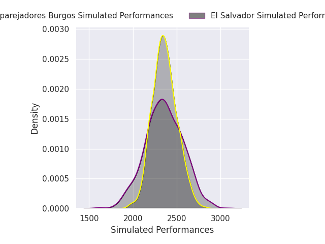

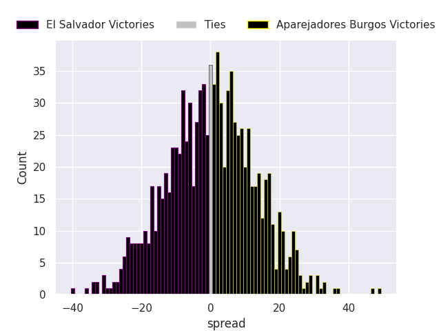

#### Liceo Frances V Cisneros on 2026/12/19

Average Margin: Liceo Frances by 1.8

#### UE Santboiana V Ordizia on 2026/12/19

Average Margin: UE Santboiana by 6.9

#### Alcobendas V VRAC on 2026/12/19

Average Margin: Alcobendas by 3.4

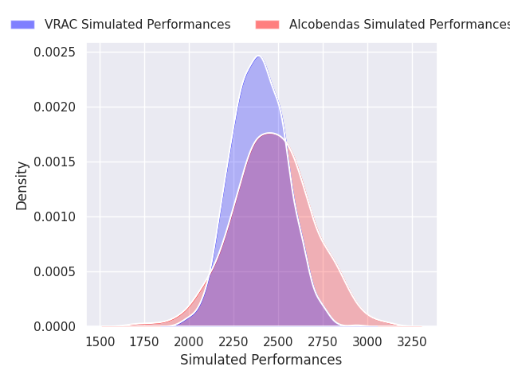

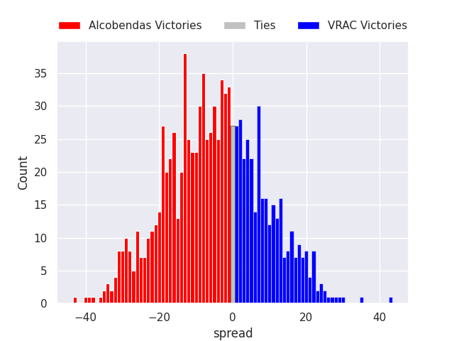

#### CRC Pozuelo Rugby V C.R. La Vila on 2026/12/19

Average Margin: CRC Pozuelo Rugby by 3.5

### Week 5
#### C.R. La Vila V Alcobendas on 2027/01/16

Average Margin: Alcobendas by 9.9

#### Ordizia V El Salvador on 2027/01/16

Average Margin: Ordizia by 2.0

#### VRAC V UE Santboiana on 2027/01/16

Average Margin: VRAC by 15.2

#### Cisneros V CRC Pozuelo Rugby on 2027/01/16

Average Margin: Cisneros by 7.7

#### Aparejadores Burgos V Liceo Frances on 2027/01/16

Average Margin: Aparejadores Burgos by 26.4

### Week 6
#### Cisneros V Alcobendas on 2027/01/23

Average Margin: Alcobendas by 9.6

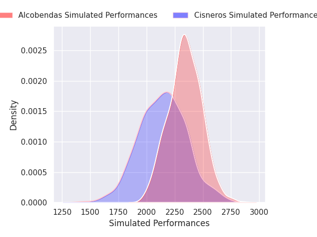

#### Aparejadores Burgos V CRC Pozuelo Rugby on 2027/01/23

Average Margin: Aparejadores Burgos by 22.8

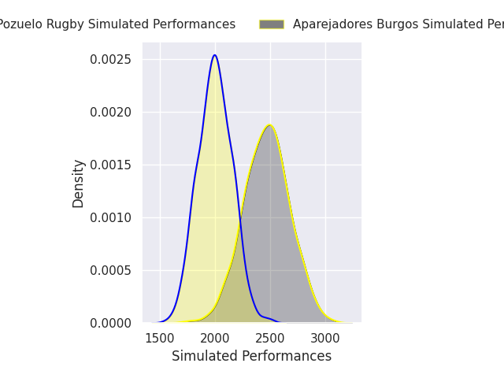

#### El Salvador V UE Santboiana on 2027/01/23

Average Margin: El Salvador by 9.4

#### C.R. La Vila V VRAC on 2027/01/23

Average Margin: VRAC by 12.8

#### Ordizia V Liceo Frances on 2027/01/23

Average Margin: Ordizia by 17.4

