## Team Rankings

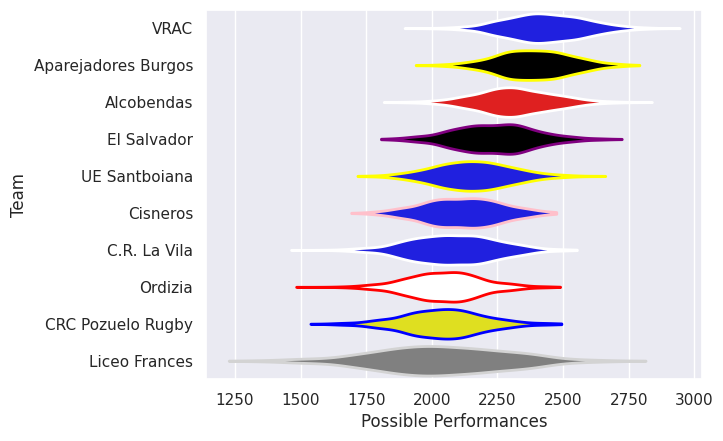
## Standings
### Current Standings

| Club                |   Played |   Wins |   Point Differential |   Losing Bonus Points | Try Bonus Points   |   Competition Points |
|:--------------------|---------:|-------:|---------------------:|----------------------:|:-------------------|---------------------:|
| Alcobendas          |        2 |      2 |                   57 |                     0 |                    |                    8 |
| Ordizia             |        2 |      2 |                   39 |                     0 |                    |                    8 |
| VRAC                |        2 |      2 |                   30 |                     0 |                    |                    8 |
| Aparejadores Burgos |        2 |      2 |                   24 |                     0 |                    |                    8 |
| El Salvador         |        2 |      1 |                    6 |                     1 |                    |                    5 |
| UE Santboiana       |        2 |      1 |                   -5 |                     0 |                    |                    4 |
| C.R. La Vila        |        2 |      0 |                  -13 |                     2 |                    |                    2 |
| CRC Pozuelo Rugby   |        2 |      0 |                  -24 |                     1 |                    |                    1 |
| Cisneros            |        2 |      0 |                  -48 |                     0 |                    |                    0 |
| Liceo Frances       |        2 |      0 |                  -66 |                     0 |                    |                    0 |

### Projected Remaining Table

| Club                |   To Play |   Projected Wins |   Projected Differential |   Projected Losing Bonus Points | Projected Try Bonus Points   |   Projected Competition Points |
|:--------------------|----------:|-----------------:|-------------------------:|--------------------------------:|:-----------------------------|-------------------------------:|
| Aparejadores Burgos |         2 |            1.337 |                   14.492 |                           0.304 |                              |                          5.742 |
| VRAC                |         2 |            1.337 |                   21.242 |                           0.219 |                              |                          5.635 |
| El Salvador         |         2 |            1.176 |                    6.7   |                           0.349 |                              |                          5.177 |
| Alcobendas          |         2 |            1.142 |                    5.399 |                           0.355 |                              |                          5.047 |
| UE Santboiana       |         2 |            1.118 |                    5.113 |                           0.377 |                              |                          4.953 |
| C.R. La Vila        |         2 |            1.068 |                    4.984 |                           0.324 |                              |                          4.692 |
| Cisneros            |         2 |            0.79  |                   -6.868 |                           0.332 |                              |                          3.592 |
| Liceo Frances       |         2 |            0.777 |                   -8.803 |                           0.282 |                              |                          3.462 |
| CRC Pozuelo Rugby   |         2 |            0.612 |                  -21.115 |                           0.243 |                              |                          2.761 |
| Ordizia             |         2 |            0.414 |                  -21.144 |                           0.378 |                              |                          2.102 |

### Projected Total Table

| Club                |   Played |   Wins |   Point Differential |   Losing Bonus Points | Try Bonus Points   |   Competition Points |
|:--------------------|---------:|-------:|---------------------:|----------------------:|:-------------------|---------------------:|
| Aparejadores Burgos |        4 |  3.337 |               38.492 |                 0.304 |                    |               13.742 |
| VRAC                |        4 |  3.337 |               51.242 |                 0.219 |                    |               13.635 |
| Alcobendas          |        4 |  3.142 |               62.399 |                 0.355 |                    |               13.047 |
| El Salvador         |        4 |  2.176 |               12.7   |                 1.349 |                    |               10.177 |
| Ordizia             |        4 |  2.414 |               17.856 |                 0.378 |                    |               10.102 |
| UE Santboiana       |        4 |  2.118 |                0.113 |                 0.377 |                    |                8.953 |
| C.R. La Vila        |        4 |  1.068 |               -8.016 |                 2.324 |                    |                6.692 |
| CRC Pozuelo Rugby   |        4 |  0.612 |              -45.115 |                 1.243 |                    |                3.761 |
| Cisneros            |        4 |  0.79  |              -54.868 |                 0.332 |                    |                3.592 |
| Liceo Frances       |        4 |  0.777 |              -74.803 |                 0.282 |                    |                3.462 |

## Completed Match Review

| Model | Percent Correct Predictions | Spread Error |
| ------ | ------ | ------ |
| Club Level | 70.0% | 14.2 |
| Player Level: Lineup | nan% | nan |
| Player Level: Minutes | nan% | nan |

## Future Predictions
### Week 3
#### C.R. La Vila V Liceo Frances on 2026/12/12

Average Margin: C.R. La Vila by 9.2

#### VRAC V CRC Pozuelo Rugby on 2026/12/12

Average Margin: VRAC by 25.3

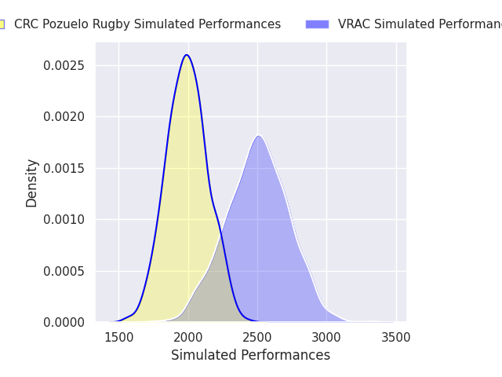

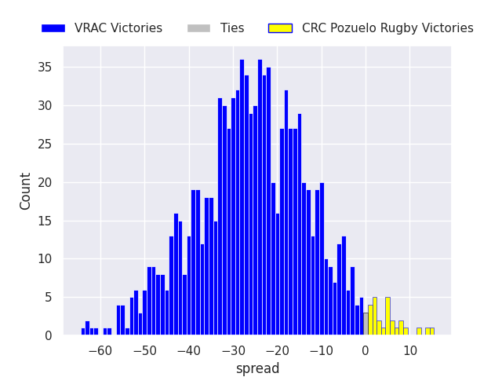

#### Aparejadores Burgos V Ordizia on 2026/12/13

Average Margin: Aparejadores Burgos by 14.7

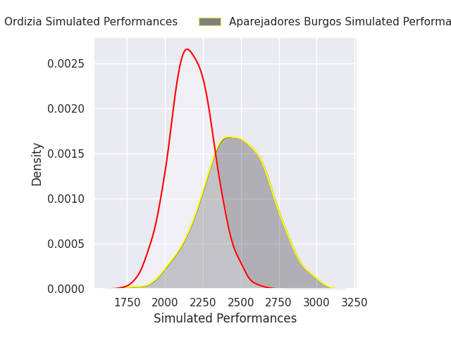

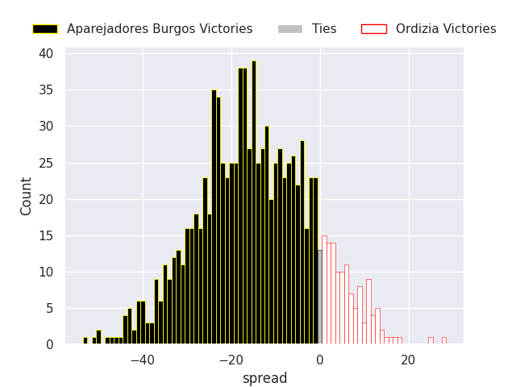

#### UE Santboiana V Alcobendas on 2026/12/13

Average Margin: Alcobendas by 1.3

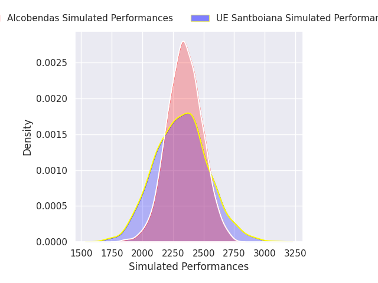

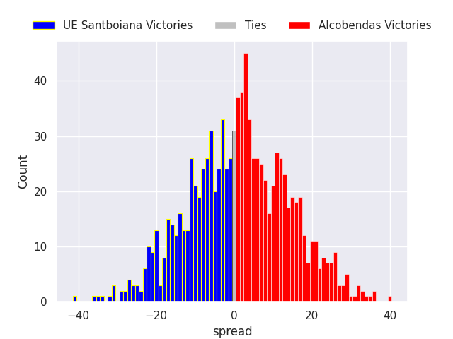

#### Cisneros V El Salvador on 2026/12/13

Average Margin: El Salvador by 6.5

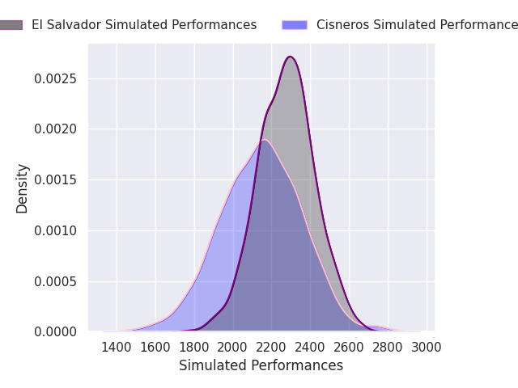

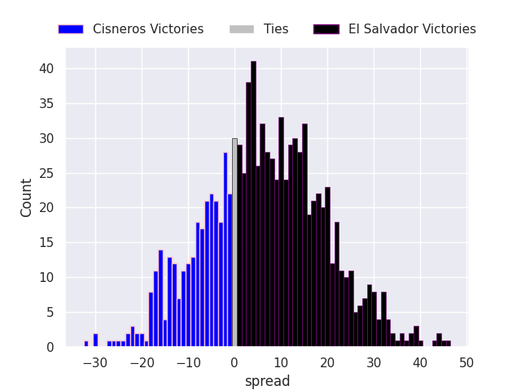

### Week 4
#### CRC Pozuelo Rugby V C.R. La Vila on 2026/12/19

Average Margin: CRC Pozuelo Rugby by 4.2

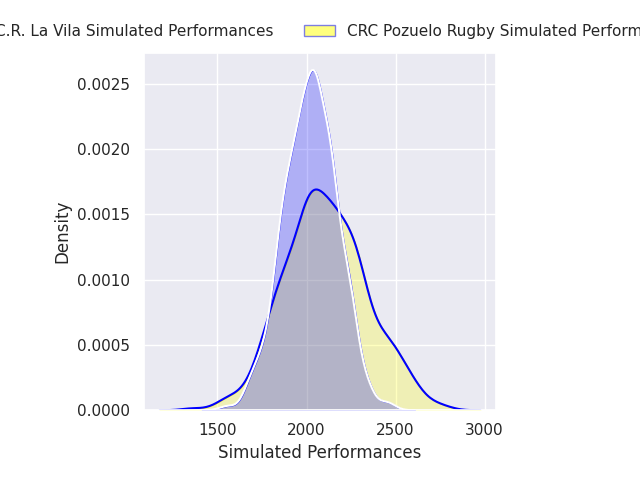

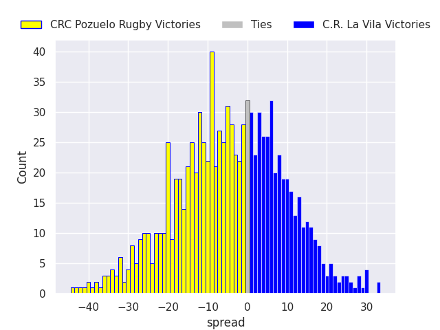

#### Liceo Frances V Cisneros on 2026/12/19

Average Margin: Liceo Frances by 0.4

#### Alcobendas V VRAC on 2026/12/19

Average Margin: Alcobendas by 4.1

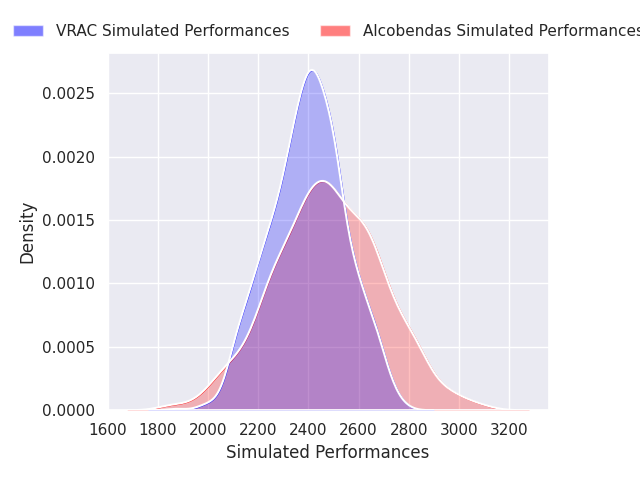

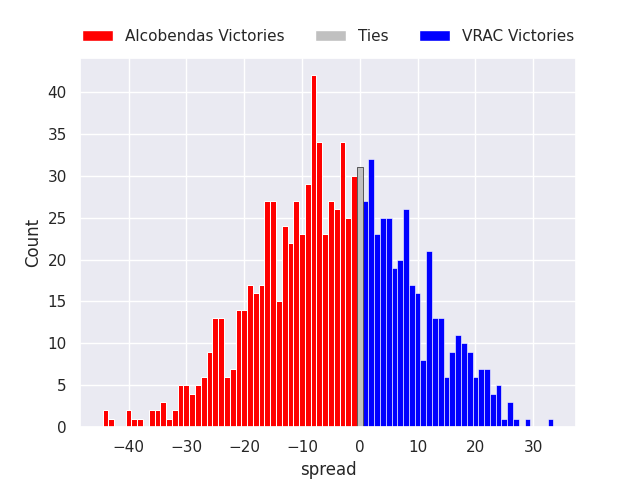

#### UE Santboiana V Ordizia on 2026/12/20

Average Margin: UE Santboiana by 6.4

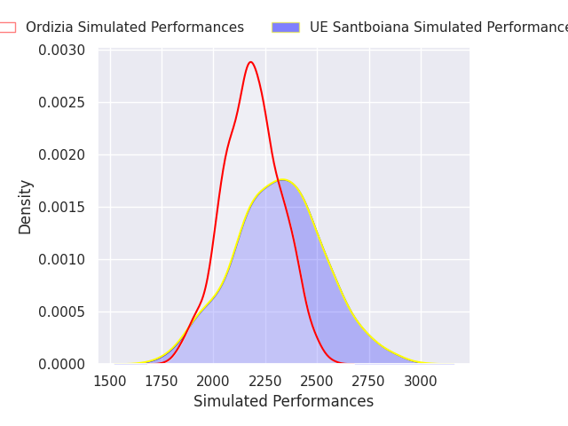

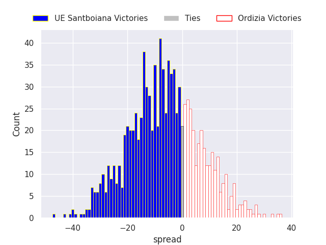

#### El Salvador V Aparejadores Burgos on 2026/12/20

Average Margin: El Salvador by 0.2

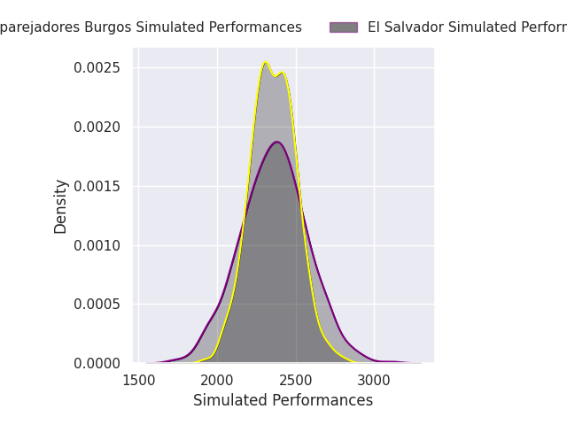

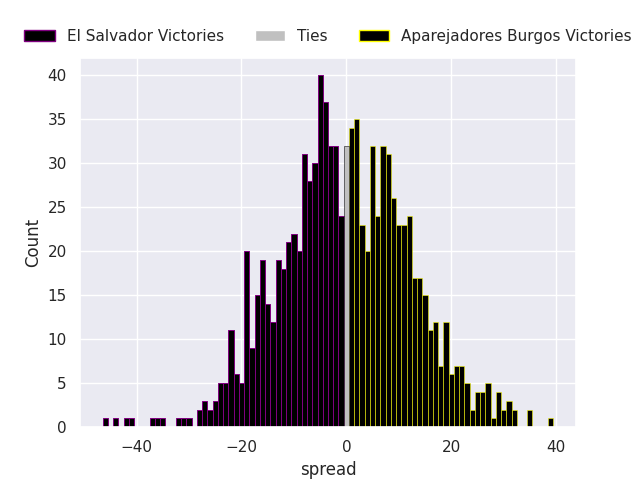

