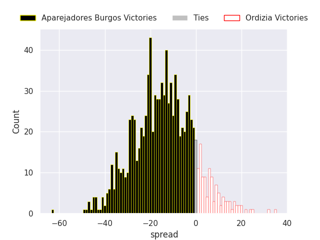
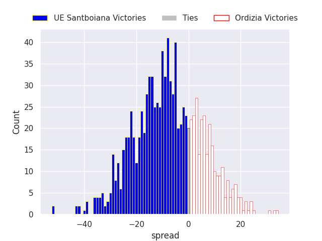
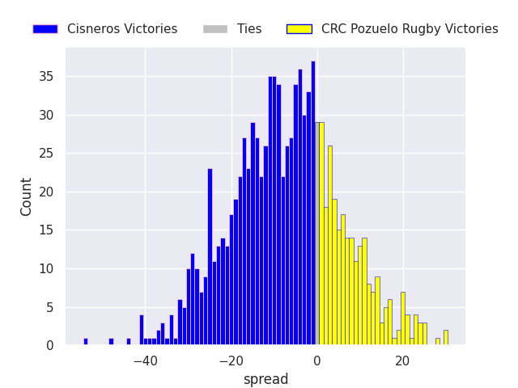
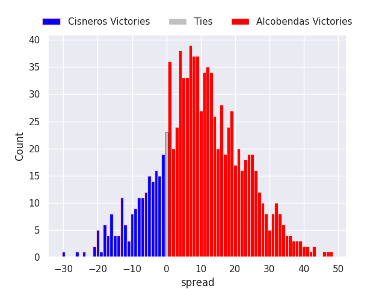
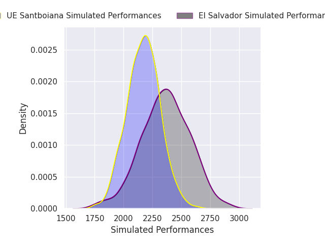

## Team Rankings

## Standings
### Current Standings

| Club                |   Played |   Wins |   Point Differential |   Losing Bonus Points |   Try Bonus Points |   Competition Points |
|:--------------------|---------:|-------:|---------------------:|----------------------:|-------------------:|---------------------:|
| Alcobendas          |        2 |      2 |                   57 |                     0 |                  1 |                    9 |
| Ordizia             |        2 |      2 |                   39 |                     0 |                  1 |                    9 |
| VRAC                |        2 |      2 |                   30 |                     0 |                  1 |                    9 |
| Aparejadores Burgos |        2 |      2 |                   24 |                     0 |                    |                    8 |
| El Salvador         |        2 |      1 |                    6 |                     1 |                  1 |                    6 |
| UE Santboiana       |        2 |      1 |                   -5 |                     0 |                    |                    4 |
| C.R. La Vila        |        2 |      0 |                  -13 |                     2 |                    |                    2 |
| CRC Pozuelo Rugby   |        2 |      0 |                  -24 |                     1 |                    |                    1 |
| Cisneros            |        2 |      0 |                  -48 |                     0 |                    |                    0 |
| Liceo Frances       |        2 |      0 |                  -66 |                     0 |                    |                    0 |

### Projected Remaining Table

| Club                |   To Play |   Projected Wins |   Projected Differential |   Projected Losing Bonus Points | Projected Try Bonus Points   |   Projected Competition Points |
|:--------------------|----------:|-----------------:|-------------------------:|--------------------------------:|:-----------------------------|-------------------------------:|
| Aparejadores Burgos |         4 |            3.261 |                   64.167 |                           0.31  |                              |                         13.484 |
| VRAC                |         4 |            3.01  |                   47.91  |                           0.43  |                              |                         12.592 |
| Alcobendas          |         4 |            2.66  |                   25.285 |                           0.627 |                              |                         11.465 |
| El Salvador         |         4 |            2.322 |                   13.457 |                           0.689 |                              |                         10.189 |
| Ordizia             |         4 |            1.766 |                   -3.129 |                           0.641 |                              |                          7.865 |
| Cisneros            |         4 |            1.706 |                   -8.778 |                           0.669 |                              |                          7.691 |
| UE Santboiana       |         4 |            1.481 |                  -19.688 |                           0.737 |                              |                          6.837 |
| C.R. La Vila        |         4 |            1.473 |                  -16.755 |                           0.624 |                              |                          6.674 |
| Liceo Frances       |         4 |            1.004 |                  -51.433 |                           0.47  |                              |                          4.608 |
| CRC Pozuelo Rugby   |         4 |            0.918 |                  -51.036 |                           0.498 |                              |                          4.29  |

### Projected Total Table

| Club                |   Played |   Wins |   Point Differential |   Losing Bonus Points |   Try Bonus Points |   Competition Points |
|:--------------------|---------:|-------:|---------------------:|----------------------:|-------------------:|---------------------:|
| VRAC                |        6 |  5.01  |               77.91  |                 0.43  |                  1 |               21.592 |
| Aparejadores Burgos |        6 |  5.261 |               88.167 |                 0.31  |                    |               21.484 |
| Alcobendas          |        6 |  4.66  |               82.285 |                 0.627 |                  1 |               20.465 |
| Ordizia             |        6 |  3.766 |               35.871 |                 0.641 |                  1 |               16.865 |
| El Salvador         |        6 |  3.322 |               19.457 |                 1.689 |                  1 |               16.189 |
| UE Santboiana       |        6 |  2.481 |              -24.688 |                 0.737 |                    |               10.837 |
| C.R. La Vila        |        6 |  1.473 |              -29.755 |                 2.624 |                    |                8.674 |
| Cisneros            |        6 |  1.706 |              -56.778 |                 0.669 |                    |                7.691 |
| CRC Pozuelo Rugby   |        6 |  0.918 |              -75.036 |                 1.498 |                    |                5.29  |
| Liceo Frances       |        6 |  1.004 |             -117.433 |                 0.47  |                    |                4.608 |

## Completed Match Review

| Model | Percent Correct Predictions | Spread Error |
| ------ | ------ | ------ |
| Club Level | 73.3% | 14.0 |
| Player Level: Lineup | nan% | nan |
| Player Level: Minutes | nan% | nan |

## Future Predictions
### Week 3
#### C.R. La Vila V Liceo Frances on 2026/12/12

Average Margin: C.R. La Vila by 9.9

#### UE Santboiana V Alcobendas on 2026/12/12

Average Margin: Alcobendas by 1.5

#### VRAC V CRC Pozuelo Rugby on 2026/12/12

Average Margin: VRAC by 24.0

#### Cisneros V El Salvador on 2026/12/13

Average Margin: El Salvador by 6.1

#### Aparejadores Burgos V Ordizia on 2026/12/13

Average Margin: Aparejadores Burgos by 14.9

### Week 4
#### CRC Pozuelo Rugby V C.R. La Vila on 2026/12/19

Average Margin: CRC Pozuelo Rugby by 4.3

#### Alcobendas V VRAC on 2026/12/19

Average Margin: Alcobendas by 3.9

#### El Salvador V Aparejadores Burgos on 2026/12/19

Average Margin: Aparejadores Burgos by 0.3

#### UE Santboiana V Ordizia on 2026/12/19

Average Margin: UE Santboiana by 7.0

#### Liceo Frances V Cisneros on 2026/12/19

Average Margin: Liceo Frances by 0.7

### Week 5
#### Aparejadores Burgos V Liceo Frances on 2027/01/16

Average Margin: Aparejadores Burgos by 25.5

#### C.R. La Vila V Alcobendas on 2027/01/16

Average Margin: Alcobendas by 10.2

#### Ordizia V El Salvador on 2027/01/16

Average Margin: Ordizia by 2.0

#### VRAC V UE Santboiana on 2027/01/16

Average Margin: VRAC by 15.6

#### Cisneros V CRC Pozuelo Rugby on 2027/01/16

Average Margin: Cisneros by 7.8

### Week 6
#### Cisneros V Alcobendas on 2027/01/23

Average Margin: Alcobendas by 9.8

#### C.R. La Vila V VRAC on 2027/01/23

Average Margin: VRAC by 12.2

#### El Salvador V UE Santboiana on 2027/01/23

Average Margin: El Salvador by 9.6

#### Aparejadores Burgos V CRC Pozuelo Rugby on 2027/01/23

Average Margin: Aparejadores Burgos by 23.5

#### Ordizia V Liceo Frances on 2027/01/23

Average Margin: Ordizia by 16.8

