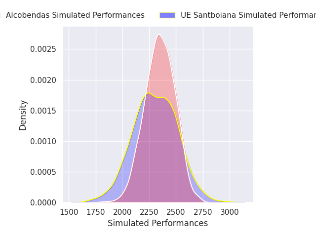
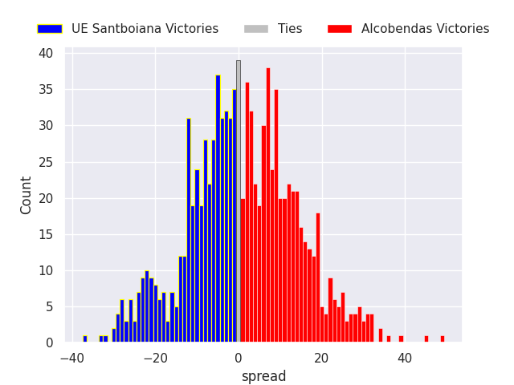
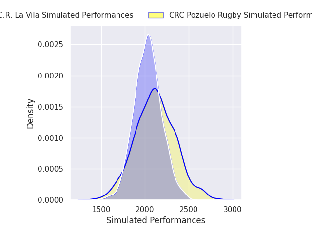
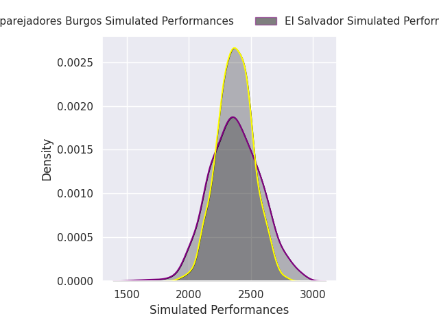
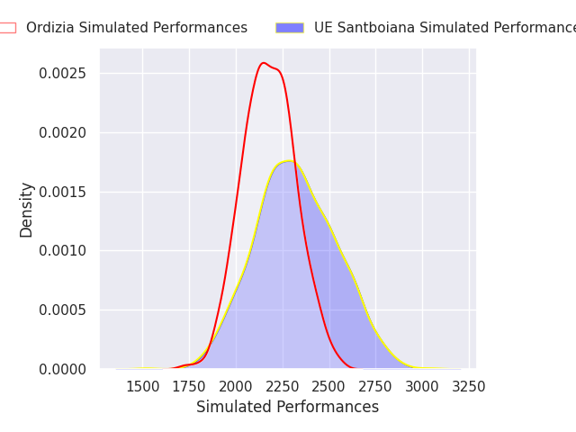
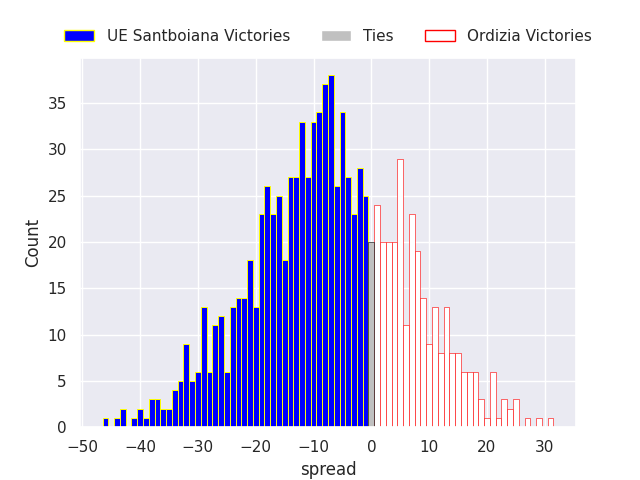
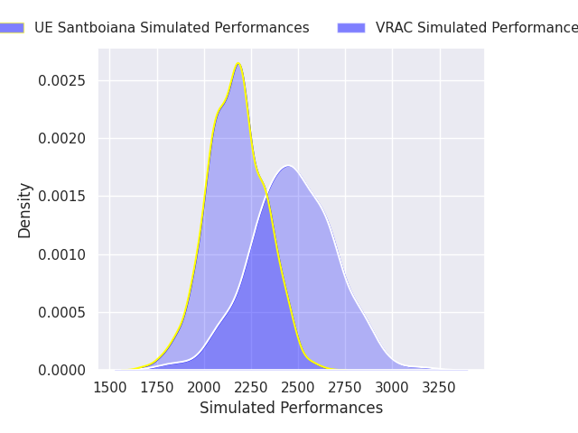
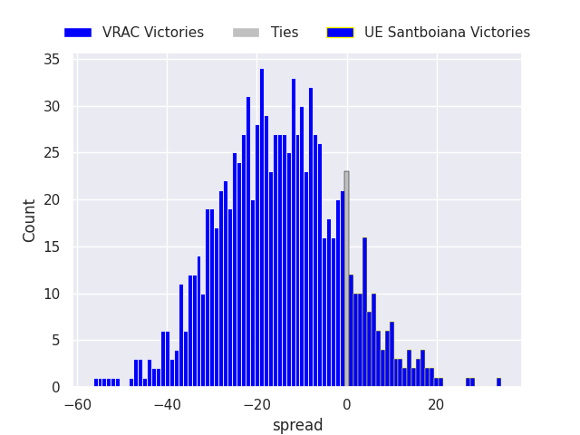

## Team Rankings

## Standings
### Current Standings

| Club                |   Played |   Wins |   Point Differential |   Losing Bonus Points |   Try Bonus Points |   Competition Points |
|:--------------------|---------:|-------:|---------------------:|----------------------:|-------------------:|---------------------:|
| Alcobendas          |        2 |      2 |                   57 |                     0 |                  1 |                    9 |
| Ordizia             |        2 |      2 |                   39 |                     0 |                  1 |                    9 |
| VRAC                |        2 |      2 |                   30 |                     0 |                  1 |                    9 |
| Aparejadores Burgos |        2 |      2 |                   24 |                     0 |                    |                    8 |
| El Salvador         |        2 |      1 |                    6 |                     1 |                  1 |                    6 |
| UE Santboiana       |        2 |      1 |                   -5 |                     0 |                    |                    4 |
| C.R. La Vila        |        2 |      0 |                  -13 |                     2 |                    |                    2 |
| CRC Pozuelo Rugby   |        2 |      0 |                  -24 |                     1 |                    |                    1 |
| Cisneros            |        2 |      0 |                  -48 |                     0 |                    |                    0 |
| Liceo Frances       |        2 |      0 |                  -66 |                     0 |                    |                    0 |

### Projected Remaining Table

| Club                |   To Play |   Projected Wins |   Projected Differential |   Projected Losing Bonus Points | Projected Try Bonus Points   |   Projected Competition Points |
|:--------------------|----------:|-----------------:|-------------------------:|--------------------------------:|:-----------------------------|-------------------------------:|
| Aparejadores Burgos |         3 |            2.29  |                   41.579 |                           0.306 |                              |                          9.57  |
| VRAC                |         3 |            2.167 |                   35.015 |                           0.293 |                              |                          9.079 |
| Alcobendas          |         3 |            1.944 |                   17.354 |                           0.495 |                              |                          8.427 |
| El Salvador         |         3 |            1.59  |                    4.19  |                           0.564 |                              |                          7.124 |
| Cisneros            |         3 |            1.512 |                    0.573 |                           0.464 |                              |                          6.666 |
| C.R. La Vila        |         3 |            1.315 |                   -4.012 |                           0.482 |                              |                          5.878 |
| UE Santboiana       |         3 |            1.24  |                   -9.926 |                           0.528 |                              |                          5.64  |
| Ordizia             |         3 |            0.903 |                  -21.218 |                           0.587 |                              |                          4.339 |
| CRC Pozuelo Rugby   |         3 |            0.882 |                  -28.38  |                           0.49  |                              |                          4.154 |
| Liceo Frances       |         3 |            0.811 |                  -35.175 |                           0.364 |                              |                          3.696 |

### Projected Total Table

| Club                |   Played |   Wins |   Point Differential |   Losing Bonus Points |   Try Bonus Points |   Competition Points |
|:--------------------|---------:|-------:|---------------------:|----------------------:|-------------------:|---------------------:|
| VRAC                |        5 |  4.167 |               65.015 |                 0.293 |                  1 |               18.079 |
| Aparejadores Burgos |        5 |  4.29  |               65.579 |                 0.306 |                    |               17.57  |
| Alcobendas          |        5 |  3.944 |               74.354 |                 0.495 |                  1 |               17.427 |
| Ordizia             |        5 |  2.903 |               17.782 |                 0.587 |                  1 |               13.339 |
| El Salvador         |        5 |  2.59  |               10.19  |                 1.564 |                  1 |               13.124 |
| UE Santboiana       |        5 |  2.24  |              -14.926 |                 0.528 |                    |                9.64  |
| C.R. La Vila        |        5 |  1.315 |              -17.012 |                 2.482 |                    |                7.878 |
| Cisneros            |        5 |  1.512 |              -47.427 |                 0.464 |                    |                6.666 |
| CRC Pozuelo Rugby   |        5 |  0.882 |              -52.38  |                 1.49  |                    |                5.154 |
| Liceo Frances       |        5 |  0.811 |             -101.175 |                 0.364 |                    |                3.696 |

## Completed Match Review

| Model | Percent Correct Predictions | Spread Error |
| ------ | ------ | ------ |
| Club Level | 76.0% | 12.7 |
| Player Level: Lineup | nan% | nan |
| Player Level: Minutes | nan% | nan |

## Future Predictions
### Week 3
#### VRAC V CRC Pozuelo Rugby on 2026/12/12

Average Margin: VRAC by 24.9

#### C.R. La Vila V Liceo Frances on 2026/12/12

Average Margin: C.R. La Vila by 10.2

#### Cisneros V El Salvador on 2026/12/13

Average Margin: El Salvador by 6.0

#### Aparejadores Burgos V Ordizia on 2026/12/13

Average Margin: Aparejadores Burgos by 15.2

#### UE Santboiana V Alcobendas on 2026/12/13

Average Margin: Alcobendas by 2.2

### Week 4
#### Alcobendas V VRAC on 2026/12/19

Average Margin: Alcobendas by 4.9

#### Liceo Frances V Cisneros on 2026/12/19

Average Margin: Liceo Frances by 0.9

#### CRC Pozuelo Rugby V C.R. La Vila on 2026/12/19

Average Margin: CRC Pozuelo Rugby by 4.0

#### El Salvador V Aparejadores Burgos on 2026/12/20

Average Margin: Aparejadores Burgos by 0.4

#### UE Santboiana V Ordizia on 2026/12/20

Average Margin: UE Santboiana by 7.3

### Week 5
#### Cisneros V CRC Pozuelo Rugby on 2027/01/16

Average Margin: Cisneros by 7.5

#### Aparejadores Burgos V Liceo Frances on 2027/01/16

Average Margin: Aparejadores Burgos by 25.9

#### Ordizia V El Salvador on 2027/01/16

Average Margin: Ordizia by 1.3

#### VRAC V UE Santboiana on 2027/01/16

Average Margin: VRAC by 15.0

#### C.R. La Vila V Alcobendas on 2027/01/16

Average Margin: Alcobendas by 10.2

