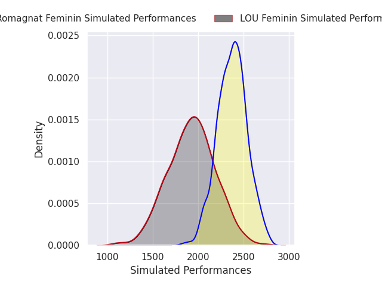
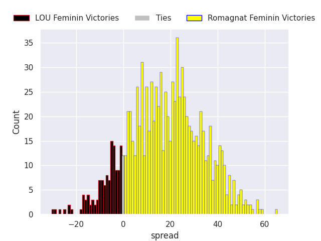
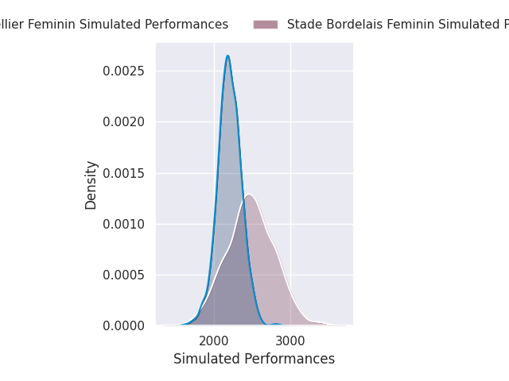
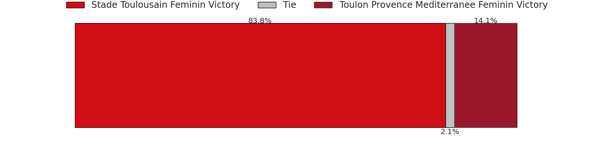
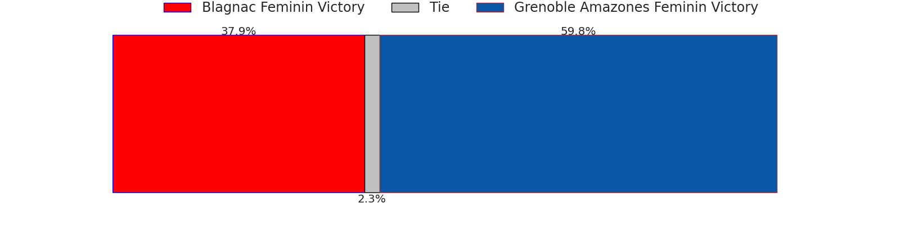
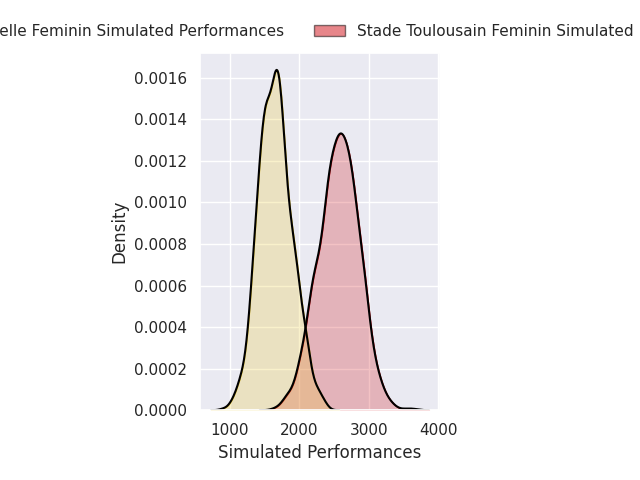
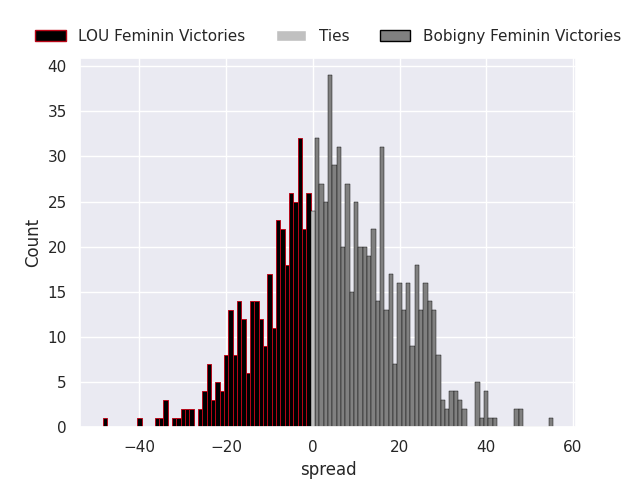

## Team Rankings

## Standings
### Current Standings

| Club                                 |   Played |   Wins |   Point Differential |   Losing Bonus Points |   Try Bonus Points |   Competition Points |
|:-------------------------------------|---------:|-------:|---------------------:|----------------------:|-------------------:|---------------------:|
| Romagnat Feminin                     |       17 |     13 |                  276 |                     1 |                 12 |                   67 |
| Stade Bordelais Feminin              |       17 |     13 |                  250 |                     3 |                  8 |                   63 |
| Stade Toulousain Feminin             |       16 |     13 |                  414 |                     2 |                  4 |                   60 |
| Blagnac Feminin                      |       16 |      9 |                   47 |                     0 |                  3 |                   39 |
| Montpellier Feminin                  |       15 |      7 |                  -49 |                     2 |                  5 |                   35 |
| Bobigny Feminin                      |       15 |      6 |                  -99 |                     3 |                  2 |                   29 |
| Toulon Provence Mediterranee Feminin |       15 |      6 |                 -191 |                     2 |                  3 |                   29 |
| Grenoble Amazones Feminin            |       15 |      5 |                 -123 |                     3 |                  3 |                   26 |
| LOU Feminin                          |       15 |      3 |                 -253 |                     3 |                    |                   17 |
| Lille Feminin                        |       11 |      1 |                 -163 |                     3 |                    |                    7 |
| La Rochelle Feminin                  |        4 |      0 |                 -109 |                     0 |                    |                    2 |

### Projected Remaining Table

| Club                                 |   To Play |   Projected Wins |   Projected Differential |   Projected Losing Bonus Points | Projected Try Bonus Points   |   Projected Competition Points |
|:-------------------------------------|----------:|-----------------:|-------------------------:|--------------------------------:|:-----------------------------|-------------------------------:|
| Stade Toulousain Feminin             |         3 |            2.59  |                   73.256 |                           0.186 |                              |                         10.608 |
| Stade Bordelais Feminin              |         3 |            2.429 |                   46.868 |                           0.262 |                              |                         10.05  |
| Romagnat Feminin                     |         3 |            2.169 |                   33.143 |                           0.302 |                              |                          9.076 |
| Toulon Provence Mediterranee Feminin |         3 |            1.557 |                    9.452 |                           0.384 |                              |                          6.72  |
| Grenoble Amazones Feminin            |         3 |            1.482 |                    0     |                           0.433 |                              |                          6.469 |
| Montpellier Feminin                  |         3 |            1.325 |                   -2.787 |                           0.335 |                              |                          5.703 |
| Blagnac Feminin                      |         3 |            1.272 |                  -10.704 |                           0.362 |                              |                          5.548 |
| Bobigny Feminin                      |         3 |            1.125 |                  -14.65  |                           0.489 |                              |                          5.117 |
| LOU Feminin                          |         3 |            0.46  |                  -51.482 |                           0.347 |                              |                          2.287 |
| La Rochelle Feminin                  |         3 |            0.364 |                  -83.096 |                           0.226 |                              |                          1.748 |

### Projected Total Table

| Club                                 |   Played |   Wins |   Point Differential |   Losing Bonus Points |   Try Bonus Points |   Competition Points |
|:-------------------------------------|---------:|-------:|---------------------:|----------------------:|-------------------:|---------------------:|
| Romagnat Feminin                     |       20 | 15.169 |              309.143 |                 1.302 |                 12 |               76.076 |
| Stade Bordelais Feminin              |       20 | 15.429 |              296.868 |                 3.262 |                  8 |               73.05  |
| Stade Toulousain Feminin             |       19 | 15.59  |              487.256 |                 2.186 |                  4 |               70.608 |
| Blagnac Feminin                      |       19 | 10.272 |               36.296 |                 0.362 |                  3 |               44.548 |
| Montpellier Feminin                  |       18 |  8.325 |              -51.787 |                 2.335 |                  5 |               40.703 |
| Toulon Provence Mediterranee Feminin |       18 |  7.557 |             -181.548 |                 2.384 |                  3 |               35.72  |
| Bobigny Feminin                      |       18 |  7.125 |             -113.65  |                 3.489 |                  2 |               34.117 |
| Grenoble Amazones Feminin            |       18 |  6.482 |             -123     |                 3.433 |                  3 |               32.469 |
| LOU Feminin                          |       18 |  3.46  |             -304.482 |                 3.347 |                    |               19.287 |
| Lille Feminin                        |       11 |  1     |             -163     |                 3     |                    |                7     |
| La Rochelle Feminin                  |        7 |  0.364 |             -192.096 |                 0.226 |                    |                3.748 |

## Completed Match Review

| Model | Percent Correct Predictions | Spread Error |
| ------ | ------ | ------ |
| Club Level | 66.7% | 14.0 |
| Player Level: Lineup | nan% | nan |
| Player Level: Minutes | nan% | nan |

## Future Predictions
### Week 18
#### LOU Feminin V Romagnat Feminin on 2026/11/28

Average Margin: Romagnat Feminin by 22.4

#### La Rochelle Feminin V Blagnac Feminin on 2026/11/29

Average Margin: Blagnac Feminin by 13.8

#### Stade Bordelais Feminin V Montpellier Feminin on 2026/11/29

Average Margin: Stade Bordelais Feminin by 14.1

#### Grenoble Amazones Feminin V Bobigny Feminin on 2026/11/29

Average Margin: Grenoble Amazones Feminin by 9.7

#### Stade Toulousain Feminin V Toulon Provence Mediterranee Feminin on 2026/11/29

Average Margin: Stade Toulousain Feminin by 17.1

### Week 19
#### Bobigny Feminin V Stade Bordelais Feminin on 2026/12/12

Average Margin: Stade Bordelais Feminin by 9.2

#### Montpellier Feminin V LOU Feminin on 2026/12/13

Average Margin: Montpellier Feminin by 24.8

#### Blagnac Feminin V Grenoble Amazones Feminin on 2026/12/13

Average Margin: Grenoble Amazones Feminin by 0.9

#### Stade Toulousain Feminin V La Rochelle Feminin on 2026/12/13

Average Margin: Stade Toulousain Feminin by 45.5

#### Toulon Provence Mediterranee Feminin V Romagnat Feminin on 2026/12/13

Average Margin: Toulon Provence Mediterranee Feminin by 2.8

### Week 20
#### Stade Bordelais Feminin V Blagnac Feminin on 2026/12/20

Average Margin: Stade Bordelais Feminin by 23.6

#### LOU Feminin V Bobigny Feminin on 2026/12/20

Average Margin: Bobigny Feminin by 4.3

#### La Rochelle Feminin V Toulon Provence Mediterranee Feminin on 2026/12/20

Average Margin: Toulon Provence Mediterranee Feminin by 23.8

#### Romagnat Feminin V Montpellier Feminin on 2026/12/20

Average Margin: Romagnat Feminin by 13.5

#### Grenoble Amazones Feminin V Stade Toulousain Feminin on 2026/12/20

Average Margin: Stade Toulousain Feminin by 10.7

