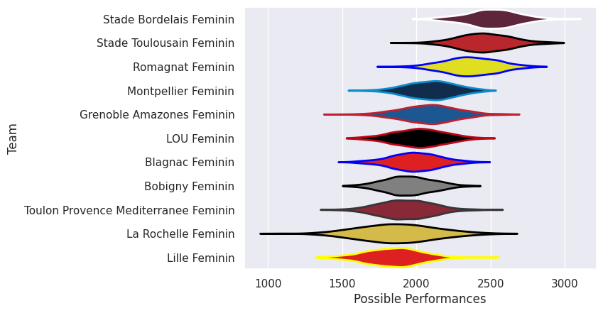
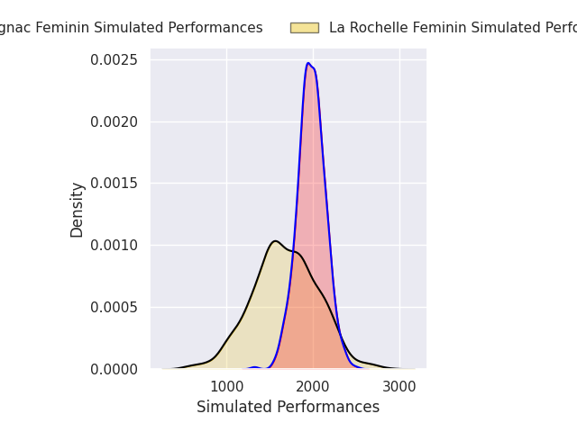
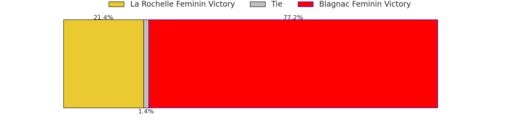
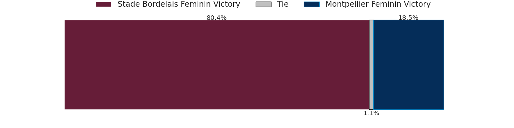
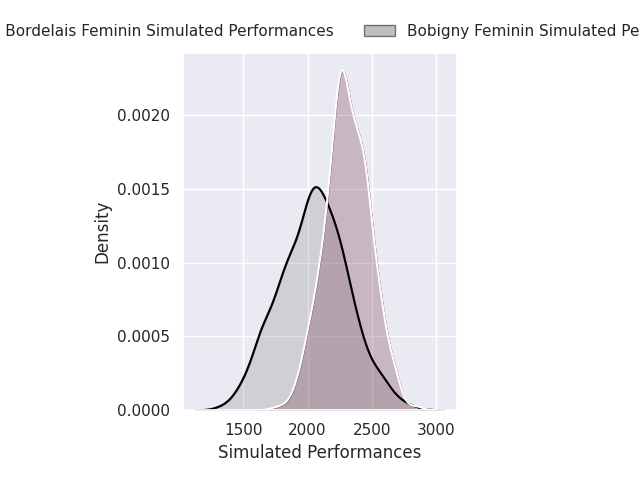
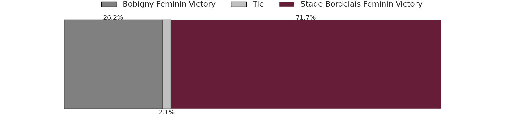
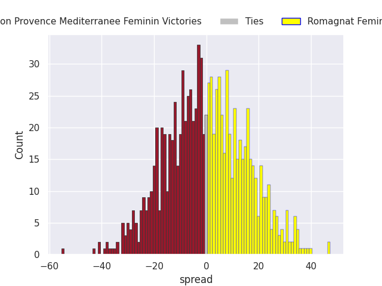
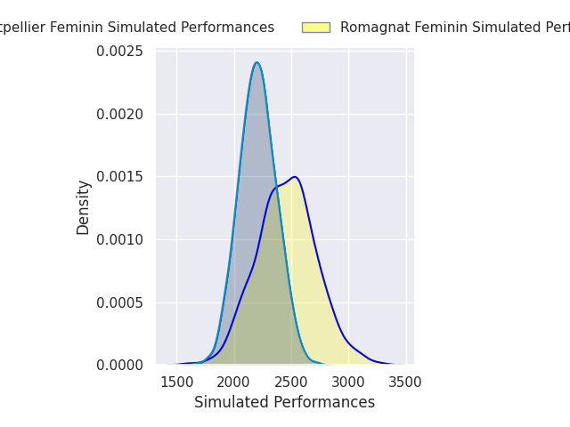
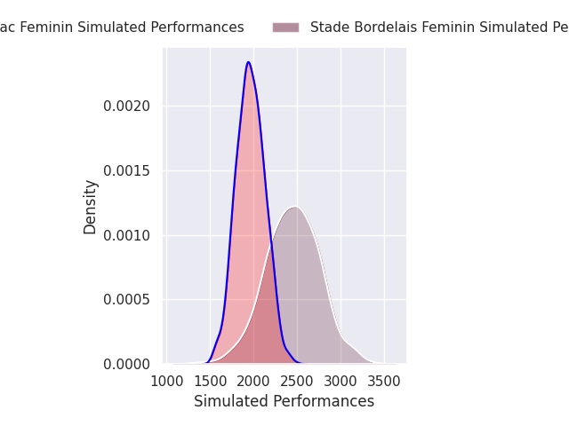
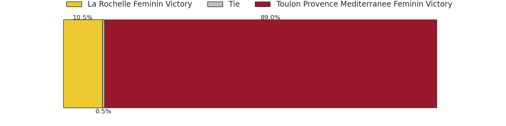

## Team Rankings

## Standings
### Current Standings

| Club                                 |   Played |   Wins |   Point Differential |   Losing Bonus Points |   Try Bonus Points |   Competition Points |
|:-------------------------------------|---------:|-------:|---------------------:|----------------------:|-------------------:|---------------------:|
| Romagnat Feminin                     |       17 |     13 |                  276 |                     1 |                 12 |                   67 |
| Stade Bordelais Feminin              |       17 |     13 |                  250 |                     3 |                  8 |                   63 |
| Stade Toulousain Feminin             |       16 |     13 |                  414 |                     2 |                  4 |                   60 |
| Blagnac Feminin                      |       16 |      9 |                   47 |                     0 |                  3 |                   39 |
| Montpellier Feminin                  |       15 |      7 |                  -49 |                     2 |                  5 |                   35 |
| Toulon Provence Mediterranee Feminin |       15 |      6 |                 -191 |                     2 |                  4 |                   30 |
| Bobigny Feminin                      |       15 |      6 |                  -99 |                     3 |                  2 |                   29 |
| Grenoble Amazones Feminin            |       15 |      5 |                 -123 |                     3 |                  3 |                   26 |
| LOU Feminin                          |       15 |      3 |                 -253 |                     3 |                    |                   17 |
| Lille Feminin                        |       11 |      1 |                 -163 |                     3 |                    |                    7 |
| La Rochelle Feminin                  |        4 |      0 |                 -109 |                     0 |                    |                    2 |

### Projected Remaining Table

| Club                                 |   To Play |   Projected Wins |   Projected Differential |   Projected Losing Bonus Points | Projected Try Bonus Points   |   Projected Competition Points |
|:-------------------------------------|----------:|-----------------:|-------------------------:|--------------------------------:|:-----------------------------|-------------------------------:|
| Stade Toulousain Feminin             |         3 |            2.58  |                   72.653 |                           0.179 |                              |                         10.565 |
| Stade Bordelais Feminin              |         3 |            2.375 |                   45.872 |                           0.276 |                              |                          9.854 |
| Romagnat Feminin                     |         3 |            2.109 |                   30.985 |                           0.345 |                              |                          8.867 |
| Toulon Provence Mediterranee Feminin |         3 |            1.609 |                   12.191 |                           0.33  |                              |                          6.86  |
| Grenoble Amazones Feminin            |         3 |            1.505 |                    2.159 |                           0.465 |                              |                          6.625 |
| Montpellier Feminin                  |         3 |            1.385 |                    0.553 |                           0.337 |                              |                          5.931 |
| Blagnac Feminin                      |         3 |            1.269 |                  -11.794 |                           0.338 |                              |                          5.526 |
| Bobigny Feminin                      |         3 |            1.148 |                  -14.316 |                           0.451 |                              |                          5.167 |
| LOU Feminin                          |         3 |            0.475 |                  -52.672 |                           0.362 |                              |                          2.338 |
| La Rochelle Feminin                  |         3 |            0.328 |                  -85.631 |                           0.221 |                              |                          1.571 |

### Projected Total Table

| Club                                 |   Played |   Wins |   Point Differential |   Losing Bonus Points |   Try Bonus Points |   Competition Points |
|:-------------------------------------|---------:|-------:|---------------------:|----------------------:|-------------------:|---------------------:|
| Romagnat Feminin                     |       20 | 15.109 |              306.985 |                 1.345 |                 12 |               75.867 |
| Stade Bordelais Feminin              |       20 | 15.375 |              295.872 |                 3.276 |                  8 |               72.854 |
| Stade Toulousain Feminin             |       19 | 15.58  |              486.653 |                 2.179 |                  4 |               70.565 |
| Blagnac Feminin                      |       19 | 10.269 |               35.206 |                 0.338 |                  3 |               44.526 |
| Montpellier Feminin                  |       18 |  8.385 |              -48.447 |                 2.337 |                  5 |               40.931 |
| Toulon Provence Mediterranee Feminin |       18 |  7.609 |             -178.809 |                 2.33  |                  4 |               36.86  |
| Bobigny Feminin                      |       18 |  7.148 |             -113.316 |                 3.451 |                  2 |               34.167 |
| Grenoble Amazones Feminin            |       18 |  6.505 |             -120.841 |                 3.465 |                  3 |               32.625 |
| LOU Feminin                          |       18 |  3.475 |             -305.672 |                 3.362 |                    |               19.338 |
| Lille Feminin                        |       11 |  1     |             -163     |                 3     |                    |                7     |
| La Rochelle Feminin                  |        7 |  0.328 |             -194.631 |                 0.221 |                    |                3.571 |

## Completed Match Review

| Model | Percent Correct Predictions | Spread Error |
| ------ | ------ | ------ |
| Club Level | 65.6% | 15.7 |
| Player Level: Lineup | nan% | nan |
| Player Level: Minutes | nan% | nan |

## Future Predictions
### Week 18
#### LOU Feminin V Romagnat Feminin on 2026/11/28

Average Margin: Romagnat Feminin by 22.1

#### La Rochelle Feminin V Blagnac Feminin on 2026/11/28

Average Margin: Blagnac Feminin by 15.1

#### Stade Bordelais Feminin V Montpellier Feminin on 2026/11/29

Average Margin: Stade Bordelais Feminin by 13.0

#### Stade Toulousain Feminin V Toulon Provence Mediterranee Feminin on 2026/11/29

Average Margin: Stade Toulousain Feminin by 16.7

#### Grenoble Amazones Feminin V Bobigny Feminin on 2026/11/29

Average Margin: Grenoble Amazones Feminin by 10.5

### Week 19
#### Bobigny Feminin V Stade Bordelais Feminin on 2026/12/12

Average Margin: Stade Bordelais Feminin by 8.3

#### Stade Toulousain Feminin V La Rochelle Feminin on 2026/12/13

Average Margin: Stade Toulousain Feminin by 45.4

#### Toulon Provence Mediterranee Feminin V Romagnat Feminin on 2026/12/13

Average Margin: Toulon Provence Mediterranee Feminin by 3.7

#### Blagnac Feminin V Grenoble Amazones Feminin on 2026/12/13

Average Margin: Grenoble Amazones Feminin by 2.3

#### Montpellier Feminin V LOU Feminin on 2026/12/13

Average Margin: Montpellier Feminin by 26.1

### Week 20
#### Romagnat Feminin V Montpellier Feminin on 2026/12/20

Average Margin: Romagnat Feminin by 12.6

#### Stade Bordelais Feminin V Blagnac Feminin on 2026/12/20

Average Margin: Stade Bordelais Feminin by 24.6

#### LOU Feminin V Bobigny Feminin on 2026/12/20

Average Margin: Bobigny Feminin by 4.5

#### Grenoble Amazones Feminin V Stade Toulousain Feminin on 2026/12/20

Average Margin: Stade Toulousain Feminin by 10.6

#### La Rochelle Feminin V Toulon Provence Mediterranee Feminin on 2026/12/20

Average Margin: Toulon Provence Mediterranee Feminin by 25.2

