## Team Rankings

## Standings
### Current Standings

| Club                                 |   Played |   Wins |   Point Differential |   Losing Bonus Points |   Try Bonus Points |   Competition Points |
|:-------------------------------------|---------:|-------:|---------------------:|----------------------:|-------------------:|---------------------:|
| Romagnat Feminin                     |       15 |     11 |                  269 |                     1 |                 11 |                   58 |
| Stade Bordelais Feminin              |       15 |     12 |                  218 |                     2 |                  8 |                   58 |
| Stade Toulousain Feminin             |       14 |     11 |                  369 |                     2 |                  2 |                   50 |
| Blagnac Feminin                      |       14 |      8 |                   58 |                     0 |                  1 |                   33 |
| Grenoble Amazones Feminin            |       13 |      5 |                  -81 |                     2 |                  3 |                   25 |
| Montpellier Feminin                  |       13 |      5 |                 -111 |                     2 |                  3 |                   25 |
| Bobigny Feminin                      |       13 |      5 |                 -115 |                     3 |                  1 |                   24 |
| Toulon Provence Mediterranee Feminin |       13 |      5 |                 -217 |                     1 |                  2 |                   23 |
| LOU Feminin                          |       13 |      3 |                 -191 |                     3 |                    |                   17 |
| Lille Feminin                        |       11 |      1 |                 -163 |                     3 |                    |                    7 |
| La Rochelle Feminin                  |        2 |      0 |                  -36 |                     0 |                    |                    2 |

### Projected Remaining Table

| Club                                 |   To Play |   Projected Wins |   Projected Differential |   Projected Losing Bonus Points | Projected Try Bonus Points   |   Projected Competition Points |
|:-------------------------------------|----------:|-----------------:|-------------------------:|--------------------------------:|:-----------------------------|-------------------------------:|
| Stade Toulousain Feminin             |         5 |            4.267 |                  108.708 |                           0.315 |                              |                         17.501 |
| Stade Bordelais Feminin              |         5 |            3.686 |                   70.511 |                           0.428 |                              |                         15.314 |
| Romagnat Feminin                     |         5 |            3.498 |                   49.813 |                           0.546 |                              |                         14.724 |
| Toulon Provence Mediterranee Feminin |         5 |            2.636 |                    8.154 |                           0.566 |                              |                         11.282 |
| Grenoble Amazones Feminin            |         5 |            2.571 |                    9.136 |                           0.721 |                              |                         11.257 |
| Montpellier Feminin                  |         5 |            2.189 |                  -16.04  |                           0.608 |                              |                          9.538 |
| Blagnac Feminin                      |         5 |            1.596 |                  -43.983 |                           0.631 |                              |                          7.199 |
| La Rochelle Feminin                  |         5 |            1.622 |                  -52.798 |                           0.559 |                              |                          7.173 |
| Bobigny Feminin                      |         5 |            1.466 |                  -56.147 |                           0.594 |                              |                          6.65  |
| LOU Feminin                          |         5 |            1.044 |                  -77.354 |                           0.565 |                              |                          4.895 |

### Projected Total Table

| Club                                 |   Played |   Wins |   Point Differential |   Losing Bonus Points |   Try Bonus Points |   Competition Points |
|:-------------------------------------|---------:|-------:|---------------------:|----------------------:|-------------------:|---------------------:|
| Stade Bordelais Feminin              |       20 | 15.686 |              288.511 |                 2.428 |                  8 |               73.314 |
| Romagnat Feminin                     |       20 | 14.498 |              318.813 |                 1.546 |                 11 |               72.724 |
| Stade Toulousain Feminin             |       19 | 15.267 |              477.708 |                 2.315 |                  2 |               67.501 |
| Blagnac Feminin                      |       19 |  9.596 |               14.017 |                 0.631 |                  1 |               40.199 |
| Grenoble Amazones Feminin            |       18 |  7.571 |              -71.864 |                 2.721 |                  3 |               36.257 |
| Montpellier Feminin                  |       18 |  7.189 |             -127.04  |                 2.608 |                  3 |               34.538 |
| Toulon Provence Mediterranee Feminin |       18 |  7.636 |             -208.846 |                 1.566 |                  2 |               34.282 |
| Bobigny Feminin                      |       18 |  6.466 |             -171.147 |                 3.594 |                  1 |               30.65  |
| LOU Feminin                          |       18 |  4.044 |             -268.354 |                 3.565 |                    |               21.895 |
| La Rochelle Feminin                  |        7 |  1.622 |              -88.798 |                 0.559 |                    |                9.173 |
| Lille Feminin                        |       11 |  1     |             -163     |                 3     |                    |                7     |

## Completed Match Review

| Model | Percent Correct Predictions | Spread Error |
| ------ | ------ | ------ |
| Club Level | 60.2% | 14.9 |
| Player Level: Lineup | nan% | nan |
| Player Level: Minutes | nan% | nan |

## Future Predictions
### Week 16
#### Stade Toulousain Feminin V Bobigny Feminin on 2026/11/14

Average Margin: Stade Toulousain Feminin by 32.9

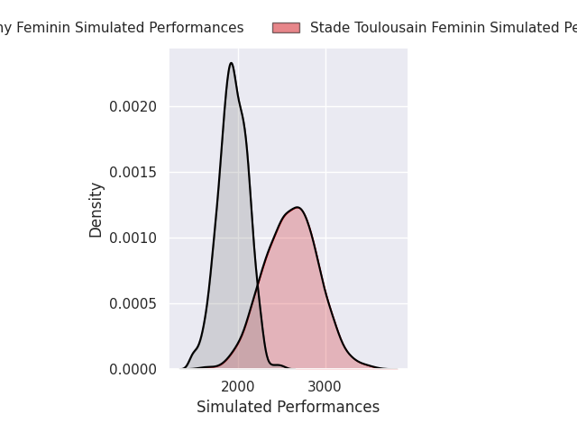
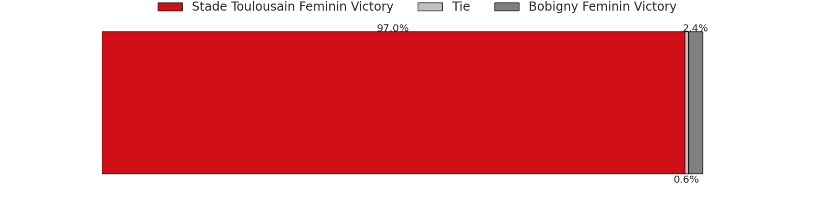
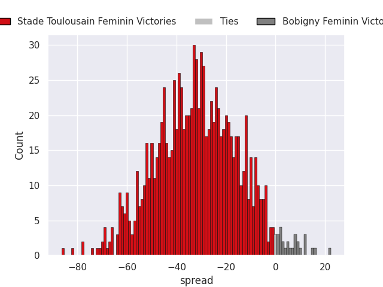

#### Grenoble Amazones Feminin V Romagnat Feminin on 2026/11/14

Average Margin: Romagnat Feminin by 3.9

#### La Rochelle Feminin V Montpellier Feminin on 2026/11/15

Average Margin: Montpellier Feminin by 5.6

#### Stade Bordelais Feminin V LOU Feminin on 2026/11/15

Average Margin: Stade Bordelais Feminin by 28.4

#### Blagnac Feminin V Toulon Provence Mediterranee Feminin on 2026/11/15

Average Margin: Toulon Provence Mediterranee Feminin by 3.1

### Week 17
#### Romagnat Feminin V Stade Bordelais Feminin on 2026/11/21

Average Margin: Romagnat Feminin by 7.5

#### Montpellier Feminin V Grenoble Amazones Feminin on 2026/11/21

Average Margin: Montpellier Feminin by 1.4

#### Toulon Provence Mediterranee Feminin V LOU Feminin on 2026/11/22

Average Margin: Toulon Provence Mediterranee Feminin by 20.7

#### Bobigny Feminin V La Rochelle Feminin on 2026/11/22

Average Margin: Bobigny Feminin by 9.5

#### Blagnac Feminin V Stade Toulousain Feminin on 2026/11/22

Average Margin: Stade Toulousain Feminin by 18.0

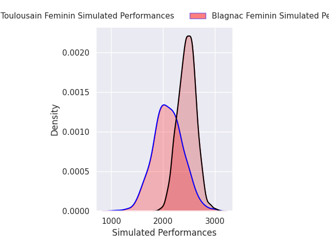
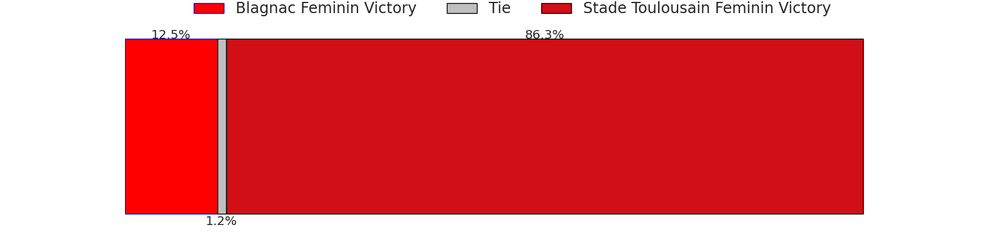
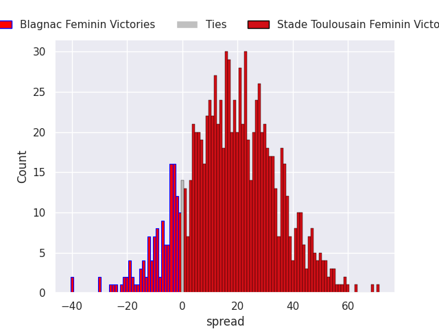

### Week 18
#### Stade Bordelais Feminin V Montpellier Feminin on 2026/11/29

Average Margin: Stade Bordelais Feminin by 18.2

#### La Rochelle Feminin V Blagnac Feminin on 2026/11/29

Average Margin: Blagnac Feminin by 0.7

#### LOU Feminin V Romagnat Feminin on 2026/11/29

Average Margin: Romagnat Feminin by 18.9

#### Grenoble Amazones Feminin V Bobigny Feminin on 2026/11/29

Average Margin: Grenoble Amazones Feminin by 17.2

#### Stade Toulousain Feminin V Toulon Provence Mediterranee Feminin on 2026/11/29

Average Margin: Stade Toulousain Feminin by 21.7

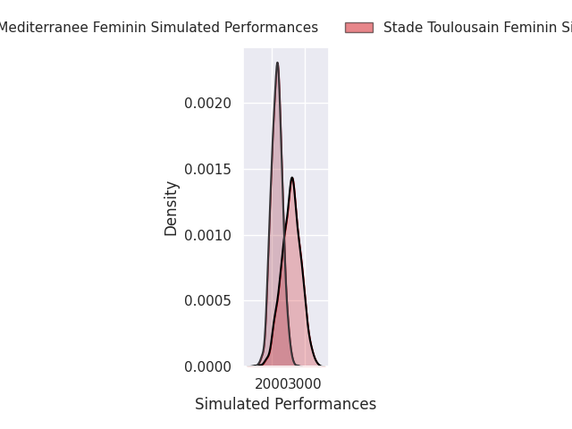
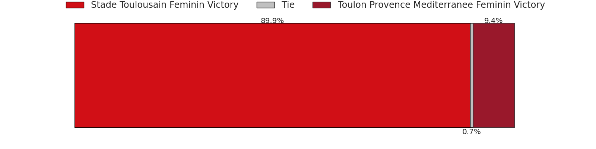
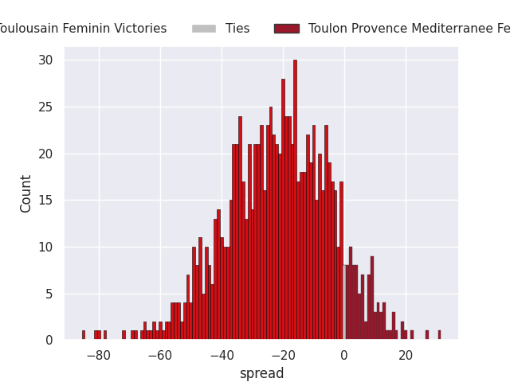

### Week 19
#### Bobigny Feminin V Stade Bordelais Feminin on 2026/12/12

Average Margin: Stade Bordelais Feminin by 10.8

#### Montpellier Feminin V LOU Feminin on 2026/12/13

Average Margin: Montpellier Feminin by 14.1

#### Toulon Provence Mediterranee Feminin V Romagnat Feminin on 2026/12/13

Average Margin: Romagnat Feminin by 0.5

#### Blagnac Feminin V Grenoble Amazones Feminin on 2026/12/13

Average Margin: Grenoble Amazones Feminin by 2.8

#### Stade Toulousain Feminin V La Rochelle Feminin on 2026/12/13

Average Margin: Stade Toulousain Feminin by 30.5

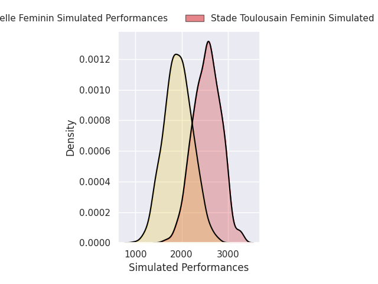
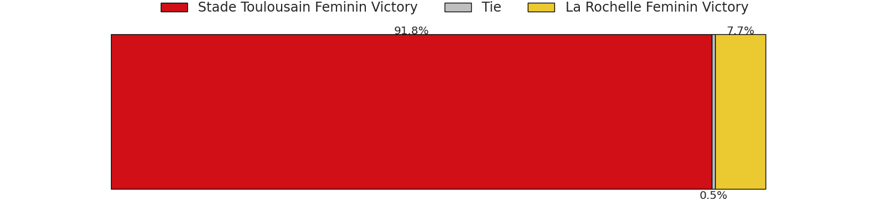
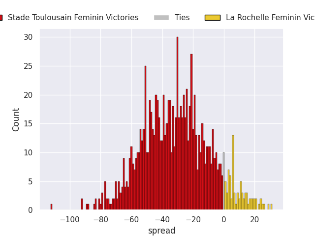

### Week 20
#### Grenoble Amazones Feminin V Stade Toulousain Feminin on 2026/12/20

Average Margin: Stade Toulousain Feminin by 5.5

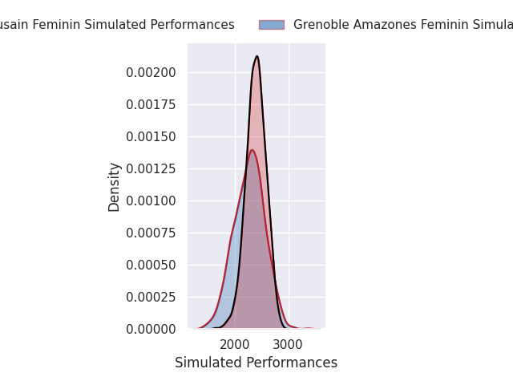
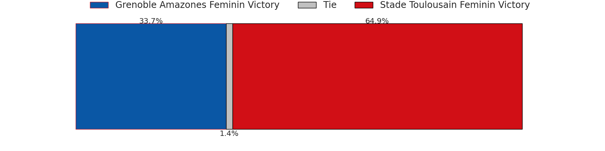
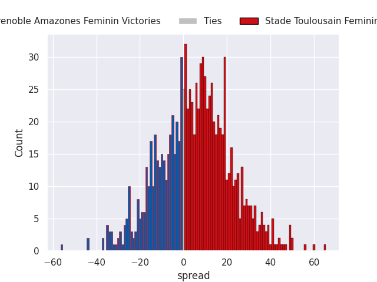

#### LOU Feminin V Bobigny Feminin on 2026/12/20

Average Margin: LOU Feminin by 4.8

#### Stade Bordelais Feminin V Blagnac Feminin on 2026/12/20

Average Margin: Stade Bordelais Feminin by 20.7

#### La Rochelle Feminin V Toulon Provence Mediterranee Feminin on 2026/12/20

Average Margin: Toulon Provence Mediterranee Feminin by 6.5

#### Romagnat Feminin V Montpellier Feminin on 2026/12/20

Average Margin: Romagnat Feminin by 19.0

