## Team Rankings

## Standings
### Current Standings

| Club                                 |   Played |   Wins |   Point Differential |   Losing Bonus Points |   Try Bonus Points |   Competition Points |
|:-------------------------------------|---------:|-------:|---------------------:|----------------------:|-------------------:|---------------------:|
| Stade Bordelais Feminin              |       14 |     12 |                  244 |                     2 |                  8 |                   58 |
| Romagnat Feminin                     |       14 |     10 |                  233 |                     1 |                 10 |                   53 |
| Stade Toulousain Feminin             |       13 |     10 |                  348 |                     2 |                  1 |                   45 |
| Blagnac Feminin                      |       13 |      7 |                   56 |                     0 |                  1 |                   29 |
| Montpellier Feminin                  |       12 |      5 |                  -90 |                     2 |                  3 |                   25 |
| Bobigny Feminin                      |       12 |      5 |                 -113 |                     2 |                  1 |                   23 |
| Grenoble Amazones Feminin            |       12 |      4 |                 -102 |                     2 |                  2 |                   20 |
| Toulon Provence Mediterranee Feminin |       12 |      4 |                 -243 |                     1 |                  1 |                   18 |
| LOU Feminin                          |       12 |      3 |                 -170 |                     3 |                    |                   17 |
| Lille Feminin                        |       11 |      1 |                 -163 |                     3 |                    |                    7 |
| La Rochelle Féminin                  |        1 |      0 |                    0 |                     0 |                    |                    2 |

### Projected Remaining Table

| Club                                 |   To Play |   Projected Wins |   Projected Differential |   Projected Losing Bonus Points | Projected Try Bonus Points   |   Projected Competition Points |
|:-------------------------------------|----------:|-----------------:|-------------------------:|--------------------------------:|:-----------------------------|-------------------------------:|
| Stade Bordelais Feminin              |         6 |            5.167 |                  134.516 |                           0.349 |                              |                         21.149 |
| Stade Toulousain Feminin             |         6 |            4.878 |                  115.269 |                           0.447 |                              |                         20.103 |
| Romagnat Feminin                     |         6 |            3.922 |                   52.285 |                           0.723 |                              |                         16.603 |
| Montpellier Feminin                  |         6 |            2.779 |                  -12.964 |                           0.7   |                              |                         12.014 |
| Grenoble Amazones Feminin            |         6 |            2.697 |                  -11.295 |                           0.824 |                              |                         11.85  |
| LOU Feminin                          |         6 |            2.27  |                  -42.463 |                           0.79  |                              |                         10.038 |
| La Rochelle Féminin                  |         6 |            2.186 |                  -50.699 |                           0.634 |                              |                          9.508 |
| Blagnac Feminin                      |         6 |            2.11  |                  -50.797 |                           0.754 |                              |                          9.376 |
| Bobigny Feminin                      |         6 |            1.897 |                  -59.124 |                           0.722 |                              |                          8.476 |
| Toulon Provence Mediterranee Feminin |         6 |            1.663 |                  -74.728 |                           0.692 |                              |                          7.518 |

### Projected Total Table

| Club                                 |   Played |   Wins |   Point Differential |   Losing Bonus Points |   Try Bonus Points |   Competition Points |
|:-------------------------------------|---------:|-------:|---------------------:|----------------------:|-------------------:|---------------------:|
| Stade Bordelais Feminin              |       20 | 17.167 |              378.516 |                 2.349 |                  8 |               79.149 |
| Romagnat Feminin                     |       20 | 13.922 |              285.285 |                 1.723 |                 10 |               69.603 |
| Stade Toulousain Feminin             |       19 | 14.878 |              463.269 |                 2.447 |                  1 |               65.103 |
| Blagnac Feminin                      |       19 |  9.11  |                5.203 |                 0.754 |                  1 |               38.376 |
| Montpellier Feminin                  |       18 |  7.779 |             -102.964 |                 2.7   |                  3 |               37.014 |
| Grenoble Amazones Feminin            |       18 |  6.697 |             -113.295 |                 2.824 |                  2 |               31.85  |
| Bobigny Feminin                      |       18 |  6.897 |             -172.124 |                 2.722 |                  1 |               31.476 |
| LOU Feminin                          |       18 |  5.27  |             -212.463 |                 3.79  |                    |               27.038 |
| Toulon Provence Mediterranee Feminin |       18 |  5.663 |             -317.728 |                 1.692 |                  1 |               25.518 |
| La Rochelle Féminin                  |        7 |  2.186 |              -50.699 |                 0.634 |                    |               11.508 |
| Lille Feminin                        |       11 |  1     |             -163     |                 3     |                    |                7     |

## Completed Match Review

| Model | Percent Correct Predictions | Spread Error |
| ------ | ------ | ------ |
| Club Level | 69.9% | 14.5 |
| Player Level: Lineup | nan% | nan |
| Player Level: Minutes | nan% | nan |

## Future Predictions
### Week 15
#### Montpellier Feminin V Stade Toulousain Feminin on 2026/10/31

Average Margin: Stade Toulousain Feminin by 5.4

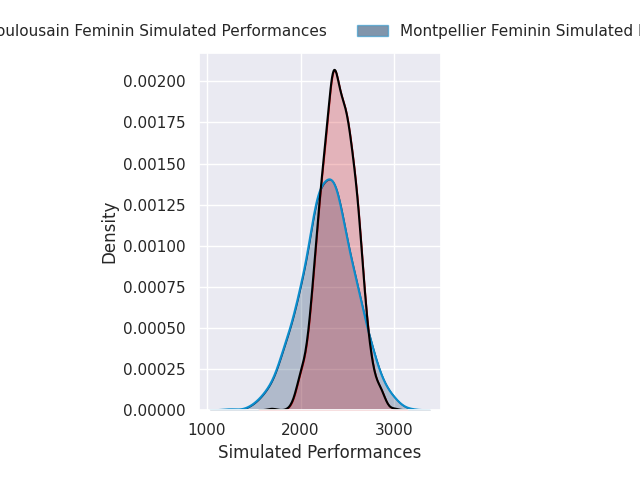
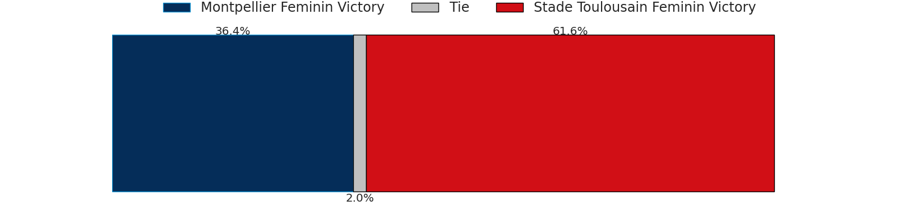
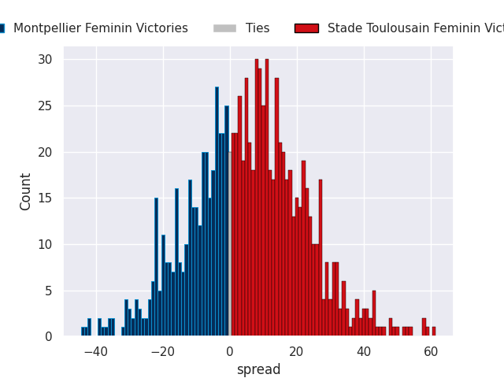

#### Romagnat Feminin V La Rochelle Féminin on 2026/10/31

Average Margin: Romagnat Feminin by 25.2

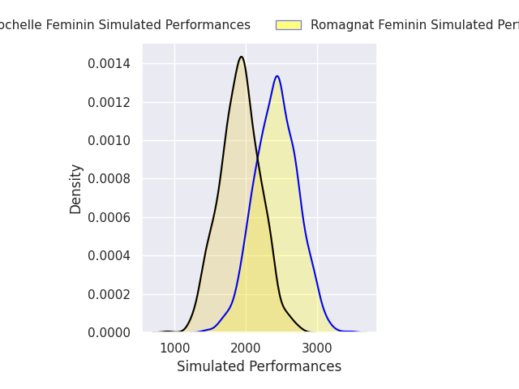
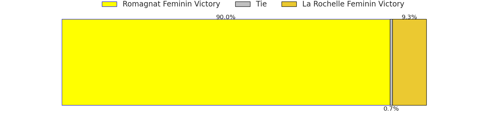
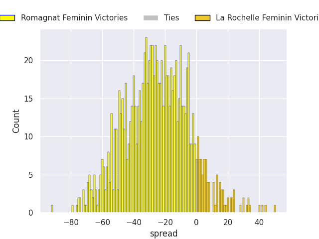

#### Bobigny Feminin V Blagnac Feminin on 2026/10/31

Average Margin: Bobigny Feminin by 4.9

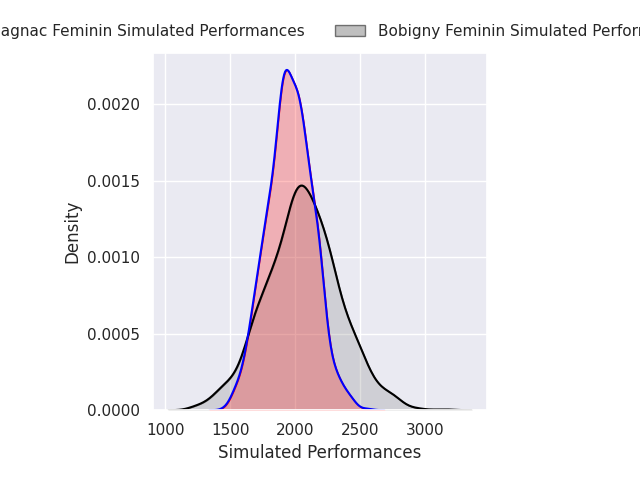
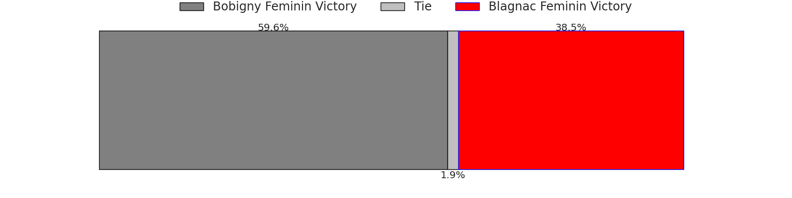
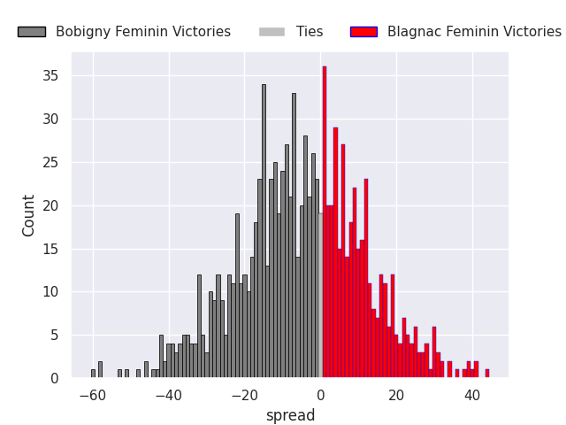

#### LOU Feminin V Grenoble Amazones Feminin on 2026/11/01

Average Margin: LOU Feminin by 3.0

#### Toulon Provence Mediterranee Feminin V Stade Bordelais Feminin on 2026/11/01

Average Margin: Stade Bordelais Feminin by 22.7

### Week 16
#### Grenoble Amazones Feminin V Romagnat Feminin on 2026/11/14

Average Margin: Romagnat Feminin by 3.8

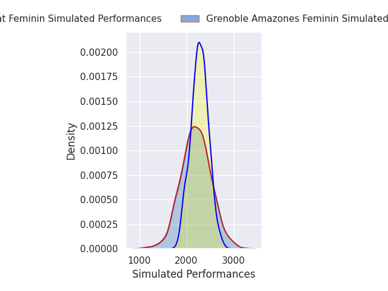
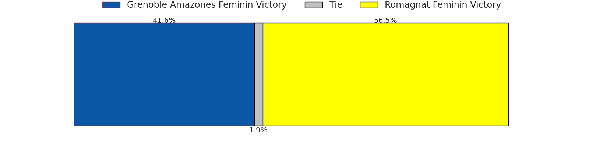
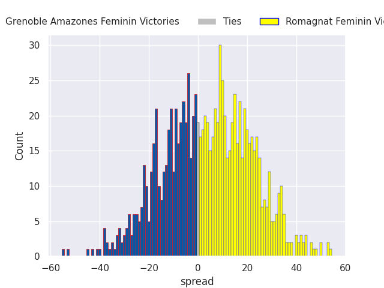

#### Stade Toulousain Feminin V Bobigny Feminin on 2026/11/14

Average Margin: Stade Toulousain Feminin by 28.9

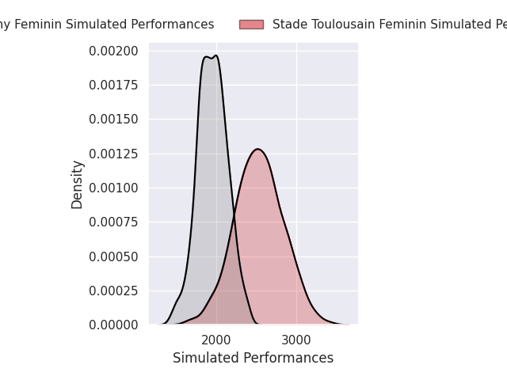
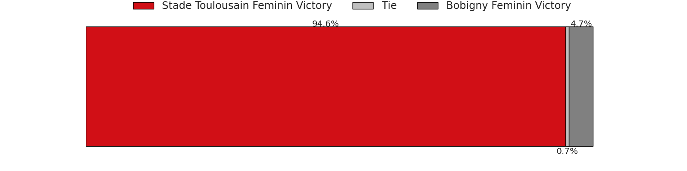
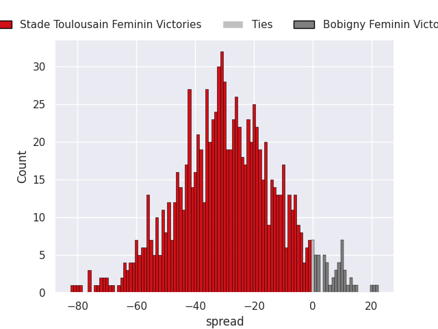

#### Stade Bordelais Feminin V LOU Feminin on 2026/11/15

Average Margin: Stade Bordelais Feminin by 31.8

#### Blagnac Feminin V Toulon Provence Mediterranee Feminin on 2026/11/15

Average Margin: Blagnac Feminin by 7.5

#### La Rochelle Féminin V Montpellier Feminin on 2026/11/15

Average Margin: Montpellier Feminin by 4.3

### Week 17
#### Romagnat Feminin V Stade Bordelais Feminin on 2026/11/21

Average Margin: Stade Bordelais Feminin by 6.3

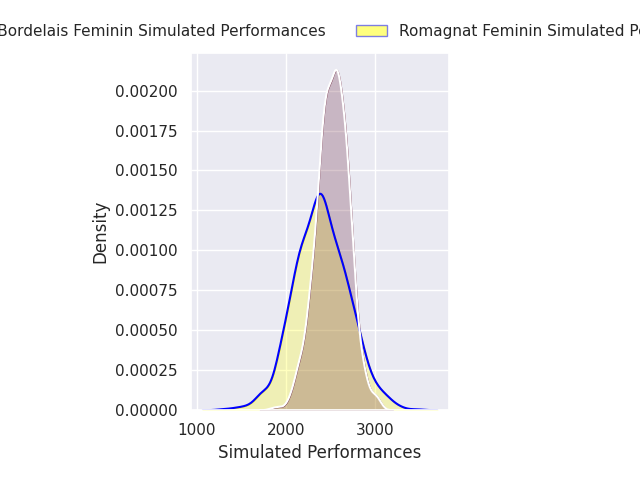
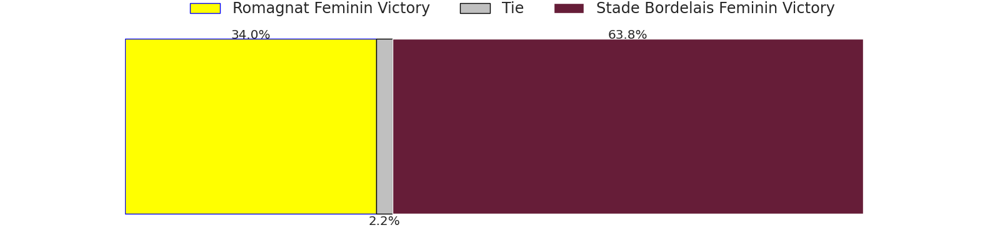
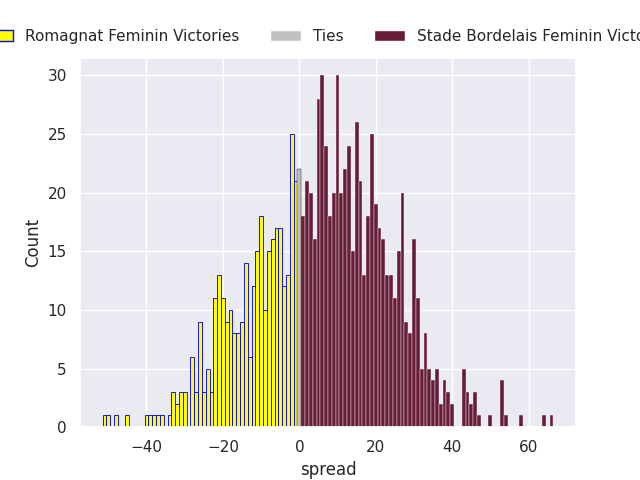

#### Montpellier Feminin V Grenoble Amazones Feminin on 2026/11/21

Average Margin: Montpellier Feminin by 11.9

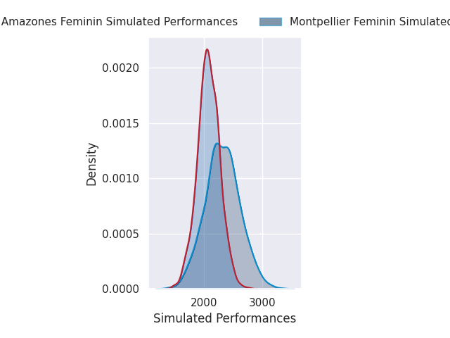
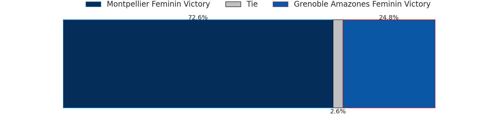
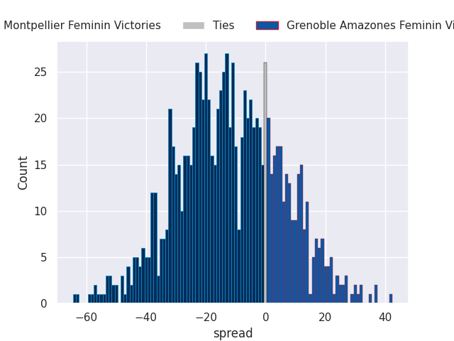

#### Toulon Provence Mediterranee Feminin V LOU Feminin on 2026/11/22

Average Margin: Toulon Provence Mediterranee Feminin by 1.8

#### Blagnac Feminin V Stade Toulousain Feminin on 2026/11/22

Average Margin: Stade Toulousain Feminin by 16.9

#### Bobigny Feminin V La Rochelle Féminin on 2026/11/22

Average Margin: Bobigny Feminin by 5.6

### Week 18
#### Grenoble Amazones Feminin V Bobigny Feminin on 2026/11/29

Average Margin: Grenoble Amazones Feminin by 12.8

#### LOU Feminin V Romagnat Feminin on 2026/11/29

Average Margin: Romagnat Feminin by 8.4

#### La Rochelle Féminin V Blagnac Feminin on 2026/11/29

Average Margin: La Rochelle Féminin by 4.8

#### Stade Bordelais Feminin V Montpellier Feminin on 2026/11/29

Average Margin: Stade Bordelais Feminin by 24.6

#### Stade Toulousain Feminin V Toulon Provence Mediterranee Feminin on 2026/11/29

Average Margin: Stade Toulousain Feminin by 30.5

### Week 19
#### Bobigny Feminin V Stade Bordelais Feminin on 2026/12/12

Average Margin: Stade Bordelais Feminin by 18.8

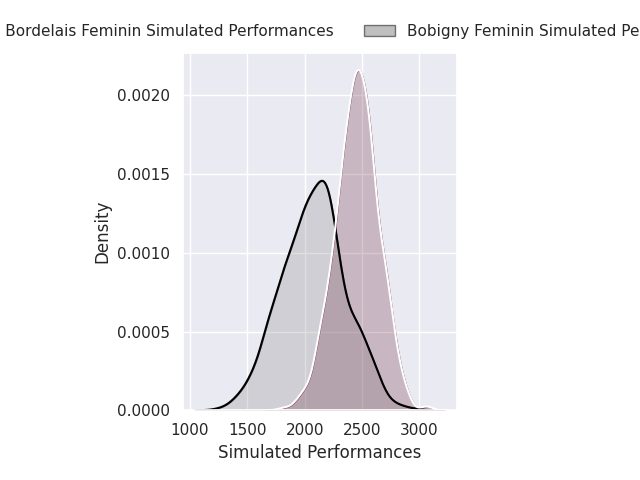
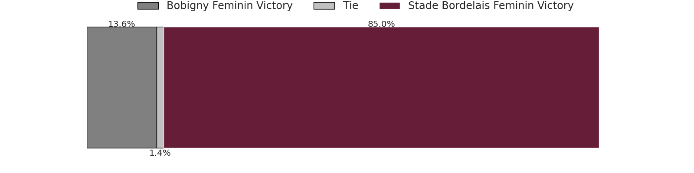
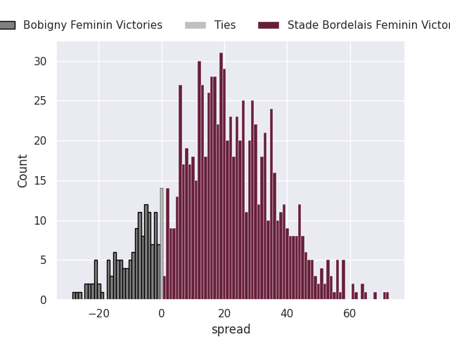

#### Stade Toulousain Feminin V La Rochelle Féminin on 2026/12/13

Average Margin: Stade Toulousain Feminin by 26.7

#### Montpellier Feminin V LOU Feminin on 2026/12/13

Average Margin: Montpellier Feminin by 12.5

#### Blagnac Feminin V Grenoble Amazones Feminin on 2026/12/13

Average Margin: Grenoble Amazones Feminin by 1.5

#### Toulon Provence Mediterranee Feminin V Romagnat Feminin on 2026/12/13

Average Margin: Romagnat Feminin by 9.4

### Week 20
#### Grenoble Amazones Feminin V Stade Toulousain Feminin on 2026/12/20

Average Margin: Stade Toulousain Feminin by 6.9

#### Romagnat Feminin V Montpellier Feminin on 2026/12/20

Average Margin: Romagnat Feminin by 11.7

#### Stade Bordelais Feminin V Blagnac Feminin on 2026/12/20

Average Margin: Stade Bordelais Feminin by 30.3

#### La Rochelle Féminin V Toulon Provence Mediterranee Feminin on 2026/12/20

Average Margin: La Rochelle Féminin by 6.4

#### LOU Feminin V Bobigny Feminin on 2026/12/20

Average Margin: LOU Feminin by 9.0

