## Team Rankings

## Standings
### Current Standings

| Club                                 |   Played |   Wins |   Point Differential |   Losing Bonus Points |   Try Bonus Points |   Competition Points |
|:-------------------------------------|---------:|-------:|---------------------:|----------------------:|-------------------:|---------------------:|
| Romagnat Feminin                     |       16 |     12 |                  275 |                     1 |                 12 |                   63 |
| Stade Bordelais Feminin              |       16 |     13 |                  251 |                     2 |                  8 |                   62 |
| Stade Toulousain Feminin             |       15 |     12 |                  400 |                     2 |                  3 |                   55 |
| Blagnac Feminin                      |       15 |      9 |                   61 |                     0 |                  2 |                   38 |
| Montpellier Feminin                  |       14 |      6 |                  -85 |                     2 |                  4 |                   30 |
| Grenoble Amazones Feminin            |       14 |      5 |                  -87 |                     3 |                  3 |                   26 |
| Toulon Provence Mediterranee Feminin |       14 |      5 |                 -220 |                     2 |                  3 |                   25 |
| Bobigny Feminin                      |       14 |      5 |                 -146 |                     3 |                  1 |                   24 |
| LOU Feminin                          |       14 |      3 |                 -224 |                     3 |                    |                   17 |
| Lille Feminin                        |       11 |      1 |                 -163 |                     3 |                    |                    7 |
| La Rochelle Feminin                  |        3 |      0 |                  -62 |                     0 |                    |                    2 |

### Projected Remaining Table

| Club                                 |   To Play |   Projected Wins |   Projected Differential |   Projected Losing Bonus Points | Projected Try Bonus Points   |   Projected Competition Points |
|:-------------------------------------|----------:|-----------------:|-------------------------:|--------------------------------:|:-----------------------------|-------------------------------:|
| Stade Toulousain Feminin             |         4 |            3.382 |                   86.649 |                           0.264 |                              |                         13.894 |
| Stade Bordelais Feminin              |         4 |            2.9   |                   49.806 |                           0.377 |                              |                         12.095 |
| Romagnat Feminin                     |         4 |            2.858 |                   40.206 |                           0.428 |                              |                         12.008 |
| Toulon Provence Mediterranee Feminin |         4 |            2.243 |                   15.413 |                           0.478 |                              |                          9.552 |
| Grenoble Amazones Feminin            |         4 |            2.199 |                   11.613 |                           0.565 |                              |                          9.537 |
| Montpellier Feminin                  |         4 |            1.758 |                  -12.874 |                           0.491 |                              |                          7.635 |
| Bobigny Feminin                      |         4 |            1.567 |                  -17.281 |                           0.509 |                              |                          6.939 |
| Blagnac Feminin                      |         4 |            1.125 |                  -42.983 |                           0.476 |                              |                          5.09  |
| LOU Feminin                          |         4 |            0.908 |                  -51.169 |                           0.556 |                              |                          4.328 |
| La Rochelle Feminin                  |         4 |            0.742 |                  -79.38  |                           0.391 |                              |                          3.457 |

### Projected Total Table

| Club                                 |   Played |   Wins |   Point Differential |   Losing Bonus Points |   Try Bonus Points |   Competition Points |
|:-------------------------------------|---------:|-------:|---------------------:|----------------------:|-------------------:|---------------------:|
| Romagnat Feminin                     |       20 | 14.858 |              315.206 |                 1.428 |                 12 |               75.008 |
| Stade Bordelais Feminin              |       20 | 15.9   |              300.806 |                 2.377 |                  8 |               74.095 |
| Stade Toulousain Feminin             |       19 | 15.382 |              486.649 |                 2.264 |                  3 |               68.894 |
| Blagnac Feminin                      |       19 | 10.125 |               18.017 |                 0.476 |                  2 |               43.09  |
| Montpellier Feminin                  |       18 |  7.758 |              -97.874 |                 2.491 |                  4 |               37.635 |
| Grenoble Amazones Feminin            |       18 |  7.199 |              -75.387 |                 3.565 |                  3 |               35.537 |
| Toulon Provence Mediterranee Feminin |       18 |  7.243 |             -204.587 |                 2.478 |                  3 |               34.552 |
| Bobigny Feminin                      |       18 |  6.567 |             -163.281 |                 3.509 |                  1 |               30.939 |
| LOU Feminin                          |       18 |  3.908 |             -275.169 |                 3.556 |                    |               21.328 |
| Lille Feminin                        |       11 |  1     |             -163     |                 3     |                    |                7     |
| La Rochelle Feminin                  |        7 |  0.742 |             -141.38  |                 0.391 |                    |                5.457 |

## Completed Match Review

| Model | Percent Correct Predictions | Spread Error |
| ------ | ------ | ------ |
| Club Level | 66.7% | 14.3 |
| Player Level: Lineup | nan% | nan |
| Player Level: Minutes | nan% | nan |

## Future Predictions
### Week 17
#### Romagnat Feminin V Stade Bordelais Feminin on 2026/11/21

Average Margin: Romagnat Feminin by 6.8

#### Montpellier Feminin V Grenoble Amazones Feminin on 2026/11/21

Average Margin: Montpellier Feminin by 4.7

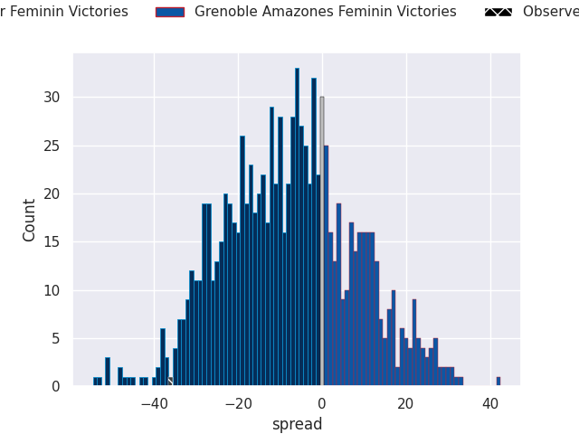

#### Blagnac Feminin V Stade Toulousain Feminin on 2026/11/22

Average Margin: Stade Toulousain Feminin by 19.9

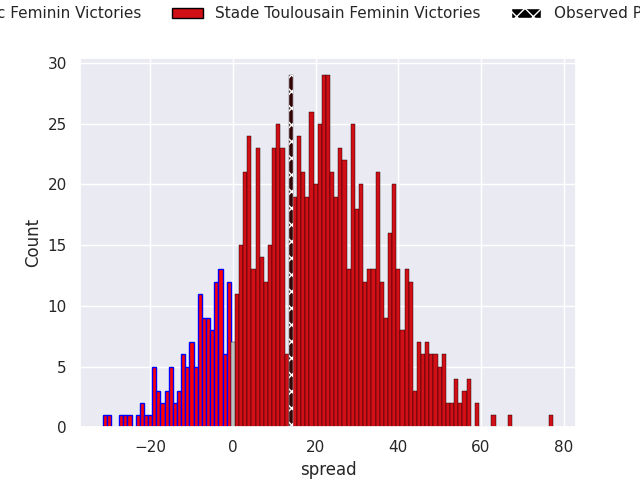

#### Toulon Provence Mediterranee Feminin V LOU Feminin on 2026/11/22

Average Margin: Toulon Provence Mediterranee Feminin by 21.2

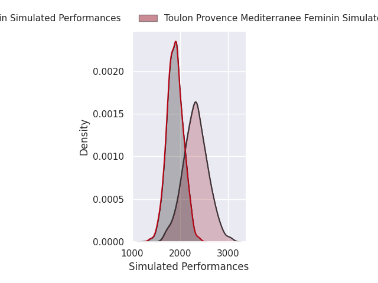
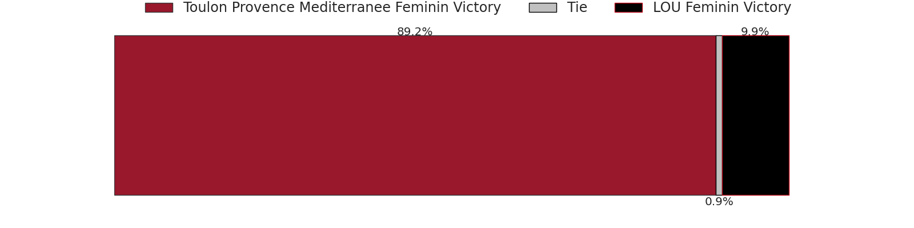
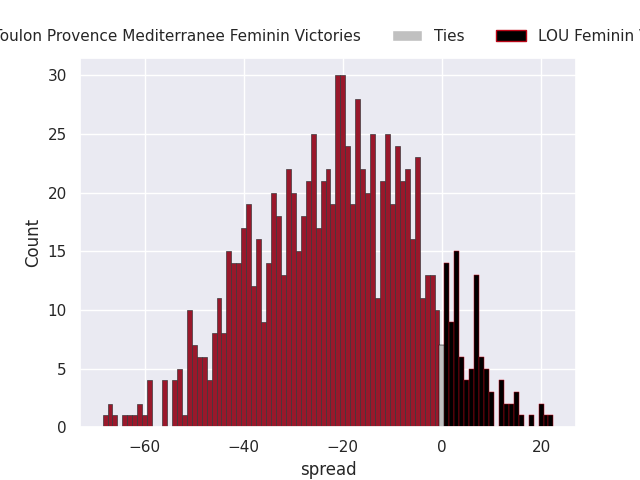

#### Bobigny Feminin V La Rochelle Feminin on 2026/11/22

Average Margin: Bobigny Feminin by 17.8

### Week 18
#### Stade Bordelais Feminin V Montpellier Feminin on 2026/11/29

Average Margin: Stade Bordelais Feminin by 18.6

#### La Rochelle Feminin V Blagnac Feminin on 2026/11/29

Average Margin: Blagnac Feminin by 7.1

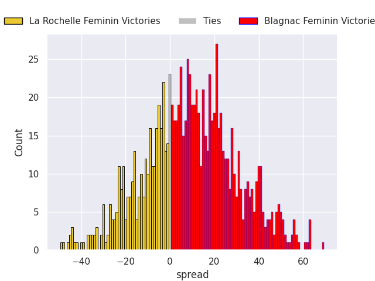

#### LOU Feminin V Romagnat Feminin on 2026/11/29

Average Margin: Romagnat Feminin by 18.2

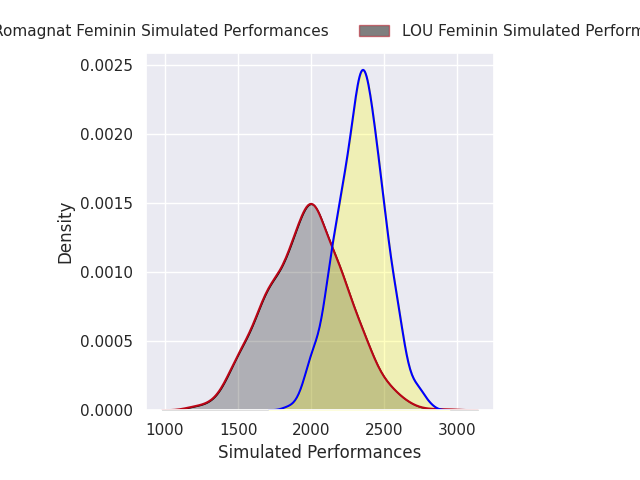
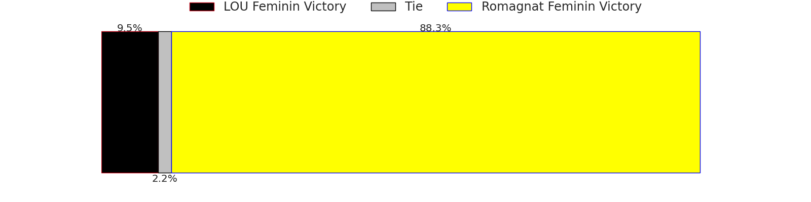
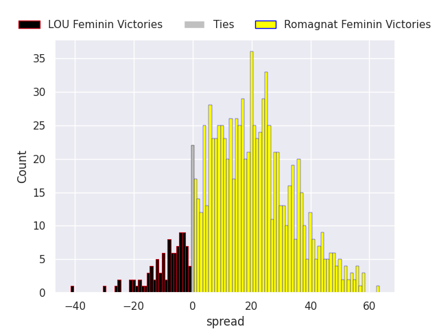

#### Grenoble Amazones Feminin V Bobigny Feminin on 2026/11/29

Average Margin: Grenoble Amazones Feminin by 16.9

#### Stade Toulousain Feminin V Toulon Provence Mediterranee Feminin on 2026/11/29

Average Margin: Stade Toulousain Feminin by 21.3

### Week 19
#### Bobigny Feminin V Stade Bordelais Feminin on 2026/12/12

Average Margin: Stade Bordelais Feminin by 13.4

#### Blagnac Feminin V Grenoble Amazones Feminin on 2026/12/13

Average Margin: Grenoble Amazones Feminin by 5.5

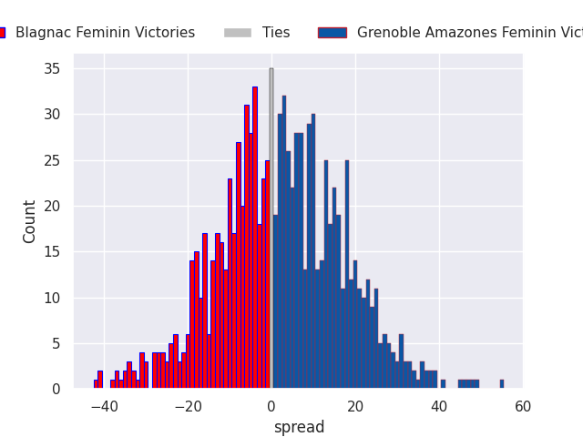

#### Toulon Provence Mediterranee Feminin V Romagnat Feminin on 2026/12/13

Average Margin: Toulon Provence Mediterranee Feminin by 0.4

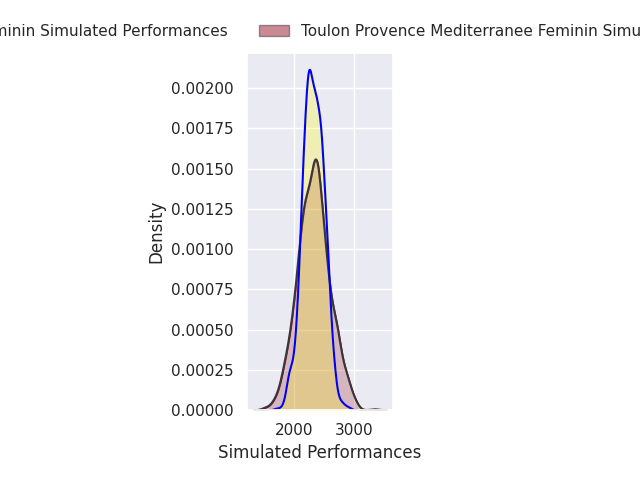

#### Stade Toulousain Feminin V La Rochelle Feminin on 2026/12/13

Average Margin: Stade Toulousain Feminin by 39.4

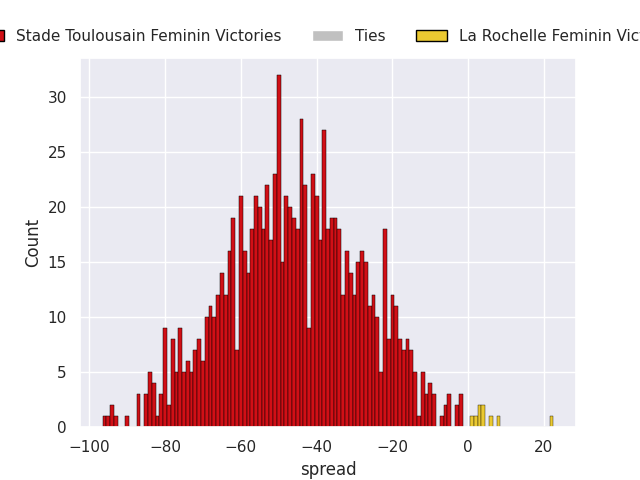

#### Montpellier Feminin V LOU Feminin on 2026/12/13

Average Margin: Montpellier Feminin by 16.6

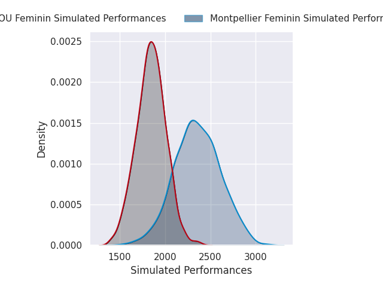

### Week 20
#### Stade Bordelais Feminin V Blagnac Feminin on 2026/12/20

Average Margin: Stade Bordelais Feminin by 24.7

#### La Rochelle Feminin V Toulon Provence Mediterranee Feminin on 2026/12/20

Average Margin: Toulon Provence Mediterranee Feminin by 15.1

#### Romagnat Feminin V Montpellier Feminin on 2026/12/20

Average Margin: Romagnat Feminin by 15.6

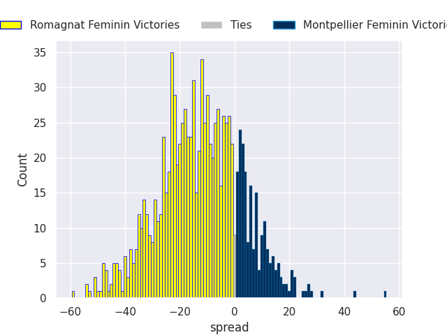

#### Grenoble Amazones Feminin V Stade Toulousain Feminin on 2026/12/20

Average Margin: Stade Toulousain Feminin by 6.1

#### LOU Feminin V Bobigny Feminin on 2026/12/20

Average Margin: LOU Feminin by 4.9

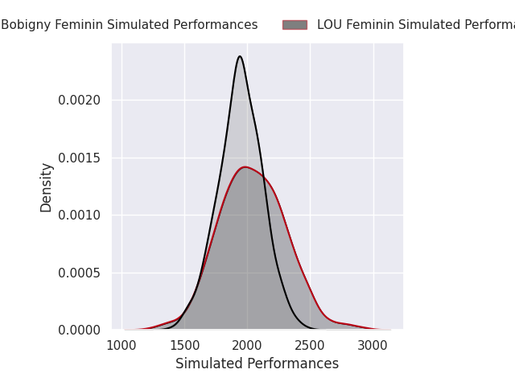

