## Team Rankings

## Standings
### Current Standings

| Club                                 |   Played |   Wins |   Point Differential |   Losing Bonus Points |   Try Bonus Points |   Competition Points |
|:-------------------------------------|---------:|-------:|---------------------:|----------------------:|-------------------:|---------------------:|
| Romagnat Feminin                     |       16 |     12 |                  275 |                     1 |                 12 |                   63 |
| Stade Bordelais Feminin              |       16 |     13 |                  251 |                     2 |                  8 |                   62 |
| Stade Toulousain Feminin             |       15 |     12 |                  400 |                     2 |                  3 |                   55 |
| Blagnac Feminin                      |       15 |      9 |                   61 |                     0 |                  2 |                   38 |
| Montpellier Feminin                  |       14 |      6 |                  -85 |                     2 |                  4 |                   30 |
| Grenoble Amazones Feminin            |       14 |      5 |                  -87 |                     3 |                  3 |                   26 |
| Toulon Provence Mediterranee Feminin |       14 |      5 |                 -220 |                     2 |                  3 |                   25 |
| Bobigny Feminin                      |       14 |      5 |                 -146 |                     3 |                  1 |                   24 |
| LOU Feminin                          |       14 |      3 |                 -224 |                     3 |                    |                   17 |
| Lille Feminin                        |       11 |      1 |                 -163 |                     3 |                    |                    7 |
| La Rochelle Feminin                  |        3 |      0 |                  -62 |                     0 |                    |                    2 |

### Projected Remaining Table

| Club                                 |   To Play |   Projected Wins |   Projected Differential |   Projected Losing Bonus Points | Projected Try Bonus Points   |   Projected Competition Points |
|:-------------------------------------|----------:|-----------------:|-------------------------:|--------------------------------:|:-----------------------------|-------------------------------:|
| Stade Toulousain Feminin             |         4 |            3.405 |                   90.043 |                           0.269 |                              |                         14.001 |
| Romagnat Feminin                     |         4 |            2.808 |                   38.22  |                           0.456 |                              |                         11.838 |
| Stade Bordelais Feminin              |         4 |            2.82  |                   45.692 |                           0.405 |                              |                         11.807 |
| Toulon Provence Mediterranee Feminin |         4 |            2.267 |                   14.092 |                           0.399 |                              |                          9.589 |
| Grenoble Amazones Feminin            |         4 |            2.129 |                   10.146 |                           0.6   |                              |                          9.278 |
| Montpellier Feminin                  |         4 |            1.83  |                   -8.917 |                           0.481 |                              |                          7.955 |
| Bobigny Feminin                      |         4 |            1.57  |                  -17.897 |                           0.534 |                              |                          6.916 |
| Blagnac Feminin                      |         4 |            1.228 |                  -38.913 |                           0.467 |                              |                          5.525 |
| LOU Feminin                          |         4 |            0.892 |                  -51.555 |                           0.498 |                              |                          4.176 |
| La Rochelle Feminin                  |         4 |            0.729 |                  -80.911 |                           0.399 |                              |                          3.423 |

### Projected Total Table

| Club                                 |   Played |   Wins |   Point Differential |   Losing Bonus Points |   Try Bonus Points |   Competition Points |
|:-------------------------------------|---------:|-------:|---------------------:|----------------------:|-------------------:|---------------------:|
| Romagnat Feminin                     |       20 | 14.808 |              313.22  |                 1.456 |                 12 |               74.838 |
| Stade Bordelais Feminin              |       20 | 15.82  |              296.692 |                 2.405 |                  8 |               73.807 |
| Stade Toulousain Feminin             |       19 | 15.405 |              490.043 |                 2.269 |                  3 |               69.001 |
| Blagnac Feminin                      |       19 | 10.228 |               22.087 |                 0.467 |                  2 |               43.525 |
| Montpellier Feminin                  |       18 |  7.83  |              -93.917 |                 2.481 |                  4 |               37.955 |
| Grenoble Amazones Feminin            |       18 |  7.129 |              -76.854 |                 3.6   |                  3 |               35.278 |
| Toulon Provence Mediterranee Feminin |       18 |  7.267 |             -205.908 |                 2.399 |                  3 |               34.589 |
| Bobigny Feminin                      |       18 |  6.57  |             -163.897 |                 3.534 |                  1 |               30.916 |
| LOU Feminin                          |       18 |  3.892 |             -275.555 |                 3.498 |                    |               21.176 |
| Lille Feminin                        |       11 |  1     |             -163     |                 3     |                    |                7     |
| La Rochelle Feminin                  |        7 |  0.729 |             -142.911 |                 0.399 |                    |                5.423 |

## Completed Match Review

| Model | Percent Correct Predictions | Spread Error |
| ------ | ------ | ------ |
| Club Level | 69.9% | 14.1 |
| Player Level: Lineup | nan% | nan |
| Player Level: Minutes | nan% | nan |

## Future Predictions
### Week 17
#### Montpellier Feminin V Grenoble Amazones Feminin on 2026/11/21

Average Margin: Montpellier Feminin by 4.1

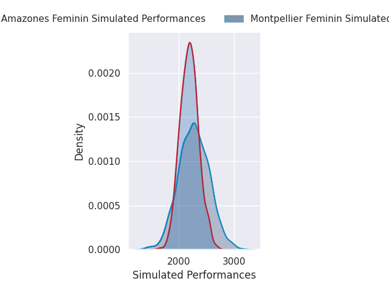
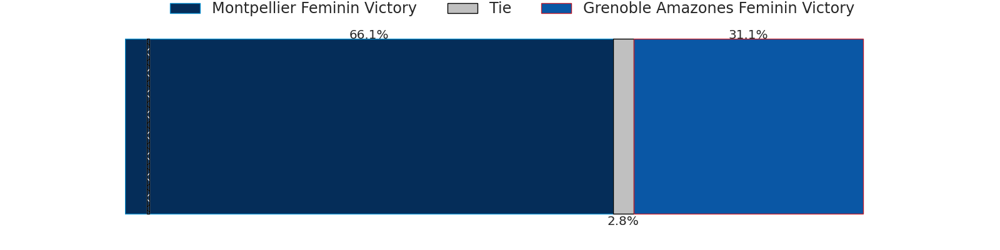

#### Romagnat Feminin V Stade Bordelais Feminin on 2026/11/21

Average Margin: Romagnat Feminin by 6.8

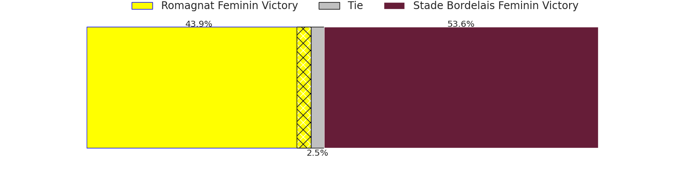

#### Blagnac Feminin V Stade Toulousain Feminin on 2026/11/22

Average Margin: Stade Toulousain Feminin by 20.4

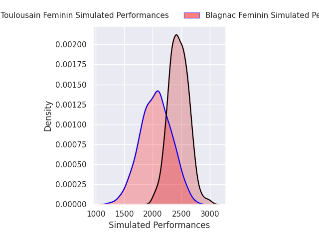
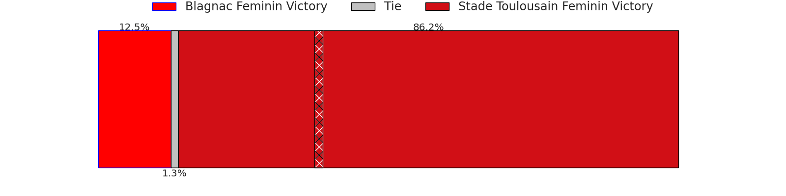

#### Bobigny Feminin V La Rochelle Feminin on 2026/11/22

Average Margin: Bobigny Feminin by 16.7

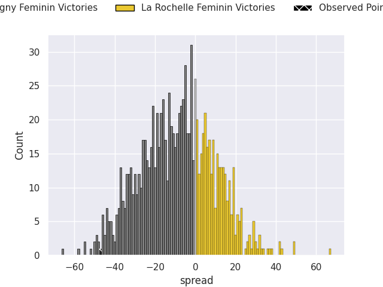

#### Toulon Provence Mediterranee Feminin V LOU Feminin on 2026/11/22

Average Margin: Toulon Provence Mediterranee Feminin by 21.3

### Week 18
#### LOU Feminin V Romagnat Feminin on 2026/11/28

Average Margin: Romagnat Feminin by 17.2

#### Stade Bordelais Feminin V Montpellier Feminin on 2026/11/29

Average Margin: Stade Bordelais Feminin by 15.8

#### La Rochelle Feminin V Blagnac Feminin on 2026/11/29

Average Margin: Blagnac Feminin by 9.4

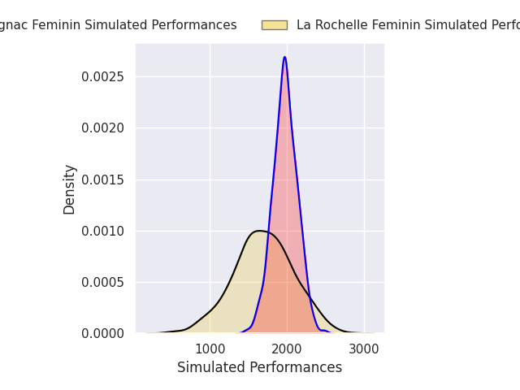

#### Grenoble Amazones Feminin V Bobigny Feminin on 2026/11/29

Average Margin: Grenoble Amazones Feminin by 17.6

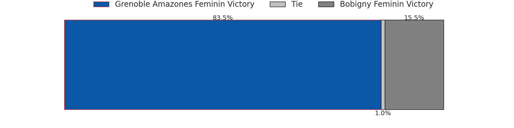

#### Stade Toulousain Feminin V Toulon Provence Mediterranee Feminin on 2026/11/29

Average Margin: Stade Toulousain Feminin by 21.8

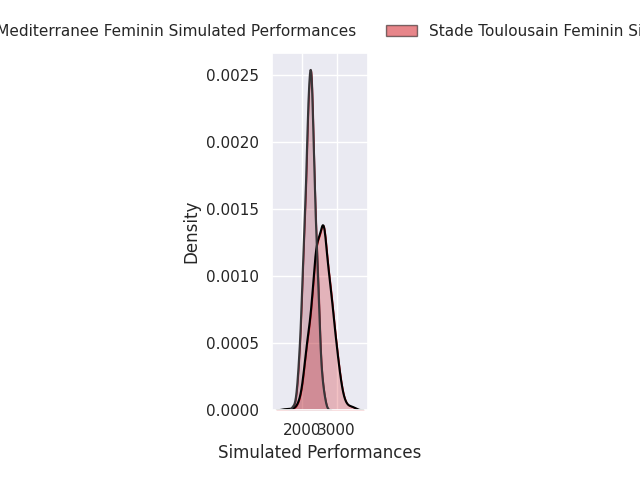

### Week 19
#### Bobigny Feminin V Stade Bordelais Feminin on 2026/12/12

Average Margin: Stade Bordelais Feminin by 13.0

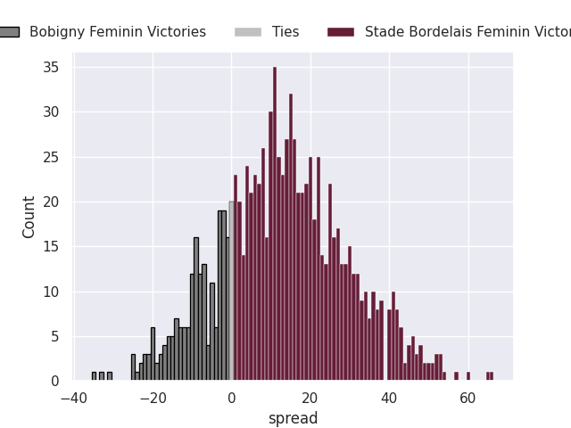

#### Toulon Provence Mediterranee Feminin V Romagnat Feminin on 2026/12/13

Average Margin: Romagnat Feminin by 0.0

#### Blagnac Feminin V Grenoble Amazones Feminin on 2026/12/13

Average Margin: Grenoble Amazones Feminin by 4.3

#### Stade Toulousain Feminin V La Rochelle Feminin on 2026/12/13

Average Margin: Stade Toulousain Feminin by 40.2

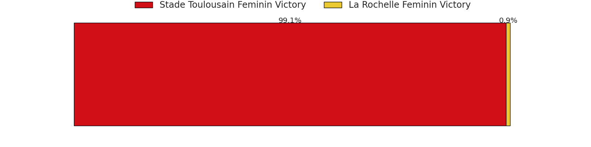

#### Montpellier Feminin V LOU Feminin on 2026/12/13

Average Margin: Montpellier Feminin by 17.1

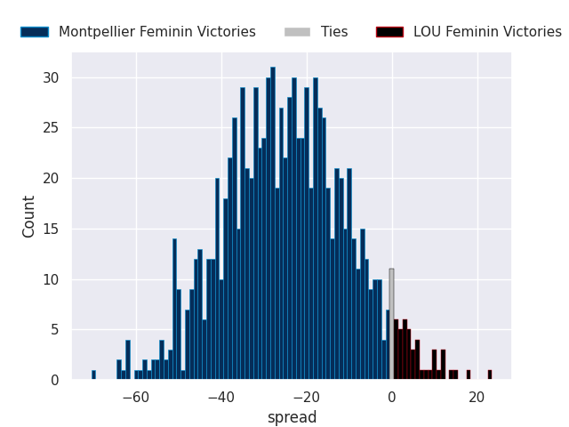

### Week 20
#### LOU Feminin V Bobigny Feminin on 2026/12/20

Average Margin: LOU Feminin by 4.0

#### Grenoble Amazones Feminin V Stade Toulousain Feminin on 2026/12/20

Average Margin: Stade Toulousain Feminin by 7.6

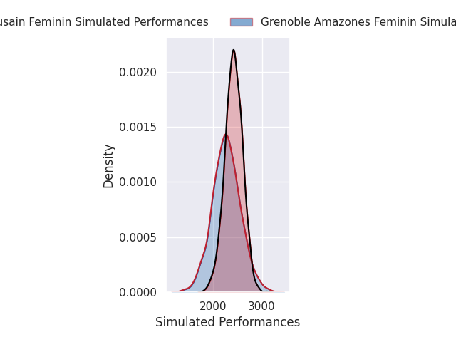
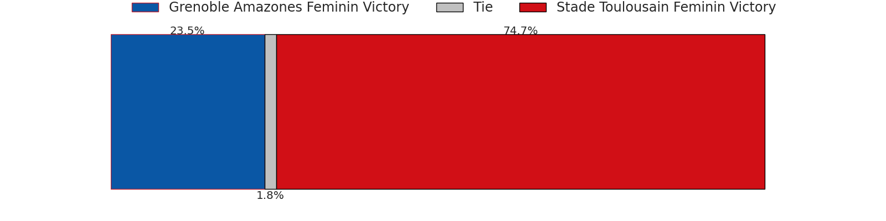

#### La Rochelle Feminin V Toulon Provence Mediterranee Feminin on 2026/12/20

Average Margin: Toulon Provence Mediterranee Feminin by 14.6

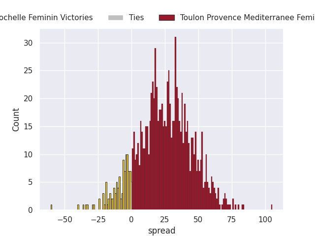

#### Stade Bordelais Feminin V Blagnac Feminin on 2026/12/20

Average Margin: Stade Bordelais Feminin by 23.7

#### Romagnat Feminin V Montpellier Feminin on 2026/12/20

Average Margin: Romagnat Feminin by 14.3

