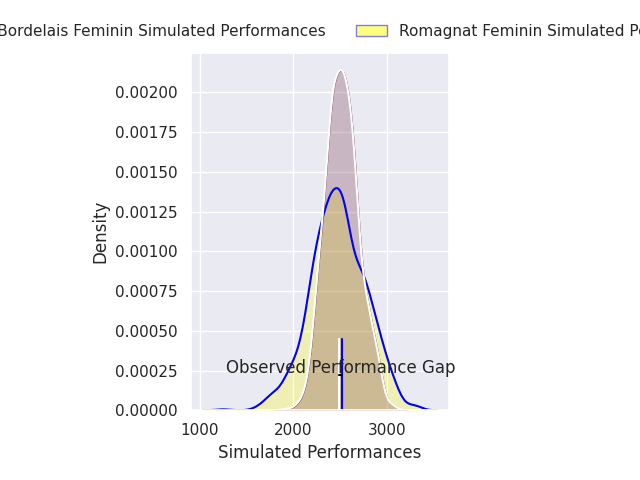
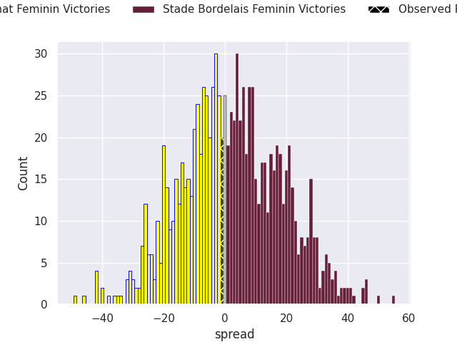
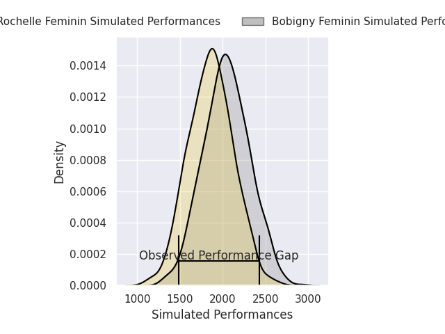
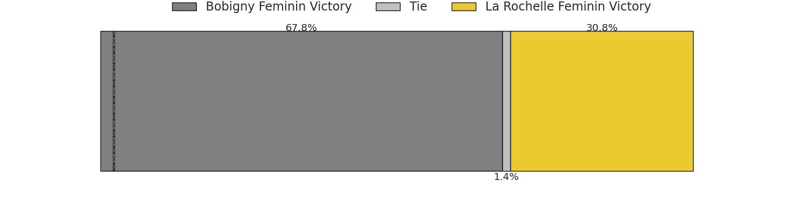
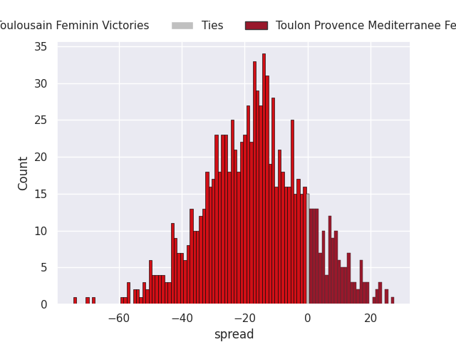
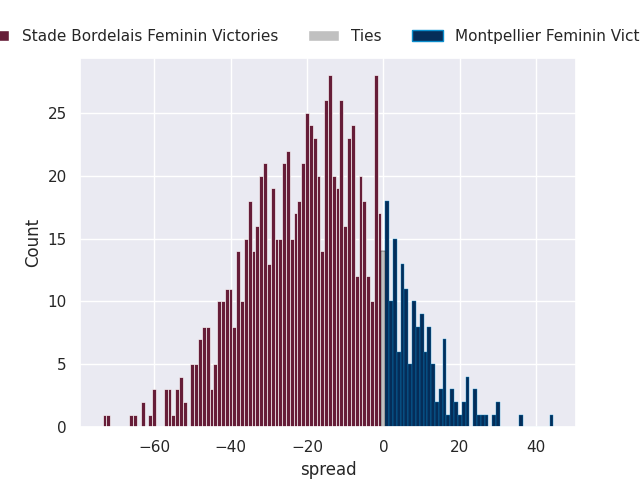
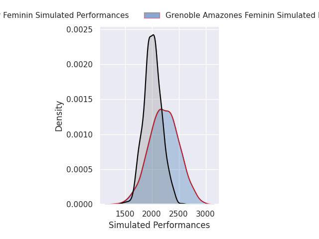
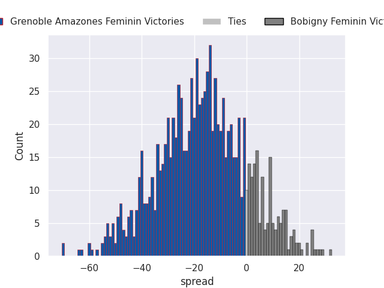
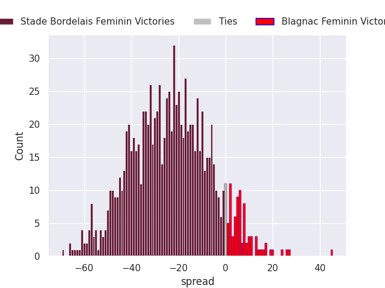
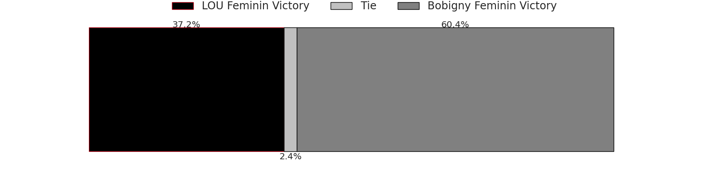

## Team Rankings

## Standings
### Current Standings

| Club                                 |   Played |   Wins |   Point Differential |   Losing Bonus Points |   Try Bonus Points |   Competition Points |
|:-------------------------------------|---------:|-------:|---------------------:|----------------------:|-------------------:|---------------------:|
| Romagnat Feminin                     |       16 |     12 |                  275 |                     1 |                 12 |                   63 |
| Stade Bordelais Feminin              |       16 |     13 |                  251 |                     2 |                  8 |                   62 |
| Stade Toulousain Feminin             |       15 |     12 |                  400 |                     2 |                  3 |                   55 |
| Blagnac Feminin                      |       15 |      9 |                   61 |                     0 |                  2 |                   38 |
| Montpellier Feminin                  |       14 |      6 |                  -85 |                     2 |                  4 |                   30 |
| Grenoble Amazones Feminin            |       14 |      5 |                  -87 |                     3 |                  3 |                   26 |
| Toulon Provence Mediterranee Feminin |       14 |      5 |                 -220 |                     2 |                  3 |                   25 |
| Bobigny Feminin                      |       14 |      5 |                 -146 |                     3 |                  1 |                   24 |
| LOU Feminin                          |       14 |      3 |                 -224 |                     3 |                    |                   17 |
| Lille Feminin                        |       11 |      1 |                 -163 |                     3 |                    |                    7 |
| La Rochelle Feminin                  |        3 |      0 |                  -62 |                     0 |                    |                    2 |

### Projected Remaining Table

| Club                                 |   To Play |   Projected Wins |   Projected Differential |   Projected Losing Bonus Points | Projected Try Bonus Points   |   Projected Competition Points |
|:-------------------------------------|----------:|-----------------:|-------------------------:|--------------------------------:|:-----------------------------|-------------------------------:|
| Stade Toulousain Feminin             |         4 |            3.422 |                   88.68  |                           0.25  |                              |                         14.028 |
| Romagnat Feminin                     |         4 |            2.831 |                   40.572 |                           0.455 |                              |                         11.941 |
| Stade Bordelais Feminin              |         4 |            2.848 |                   46.882 |                           0.372 |                              |                         11.886 |
| Toulon Provence Mediterranee Feminin |         4 |            2.185 |                   12.485 |                           0.457 |                              |                          9.327 |
| Grenoble Amazones Feminin            |         4 |            2.106 |                    9.366 |                           0.596 |                              |                          9.19  |
| Montpellier Feminin                  |         4 |            1.81  |                  -10.203 |                           0.452 |                              |                          7.846 |
| Bobigny Feminin                      |         4 |            1.555 |                  -16.07  |                           0.529 |                              |                          6.895 |
| Blagnac Feminin                      |         4 |            1.219 |                  -40.589 |                           0.481 |                              |                          5.461 |
| LOU Feminin                          |         4 |            0.933 |                  -52.753 |                           0.482 |                              |                          4.326 |
| La Rochelle Feminin                  |         4 |            0.769 |                  -78.37  |                           0.401 |                              |                          3.575 |

### Projected Total Table

| Club                                 |   Played |   Wins |   Point Differential |   Losing Bonus Points |   Try Bonus Points |   Competition Points |
|:-------------------------------------|---------:|-------:|---------------------:|----------------------:|-------------------:|---------------------:|
| Romagnat Feminin                     |       20 | 14.831 |              315.572 |                 1.455 |                 12 |               74.941 |
| Stade Bordelais Feminin              |       20 | 15.848 |              297.882 |                 2.372 |                  8 |               73.886 |
| Stade Toulousain Feminin             |       19 | 15.422 |              488.68  |                 2.25  |                  3 |               69.028 |
| Blagnac Feminin                      |       19 | 10.219 |               20.411 |                 0.481 |                  2 |               43.461 |
| Montpellier Feminin                  |       18 |  7.81  |              -95.203 |                 2.452 |                  4 |               37.846 |
| Grenoble Amazones Feminin            |       18 |  7.106 |              -77.634 |                 3.596 |                  3 |               35.19  |
| Toulon Provence Mediterranee Feminin |       18 |  7.185 |             -207.515 |                 2.457 |                  3 |               34.327 |
| Bobigny Feminin                      |       18 |  6.555 |             -162.07  |                 3.529 |                  1 |               30.895 |
| LOU Feminin                          |       18 |  3.933 |             -276.753 |                 3.482 |                    |               21.326 |
| Lille Feminin                        |       11 |  1     |             -163     |                 3     |                    |                7     |
| La Rochelle Feminin                  |        7 |  0.769 |             -140.37  |                 0.401 |                    |                5.575 |

## Completed Match Review

| Model | Percent Correct Predictions | Spread Error |
| ------ | ------ | ------ |
| Club Level | 68.8% | 14.2 |
| Player Level: Lineup | nan% | nan |
| Player Level: Minutes | nan% | nan |

## Future Predictions
### Week 17
#### Montpellier Feminin V Grenoble Amazones Feminin on 2026/11/21

Average Margin: Montpellier Feminin by 4.8

#### Romagnat Feminin V Stade Bordelais Feminin on 2026/11/21

Average Margin: Romagnat Feminin by 7.2

#### Blagnac Feminin V Stade Toulousain Feminin on 2026/11/22

Average Margin: Stade Toulousain Feminin by 19.4

#### Bobigny Feminin V La Rochelle Feminin on 2026/11/22

Average Margin: Bobigny Feminin by 17.5

#### Toulon Provence Mediterranee Feminin V LOU Feminin on 2026/11/22

Average Margin: Toulon Provence Mediterranee Feminin by 20.4

### Week 18
#### LOU Feminin V Romagnat Feminin on 2026/11/28

Average Margin: Romagnat Feminin by 18.0

#### La Rochelle Feminin V Blagnac Feminin on 2026/11/29

Average Margin: Blagnac Feminin by 7.0

#### Stade Toulousain Feminin V Toulon Provence Mediterranee Feminin on 2026/11/29

Average Margin: Stade Toulousain Feminin by 21.8

#### Stade Bordelais Feminin V Montpellier Feminin on 2026/11/29

Average Margin: Stade Bordelais Feminin by 17.3

#### Grenoble Amazones Feminin V Bobigny Feminin on 2026/11/29

Average Margin: Grenoble Amazones Feminin by 16.9

### Week 19
#### Bobigny Feminin V Stade Bordelais Feminin on 2026/12/12

Average Margin: Stade Bordelais Feminin by 13.3

#### Toulon Provence Mediterranee Feminin V Romagnat Feminin on 2026/12/13

Average Margin: Romagnat Feminin by 0.0

#### Montpellier Feminin V LOU Feminin on 2026/12/13

Average Margin: Montpellier Feminin by 17.7

#### Stade Toulousain Feminin V La Rochelle Feminin on 2026/12/13

Average Margin: Stade Toulousain Feminin by 40.1

#### Blagnac Feminin V Grenoble Amazones Feminin on 2026/12/13

Average Margin: Grenoble Amazones Feminin by 4.7

### Week 20
#### Grenoble Amazones Feminin V Stade Toulousain Feminin on 2026/12/20

Average Margin: Stade Toulousain Feminin by 7.4

#### Stade Bordelais Feminin V Blagnac Feminin on 2026/12/20

Average Margin: Stade Bordelais Feminin by 23.5

#### LOU Feminin V Bobigny Feminin on 2026/12/20

Average Margin: LOU Feminin by 3.4

#### La Rochelle Feminin V Toulon Provence Mediterranee Feminin on 2026/12/20

Average Margin: Toulon Provence Mediterranee Feminin by 13.8

#### Romagnat Feminin V Montpellier Feminin on 2026/12/20

Average Margin: Romagnat Feminin by 15.4

