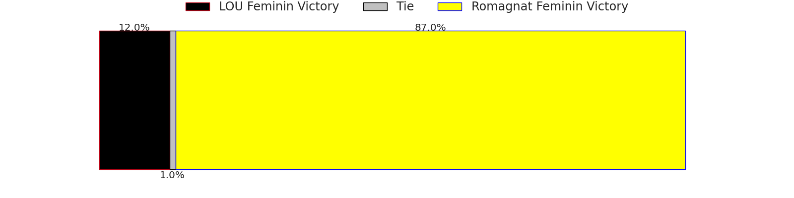
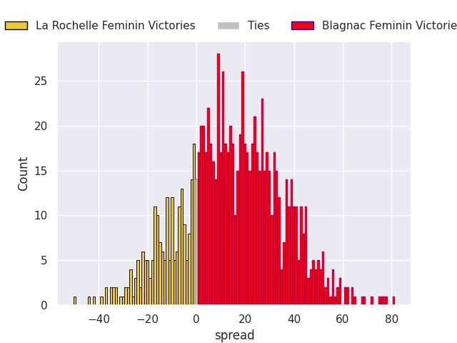
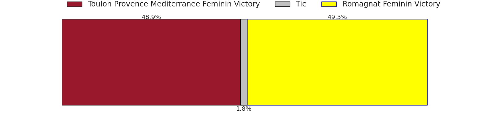
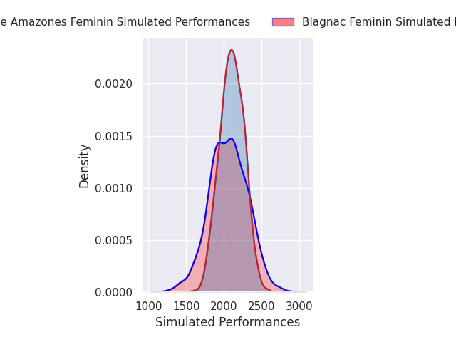
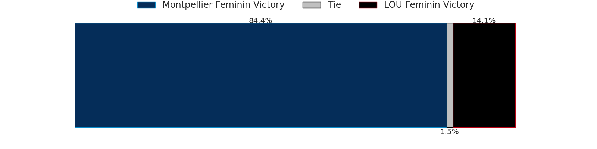
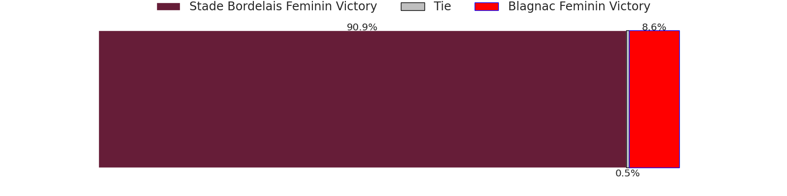
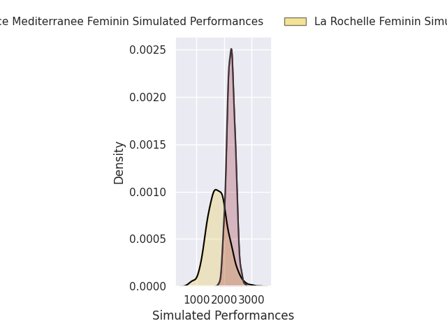
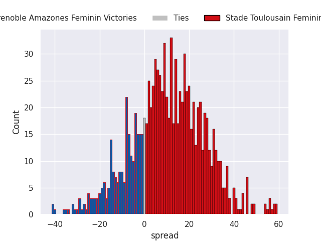
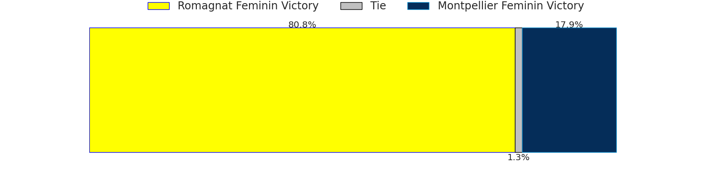

## Team Rankings

## Standings
### Current Standings

| Club                                 |   Played |   Wins |   Point Differential |   Losing Bonus Points |   Try Bonus Points |   Competition Points |
|:-------------------------------------|---------:|-------:|---------------------:|----------------------:|-------------------:|---------------------:|
| Romagnat Feminin                     |       17 |     13 |                  276 |                     1 |                 12 |                   67 |
| Stade Bordelais Feminin              |       17 |     13 |                  250 |                     3 |                  8 |                   63 |
| Stade Toulousain Feminin             |       16 |     13 |                  414 |                     2 |                  4 |                   60 |
| Blagnac Feminin                      |       16 |      9 |                   47 |                     0 |                  3 |                   39 |
| Montpellier Feminin                  |       15 |      7 |                  -49 |                     2 |                  5 |                   35 |
| Toulon Provence Mediterranee Feminin |       15 |      6 |                 -191 |                     2 |                  4 |                   30 |
| Bobigny Feminin                      |       15 |      6 |                  -99 |                     3 |                  2 |                   29 |
| Grenoble Amazones Feminin            |       15 |      5 |                 -123 |                     3 |                  3 |                   26 |
| LOU Feminin                          |       15 |      3 |                 -253 |                     3 |                    |                   17 |
| Lille Feminin                        |       11 |      1 |                 -163 |                     3 |                    |                    7 |
| La Rochelle Feminin                  |        4 |      0 |                 -109 |                     0 |                    |                    2 |

### Projected Remaining Table

| Club                                 |   To Play |   Projected Wins |   Projected Differential |   Projected Losing Bonus Points | Projected Try Bonus Points   |   Projected Competition Points |
|:-------------------------------------|----------:|-----------------:|-------------------------:|--------------------------------:|:-----------------------------|-------------------------------:|
| Stade Toulousain Feminin             |         3 |            2.556 |                   72.236 |                           0.2   |                              |                         10.504 |
| Stade Bordelais Feminin              |         3 |            2.395 |                   47.239 |                           0.245 |                              |                          9.923 |
| Romagnat Feminin                     |         3 |            2.102 |                   31.798 |                           0.345 |                              |                          8.835 |
| Toulon Provence Mediterranee Feminin |         3 |            1.611 |                   11.262 |                           0.341 |                              |                          6.887 |
| Grenoble Amazones Feminin            |         3 |            1.506 |                    1.681 |                           0.461 |                              |                          6.615 |
| Montpellier Feminin                  |         3 |            1.36  |                   -1.545 |                           0.314 |                              |                          5.832 |
| Blagnac Feminin                      |         3 |            1.259 |                  -12.668 |                           0.344 |                              |                          5.458 |
| Bobigny Feminin                      |         3 |            1.106 |                  -14.615 |                           0.479 |                              |                          5.053 |
| LOU Feminin                          |         3 |            0.493 |                  -52.018 |                           0.337 |                              |                          2.387 |
| La Rochelle Feminin                  |         3 |            0.379 |                  -83.37  |                           0.189 |                              |                          1.761 |

### Projected Total Table

| Club                                 |   Played |   Wins |   Point Differential |   Losing Bonus Points |   Try Bonus Points |   Competition Points |
|:-------------------------------------|---------:|-------:|---------------------:|----------------------:|-------------------:|---------------------:|
| Romagnat Feminin                     |       20 | 15.102 |              307.798 |                 1.345 |                 12 |               75.835 |
| Stade Bordelais Feminin              |       20 | 15.395 |              297.239 |                 3.245 |                  8 |               72.923 |
| Stade Toulousain Feminin             |       19 | 15.556 |              486.236 |                 2.2   |                  4 |               70.504 |
| Blagnac Feminin                      |       19 | 10.259 |               34.332 |                 0.344 |                  3 |               44.458 |
| Montpellier Feminin                  |       18 |  8.36  |              -50.545 |                 2.314 |                  5 |               40.832 |
| Toulon Provence Mediterranee Feminin |       18 |  7.611 |             -179.738 |                 2.341 |                  4 |               36.887 |
| Bobigny Feminin                      |       18 |  7.106 |             -113.615 |                 3.479 |                  2 |               34.053 |
| Grenoble Amazones Feminin            |       18 |  6.506 |             -121.319 |                 3.461 |                  3 |               32.615 |
| LOU Feminin                          |       18 |  3.493 |             -305.018 |                 3.337 |                    |               19.387 |
| Lille Feminin                        |       11 |  1     |             -163     |                 3     |                    |                7     |
| La Rochelle Feminin                  |        7 |  0.379 |             -192.37  |                 0.189 |                    |                3.761 |

## Completed Match Review

| Model | Percent Correct Predictions | Spread Error |
| ------ | ------ | ------ |
| Club Level | 66.7% | 14.6 |
| Player Level: Lineup | nan% | nan |
| Player Level: Minutes | nan% | nan |

## Future Predictions
### Week 18
#### LOU Feminin V Romagnat Feminin on 2026/11/28

Average Margin: Romagnat Feminin by 22.3

#### La Rochelle Feminin V Blagnac Feminin on 2026/11/28

Average Margin: Blagnac Feminin by 13.2

#### Grenoble Amazones Feminin V Bobigny Feminin on 2026/11/29

Average Margin: Grenoble Amazones Feminin by 10.0

#### Stade Bordelais Feminin V Montpellier Feminin on 2026/11/29

Average Margin: Stade Bordelais Feminin by 14.1

#### Stade Toulousain Feminin V Toulon Provence Mediterranee Feminin on 2026/11/29

Average Margin: Stade Toulousain Feminin by 16.9

### Week 19
#### Bobigny Feminin V Stade Bordelais Feminin on 2026/12/12

Average Margin: Stade Bordelais Feminin by 8.9

#### Stade Toulousain Feminin V La Rochelle Feminin on 2026/12/13

Average Margin: Stade Toulousain Feminin by 45.4

#### Toulon Provence Mediterranee Feminin V Romagnat Feminin on 2026/12/13

Average Margin: Toulon Provence Mediterranee Feminin by 3.4

#### Blagnac Feminin V Grenoble Amazones Feminin on 2026/12/13

Average Margin: Grenoble Amazones Feminin by 1.6

#### Montpellier Feminin V LOU Feminin on 2026/12/13

Average Margin: Montpellier Feminin by 25.5

### Week 20
#### Stade Bordelais Feminin V Blagnac Feminin on 2026/12/20

Average Margin: Stade Bordelais Feminin by 24.2

#### La Rochelle Feminin V Toulon Provence Mediterranee Feminin on 2026/12/20

Average Margin: Toulon Provence Mediterranee Feminin by 24.8

#### Grenoble Amazones Feminin V Stade Toulousain Feminin on 2026/12/20

Average Margin: Stade Toulousain Feminin by 9.9

#### LOU Feminin V Bobigny Feminin on 2026/12/20

Average Margin: Bobigny Feminin by 4.3

#### Romagnat Feminin V Montpellier Feminin on 2026/12/20

Average Margin: Romagnat Feminin by 12.9

