## Team Rankings

## Standings
### Projected Remaining Table

| Club                                 |   To Play |   Projected Wins |   Projected Differential |   Projected Losing Bonus Points | Projected Try Bonus Points   |   Projected Competition Points |
|:-------------------------------------|----------:|-----------------:|-------------------------:|--------------------------------:|:-----------------------------|-------------------------------:|
| Stade Toulousain Feminin             |        11 |            8.408 |                  153.659 |                           1.029 |                              |                         34.973 |
| Romagnat Feminin                     |        11 |            7.738 |                  111.833 |                           1.199 |                              |                         32.557 |
| Stade Bordelais Feminin              |        11 |            7.142 |                   89.32  |                           1.339 |                              |                         30.309 |
| Grenoble Amazones Feminin            |        11 |            6.205 |                   38.783 |                           1.395 |                              |                         26.665 |
| Montpellier Feminin                  |        11 |            5.937 |                   25.697 |                           1.488 |                              |                         25.702 |
| Toulon Provence Mediterranee Feminin |        11 |            5.626 |                   13.777 |                           1.536 |                              |                         24.518 |
| Blagnac Feminin                      |        11 |            3.735 |                  -81.584 |                           1.548 |                              |                         16.906 |
| Bobigny Feminin                      |        11 |            3.479 |                  -85.71  |                           1.669 |                              |                         16.051 |
| LOU Feminin                          |        11 |            3.206 |                 -102.647 |                           1.592 |                              |                         14.87  |
| La Rochelle Feminin                  |        11 |            2.484 |                 -163.128 |                           1.312 |                              |                         11.556 |

### Projected Total Table

| Club                                 |   Played |   Wins |   Point Differential |   Losing Bonus Points | Try Bonus Points   |   Competition Points |
|:-------------------------------------|---------:|-------:|---------------------:|----------------------:|:-------------------|---------------------:|
| Stade Toulousain Feminin             |       11 |  8.408 |              153.659 |                 1.029 |                    |               34.973 |
| Romagnat Feminin                     |       11 |  7.738 |              111.833 |                 1.199 |                    |               32.557 |
| Stade Bordelais Feminin              |       11 |  7.142 |               89.32  |                 1.339 |                    |               30.309 |
| Grenoble Amazones Feminin            |       11 |  6.205 |               38.783 |                 1.395 |                    |               26.665 |
| Montpellier Feminin                  |       11 |  5.937 |               25.697 |                 1.488 |                    |               25.702 |
| Toulon Provence Mediterranee Feminin |       11 |  5.626 |               13.777 |                 1.536 |                    |               24.518 |
| Blagnac Feminin                      |       11 |  3.735 |              -81.584 |                 1.548 |                    |               16.906 |
| Bobigny Feminin                      |       11 |  3.479 |              -85.71  |                 1.669 |                    |               16.051 |
| LOU Feminin                          |       11 |  3.206 |             -102.647 |                 1.592 |                    |               14.87  |
| La Rochelle Feminin                  |       11 |  2.484 |             -163.128 |                 1.312 |                    |               11.556 |

## Future Predictions
### Week 1
#### Toulon Provence Mediterranee Feminin V Montpellier Feminin on 2027/01/17

Average Margin: Toulon Provence Mediterranee Feminin by 8.6

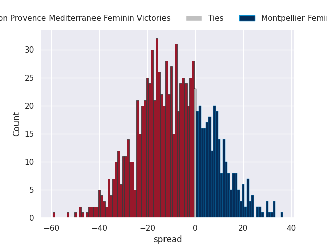

#### Bobigny Feminin V Romagnat Feminin on 2027/01/17

Average Margin: Romagnat Feminin by 11.9

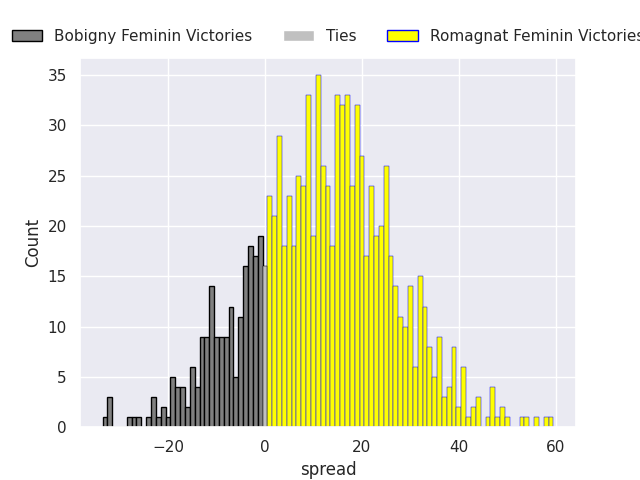

#### Blagnac Feminin V LOU Feminin on 2027/01/17

Average Margin: Blagnac Feminin by 7.7

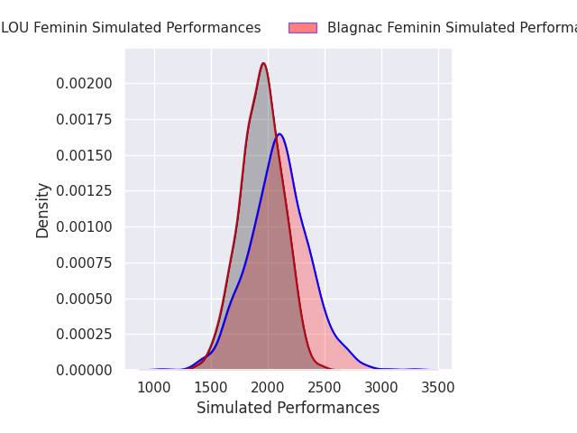

#### Stade Toulousain Feminin V Stade Bordelais Feminin on 2027/01/17

Average Margin: Stade Toulousain Feminin by 13.5

#### La Rochelle Feminin V Grenoble Amazones Feminin on 2027/01/17

Average Margin: Grenoble Amazones Feminin by 12.6

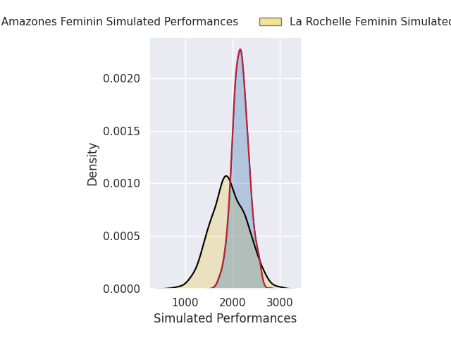
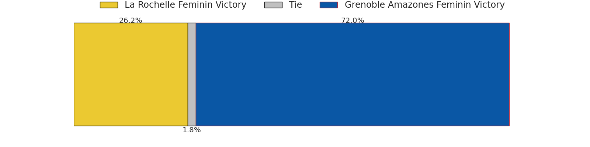
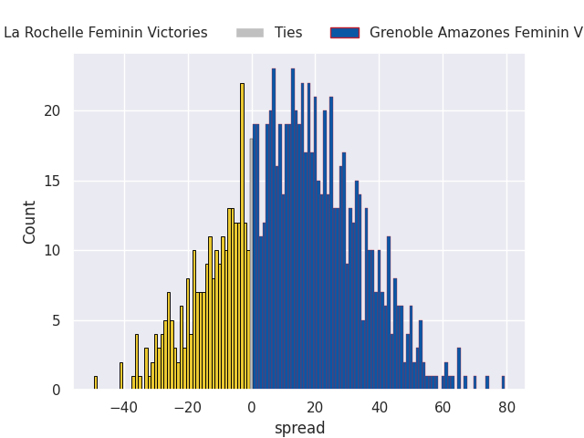

### Week 2
#### Romagnat Feminin V Blagnac Feminin on 2027/01/24

Average Margin: Romagnat Feminin by 21.4

#### Grenoble Amazones Feminin V Toulon Provence Mediterranee Feminin on 2027/01/24

Average Margin: Grenoble Amazones Feminin by 7.6

#### Stade Bordelais Feminin V La Rochelle Feminin on 2027/01/24

Average Margin: Stade Bordelais Feminin by 29.9

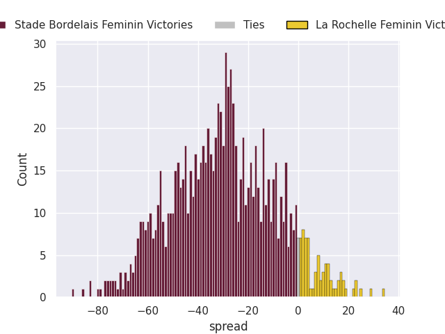

#### LOU Feminin V Stade Toulousain Feminin on 2027/01/24

Average Margin: Stade Toulousain Feminin by 18.9

#### Montpellier Feminin V Bobigny Feminin on 2027/01/24

Average Margin: Montpellier Feminin by 16.1

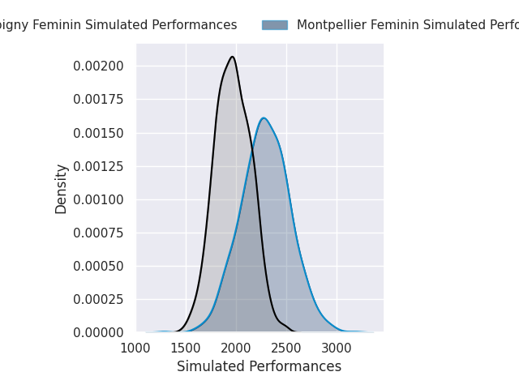
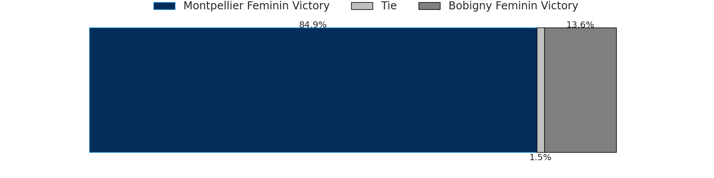

### Week 3
#### Grenoble Amazones Feminin V Stade Bordelais Feminin on 2027/02/21

Average Margin: Stade Bordelais Feminin by 1.2

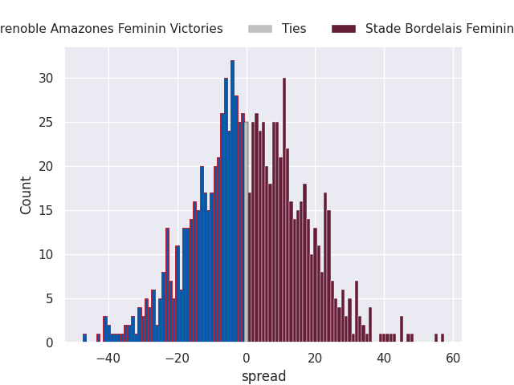

#### Montpellier Feminin V Blagnac Feminin on 2027/02/21

Average Margin: Montpellier Feminin by 14.1

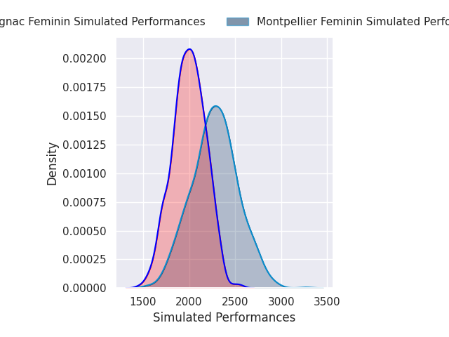

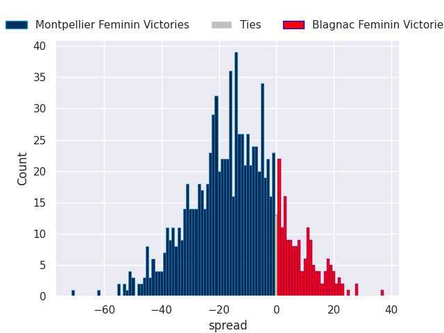

#### Romagnat Feminin V Stade Toulousain Feminin on 2027/02/21

Average Margin: Romagnat Feminin by 0.2

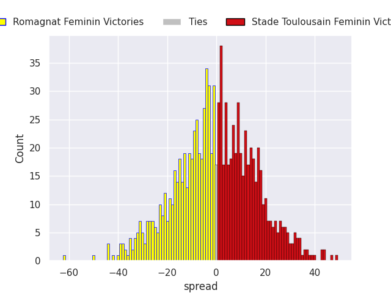

#### LOU Feminin V La Rochelle Feminin on 2027/02/21

Average Margin: LOU Feminin by 9.9

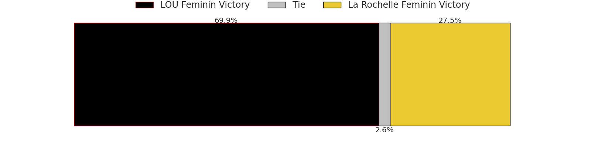

#### Bobigny Feminin V Toulon Provence Mediterranee Feminin on 2027/02/21

Average Margin: Toulon Provence Mediterranee Feminin by 2.9

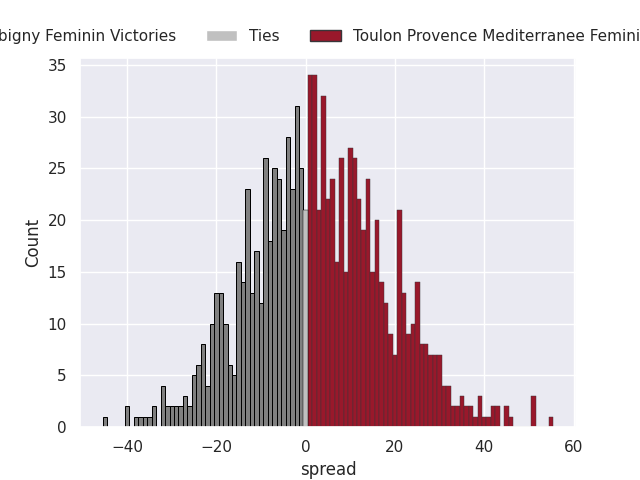

### Week 4
#### Stade Toulousain Feminin V Montpellier Feminin on 2027/02/28

Average Margin: Stade Toulousain Feminin by 19.9

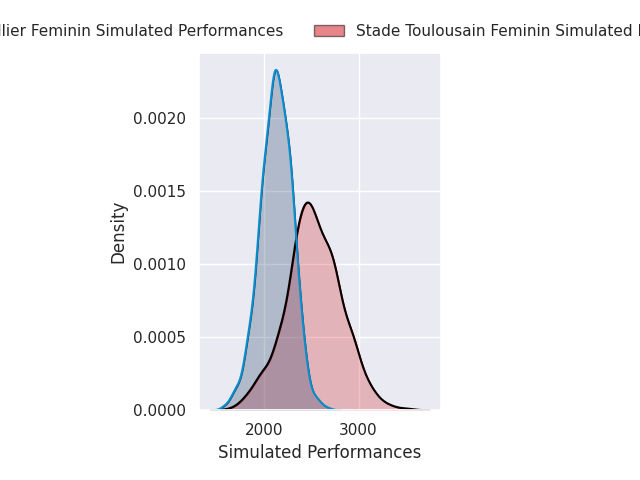

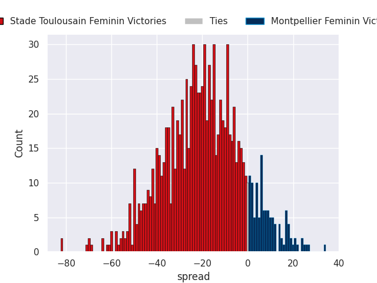

#### Grenoble Amazones Feminin V LOU Feminin on 2027/02/28

Average Margin: Grenoble Amazones Feminin by 16.6

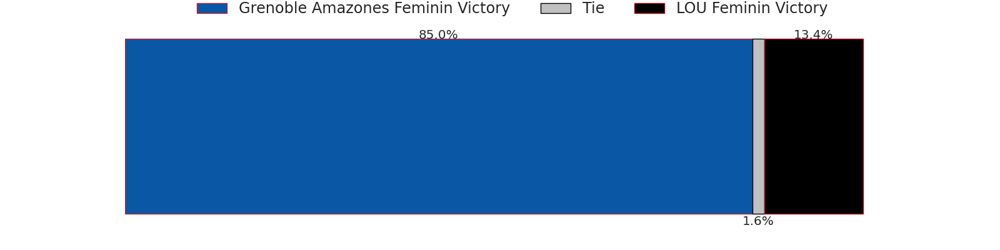

#### Blagnac Feminin V Bobigny Feminin on 2027/02/28

Average Margin: Blagnac Feminin by 5.5

#### Stade Bordelais Feminin V Toulon Provence Mediterranee Feminin on 2027/02/28

Average Margin: Stade Bordelais Feminin by 14.1

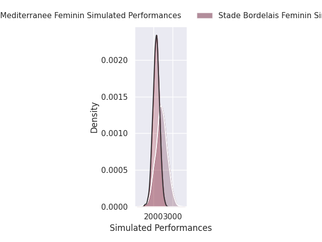

#### La Rochelle Feminin V Romagnat Feminin on 2027/02/28

Average Margin: Romagnat Feminin by 16.4

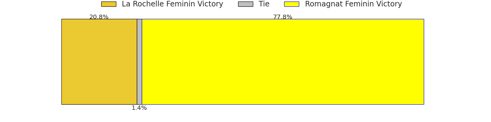

### Week 5
#### Bobigny Feminin V Stade Toulousain Feminin on 2027/03/07

Average Margin: Stade Toulousain Feminin by 14.4

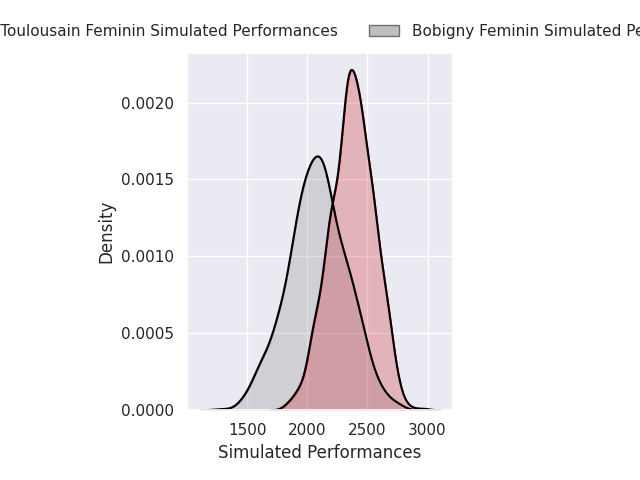

#### LOU Feminin V Stade Bordelais Feminin on 2027/03/07

Average Margin: Stade Bordelais Feminin by 10.3

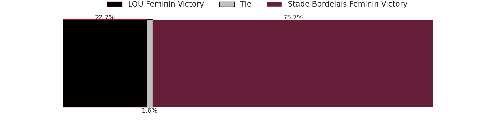
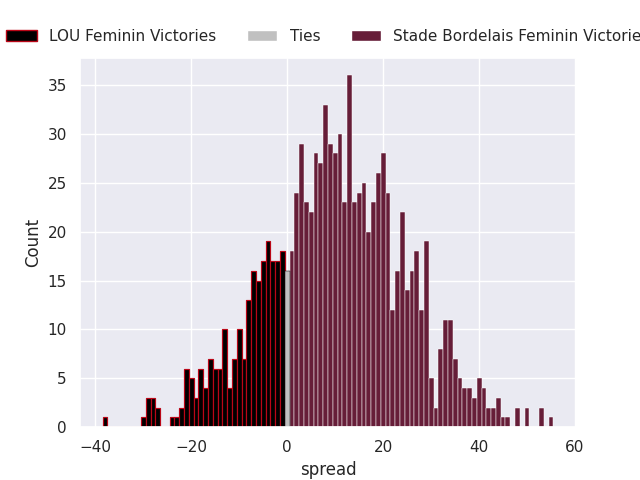

#### Romagnat Feminin V Grenoble Amazones Feminin on 2027/03/07

Average Margin: Romagnat Feminin by 12.0

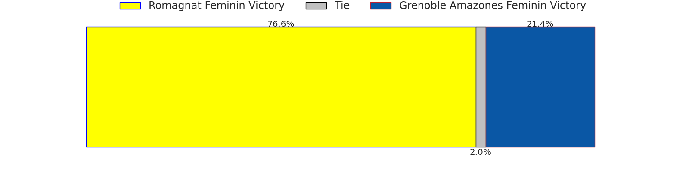

#### Montpellier Feminin V La Rochelle Feminin on 2027/03/07

Average Margin: Montpellier Feminin by 19.0

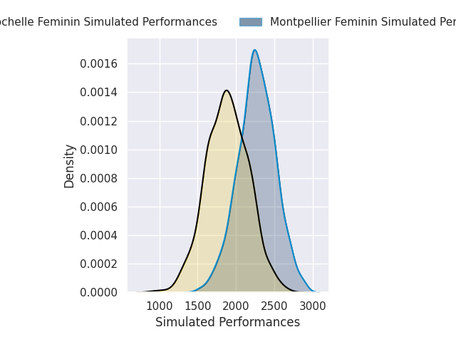
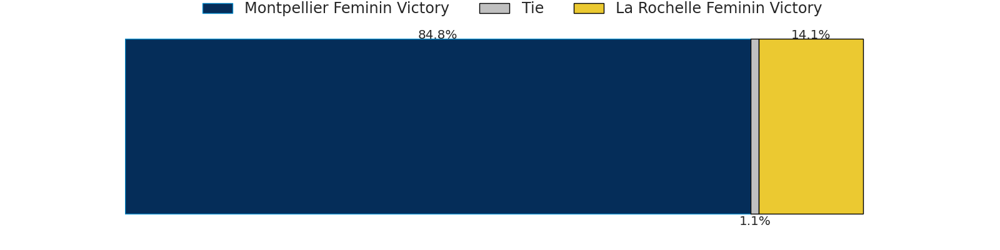

#### Toulon Provence Mediterranee Feminin V Blagnac Feminin on 2027/03/07

Average Margin: Toulon Provence Mediterranee Feminin by 15.0

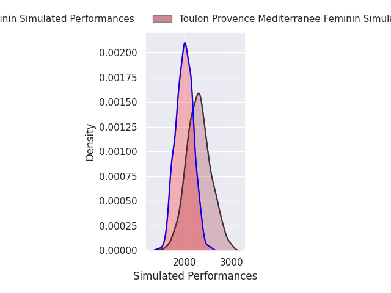

### Week 6
#### LOU Feminin V Toulon Provence Mediterranee Feminin on 2027/03/21

Average Margin: Toulon Provence Mediterranee Feminin by 5.2

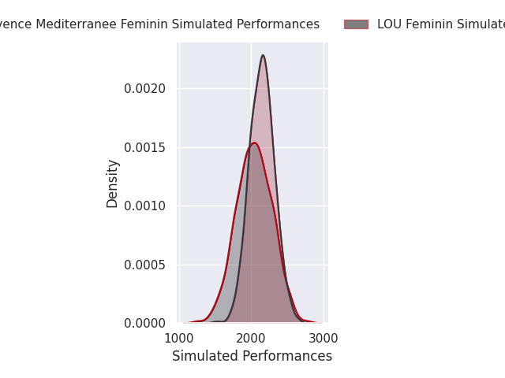

#### Stade Toulousain Feminin V Blagnac Feminin on 2027/03/21

Average Margin: Stade Toulousain Feminin by 25.7

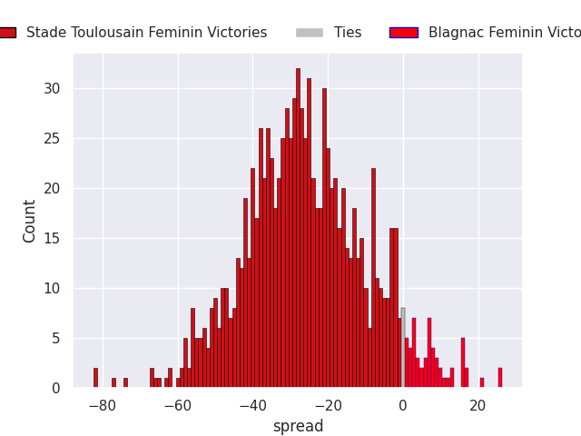

#### Grenoble Amazones Feminin V Montpellier Feminin on 2027/03/21

Average Margin: Grenoble Amazones Feminin by 6.8

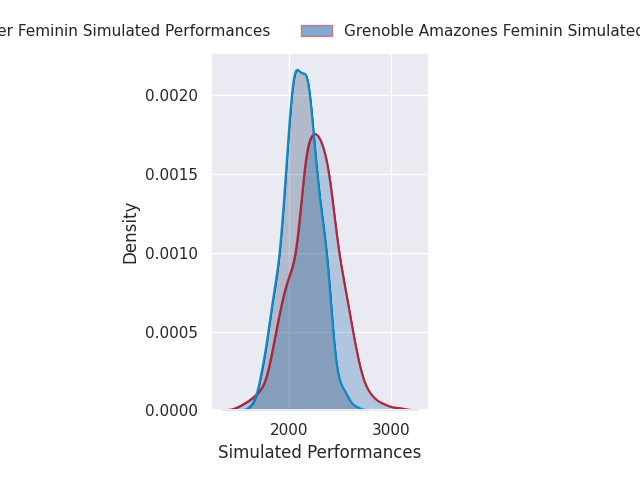
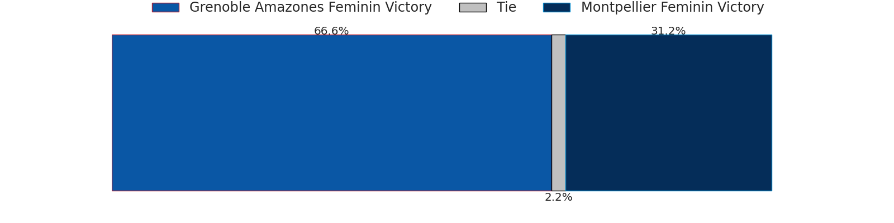
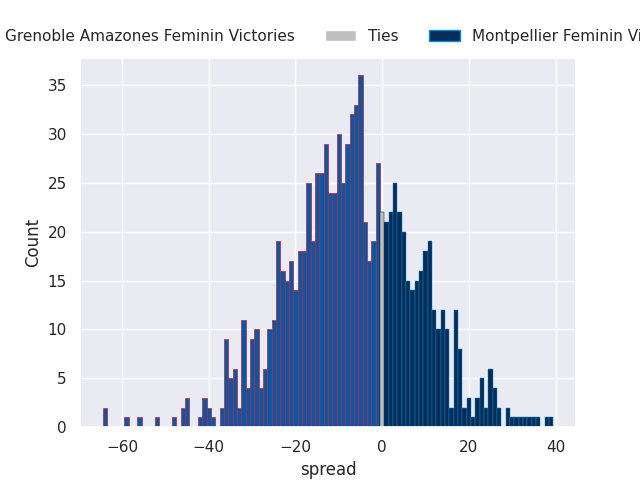

#### Stade Bordelais Feminin V Romagnat Feminin on 2027/03/21

Average Margin: Stade Bordelais Feminin by 7.2

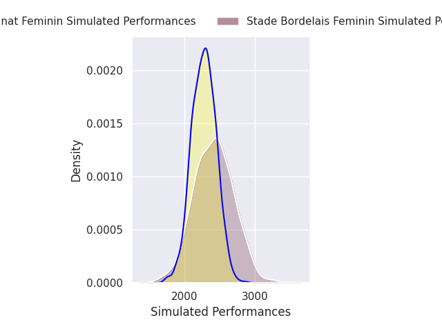

#### La Rochelle Feminin V Bobigny Feminin on 2027/03/21

Average Margin: Bobigny Feminin by 0.2

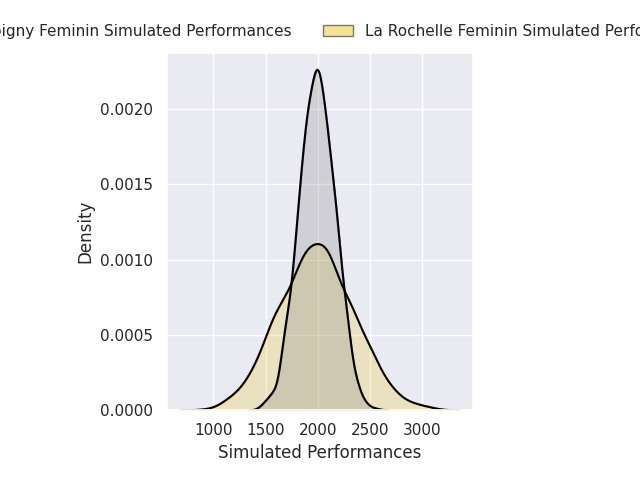
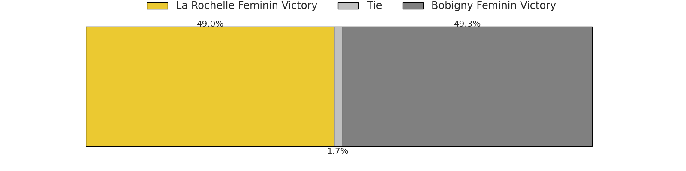

### Week 7
#### Montpellier Feminin V Stade Bordelais Feminin on 2027/03/28

Average Margin: Stade Bordelais Feminin by 0.0

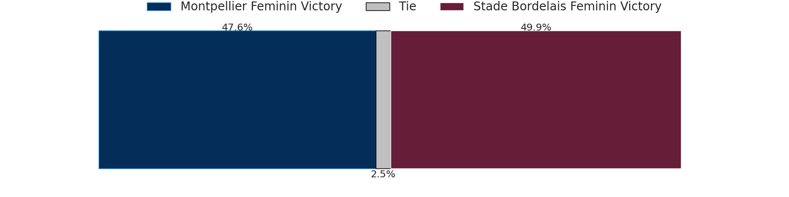
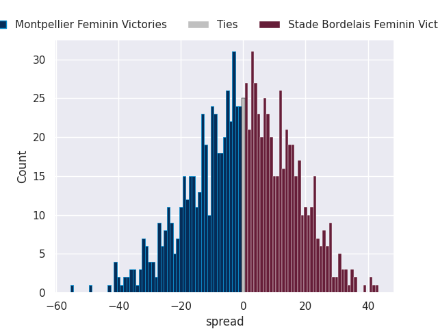

#### Toulon Provence Mediterranee Feminin V Stade Toulousain Feminin on 2027/03/28

Average Margin: Stade Toulousain Feminin by 3.9

#### Blagnac Feminin V La Rochelle Feminin on 2027/03/28

Average Margin: Blagnac Feminin by 10.8

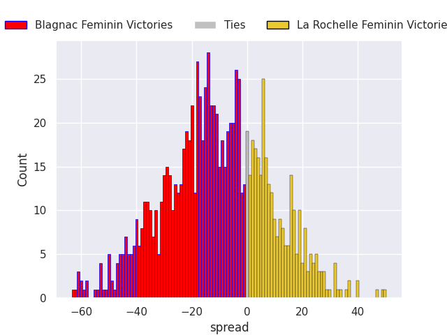

#### Romagnat Feminin V LOU Feminin on 2027/03/28

Average Margin: Romagnat Feminin by 21.4

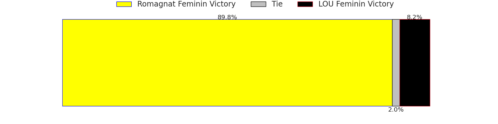

#### Bobigny Feminin V Grenoble Amazones Feminin on 2027/03/28

Average Margin: Grenoble Amazones Feminin by 3.2

### Week 8
#### Romagnat Feminin V Toulon Provence Mediterranee Feminin on 2027/04/25

Average Margin: Romagnat Feminin by 12.2

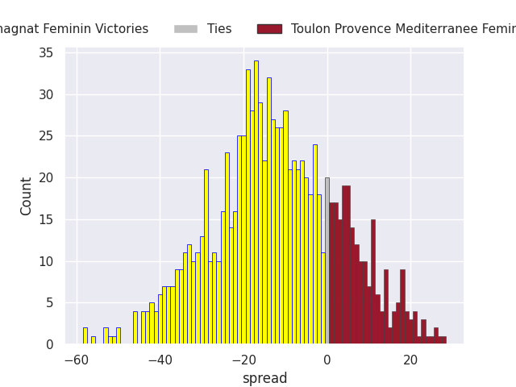

#### La Rochelle Feminin V Stade Toulousain Feminin on 2027/04/25

Average Margin: Stade Toulousain Feminin by 17.2

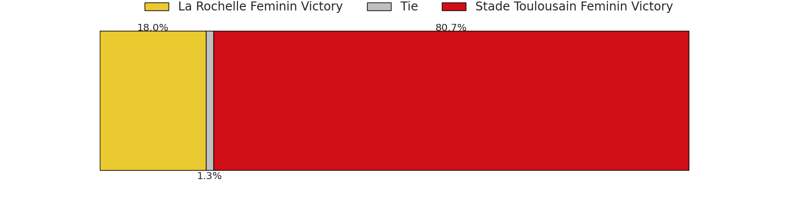
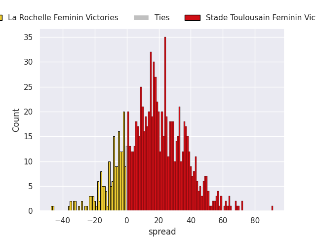

#### Stade Bordelais Feminin V Bobigny Feminin on 2027/04/25

Average Margin: Stade Bordelais Feminin by 19.7

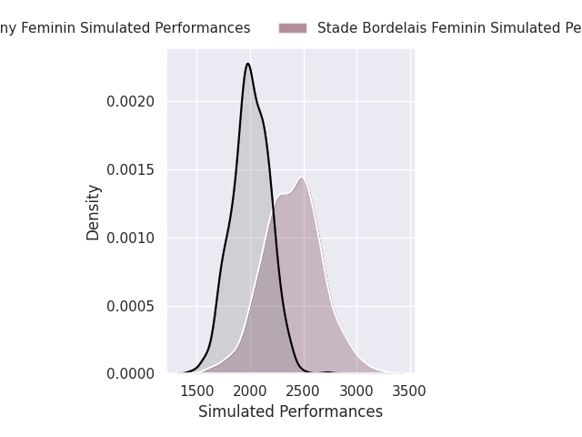

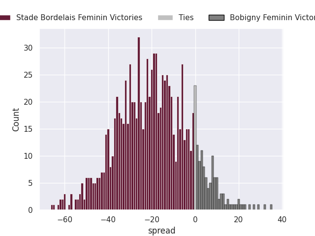

#### Grenoble Amazones Feminin V Blagnac Feminin on 2027/04/25

Average Margin: Grenoble Amazones Feminin by 12.6

#### LOU Feminin V Montpellier Feminin on 2027/04/25

Average Margin: Montpellier Feminin by 3.0

### Week 9
#### Toulon Provence Mediterranee Feminin V La Rochelle Feminin on 2027/05/23

Average Margin: Toulon Provence Mediterranee Feminin by 19.6

#### Blagnac Feminin V Stade Bordelais Feminin on 2027/05/23

Average Margin: Stade Bordelais Feminin by 7.6

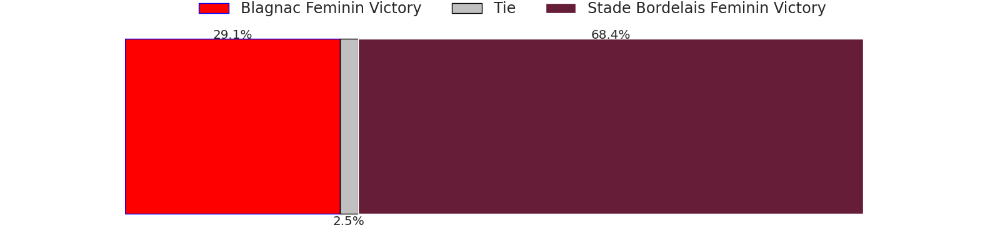

#### Stade Toulousain Feminin V Grenoble Amazones Feminin on 2027/05/23

Average Margin: Stade Toulousain Feminin by 17.2

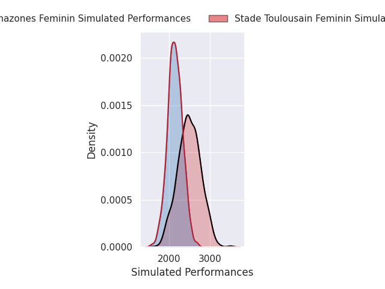
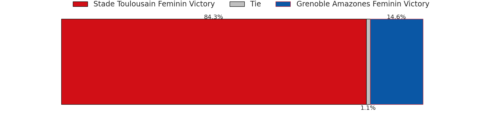

#### Bobigny Feminin V LOU Feminin on 2027/05/23

Average Margin: Bobigny Feminin by 6.7

#### Montpellier Feminin V Romagnat Feminin on 2027/05/23

Average Margin: Montpellier Feminin by 0.8

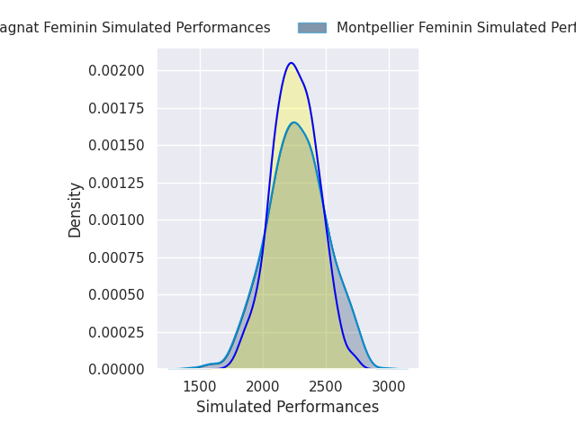

### Week 10
#### Romagnat Feminin V Bobigny Feminin on 2027/05/30

Average Margin: Romagnat Feminin by 17.7

#### Stade Bordelais Feminin V Stade Toulousain Feminin on 2027/05/30

Average Margin: Stade Bordelais Feminin by 1.9

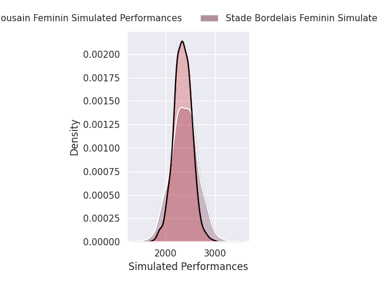

#### Montpellier Feminin V Toulon Provence Mediterranee Feminin on 2027/05/30

Average Margin: Montpellier Feminin by 6.8

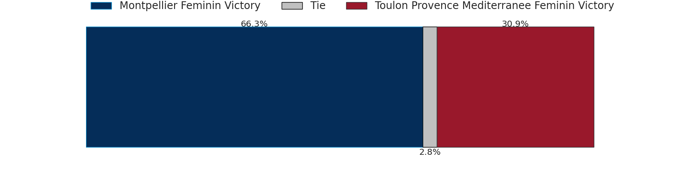

#### Grenoble Amazones Feminin V La Rochelle Feminin on 2027/05/30

Average Margin: Grenoble Amazones Feminin by 16.9

#### LOU Feminin V Blagnac Feminin on 2027/05/30

Average Margin: LOU Feminin by 2.5

### Week 11
#### La Rochelle Feminin V Stade Bordelais Feminin on 2027/06/06

Average Margin: Stade Bordelais Feminin by 10.8

#### Blagnac Feminin V Romagnat Feminin on 2027/06/06

Average Margin: Romagnat Feminin by 6.6

#### Bobigny Feminin V Montpellier Feminin on 2027/06/06

Average Margin: Montpellier Feminin by 1.2

#### Toulon Provence Mediterranee Feminin V Grenoble Amazones Feminin on 2027/06/06

Average Margin: Toulon Provence Mediterranee Feminin by 7.0

#### Stade Toulousain Feminin V LOU Feminin on 2027/06/06

Average Margin: Stade Toulousain Feminin by 25.3

