## Team Rankings

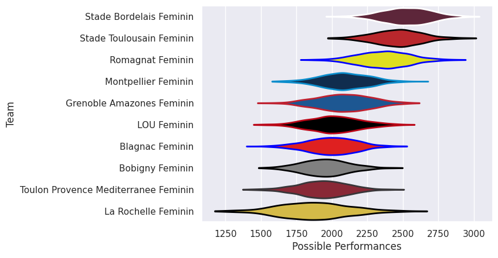
## Standings
### Projected Remaining Table

| Club                                 |   To Play |   Projected Wins |   Projected Differential |   Projected Losing Bonus Points | Projected Try Bonus Points   |   Projected Competition Points |
|:-------------------------------------|----------:|-----------------:|-------------------------:|--------------------------------:|:-----------------------------|-------------------------------:|
| Stade Toulousain Feminin             |        11 |            8.355 |                  150.022 |                           1.024 |                              |                         34.728 |
| Romagnat Feminin                     |        11 |            7.837 |                  116.668 |                           1.187 |                              |                         32.953 |
| Stade Bordelais Feminin              |        11 |            6.961 |                   83.765 |                           1.323 |                              |                         29.601 |
| Grenoble Amazones Feminin            |        11 |            6.167 |                   38.699 |                           1.471 |                              |                         26.527 |
| Montpellier Feminin                  |        11 |            5.809 |                   21.488 |                           1.564 |                              |                         25.28  |
| Toulon Provence Mediterranee Feminin |        11 |            5.815 |                   20.22  |                           1.52  |                              |                         25.196 |
| Blagnac Feminin                      |        11 |            3.683 |                  -78.889 |                           1.596 |                              |                         16.728 |
| Bobigny Feminin                      |        11 |            3.548 |                  -83.572 |                           1.571 |                              |                         16.259 |
| LOU Feminin                          |        11 |            3.363 |                  -99.344 |                           1.531 |                              |                         15.391 |
| La Rochelle Feminin                  |        11 |            2.45  |                 -169.057 |                           1.227 |                              |                         11.351 |

### Projected Total Table

| Club                                 |   Played |   Wins |   Point Differential |   Losing Bonus Points | Try Bonus Points   |   Competition Points |
|:-------------------------------------|---------:|-------:|---------------------:|----------------------:|:-------------------|---------------------:|
| Stade Toulousain Feminin             |       11 |  8.355 |              150.022 |                 1.024 |                    |               34.728 |
| Romagnat Feminin                     |       11 |  7.837 |              116.668 |                 1.187 |                    |               32.953 |
| Stade Bordelais Feminin              |       11 |  6.961 |               83.765 |                 1.323 |                    |               29.601 |
| Grenoble Amazones Feminin            |       11 |  6.167 |               38.699 |                 1.471 |                    |               26.527 |
| Montpellier Feminin                  |       11 |  5.809 |               21.488 |                 1.564 |                    |               25.28  |
| Toulon Provence Mediterranee Feminin |       11 |  5.815 |               20.22  |                 1.52  |                    |               25.196 |
| Blagnac Feminin                      |       11 |  3.683 |              -78.889 |                 1.596 |                    |               16.728 |
| Bobigny Feminin                      |       11 |  3.548 |              -83.572 |                 1.571 |                    |               16.259 |
| LOU Feminin                          |       11 |  3.363 |              -99.344 |                 1.531 |                    |               15.391 |
| La Rochelle Feminin                  |       11 |  2.45  |             -169.057 |                 1.227 |                    |               11.351 |

## Future Predictions
### Week 1
#### Blagnac Feminin V LOU Feminin on 2027/01/17

Average Margin: Blagnac Feminin by 7.6

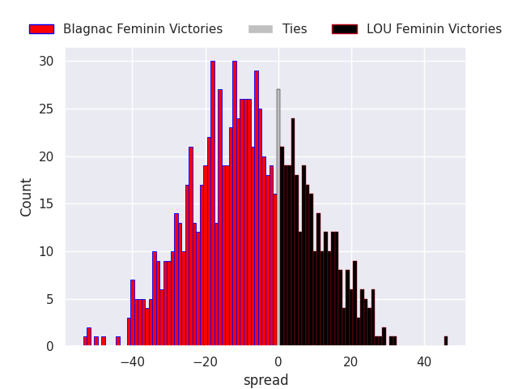

#### La Rochelle Feminin V Grenoble Amazones Feminin on 2027/01/17

Average Margin: Grenoble Amazones Feminin by 13.4

#### Stade Toulousain Feminin V Stade Bordelais Feminin on 2027/01/17

Average Margin: Stade Toulousain Feminin by 13.6

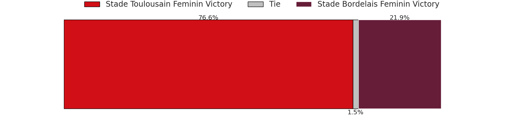
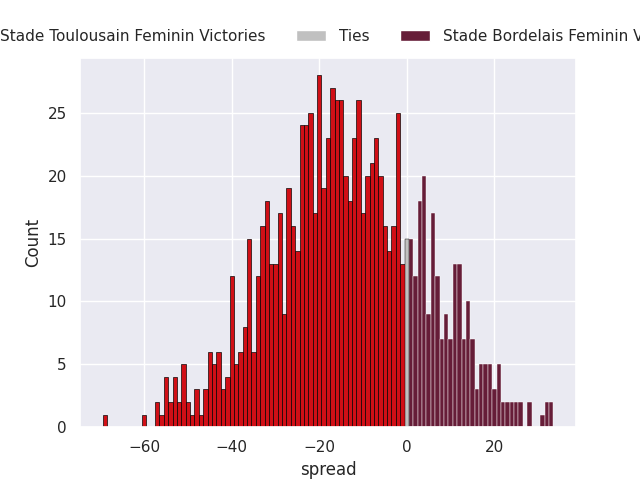

#### Bobigny Feminin V Romagnat Feminin on 2027/01/17

Average Margin: Romagnat Feminin by 12.2

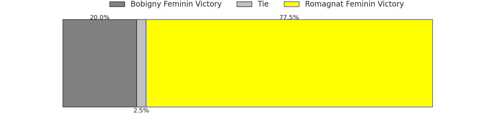

#### Toulon Provence Mediterranee Feminin V Montpellier Feminin on 2027/01/17

Average Margin: Toulon Provence Mediterranee Feminin by 8.6

### Week 2
#### Romagnat Feminin V Blagnac Feminin on 2027/01/24

Average Margin: Romagnat Feminin by 20.8

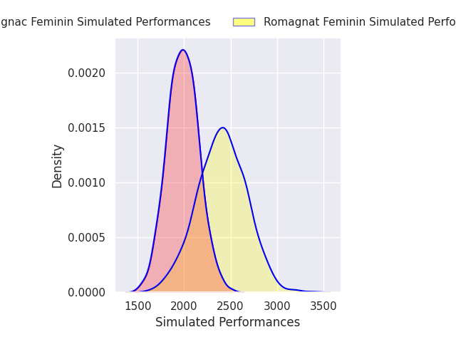

#### Grenoble Amazones Feminin V Toulon Provence Mediterranee Feminin on 2027/01/24

Average Margin: Grenoble Amazones Feminin by 6.6

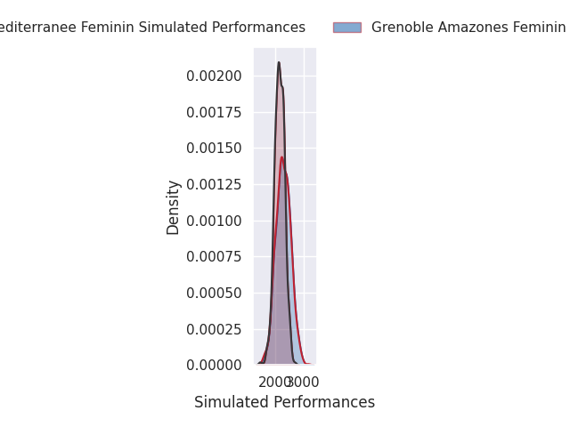

#### Stade Bordelais Feminin V La Rochelle Feminin on 2027/01/24

Average Margin: Stade Bordelais Feminin by 30.8

#### LOU Feminin V Stade Toulousain Feminin on 2027/01/24

Average Margin: Stade Toulousain Feminin by 19.2

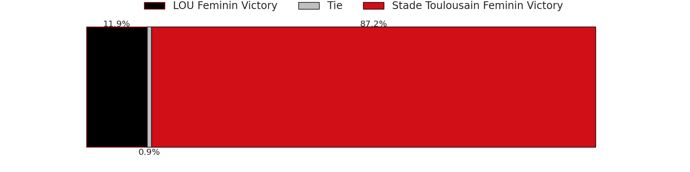

#### Montpellier Feminin V Bobigny Feminin on 2027/01/24

Average Margin: Montpellier Feminin by 15.2

### Week 3
#### LOU Feminin V La Rochelle Feminin on 2027/02/21

Average Margin: LOU Feminin by 10.5

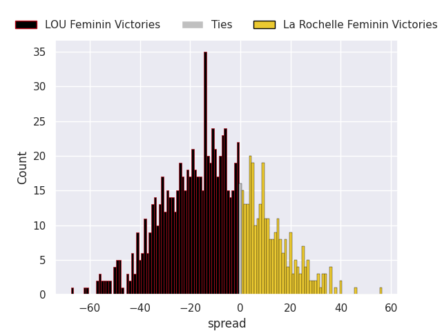

#### Romagnat Feminin V Stade Toulousain Feminin on 2027/02/21

Average Margin: Romagnat Feminin by 0.8

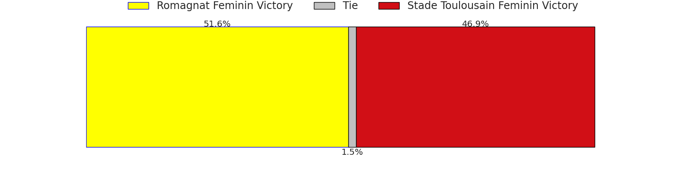

#### Bobigny Feminin V Toulon Provence Mediterranee Feminin on 2027/02/21

Average Margin: Toulon Provence Mediterranee Feminin by 3.1

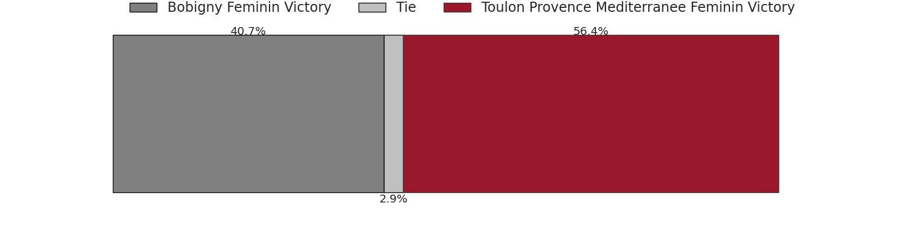

#### Montpellier Feminin V Blagnac Feminin on 2027/02/21

Average Margin: Montpellier Feminin by 13.0

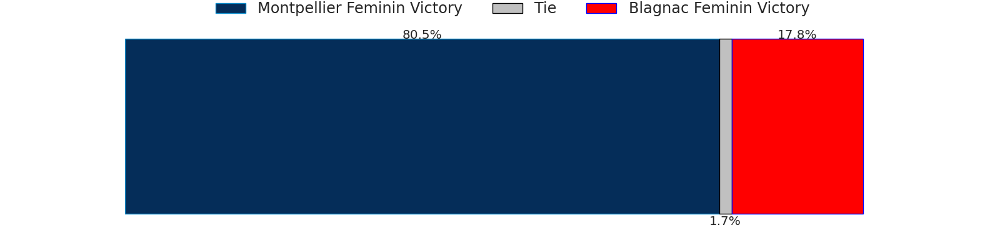

#### Grenoble Amazones Feminin V Stade Bordelais Feminin on 2027/02/21

Average Margin: Stade Bordelais Feminin by 0.5

### Week 4
#### Stade Toulousain Feminin V Montpellier Feminin on 2027/02/28

Average Margin: Stade Toulousain Feminin by 19.7

#### Grenoble Amazones Feminin V LOU Feminin on 2027/02/28

Average Margin: Grenoble Amazones Feminin by 16.0

#### Blagnac Feminin V Bobigny Feminin on 2027/02/28

Average Margin: Blagnac Feminin by 5.8

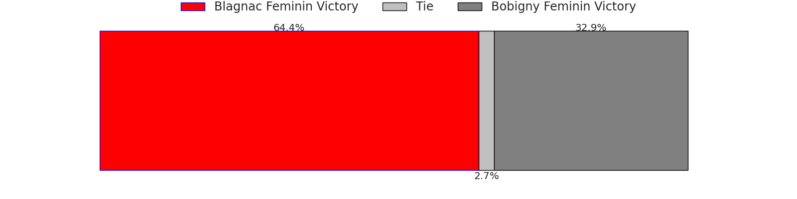
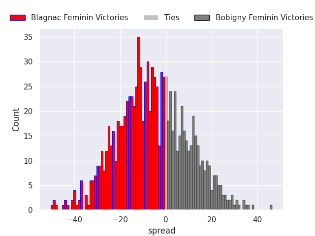

#### Stade Bordelais Feminin V Toulon Provence Mediterranee Feminin on 2027/02/28

Average Margin: Stade Bordelais Feminin by 12.8

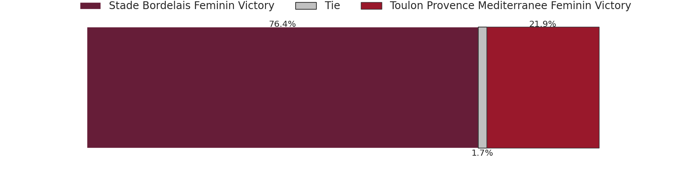

#### La Rochelle Feminin V Romagnat Feminin on 2027/02/28

Average Margin: Romagnat Feminin by 16.8

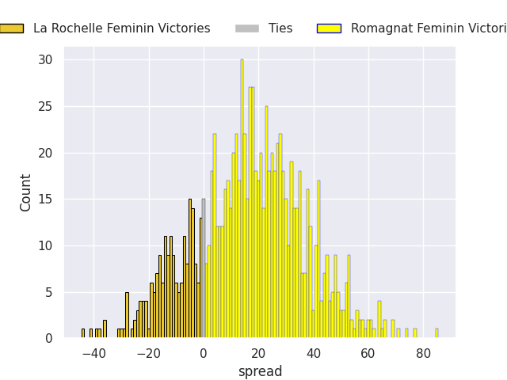

### Week 5
#### Bobigny Feminin V Stade Toulousain Feminin on 2027/03/07

Average Margin: Stade Toulousain Feminin by 13.8

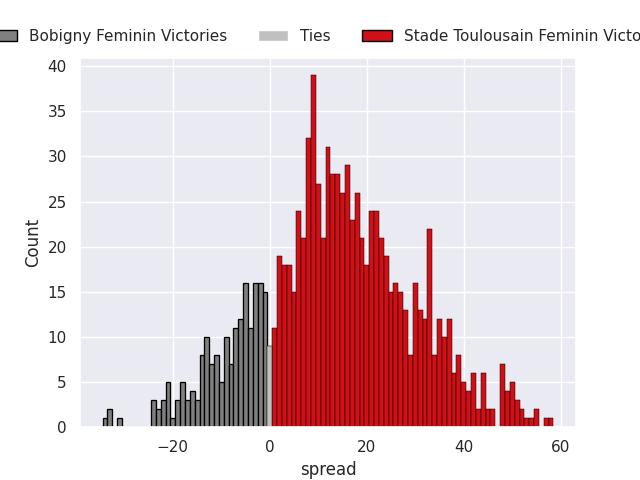

#### LOU Feminin V Stade Bordelais Feminin on 2027/03/07

Average Margin: Stade Bordelais Feminin by 10.3

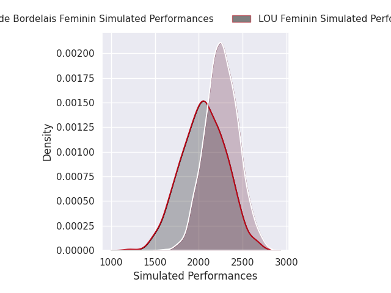

#### Romagnat Feminin V Grenoble Amazones Feminin on 2027/03/07

Average Margin: Romagnat Feminin by 11.7

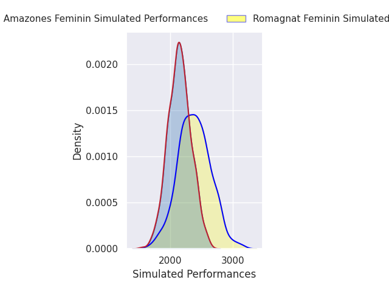

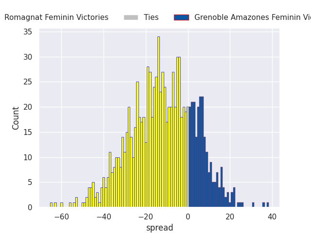

#### Montpellier Feminin V La Rochelle Feminin on 2027/03/07

Average Margin: Montpellier Feminin by 19.4

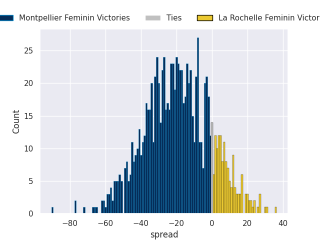

#### Toulon Provence Mediterranee Feminin V Blagnac Feminin on 2027/03/07

Average Margin: Toulon Provence Mediterranee Feminin by 15.9

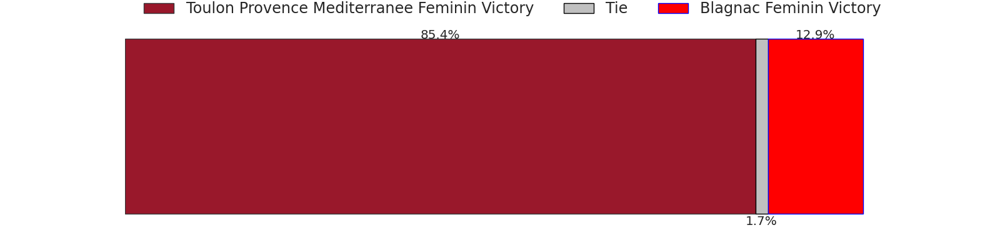
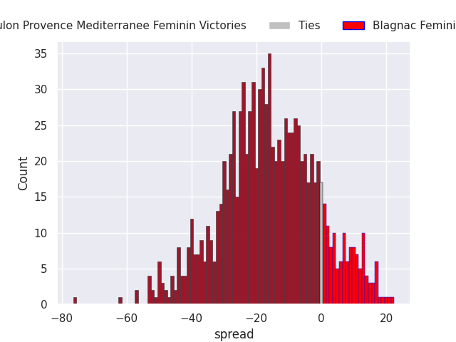

### Week 6
#### LOU Feminin V Toulon Provence Mediterranee Feminin on 2027/03/21

Average Margin: Toulon Provence Mediterranee Feminin by 4.8

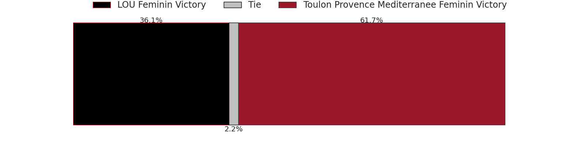
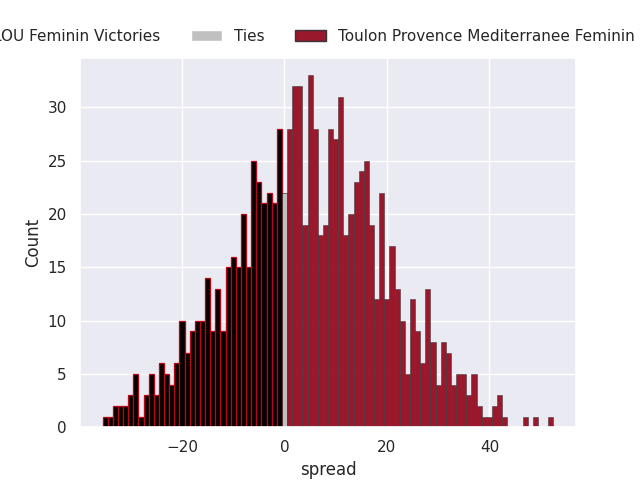

#### Stade Toulousain Feminin V Blagnac Feminin on 2027/03/21

Average Margin: Stade Toulousain Feminin by 24.3

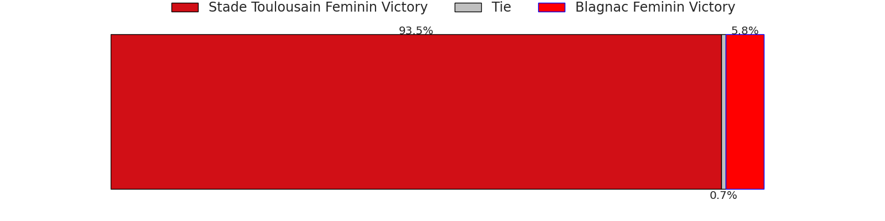

#### Grenoble Amazones Feminin V Montpellier Feminin on 2027/03/21

Average Margin: Grenoble Amazones Feminin by 6.1

#### Stade Bordelais Feminin V Romagnat Feminin on 2027/03/21

Average Margin: Stade Bordelais Feminin by 5.6

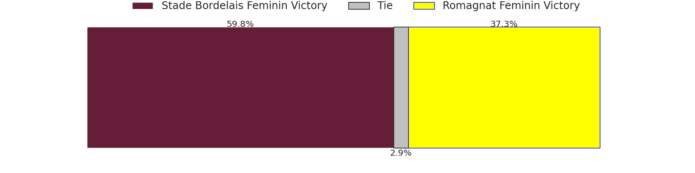

#### La Rochelle Feminin V Bobigny Feminin on 2027/03/21

Average Margin: Bobigny Feminin by 0.8

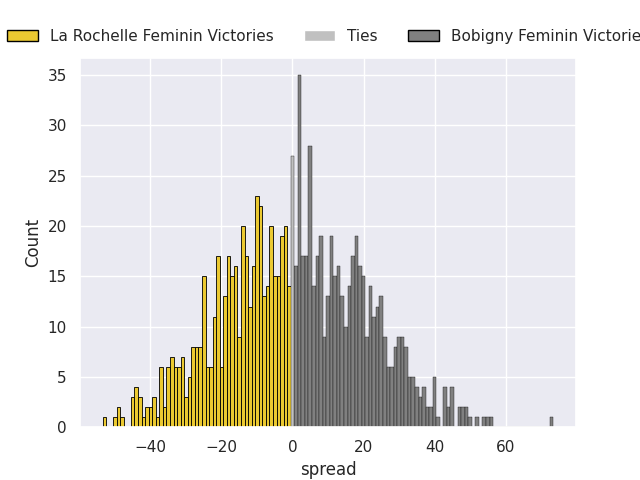

### Week 7
#### Montpellier Feminin V Stade Bordelais Feminin on 2027/03/28

Average Margin: Stade Bordelais Feminin by 0.2

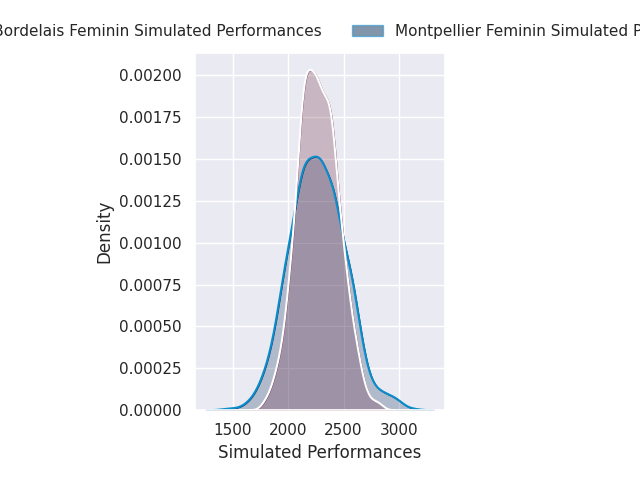

#### Toulon Provence Mediterranee Feminin V Stade Toulousain Feminin on 2027/03/28

Average Margin: Stade Toulousain Feminin by 2.4

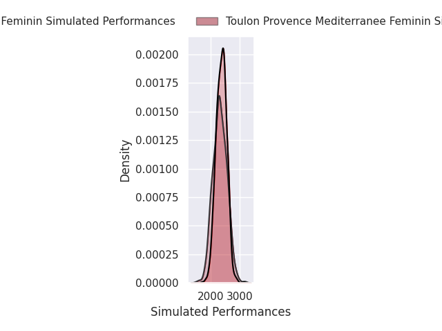
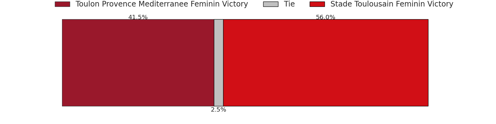
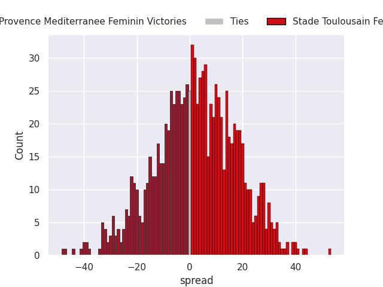

#### Blagnac Feminin V La Rochelle Feminin on 2027/03/28

Average Margin: Blagnac Feminin by 11.0

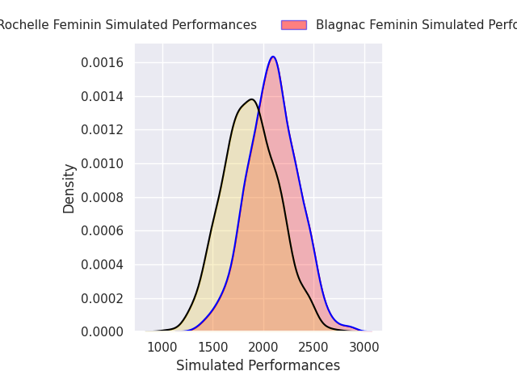

#### Romagnat Feminin V LOU Feminin on 2027/03/28

Average Margin: Romagnat Feminin by 21.9

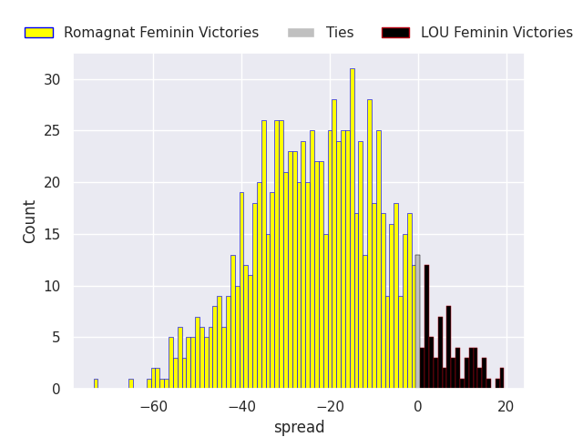

#### Bobigny Feminin V Grenoble Amazones Feminin on 2027/03/28

Average Margin: Grenoble Amazones Feminin by 3.3

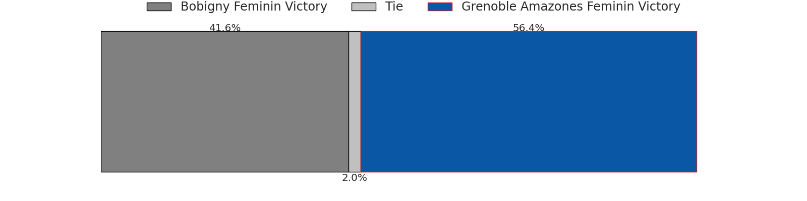

### Week 8
#### Romagnat Feminin V Toulon Provence Mediterranee Feminin on 2027/04/25

Average Margin: Romagnat Feminin by 12.6

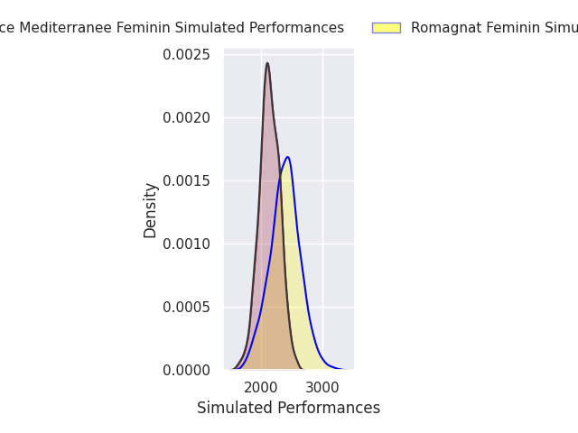
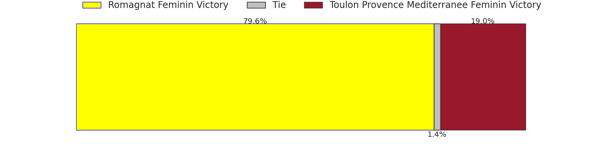

#### La Rochelle Feminin V Stade Toulousain Feminin on 2027/04/25

Average Margin: Stade Toulousain Feminin by 17.5

#### Stade Bordelais Feminin V Bobigny Feminin on 2027/04/25

Average Margin: Stade Bordelais Feminin by 18.7

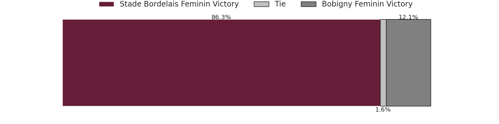

#### Grenoble Amazones Feminin V Blagnac Feminin on 2027/04/25

Average Margin: Grenoble Amazones Feminin by 12.4

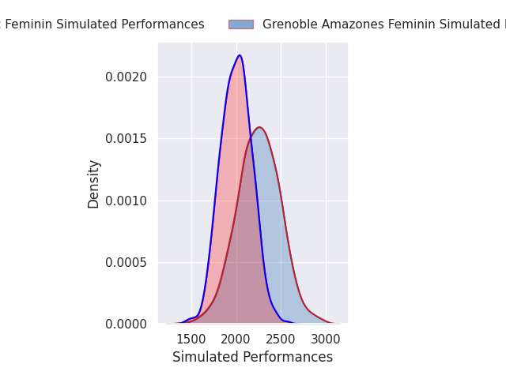
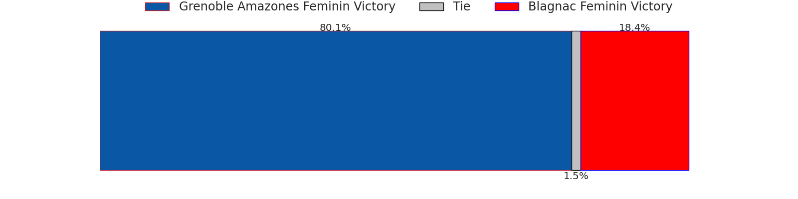

#### LOU Feminin V Montpellier Feminin on 2027/04/25

Average Margin: Montpellier Feminin by 2.4

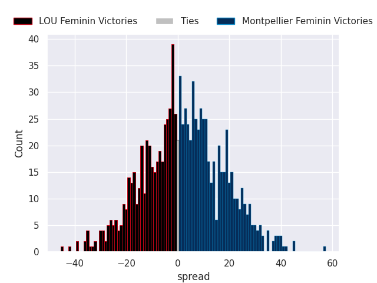

### Week 9
#### Toulon Provence Mediterranee Feminin V La Rochelle Feminin on 2027/05/23

Average Margin: Toulon Provence Mediterranee Feminin by 20.1

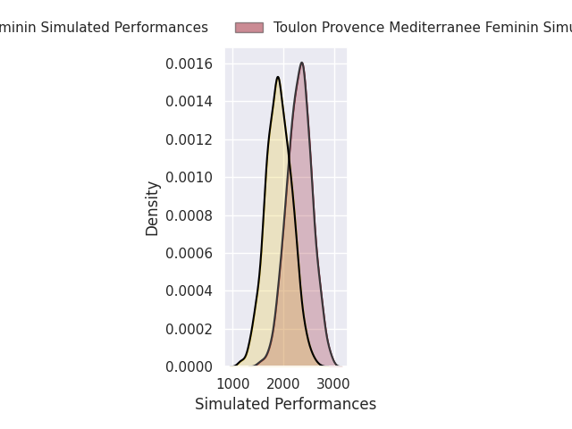

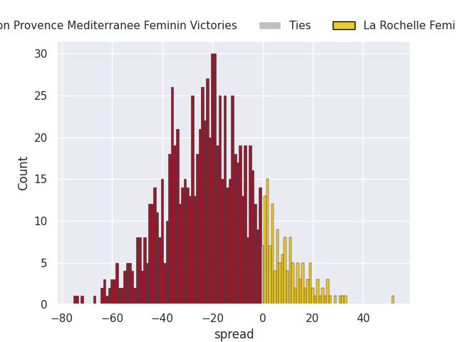

#### Blagnac Feminin V Stade Bordelais Feminin on 2027/05/23

Average Margin: Stade Bordelais Feminin by 6.5

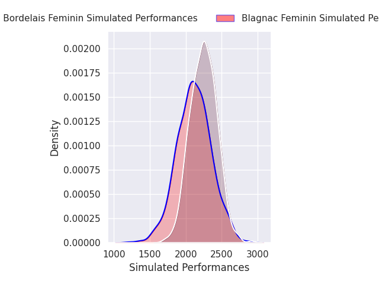

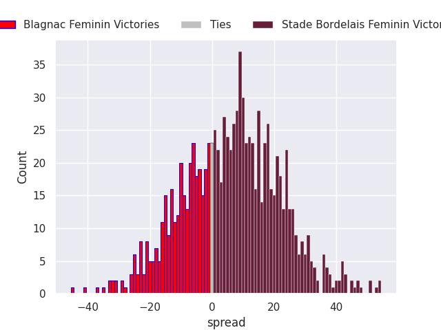

#### Stade Toulousain Feminin V Grenoble Amazones Feminin on 2027/05/23

Average Margin: Stade Toulousain Feminin by 16.9

#### Bobigny Feminin V LOU Feminin on 2027/05/23

Average Margin: Bobigny Feminin by 6.5

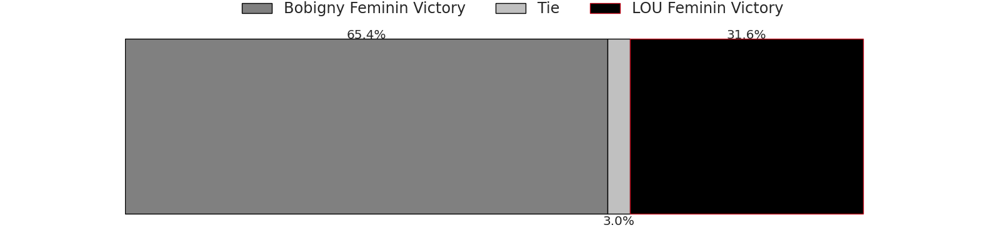

#### Montpellier Feminin V Romagnat Feminin on 2027/05/23

Average Margin: Montpellier Feminin by 0.1

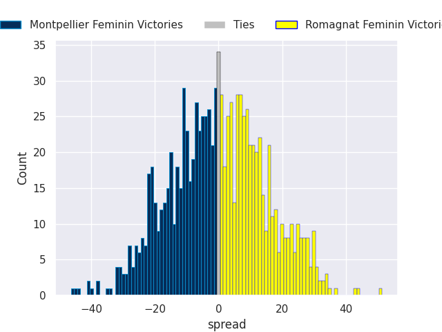

### Week 10
#### Romagnat Feminin V Bobigny Feminin on 2027/05/30

Average Margin: Romagnat Feminin by 18.6

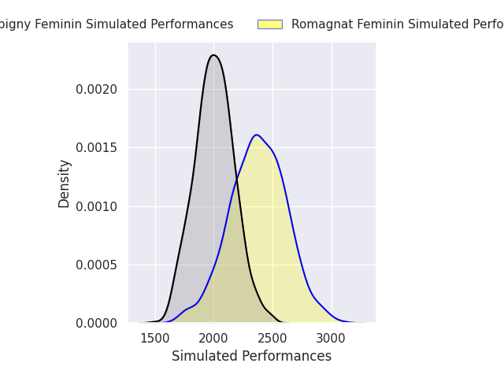
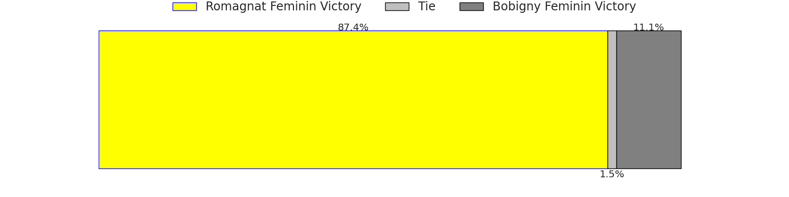
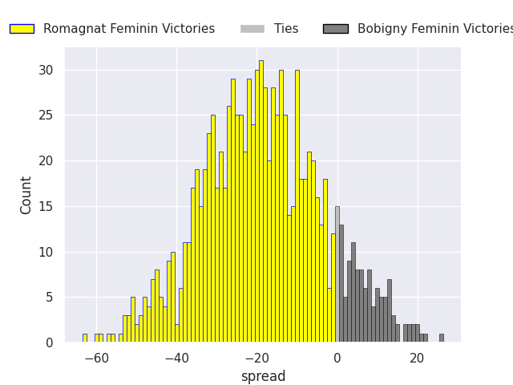

#### Stade Bordelais Feminin V Stade Toulousain Feminin on 2027/05/30

Average Margin: Stade Bordelais Feminin by 1.2

#### Montpellier Feminin V Toulon Provence Mediterranee Feminin on 2027/05/30

Average Margin: Montpellier Feminin by 5.7

#### Grenoble Amazones Feminin V La Rochelle Feminin on 2027/05/30

Average Margin: Grenoble Amazones Feminin by 18.0

#### LOU Feminin V Blagnac Feminin on 2027/05/30

Average Margin: LOU Feminin by 3.4

### Week 11
#### La Rochelle Feminin V Stade Bordelais Feminin on 2027/06/06

Average Margin: Stade Bordelais Feminin by 10.8

#### Blagnac Feminin V Romagnat Feminin on 2027/06/06

Average Margin: Romagnat Feminin by 6.9

#### Bobigny Feminin V Montpellier Feminin on 2027/06/06

Average Margin: Montpellier Feminin by 0.3

#### Toulon Provence Mediterranee Feminin V Grenoble Amazones Feminin on 2027/06/06

Average Margin: Toulon Provence Mediterranee Feminin by 8.0

#### Stade Toulousain Feminin V LOU Feminin on 2027/06/06

Average Margin: Stade Toulousain Feminin by 24.6

