## Team Rankings

## Standings
### Projected Remaining Table

| Club                                 |   To Play |   Projected Wins |   Projected Differential |   Projected Losing Bonus Points | Projected Try Bonus Points   |   Projected Competition Points |
|:-------------------------------------|----------:|-----------------:|-------------------------:|--------------------------------:|:-----------------------------|-------------------------------:|
| Stade Toulousain Feminin             |        11 |            8.171 |                  145.311 |                           1.048 |                              |                         34.07  |
| Romagnat Feminin                     |        11 |            8.15  |                  138.562 |                           1.057 |                              |                         34.063 |
| Stade Bordelais Feminin              |        11 |            7.163 |                   95.736 |                           1.299 |                              |                         30.341 |
| Toulon Provence Mediterranee Feminin |        11 |            6.724 |                   67.172 |                           1.405 |                              |                         28.707 |
| Montpellier Feminin                  |        11 |            6.562 |                   59.224 |                           1.497 |                              |                         28.215 |
| Grenoble Amazones Feminin            |        11 |            5.437 |                    6.342 |                           1.453 |                              |                         23.595 |
| Bobigny Feminin                      |        11 |            4.105 |                  -55.114 |                           1.622 |                              |                         18.514 |
| Blagnac Feminin                      |        11 |            3.552 |                  -89.989 |                           1.442 |                              |                         16.06  |
| LOU Feminin                          |        11 |            2.561 |                 -137.941 |                           1.429 |                              |                         12.037 |
| La Rochelle Feminin                  |        11 |            1.595 |                 -229.303 |                           1.1   |                              |                          7.75  |

### Projected Total Table

| Club                                 |   Played |   Wins |   Point Differential |   Losing Bonus Points | Try Bonus Points   |   Competition Points |
|:-------------------------------------|---------:|-------:|---------------------:|----------------------:|:-------------------|---------------------:|
| Stade Toulousain Feminin             |       11 |  8.171 |              145.311 |                 1.048 |                    |               34.07  |
| Romagnat Feminin                     |       11 |  8.15  |              138.562 |                 1.057 |                    |               34.063 |
| Stade Bordelais Feminin              |       11 |  7.163 |               95.736 |                 1.299 |                    |               30.341 |
| Toulon Provence Mediterranee Feminin |       11 |  6.724 |               67.172 |                 1.405 |                    |               28.707 |
| Montpellier Feminin                  |       11 |  6.562 |               59.224 |                 1.497 |                    |               28.215 |
| Grenoble Amazones Feminin            |       11 |  5.437 |                6.342 |                 1.453 |                    |               23.595 |
| Bobigny Feminin                      |       11 |  4.105 |              -55.114 |                 1.622 |                    |               18.514 |
| Blagnac Feminin                      |       11 |  3.552 |              -89.989 |                 1.442 |                    |               16.06  |
| LOU Feminin                          |       11 |  2.561 |             -137.941 |                 1.429 |                    |               12.037 |
| La Rochelle Feminin                  |       11 |  1.595 |             -229.303 |                 1.1   |                    |                7.75  |

## Future Predictions
### Week 1
#### Toulon Provence Mediterranee Feminin V Montpellier Feminin on 2027/01/17

Average Margin: Toulon Provence Mediterranee Feminin by 10.4

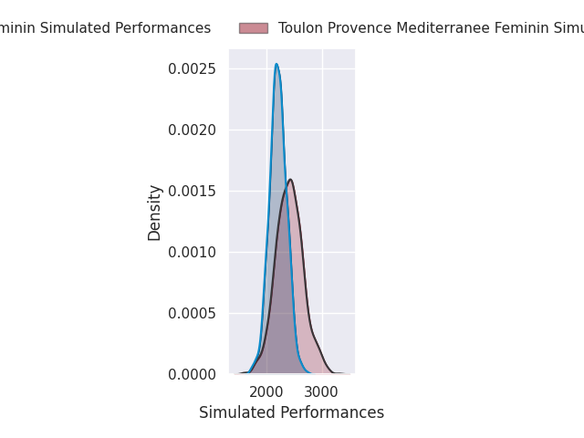
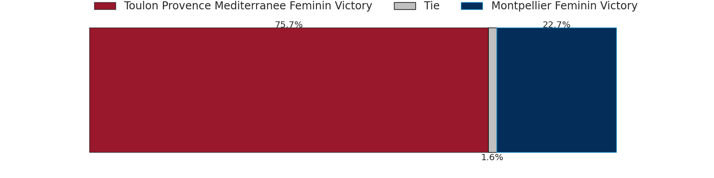

#### Bobigny Feminin V Romagnat Feminin on 2027/01/17

Average Margin: Romagnat Feminin by 11.0

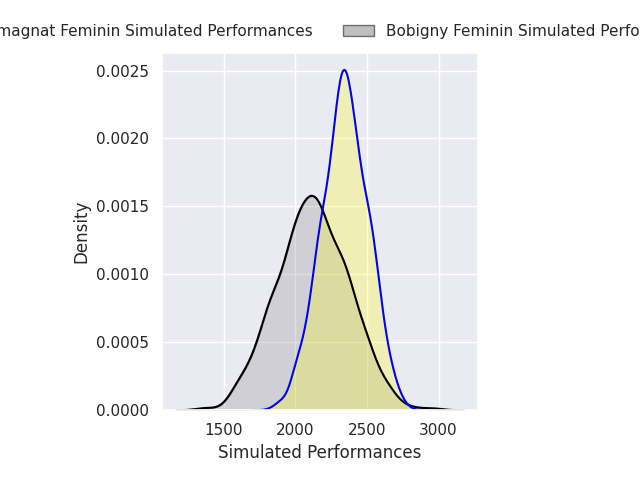

#### Stade Toulousain Feminin V Stade Bordelais Feminin on 2027/01/17

Average Margin: Stade Toulousain Feminin by 12.7

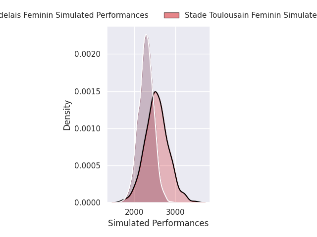

#### La Rochelle Feminin V Grenoble Amazones Feminin on 2027/01/17

Average Margin: Grenoble Amazones Feminin by 15.9

#### Blagnac Feminin V LOU Feminin on 2027/01/17

Average Margin: Blagnac Feminin by 10.4

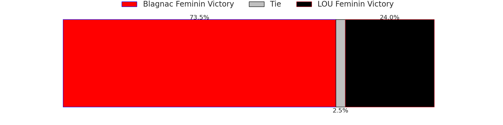

### Week 2
#### Montpellier Feminin V Bobigny Feminin on 2027/01/24

Average Margin: Montpellier Feminin by 16.5

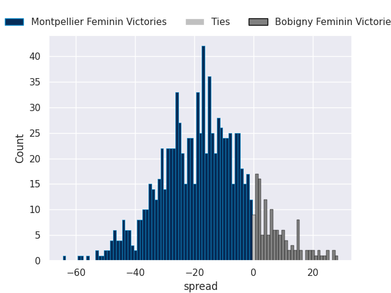

#### LOU Feminin V Stade Toulousain Feminin on 2027/01/24

Average Margin: Stade Toulousain Feminin by 21.6

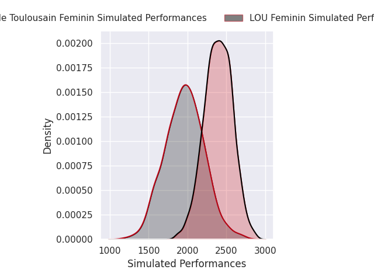

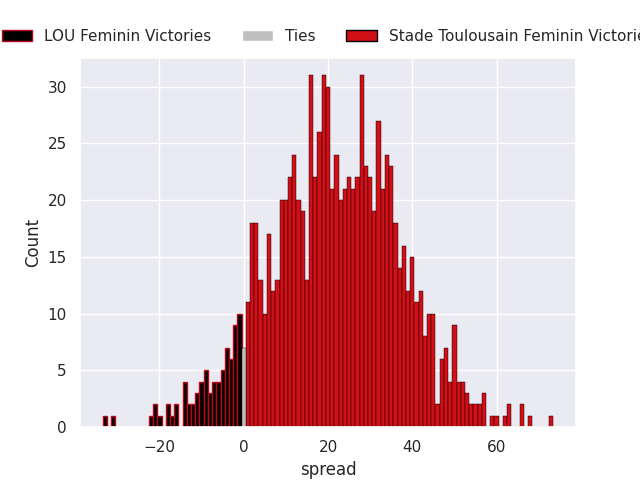

#### Romagnat Feminin V Blagnac Feminin on 2027/01/24

Average Margin: Romagnat Feminin by 24.9

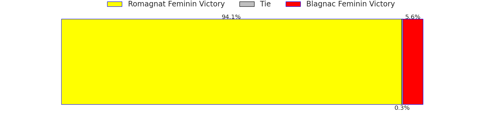
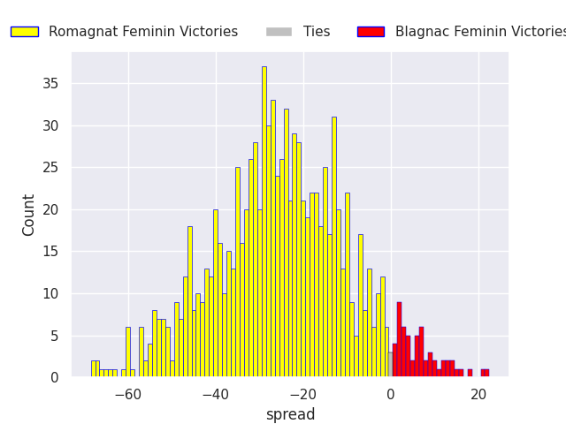

#### Stade Bordelais Feminin V La Rochelle Feminin on 2027/01/24

Average Margin: Stade Bordelais Feminin by 36.7

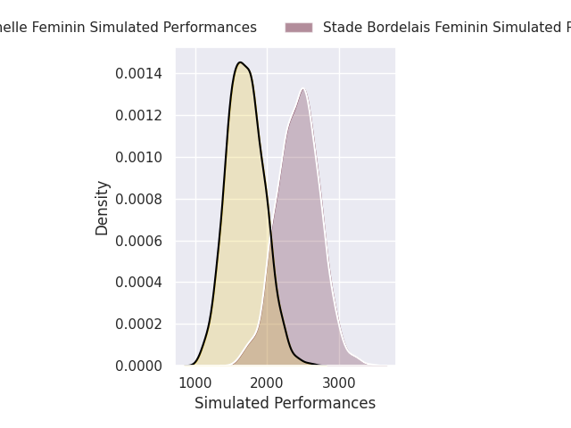
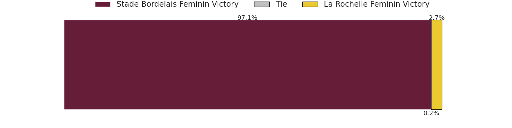

#### Grenoble Amazones Feminin V Toulon Provence Mediterranee Feminin on 2027/01/24

Average Margin: Toulon Provence Mediterranee Feminin by 0.3

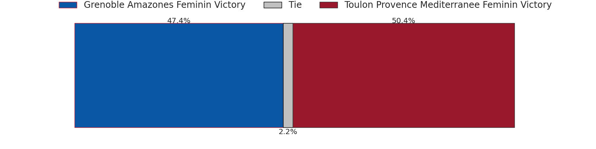
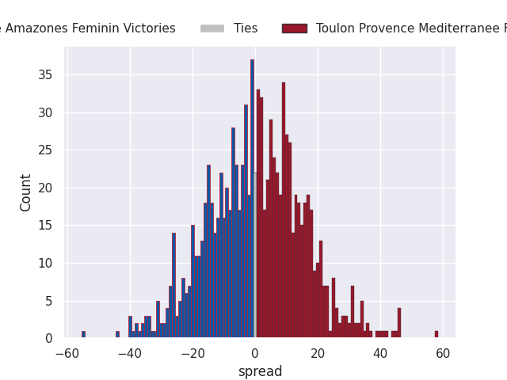

### Week 3
#### Romagnat Feminin V Stade Toulousain Feminin on 2027/02/21

Average Margin: Romagnat Feminin by 4.2

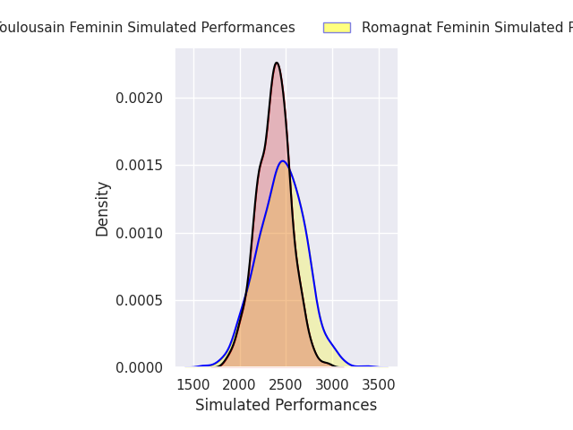

#### Montpellier Feminin V Blagnac Feminin on 2027/02/21

Average Margin: Montpellier Feminin by 18.8

#### Bobigny Feminin V Toulon Provence Mediterranee Feminin on 2027/02/21

Average Margin: Toulon Provence Mediterranee Feminin by 3.4

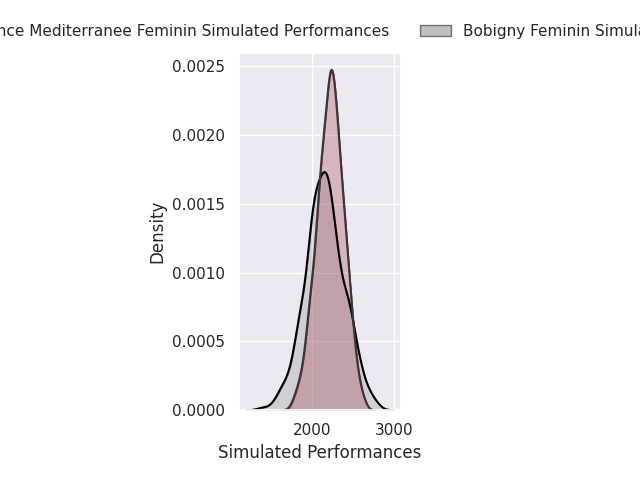

#### LOU Feminin V La Rochelle Feminin on 2027/02/21

Average Margin: LOU Feminin by 12.3

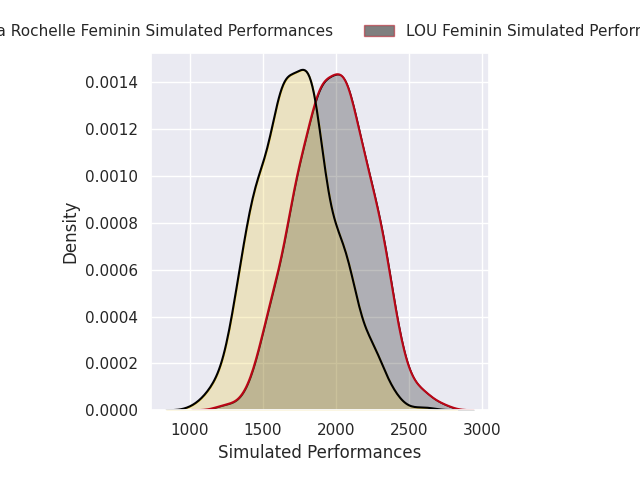

#### Grenoble Amazones Feminin V Stade Bordelais Feminin on 2027/02/21

Average Margin: Stade Bordelais Feminin by 3.3

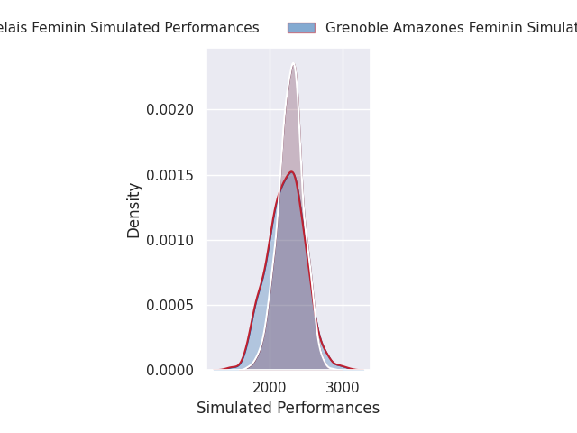
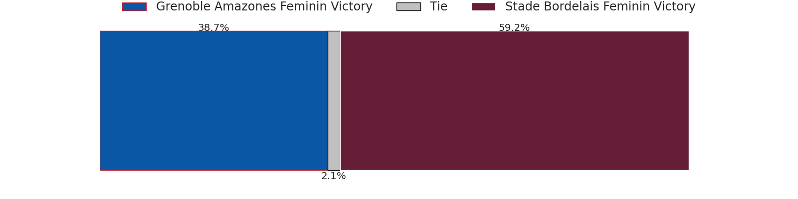

### Week 4
#### Grenoble Amazones Feminin V LOU Feminin on 2027/02/28

Average Margin: Grenoble Amazones Feminin by 16.0

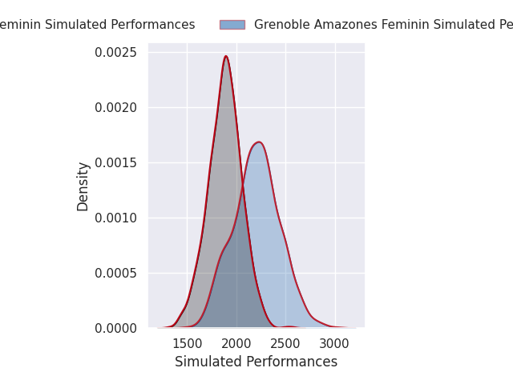

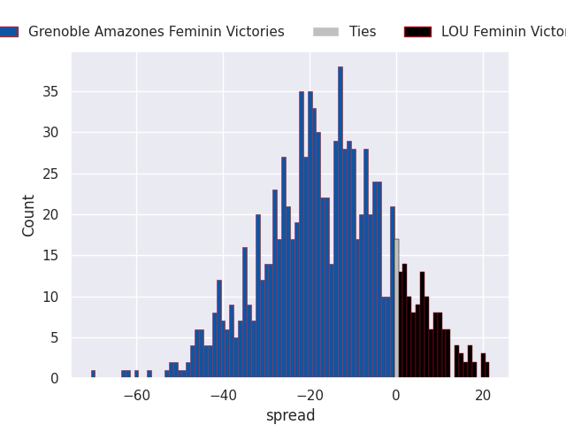

#### La Rochelle Feminin V Romagnat Feminin on 2027/02/28

Average Margin: Romagnat Feminin by 24.8

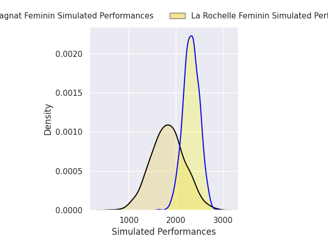

#### Stade Bordelais Feminin V Toulon Provence Mediterranee Feminin on 2027/02/28

Average Margin: Stade Bordelais Feminin by 10.3

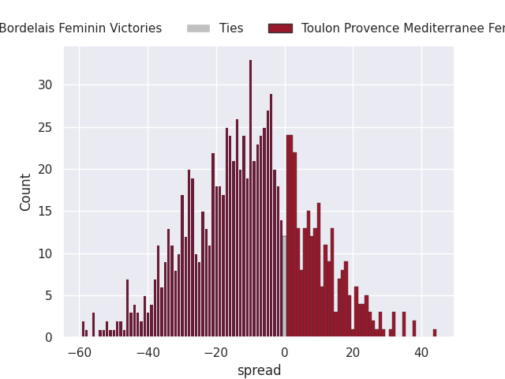

#### Blagnac Feminin V Bobigny Feminin on 2027/02/28

Average Margin: Blagnac Feminin by 1.7

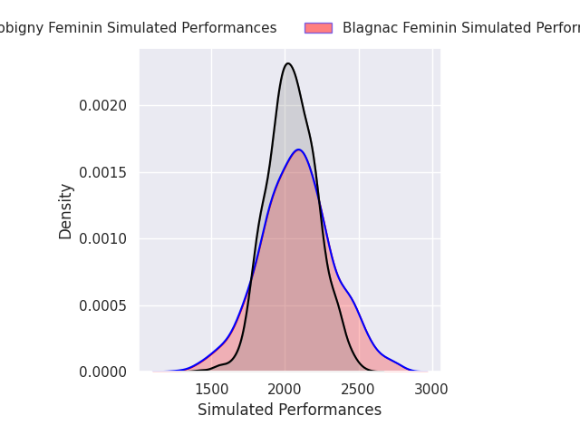

#### Stade Toulousain Feminin V Montpellier Feminin on 2027/02/28

Average Margin: Stade Toulousain Feminin by 16.2

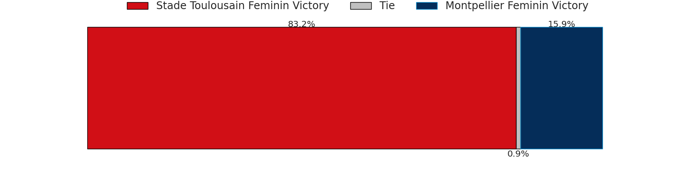

### Week 5
#### Montpellier Feminin V La Rochelle Feminin on 2027/03/07

Average Margin: Montpellier Feminin by 29.1

#### Romagnat Feminin V Grenoble Amazones Feminin on 2027/03/07

Average Margin: Romagnat Feminin by 16.3

#### Toulon Provence Mediterranee Feminin V Blagnac Feminin on 2027/03/07

Average Margin: Toulon Provence Mediterranee Feminin by 20.2

#### LOU Feminin V Stade Bordelais Feminin on 2027/03/07

Average Margin: Stade Bordelais Feminin by 14.3

#### Bobigny Feminin V Stade Toulousain Feminin on 2027/03/07

Average Margin: Stade Toulousain Feminin by 10.5

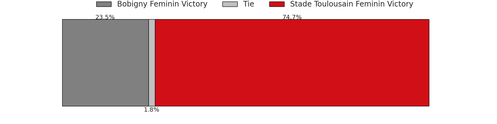

### Week 6
#### Stade Bordelais Feminin V Romagnat Feminin on 2027/03/21

Average Margin: Stade Bordelais Feminin by 4.8

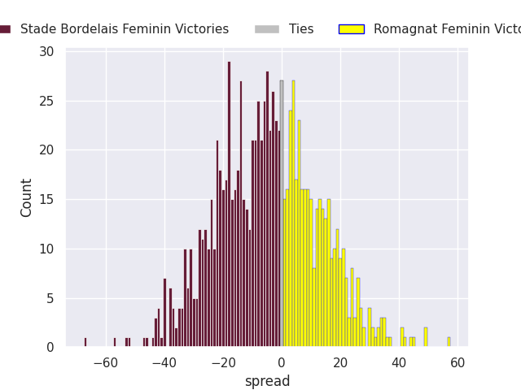

#### Grenoble Amazones Feminin V Montpellier Feminin on 2027/03/21

Average Margin: Grenoble Amazones Feminin by 0.6

#### Stade Toulousain Feminin V Blagnac Feminin on 2027/03/21

Average Margin: Stade Toulousain Feminin by 24.8

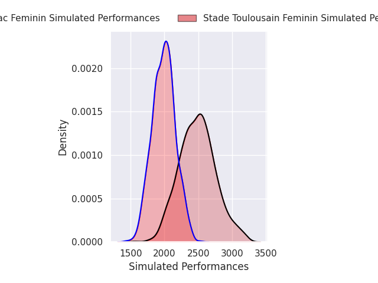

#### LOU Feminin V Toulon Provence Mediterranee Feminin on 2027/03/21

Average Margin: Toulon Provence Mediterranee Feminin by 12.1

#### La Rochelle Feminin V Bobigny Feminin on 2027/03/21

Average Margin: Bobigny Feminin by 8.7

### Week 7
#### Toulon Provence Mediterranee Feminin V Stade Toulousain Feminin on 2027/03/28

Average Margin: Toulon Provence Mediterranee Feminin by 1.8

#### Romagnat Feminin V LOU Feminin on 2027/03/28

Average Margin: Romagnat Feminin by 27.6

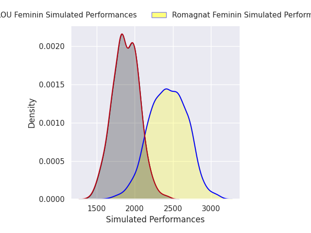

#### Bobigny Feminin V Grenoble Amazones Feminin on 2027/03/28

Average Margin: Bobigny Feminin by 3.2

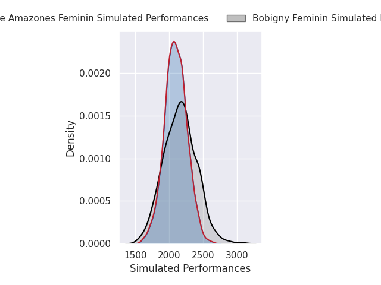

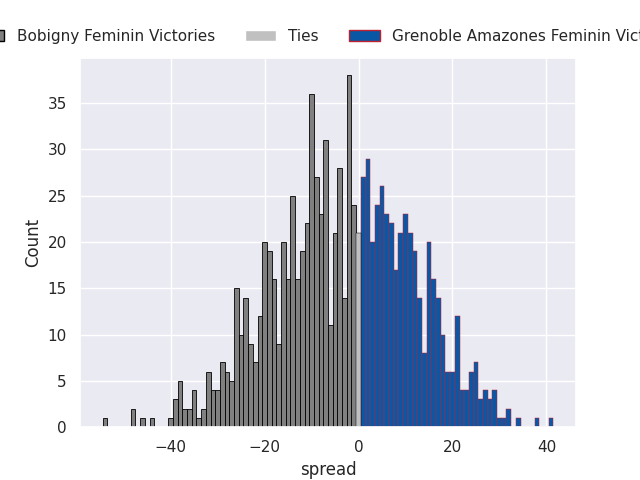

#### Blagnac Feminin V La Rochelle Feminin on 2027/03/28

Average Margin: Blagnac Feminin by 15.1

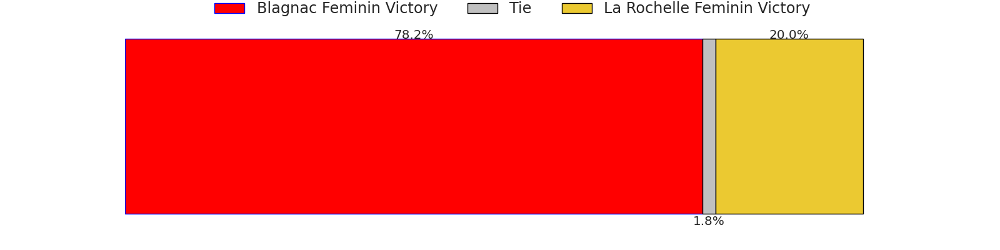

#### Montpellier Feminin V Stade Bordelais Feminin on 2027/03/28

Average Margin: Montpellier Feminin by 4.1

### Week 8
#### Stade Bordelais Feminin V Bobigny Feminin on 2027/04/25

Average Margin: Stade Bordelais Feminin by 17.2

#### La Rochelle Feminin V Stade Toulousain Feminin on 2027/04/25

Average Margin: Stade Toulousain Feminin by 21.6

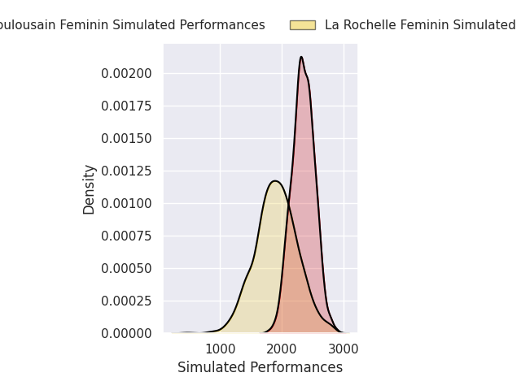

#### Romagnat Feminin V Toulon Provence Mediterranee Feminin on 2027/04/25

Average Margin: Romagnat Feminin by 10.3

#### Grenoble Amazones Feminin V Blagnac Feminin on 2027/04/25

Average Margin: Grenoble Amazones Feminin by 10.5

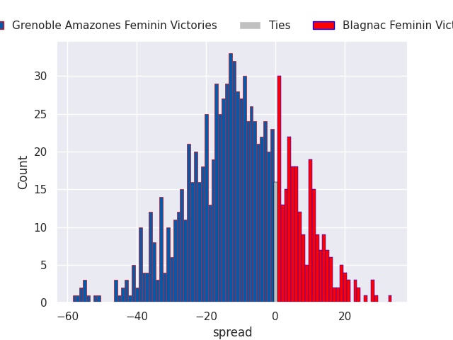

#### LOU Feminin V Montpellier Feminin on 2027/04/25

Average Margin: Montpellier Feminin by 9.0

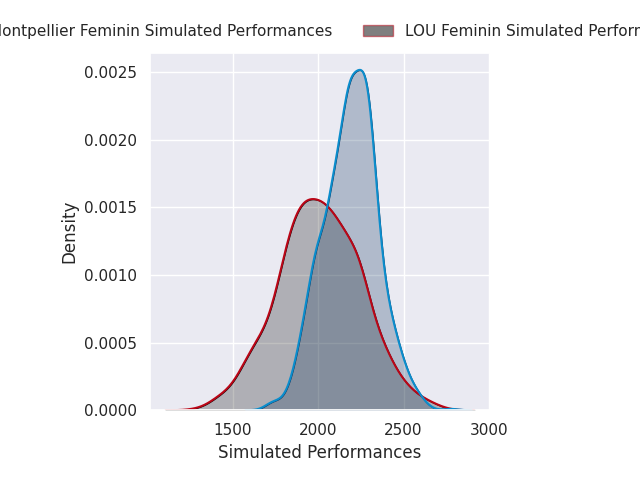

### Week 9
#### Stade Toulousain Feminin V Grenoble Amazones Feminin on 2027/05/23

Average Margin: Stade Toulousain Feminin by 18.3

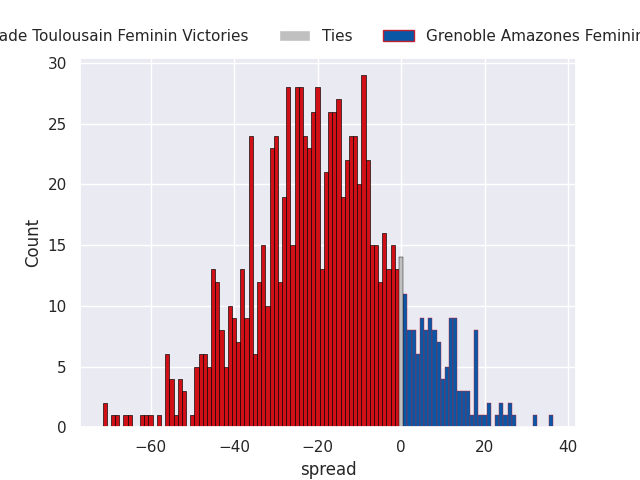

#### Bobigny Feminin V LOU Feminin on 2027/05/23

Average Margin: Bobigny Feminin by 12.0

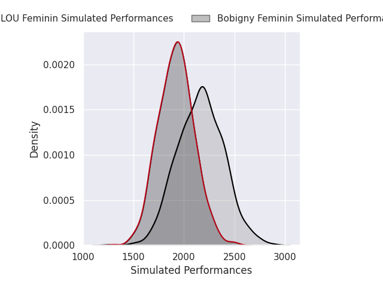

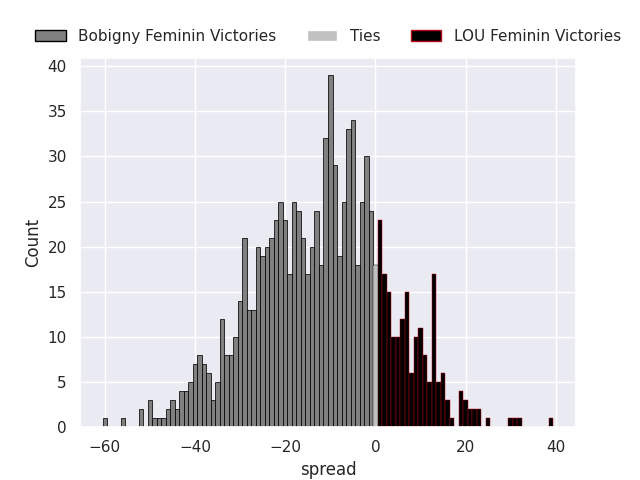

#### Montpellier Feminin V Romagnat Feminin on 2027/05/23

Average Margin: Montpellier Feminin by 2.6

#### Blagnac Feminin V Stade Bordelais Feminin on 2027/05/23

Average Margin: Stade Bordelais Feminin by 8.1

#### Toulon Provence Mediterranee Feminin V La Rochelle Feminin on 2027/05/23

Average Margin: Toulon Provence Mediterranee Feminin by 29.5

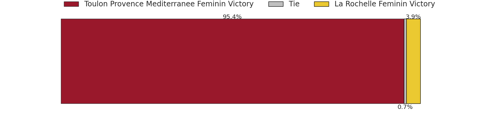

### Week 10
#### Grenoble Amazones Feminin V La Rochelle Feminin on 2027/05/30

Average Margin: Grenoble Amazones Feminin by 19.8

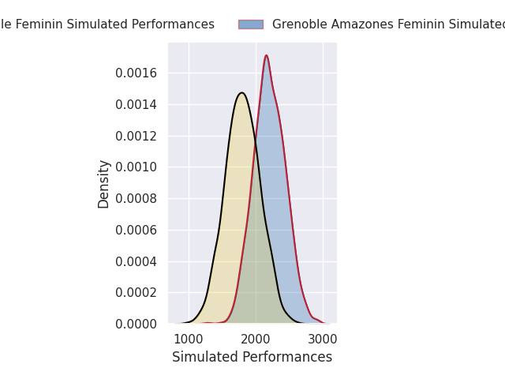
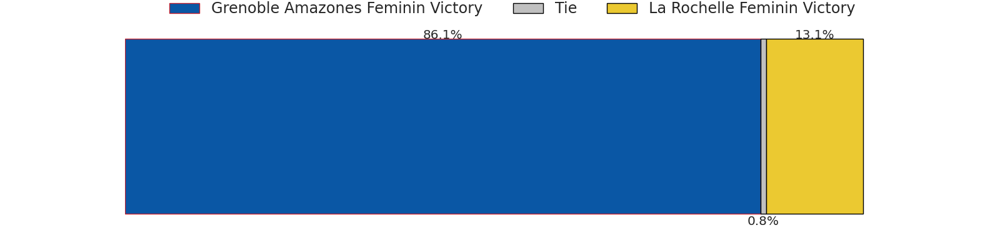

#### LOU Feminin V Blagnac Feminin on 2027/05/30

Average Margin: LOU Feminin by 0.4

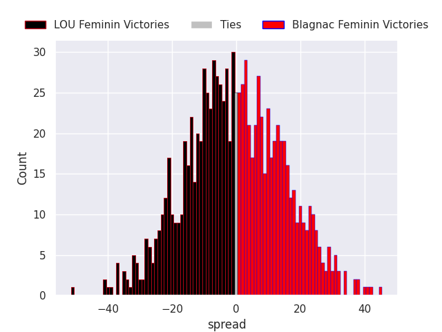

#### Stade Bordelais Feminin V Stade Toulousain Feminin on 2027/05/30

Average Margin: Stade Bordelais Feminin by 2.2

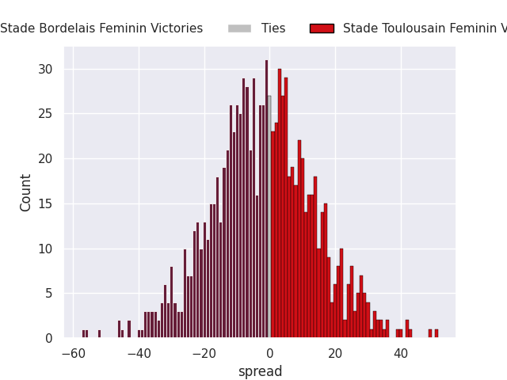

#### Romagnat Feminin V Bobigny Feminin on 2027/05/30

Average Margin: Romagnat Feminin by 17.6

#### Montpellier Feminin V Toulon Provence Mediterranee Feminin on 2027/05/30

Average Margin: Montpellier Feminin by 5.1

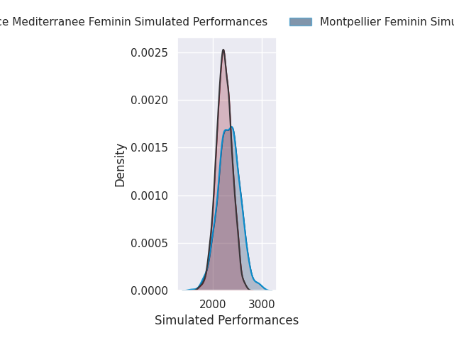

### Week 11
#### Bobigny Feminin V Montpellier Feminin on 2027/06/06

Average Margin: Montpellier Feminin by 1.1

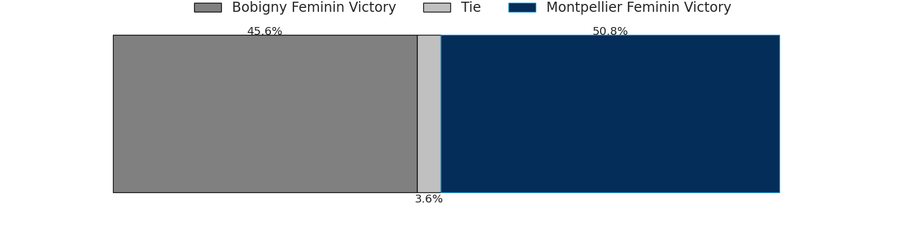
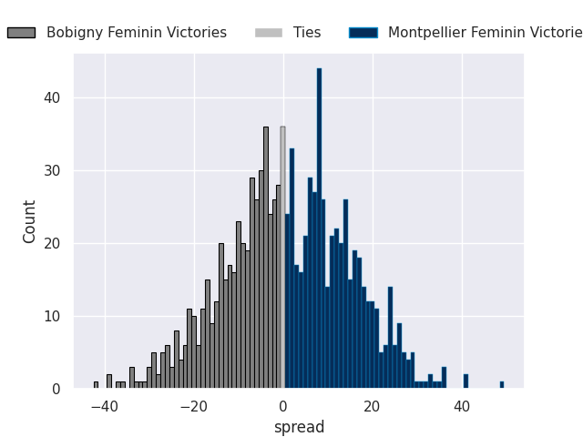

#### Blagnac Feminin V Romagnat Feminin on 2027/06/06

Average Margin: Romagnat Feminin by 9.4

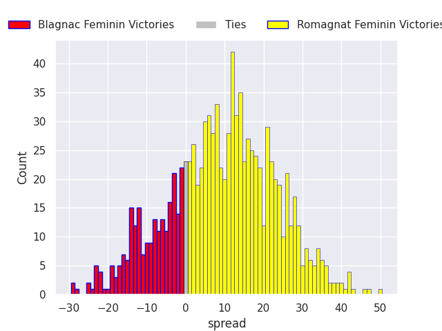

#### La Rochelle Feminin V Stade Bordelais Feminin on 2027/06/06

Average Margin: Stade Bordelais Feminin by 15.7

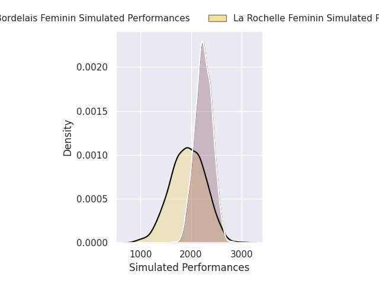

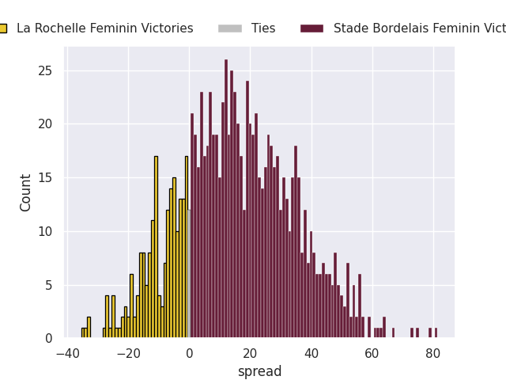

#### Stade Toulousain Feminin V LOU Feminin on 2027/06/06

Average Margin: Stade Toulousain Feminin by 27.6

#### Toulon Provence Mediterranee Feminin V Grenoble Amazones Feminin on 2027/06/06

Average Margin: Toulon Provence Mediterranee Feminin by 15.1

