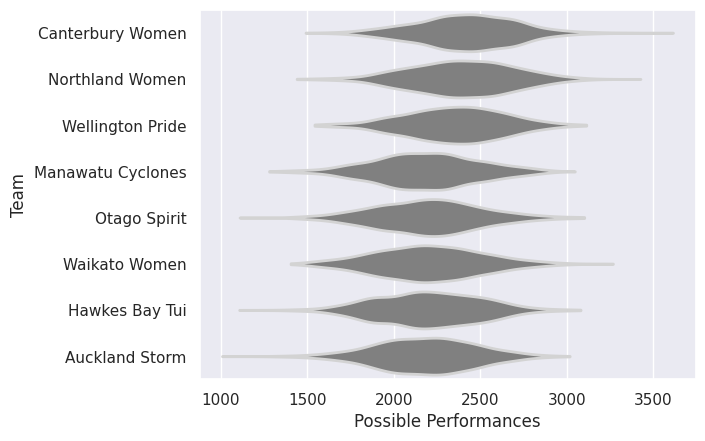

## Team Rankings

## Standings
### Current Standings

| Club              |   Played |   Wins |   Point Differential |   Losing Bonus Points | Try Bonus Points   |   Competition Points |
|:------------------|---------:|-------:|---------------------:|----------------------:|:-------------------|---------------------:|
| Canterbury Women  |        1 |      1 |                   50 |                     0 |                    |                    4 |
| Northland Women   |        1 |      1 |                   35 |                     0 |                    |                    4 |
| Wellington Pride  |        1 |      1 |                   25 |                     0 |                    |                    4 |
| Auckland Storm    |        1 |      1 |                    5 |                     0 |                    |                    4 |
| Waikato Women     |        1 |      0 |                   -5 |                     1 |                    |                    1 |
| Hawkes Bay Tui    |        1 |      0 |                  -25 |                     0 |                    |                    0 |
| Otago Spirit      |        1 |      0 |                  -35 |                     0 |                    |                    0 |
| Manawatu Cyclones |        1 |      0 |                  -50 |                     0 |                    |                    0 |

### Projected Remaining Table

| Club             |   To Play |   Projected Wins |   Projected Differential |   Projected Losing Bonus Points | Projected Try Bonus Points   |   Projected Competition Points |
|:-----------------|----------:|-----------------:|-------------------------:|--------------------------------:|:-----------------------------|-------------------------------:|
| Canterbury Women |         1 |            0.748 |                   18.487 |                           0.076 |                              |                          3.094 |
| Wellington Pride |         1 |            0.59  |                    6.284 |                           0.101 |                              |                          2.489 |
| Northland Women  |         1 |            0.396 |                   -6.284 |                           0.093 |                              |                          1.705 |
| Auckland Storm   |         1 |            0.239 |                  -18.487 |                           0.082 |                              |                          1.064 |

### Projected Total Table

| Club              |   Played |   Wins |   Point Differential |   Losing Bonus Points | Try Bonus Points   |   Competition Points |
|:------------------|---------:|-------:|---------------------:|----------------------:|:-------------------|---------------------:|
| Canterbury Women  |        2 |  1.748 |               68.487 |                 0.076 |                    |                7.094 |
| Wellington Pride  |        2 |  1.59  |               31.284 |                 0.101 |                    |                6.489 |
| Northland Women   |        2 |  1.396 |               28.716 |                 0.093 |                    |                5.705 |
| Auckland Storm    |        2 |  1.239 |              -13.487 |                 0.082 |                    |                5.064 |
| Waikato Women     |        1 |  0     |               -5     |                 1     |                    |                1     |
| Hawkes Bay Tui    |        1 |  0     |              -25     |                 0     |                    |                0     |
| Otago Spirit      |        1 |  0     |              -35     |                 0     |                    |                0     |
| Manawatu Cyclones |        1 |  0     |              -50     |                 0     |                    |                0     |

## Completed Match Review

| Model | Percent Correct Predictions | Spread Error |
| ------ | ------ | ------ |
| Club Level | 100.0% | 15.5 |
| Player Level: Lineup | nan% | nan |
| Player Level: Minutes | nan% | nan |

## Future Predictions
### Week 2
#### Wellington Pride V Northland Women on 2026/09/01

Average Margin: Wellington Pride by 6.3

### Week 3
#### Canterbury Women V Auckland Storm on 2026/10/01

Average Margin: Canterbury Women by 18.5

