## Team Rankings

## Standings
### Current Standings

| Club                |   Played |   Wins |   Point Differential |   Losing Bonus Points |   Try Bonus Points |   Competition Points |
|:--------------------|---------:|-------:|---------------------:|----------------------:|-------------------:|---------------------:|
| Gloucester Rugby    |        3 |      2 |                   62 |                     1 |                  3 |                   12 |
| Northampton Saints  |        3 |      2 |                   41 |                     0 |                  3 |                   11 |
| Leicester Tigers    |        3 |      2 |                   10 |                     1 |                  2 |                   11 |
| Bath Rugby          |        3 |      2 |                   -1 |                     0 |                  3 |                   11 |
| Saracens            |        3 |      2 |                   21 |                     1 |                  1 |                   10 |
| Bristol Rugby       |        3 |      2 |                    2 |                     0 |                  2 |                   10 |
| Sale Sharks         |        3 |      2 |                   -2 |                     0 |                    |                    8 |
| Exeter Chiefs       |        3 |      1 |                  -21 |                     1 |                  3 |                    8 |
| Newcastle Red Bulls |        3 |      0 |                  -44 |                     2 |                    |                    2 |
| Harlequins          |        3 |      0 |                  -68 |                     1 |                  1 |                    2 |

### Projected Remaining Table

| Club                |   To Play |   Projected Wins |   Projected Differential |   Projected Losing Bonus Points | Projected Try Bonus Points   |   Projected Competition Points |
|:--------------------|----------:|-----------------:|-------------------------:|--------------------------------:|:-----------------------------|-------------------------------:|
| Saracens            |        16 |           10.261 |                   63.135 |                           3.512 |                              |                         45.824 |
| Bath Rugby          |        16 |           10.143 |                   60.249 |                           3.613 |                              |                         45.561 |
| Exeter Chiefs       |        16 |            9.799 |                   52.513 |                           3.707 |                              |                         44.135 |
| Northampton Saints  |        16 |            9.036 |                   28.233 |                           4.032 |                              |                         41.642 |
| Gloucester Rugby    |        16 |            8.416 |                   16.547 |                           4.03  |                              |                         39.012 |
| Leicester Tigers    |        16 |            8.126 |                   18.809 |                           4.21  |                              |                         38.022 |
| Bristol Rugby       |        16 |            6.844 |                  -16.799 |                           4.595 |                              |                         33.313 |
| Sale Sharks         |        16 |            6.607 |                  -23.143 |                           4.676 |                              |                         32.464 |
| Harlequins          |        16 |            6.039 |                  -31.808 |                           4.99  |                              |                         30.564 |
| Newcastle Red Bulls |        16 |            1.534 |                 -167.736 |                           3.976 |                              |                         10.804 |

### Projected Total Table

| Club                |   Played |   Wins |   Point Differential |   Losing Bonus Points |   Try Bonus Points |   Competition Points |
|:--------------------|---------:|-------:|---------------------:|----------------------:|-------------------:|---------------------:|
| Bath Rugby          |       19 | 12.143 |               59.249 |                 3.613 |                  3 |               56.561 |
| Saracens            |       19 | 12.261 |               84.135 |                 4.512 |                  1 |               55.824 |
| Northampton Saints  |       19 | 11.036 |               69.233 |                 4.032 |                  3 |               52.642 |
| Exeter Chiefs       |       19 | 10.799 |               31.513 |                 4.707 |                  3 |               52.135 |
| Gloucester Rugby    |       19 | 10.416 |               78.547 |                 5.03  |                  3 |               51.012 |
| Leicester Tigers    |       19 | 10.126 |               28.809 |                 5.21  |                  2 |               49.022 |
| Bristol Rugby       |       19 |  8.844 |              -14.799 |                 4.595 |                  2 |               43.313 |
| Sale Sharks         |       19 |  8.607 |              -25.143 |                 4.676 |                    |               40.464 |
| Harlequins          |       19 |  6.039 |              -99.808 |                 5.99  |                  1 |               32.564 |
| Newcastle Red Bulls |       19 |  1.534 |             -211.736 |                 5.976 |                    |               12.804 |

## Completed Match Review

| Model | Percent Correct Predictions | Spread Error |
| ------ | ------ | ------ |
| Club Level | 80.0% | 6.3 |
| Player Level: Lineup | nan% | nan |
| Player Level: Minutes | nan% | nan |

## Future Predictions
### Week 4
#### Leicester Tigers V Gloucester Rugby on 2026/09/01

Average Margin: Leicester Tigers by 12.1

### Week 5
#### Northampton Saints V Bath Rugby on 2026/10/01

Average Margin: Northampton Saints by 2.0

#### Saracens V Bristol Rugby on 2026/10/01

Average Margin: Saracens by 10.2

### Week 6
#### Gloucester Rugby V Bath Rugby on 2026/10/23

Average Margin: Gloucester Rugby by 2.1

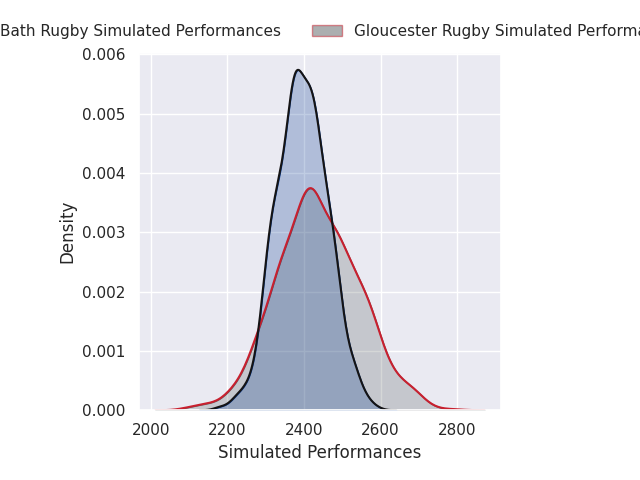

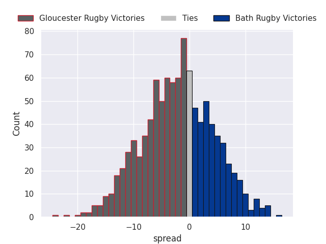

#### Newcastle Red Bulls V Sale Sharks on 2026/10/23

Average Margin: Sale Sharks by 3.6

#### Bristol Rugby V Exeter Chiefs on 2026/10/24

Average Margin: Bristol Rugby by 1.2

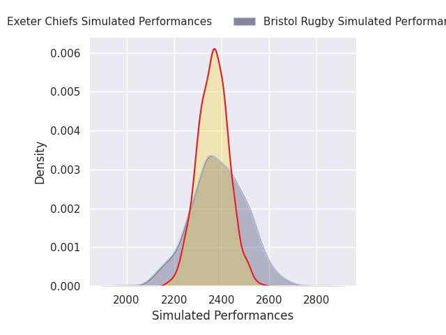

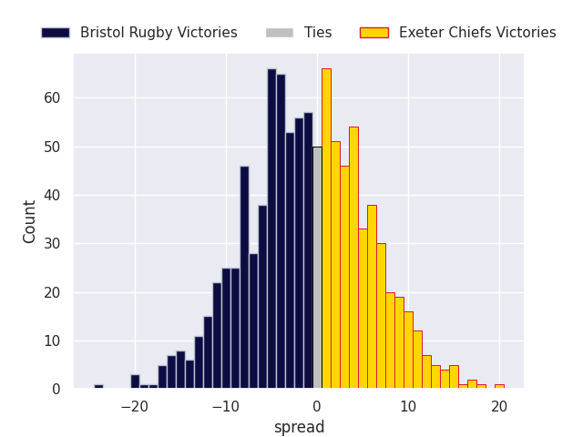

#### Leicester Tigers V Northampton Saints on 2026/10/24

Average Margin: Leicester Tigers by 3.3

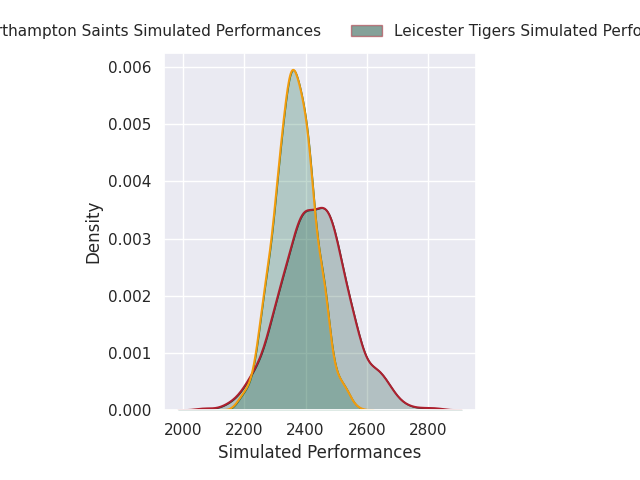

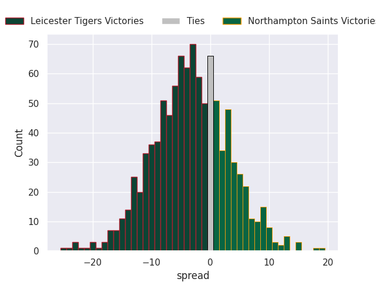

#### Harlequins V Saracens on 2026/10/25

Average Margin: Saracens by 1.5

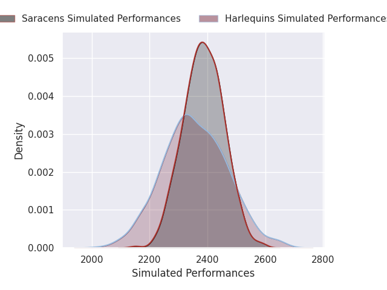

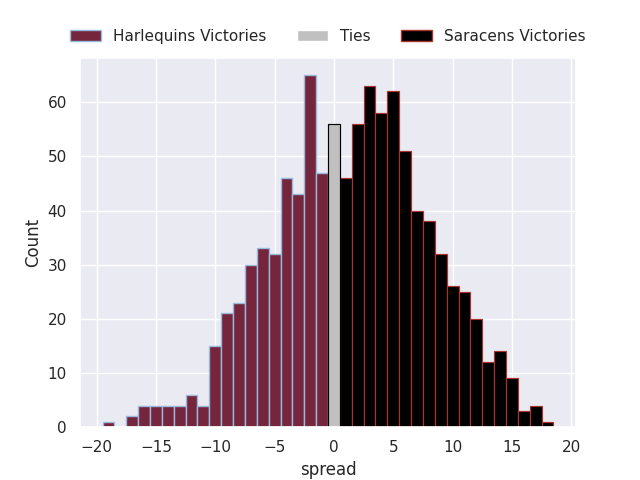

### Week 7
#### Bristol Rugby V Leicester Tigers on 2026/10/30

Average Margin: Bristol Rugby by 3.0

#### Bath Rugby V Sale Sharks on 2026/10/31

Average Margin: Bath Rugby by 9.4

#### Saracens V Newcastle Red Bulls on 2026/10/31

Average Margin: Saracens by 17.9

#### Northampton Saints V Gloucester Rugby on 2026/10/31

Average Margin: Northampton Saints by 6.1

#### Exeter Chiefs V Harlequins on 2026/10/31

Average Margin: Exeter Chiefs by 9.3

#### Exeter Chiefs V Newcastle Red Bulls on 2026/11/01

Average Margin: Exeter Chiefs by 17.6

#### Sale Sharks V Harlequins on 2026/11/01

Average Margin: Sale Sharks by 4.7

### Week 8
#### Bath Rugby V Bristol Rugby on 2026/12/04

Average Margin: Bath Rugby by 8.3

#### Saracens V Northampton Saints on 2026/12/05

Average Margin: Saracens by 6.0

#### Harlequins V Leicester Tigers on 2026/12/05

Average Margin: Harlequins by 1.1

#### Gloucester Rugby V Newcastle Red Bulls on 2026/12/05

Average Margin: Gloucester Rugby by 15.7

#### Sale Sharks V Exeter Chiefs on 2026/12/06

Average Margin: Sale Sharks by 1.2

### Week 9
#### Newcastle Red Bulls V Bath Rugby on 2026/12/18

Average Margin: Bath Rugby by 9.0

#### Leicester Tigers V Sale Sharks on 2026/12/19

Average Margin: Leicester Tigers by 8.2

#### Gloucester Rugby V Saracens on 2026/12/19

Average Margin: Gloucester Rugby by 2.9

#### Northampton Saints V Exeter Chiefs on 2026/12/19

Average Margin: Northampton Saints by 4.9

#### Bristol Rugby V Harlequins on 2026/12/20

Average Margin: Bristol Rugby by 5.2

### Week 10
#### Sale Sharks V Gloucester Rugby on 2026/12/26

Average Margin: Sale Sharks by 2.5

#### Bath Rugby V Leicester Tigers on 2026/12/26

Average Margin: Bath Rugby by 6.4

#### Bristol Rugby V Newcastle Red Bulls on 2026/12/26

Average Margin: Bristol Rugby by 12.5

#### Exeter Chiefs V Saracens on 2026/12/27

Average Margin: Exeter Chiefs by 4.4

### Week 11
#### Harlequins V Northampton Saints on 2026/12/28

Average Margin: Northampton Saints by 0.3

#### Gloucester Rugby V Bristol Rugby on 2027/01/01

Average Margin: Gloucester Rugby by 6.7

#### Newcastle Red Bulls V Harlequins on 2027/01/02

Average Margin: Harlequins by 3.6

#### Saracens V Bath Rugby on 2027/01/02

Average Margin: Saracens by 4.3

#### Leicester Tigers V Exeter Chiefs on 2027/01/02

Average Margin: Leicester Tigers by 3.3

#### Northampton Saints V Sale Sharks on 2027/01/03

Average Margin: Northampton Saints by 8.3

### Week 12
#### Sale Sharks V Leicester Tigers on 2027/01/23

Average Margin: Sale Sharks by 2.7

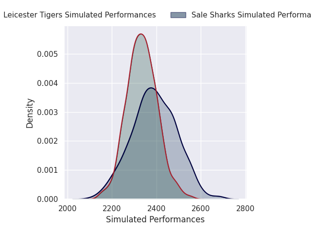

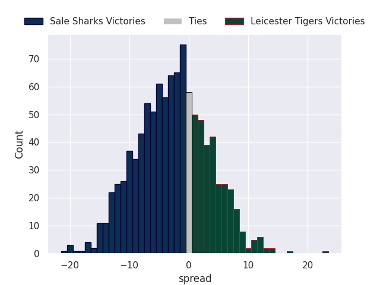

#### Newcastle Red Bulls V Saracens on 2027/01/23

Average Margin: Saracens by 8.5

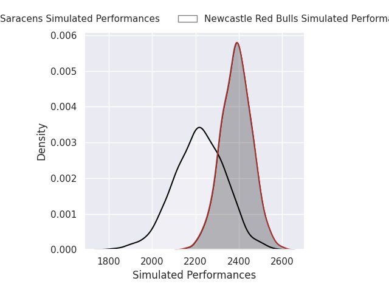
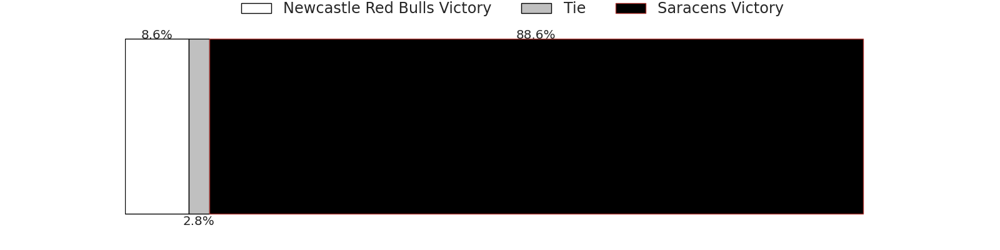
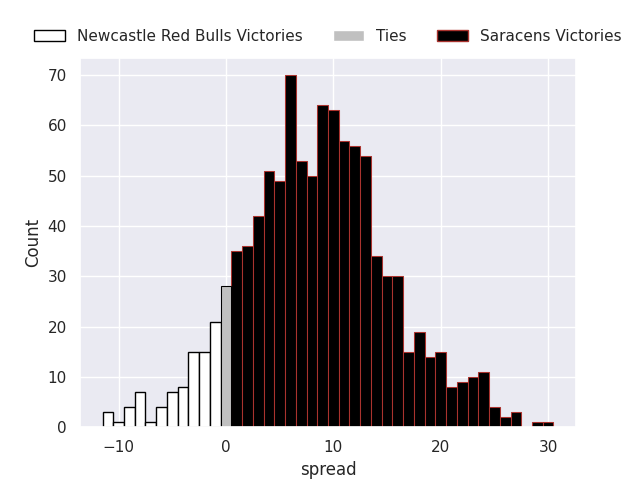

#### Bath Rugby V Northampton Saints on 2027/01/23

Average Margin: Bath Rugby by 5.1

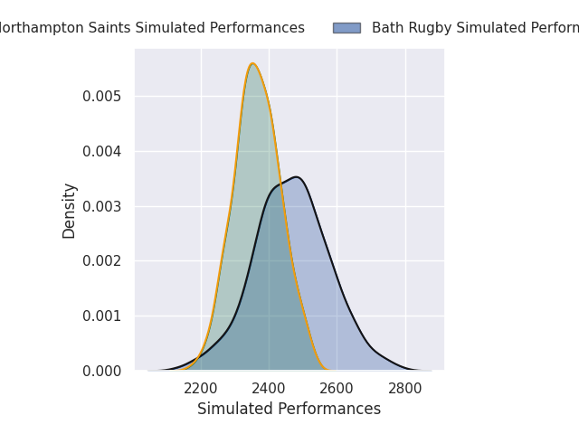

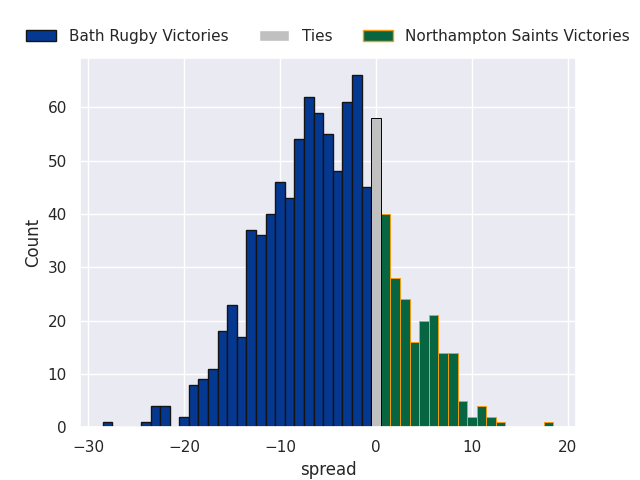

#### Exeter Chiefs V Bristol Rugby on 2027/01/23

Average Margin: Exeter Chiefs by 8.7

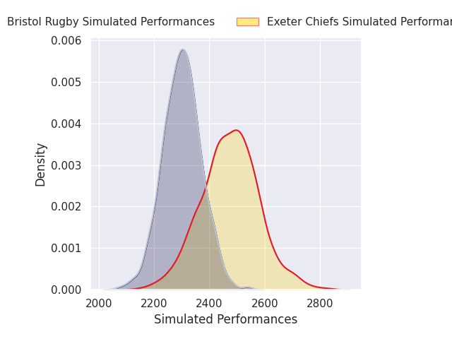
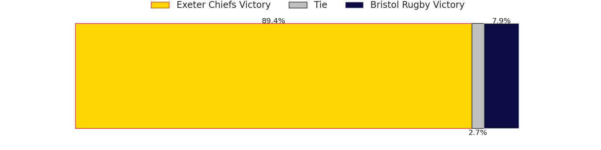
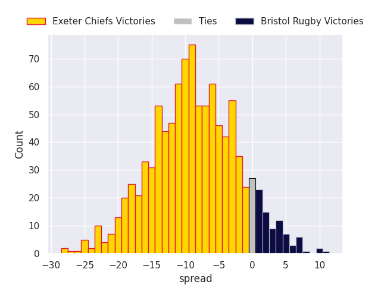

#### Harlequins V Gloucester Rugby on 2027/01/23

Average Margin: Harlequins by 0.8

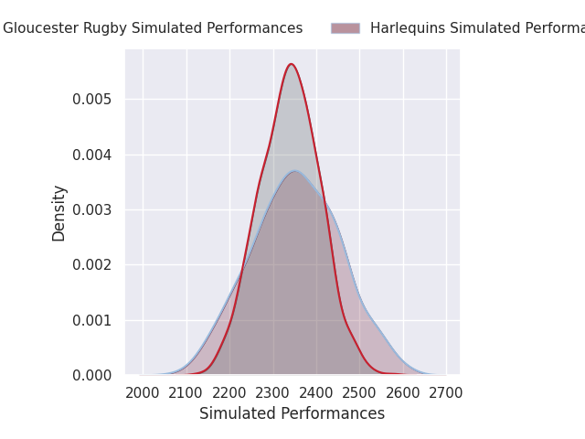

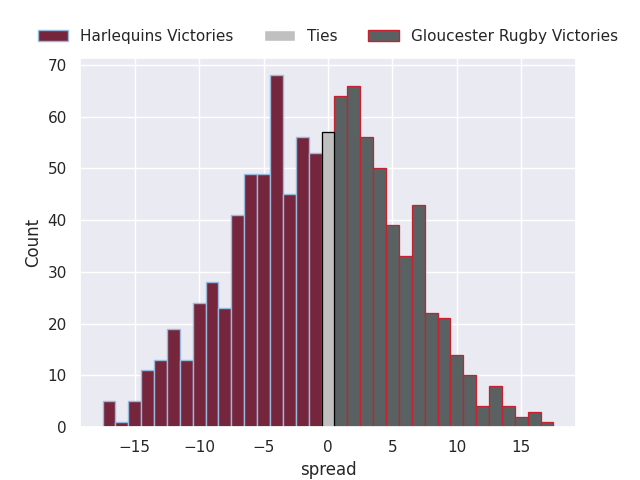

### Week 13
#### Leicester Tigers V Newcastle Red Bulls on 2027/03/20

Average Margin: Leicester Tigers by 15.1

#### Exeter Chiefs V Northampton Saints on 2027/03/20

Average Margin: Exeter Chiefs by 5.6

#### Bristol Rugby V Sale Sharks on 2027/03/20

Average Margin: Bristol Rugby by 5.1

#### Bath Rugby V Gloucester Rugby on 2027/03/20

Average Margin: Bath Rugby by 6.2

#### Saracens V Harlequins on 2027/03/20

Average Margin: Saracens by 9.4

### Week 14
#### Gloucester Rugby V Leicester Tigers on 2027/03/27

Average Margin: Gloucester Rugby by 5.5

#### Northampton Saints V Saracens on 2027/03/27

Average Margin: Northampton Saints by 3.6

#### Newcastle Red Bulls V Bristol Rugby on 2027/03/27

Average Margin: Bristol Rugby by 4.3

#### Sale Sharks V Bath Rugby on 2027/03/27

Average Margin: Bath Rugby by 0.4

#### Harlequins V Exeter Chiefs on 2027/03/27

Average Margin: Harlequins by 0.1

### Week 15
#### Saracens V Leicester Tigers on 2027/04/17

Average Margin: Saracens by 7.5

#### Bath Rugby V Newcastle Red Bulls on 2027/04/17

Average Margin: Bath Rugby by 16.9

#### Northampton Saints V Harlequins on 2027/04/17

Average Margin: Northampton Saints by 8.1

#### Bristol Rugby V Gloucester Rugby on 2027/04/17

Average Margin: Bristol Rugby by 2.5

#### Exeter Chiefs V Sale Sharks on 2027/04/17

Average Margin: Exeter Chiefs by 9.5

### Week 16
#### Newcastle Red Bulls V Exeter Chiefs on 2027/04/24

Average Margin: Exeter Chiefs by 7.1

#### Gloucester Rugby V Northampton Saints on 2027/04/24

Average Margin: Gloucester Rugby by 3.7

#### Sale Sharks V Saracens on 2027/04/24

Average Margin: Sale Sharks by 0.2

#### Leicester Tigers V Bath Rugby on 2027/04/24

Average Margin: Leicester Tigers by 1.9

#### Harlequins V Bristol Rugby on 2027/04/24

Average Margin: Harlequins by 2.6

### Week 17
#### Gloucester Rugby V Sale Sharks on 2027/05/08

Average Margin: Gloucester Rugby by 7.6

#### Harlequins V Newcastle Red Bulls on 2027/05/08

Average Margin: Harlequins by 10.9

#### Northampton Saints V Leicester Tigers on 2027/05/08

Average Margin: Northampton Saints by 6.0

#### Bristol Rugby V Saracens on 2027/05/08

Average Margin: Saracens by 0.0

#### Exeter Chiefs V Bath Rugby on 2027/05/08

Average Margin: Exeter Chiefs by 3.9

### Week 18
#### Sale Sharks V Northampton Saints on 2027/05/15

Average Margin: Sale Sharks by 1.4

#### Newcastle Red Bulls V Gloucester Rugby on 2027/05/15

Average Margin: Gloucester Rugby by 5.5

#### Leicester Tigers V Bristol Rugby on 2027/05/15

Average Margin: Leicester Tigers by 6.8

#### Saracens V Exeter Chiefs on 2027/05/15

Average Margin: Saracens by 5.8

#### Bath Rugby V Harlequins on 2027/05/15

Average Margin: Bath Rugby by 8.5

### Week 19
#### Bristol Rugby V Bath Rugby on 2027/05/29

Average Margin: Bath Rugby by 0.1

#### Newcastle Red Bulls V Northampton Saints on 2027/05/29

Average Margin: Northampton Saints by 6.9

#### Saracens V Gloucester Rugby on 2027/05/29

Average Margin: Saracens by 7.2

#### Harlequins V Sale Sharks on 2027/05/29

Average Margin: Harlequins by 3.5

#### Exeter Chiefs V Leicester Tigers on 2027/05/29

Average Margin: Exeter Chiefs by 7.1

### Week 20
#### Leicester Tigers V Harlequins on 2027/06/05

Average Margin: Leicester Tigers by 7.4

#### Gloucester Rugby V Exeter Chiefs on 2027/06/05

Average Margin: Gloucester Rugby by 4.2

#### Northampton Saints V Bristol Rugby on 2027/06/05

Average Margin: Northampton Saints by 7.3

#### Bath Rugby V Saracens on 2027/06/05

Average Margin: Bath Rugby by 4.0

#### Sale Sharks V Newcastle Red Bulls on 2027/06/05

Average Margin: Sale Sharks by 12.5

