## Team Rankings

## Standings
### Current Standings

| Club                |   Played |   Wins |   Point Differential |   Losing Bonus Points |   Try Bonus Points |   Competition Points |
|:--------------------|---------:|-------:|---------------------:|----------------------:|-------------------:|---------------------:|
| Northampton Saints  |        1 |      1 |                   33 |                     0 |                  1 |                    5 |
| Gloucester Rugby    |        1 |      1 |                   21 |                     0 |                  1 |                    5 |
| Bath Rugby          |        1 |      1 |                   16 |                     0 |                  1 |                    5 |
| Bristol Rugby       |        1 |      1 |                   10 |                     0 |                  1 |                    5 |
| Saracens            |        1 |      1 |                    2 |                     0 |                  1 |                    5 |
| Leicester Tigers    |        1 |      0 |                   -2 |                     1 |                  1 |                    2 |
| Exeter Chiefs       |        1 |      0 |                  -21 |                     0 |                  1 |                    1 |
| Sale Sharks         |        1 |      0 |                  -10 |                     0 |                    |                    0 |
| Harlequins          |        1 |      0 |                  -16 |                     0 |                    |                    0 |
| Newcastle Red Bulls |        1 |      0 |                  -33 |                     0 |                    |                    0 |

### Projected Remaining Table

| Club                |   To Play |   Projected Wins |   Projected Differential |   Projected Losing Bonus Points | Projected Try Bonus Points   |   Projected Competition Points |
|:--------------------|----------:|-----------------:|-------------------------:|--------------------------------:|:-----------------------------|-------------------------------:|
| Saracens            |        17 |           11.712 |                   92.621 |                           3.235 |                              |                         51.351 |
| Bath Rugby          |        17 |           11.41  |                   79.396 |                           3.349 |                              |                         50.247 |
| Exeter Chiefs       |        17 |           10.386 |                   58.56  |                           3.727 |                              |                         46.567 |
| Northampton Saints  |        17 |            9.774 |                   35.449 |                           4.169 |                              |                         44.715 |
| Leicester Tigers    |        17 |            8.927 |                   22.694 |                           4.253 |                              |                         41.305 |
| Gloucester Rugby    |        17 |            8.409 |                    8.938 |                           4.487 |                              |                         39.567 |
| Harlequins          |        17 |            7.583 |                  -10.73  |                           4.766 |                              |                         36.414 |
| Bristol Rugby       |        17 |            6.536 |                  -34.111 |                           4.89  |                              |                         32.464 |
| Sale Sharks         |        17 |            5.546 |                  -60.293 |                           4.878 |                              |                         28.388 |
| Newcastle Red Bulls |        17 |            1.514 |                 -192.524 |                           3.944 |                              |                         10.68  |

### Projected Total Table

| Club                |   Played |   Wins |   Point Differential |   Losing Bonus Points |   Try Bonus Points |   Competition Points |
|:--------------------|---------:|-------:|---------------------:|----------------------:|-------------------:|---------------------:|
| Saracens            |       18 | 12.712 |               94.621 |                 3.235 |                  1 |               56.351 |
| Bath Rugby          |       18 | 12.41  |               95.396 |                 3.349 |                  1 |               55.247 |
| Northampton Saints  |       18 | 10.774 |               68.449 |                 4.169 |                  1 |               49.715 |
| Exeter Chiefs       |       18 | 10.386 |               37.56  |                 3.727 |                  1 |               47.567 |
| Gloucester Rugby    |       18 |  9.409 |               29.938 |                 4.487 |                  1 |               44.567 |
| Leicester Tigers    |       18 |  8.927 |               20.694 |                 5.253 |                  1 |               43.305 |
| Bristol Rugby       |       18 |  7.536 |              -24.111 |                 4.89  |                  1 |               37.464 |
| Harlequins          |       18 |  7.583 |              -26.73  |                 4.766 |                    |               36.414 |
| Sale Sharks         |       18 |  5.546 |              -70.293 |                 4.878 |                    |               28.388 |
| Newcastle Red Bulls |       18 |  1.514 |             -225.524 |                 3.944 |                    |               10.68  |

## Completed Match Review

| Model | Percent Correct Predictions | Spread Error |
| ------ | ------ | ------ |
| Club Level | 78.9% | 5.8 |
| Player Level: Lineup | nan% | nan |
| Player Level: Minutes | nan% | nan |

## Future Predictions
### Week 2
#### Bath Rugby V Exeter Chiefs on 2026/10/02

Average Margin: Bath Rugby by 5.7

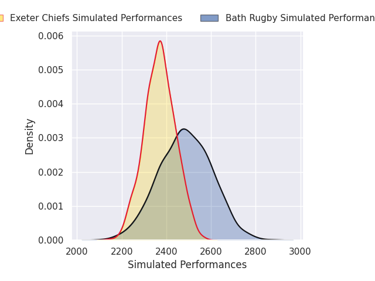

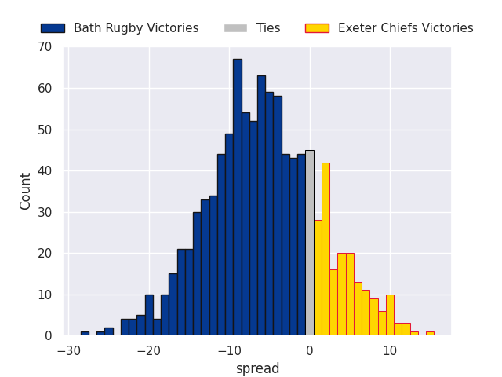

#### Bristol Rugby V Northampton Saints on 2026/10/03

Average Margin: Northampton Saints by 0.9

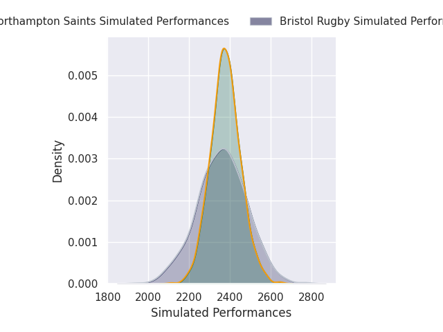

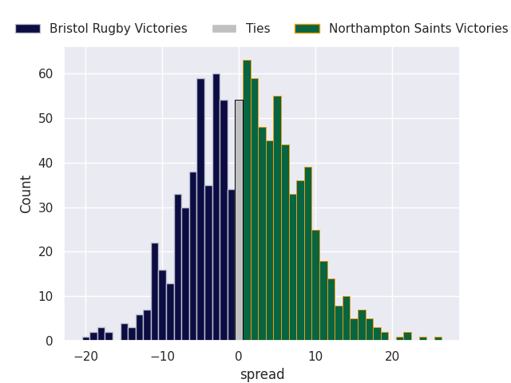

#### Gloucester Rugby V Harlequins on 2026/10/03

Average Margin: Gloucester Rugby by 4.7

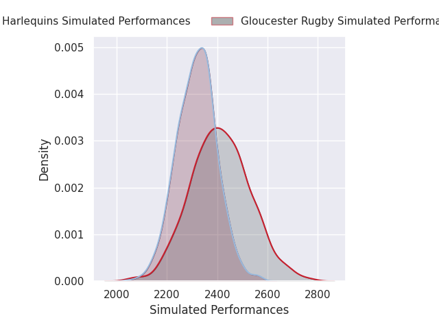
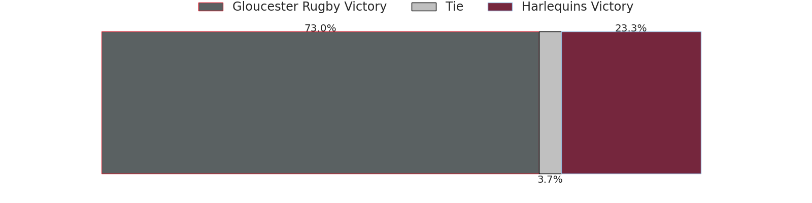
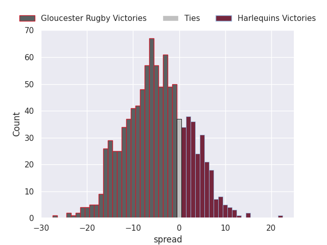

#### Newcastle Red Bulls V Leicester Tigers on 2026/10/03

Average Margin: Leicester Tigers by 8.0

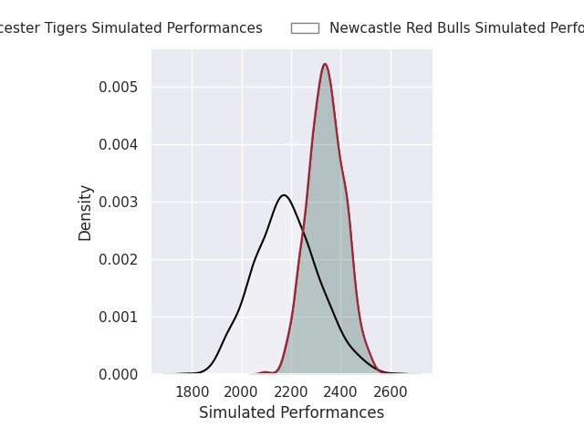
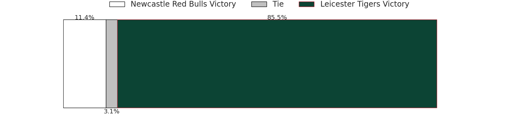
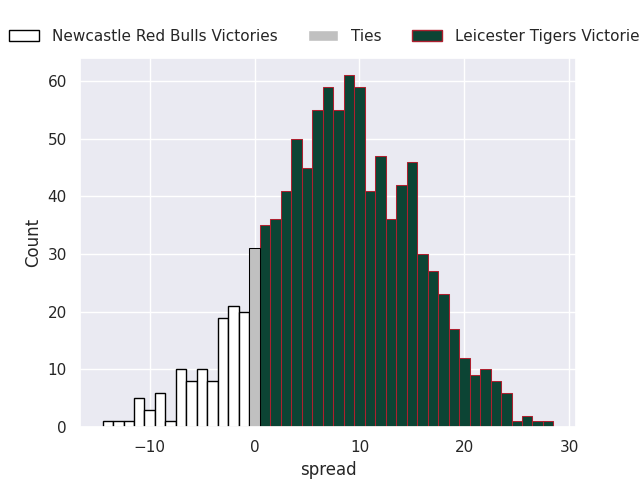

#### Saracens V Sale Sharks on 2026/10/04

Average Margin: Saracens by 12.9

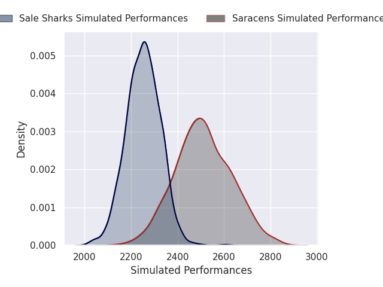

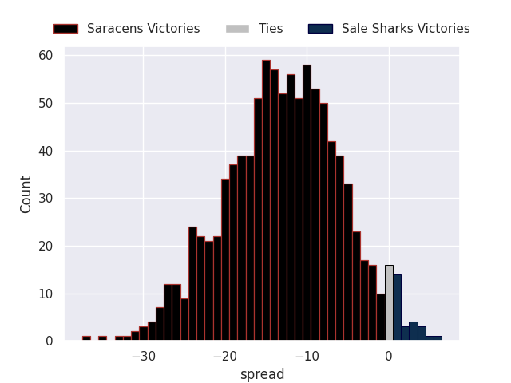

### Week 3
#### Leicester Tigers V Gloucester Rugby on 2026/10/09

Average Margin: Leicester Tigers by 6.3

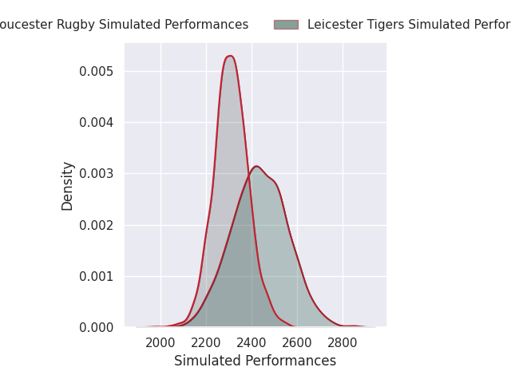

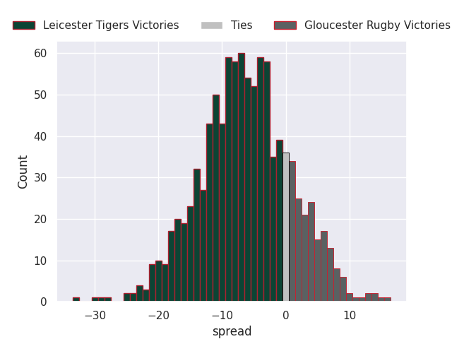

#### Northampton Saints V Bath Rugby on 2026/10/10

Average Margin: Northampton Saints by 2.3

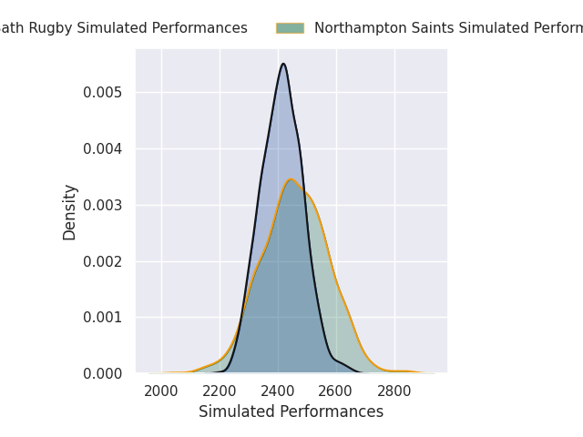

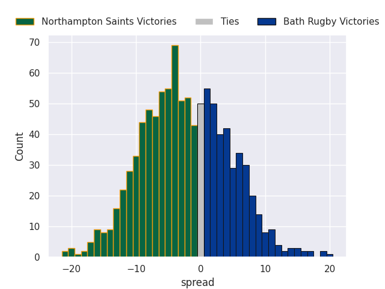

#### Saracens V Bristol Rugby on 2026/10/10

Average Margin: Saracens by 11.4

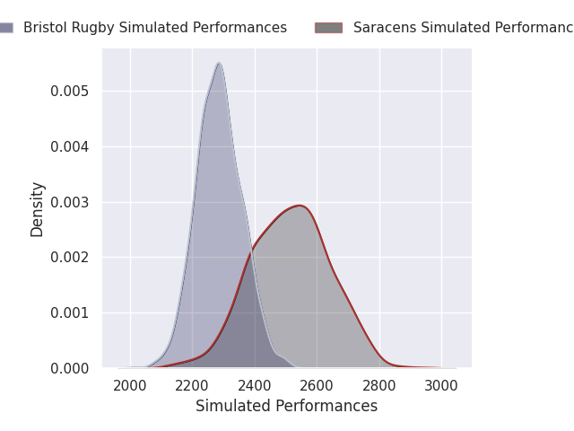
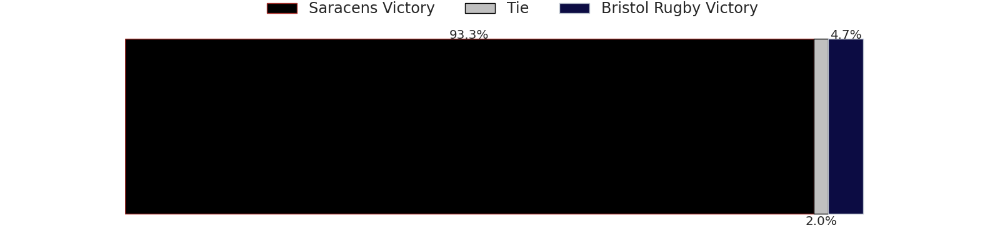
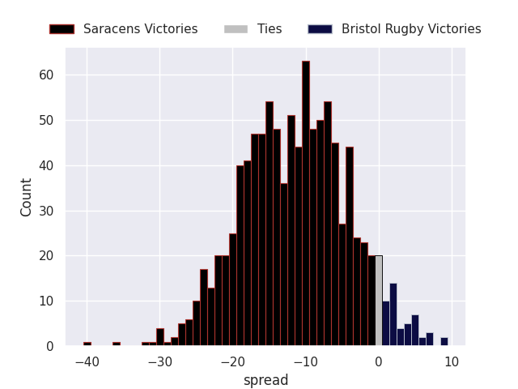

#### Sale Sharks V Harlequins on 2026/10/11

Average Margin: Sale Sharks by 1.9

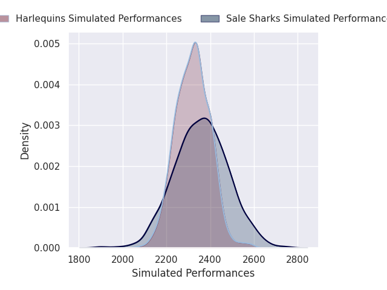

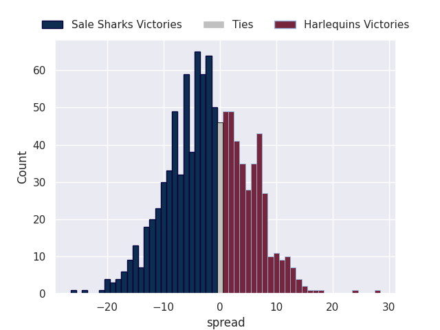

#### Exeter Chiefs V Newcastle Red Bulls on 2026/10/11

Average Margin: Exeter Chiefs by 19.5

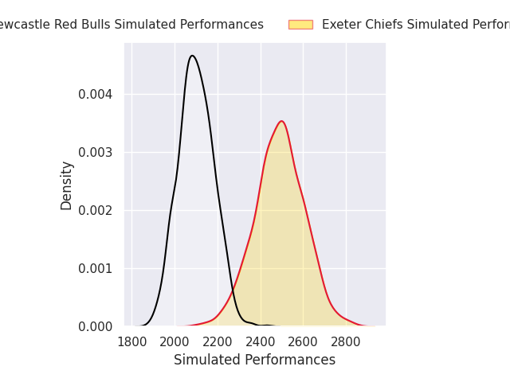
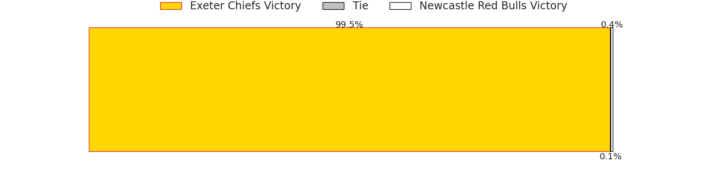
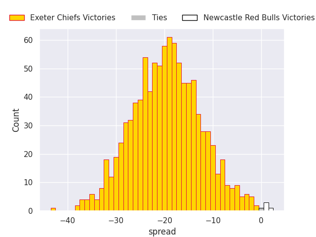

### Week 4
#### Newcastle Red Bulls V Sale Sharks on 2026/10/23

Average Margin: Sale Sharks by 3.0

#### Gloucester Rugby V Bath Rugby on 2026/10/23

Average Margin: Bath Rugby by 0.0

#### Bristol Rugby V Exeter Chiefs on 2026/10/24

Average Margin: Exeter Chiefs by 0.5

#### Leicester Tigers V Northampton Saints on 2026/10/24

Average Margin: Leicester Tigers by 3.0

#### Harlequins V Saracens on 2026/10/25

Average Margin: Saracens by 1.0

### Week 5
#### Bristol Rugby V Leicester Tigers on 2026/10/30

Average Margin: Bristol Rugby by 1.4

#### Bath Rugby V Sale Sharks on 2026/10/31

Average Margin: Bath Rugby by 11.6

#### Exeter Chiefs V Harlequins on 2026/10/31

Average Margin: Exeter Chiefs by 8.7

#### Northampton Saints V Gloucester Rugby on 2026/10/31

Average Margin: Northampton Saints by 7.6

#### Saracens V Newcastle Red Bulls on 2026/10/31

Average Margin: Saracens by 20.6

### Week 6
#### Bath Rugby V Bristol Rugby on 2026/12/04

Average Margin: Bath Rugby by 9.9

#### Gloucester Rugby V Newcastle Red Bulls on 2026/12/05

Average Margin: Gloucester Rugby by 15.3

#### Saracens V Northampton Saints on 2026/12/05

Average Margin: Saracens by 6.5

#### Harlequins V Leicester Tigers on 2026/12/05

Average Margin: Harlequins by 2.3

#### Sale Sharks V Exeter Chiefs on 2026/12/06

Average Margin: Exeter Chiefs by 1.2

### Week 7
#### Newcastle Red Bulls V Bath Rugby on 2026/12/18

Average Margin: Bath Rugby by 10.8

#### Leicester Tigers V Sale Sharks on 2026/12/19

Average Margin: Leicester Tigers by 9.0

#### Northampton Saints V Exeter Chiefs on 2026/12/19

Average Margin: Northampton Saints by 3.9

#### Gloucester Rugby V Saracens on 2026/12/19

Average Margin: Gloucester Rugby by 0.6

#### Bristol Rugby V Harlequins on 2026/12/20

Average Margin: Bristol Rugby by 2.3

### Week 8
#### Sale Sharks V Gloucester Rugby on 2026/12/26

Average Margin: Sale Sharks by 2.0

#### Bristol Rugby V Newcastle Red Bulls on 2026/12/26

Average Margin: Bristol Rugby by 12.8

#### Bath Rugby V Leicester Tigers on 2026/12/26

Average Margin: Bath Rugby by 7.4

#### Exeter Chiefs V Saracens on 2026/12/27

Average Margin: Exeter Chiefs by 4.4

### Week 9
#### Harlequins V Northampton Saints on 2026/12/28

Average Margin: Harlequins by 0.5

#### Gloucester Rugby V Bristol Rugby on 2027/01/01

Average Margin: Gloucester Rugby by 6.7

#### Leicester Tigers V Exeter Chiefs on 2027/01/02

Average Margin: Leicester Tigers by 3.2

#### Saracens V Bath Rugby on 2027/01/02

Average Margin: Saracens by 4.9

#### Newcastle Red Bulls V Harlequins on 2027/01/02

Average Margin: Harlequins by 6.3

#### Northampton Saints V Sale Sharks on 2027/01/03

Average Margin: Northampton Saints by 10.4

### Week 10
#### Harlequins V Gloucester Rugby on 2027/01/23

Average Margin: Harlequins by 3.6

#### Bath Rugby V Northampton Saints on 2027/01/23

Average Margin: Bath Rugby by 5.0

#### Newcastle Red Bulls V Saracens on 2027/01/23

Average Margin: Saracens by 10.8

#### Exeter Chiefs V Bristol Rugby on 2027/01/23

Average Margin: Exeter Chiefs by 10.0

#### Sale Sharks V Leicester Tigers on 2027/01/23

Average Margin: Sale Sharks by 1.1

### Week 11
#### Leicester Tigers V Newcastle Red Bulls on 2027/03/20

Average Margin: Leicester Tigers by 15.7

#### Bath Rugby V Gloucester Rugby on 2027/03/20

Average Margin: Bath Rugby by 8.4

#### Exeter Chiefs V Northampton Saints on 2027/03/20

Average Margin: Exeter Chiefs by 5.6

#### Bristol Rugby V Sale Sharks on 2027/03/20

Average Margin: Bristol Rugby by 5.6

#### Saracens V Harlequins on 2027/03/20

Average Margin: Saracens by 8.7

### Week 12
#### Northampton Saints V Saracens on 2027/03/27

Average Margin: Northampton Saints by 2.8

#### Newcastle Red Bulls V Bristol Rugby on 2027/03/27

Average Margin: Bristol Rugby by 4.4

#### Gloucester Rugby V Leicester Tigers on 2027/03/27

Average Margin: Gloucester Rugby by 3.9

#### Harlequins V Exeter Chiefs on 2027/03/27

Average Margin: Harlequins by 0.3

#### Sale Sharks V Bath Rugby on 2027/03/27

Average Margin: Bath Rugby by 2.4

### Week 13
#### Bath Rugby V Newcastle Red Bulls on 2027/04/17

Average Margin: Bath Rugby by 18.2

#### Saracens V Leicester Tigers on 2027/04/17

Average Margin: Saracens by 8.1

#### Bristol Rugby V Gloucester Rugby on 2027/04/17

Average Margin: Bristol Rugby by 2.7

#### Exeter Chiefs V Sale Sharks on 2027/04/17

Average Margin: Exeter Chiefs by 11.1

#### Northampton Saints V Harlequins on 2027/04/17

Average Margin: Northampton Saints by 7.0

### Week 14
#### Newcastle Red Bulls V Exeter Chiefs on 2027/04/24

Average Margin: Exeter Chiefs by 8.5

#### Harlequins V Bristol Rugby on 2027/04/24

Average Margin: Harlequins by 5.0

#### Gloucester Rugby V Northampton Saints on 2027/04/24

Average Margin: Gloucester Rugby by 2.0

#### Sale Sharks V Saracens on 2027/04/24

Average Margin: Saracens by 1.9

#### Leicester Tigers V Bath Rugby on 2027/04/24

Average Margin: Leicester Tigers by 2.0

### Week 15
#### Bristol Rugby V Saracens on 2027/05/08

Average Margin: Saracens by 1.6

#### Harlequins V Newcastle Red Bulls on 2027/05/08

Average Margin: Harlequins by 13.3

#### Exeter Chiefs V Bath Rugby on 2027/05/08

Average Margin: Exeter Chiefs by 4.0

#### Gloucester Rugby V Sale Sharks on 2027/05/08

Average Margin: Gloucester Rugby by 7.6

#### Northampton Saints V Leicester Tigers on 2027/05/08

Average Margin: Northampton Saints by 6.1

### Week 16
#### Saracens V Exeter Chiefs on 2027/05/15

Average Margin: Saracens by 6.7

#### Leicester Tigers V Bristol Rugby on 2027/05/15

Average Margin: Leicester Tigers by 7.2

#### Newcastle Red Bulls V Gloucester Rugby on 2027/05/15

Average Margin: Gloucester Rugby by 5.2

#### Sale Sharks V Northampton Saints on 2027/05/15

Average Margin: Northampton Saints by 0.5

#### Bath Rugby V Harlequins on 2027/05/15

Average Margin: Bath Rugby by 7.9

### Week 17
#### Saracens V Gloucester Rugby on 2027/05/29

Average Margin: Saracens by 8.9

#### Harlequins V Sale Sharks on 2027/05/29

Average Margin: Harlequins by 6.0

#### Exeter Chiefs V Leicester Tigers on 2027/05/29

Average Margin: Exeter Chiefs by 7.2

#### Bristol Rugby V Bath Rugby on 2027/05/29

Average Margin: Bath Rugby by 1.6

#### Newcastle Red Bulls V Northampton Saints on 2027/05/29

Average Margin: Northampton Saints by 8.4

### Week 18
#### Gloucester Rugby V Exeter Chiefs on 2027/06/05

Average Margin: Gloucester Rugby by 2.5

#### Bath Rugby V Saracens on 2027/06/05

Average Margin: Bath Rugby by 3.7

#### Northampton Saints V Bristol Rugby on 2027/06/05

Average Margin: Northampton Saints by 8.3

#### Leicester Tigers V Harlequins on 2027/06/05

Average Margin: Leicester Tigers by 5.8

#### Sale Sharks V Newcastle Red Bulls on 2027/06/05

Average Margin: Sale Sharks by 11.8

