## Team Rankings

## Completed Match Review

| Model | Percent Correct Predictions | Spread Error |
| ------ | ------ | ------ |
| Club Level | 73.9% | 10.3 |
| Player Level: Lineup | nan% | nan |
| Player Level: Minutes | nan% | nan |

## Future Predictions
### Week 6
#### New Zealand V Australia on 2026/10/01

Average Margin: New Zealand by 13.4

### Week 7
#### New Zealand V Australia on 2026/10/10

Average Margin: New Zealand by 13.8

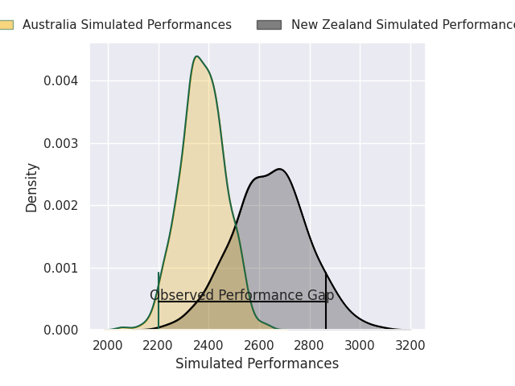
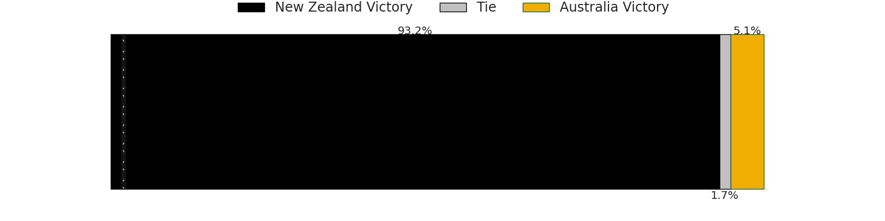
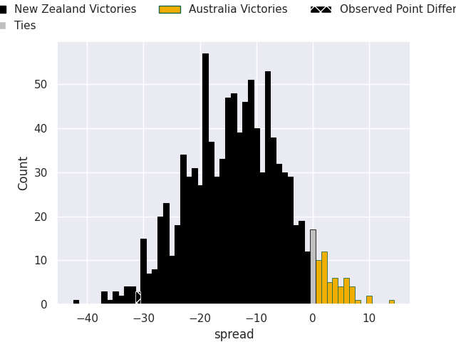

### Week 8
#### Australia V New Zealand on 2026/10/17

Average Margin: New Zealand by 5.7

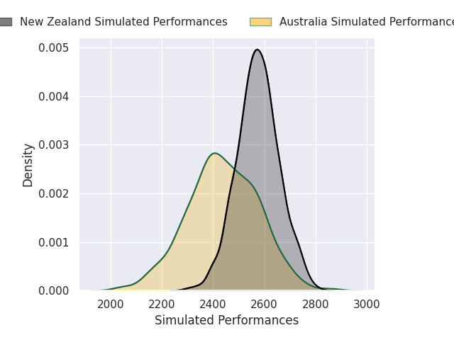
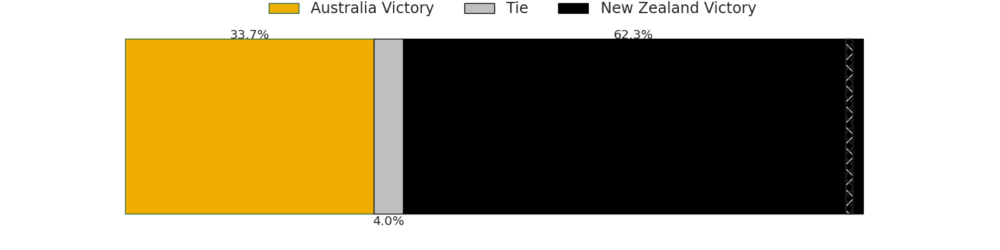
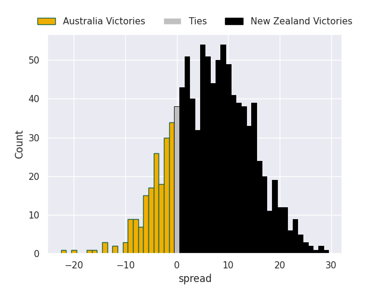

### Week 9
#### Japan V Fiji on 2026/10/24

Average Margin: Japan by 11.0

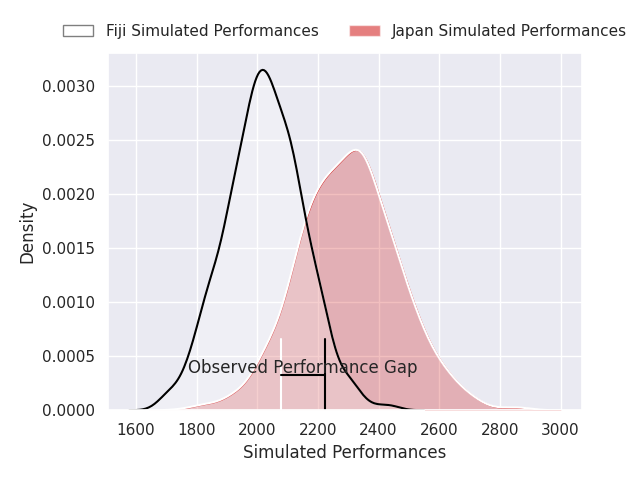
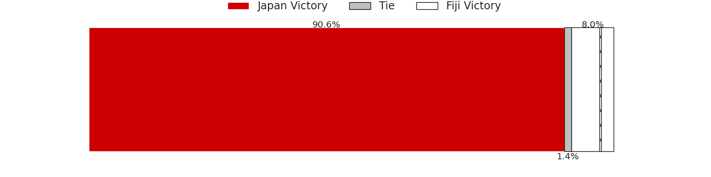
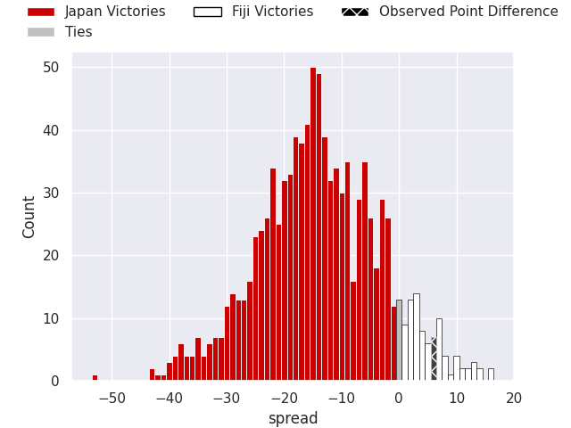

#### United States of America V Australia A on 2026/10/25

Average Margin: Australia A by 18.5

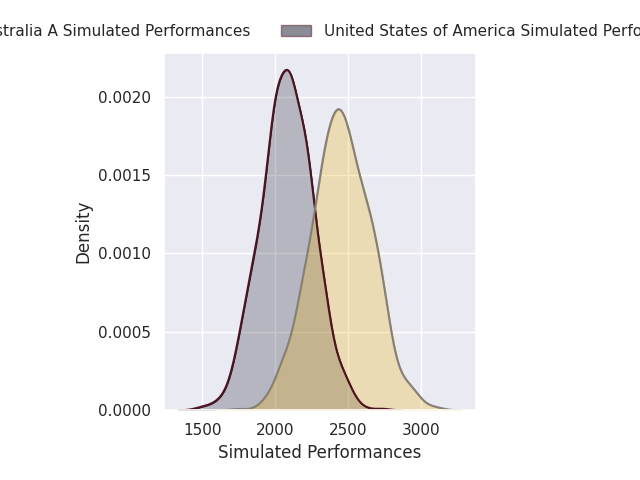

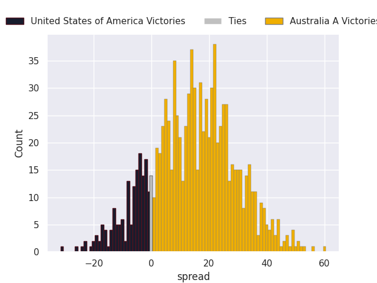

### Week 10
#### United States of America V Australia A on 2026/10/31

Average Margin: Australia A by 18.6

#### Belgium V Hong Kong on 2026/10/31

Average Margin: Belgium by 10.8

### Week 11
#### England A V Argentina A on 2026/11/06

Average Margin: England A by 10.8

### Week 12
#### Paraguay V Brazil on 2026/11/13

Average Margin: Paraguay by 19.1

