## Team Rankings

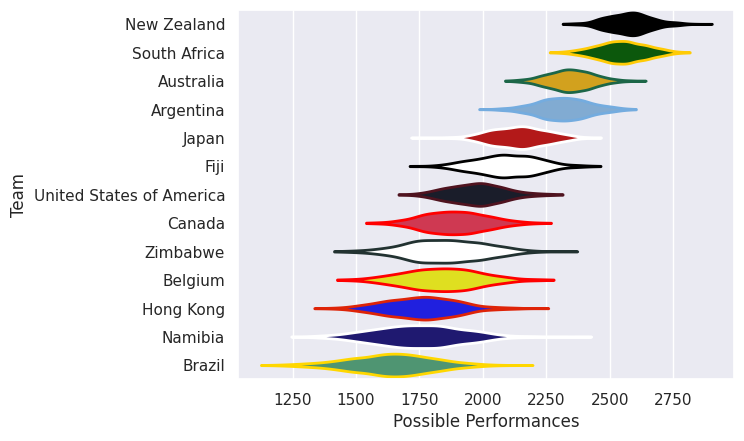
## Completed Match Review

| Model | Percent Correct Predictions | Spread Error |
| ------ | ------ | ------ |
| Club Level | 71.4% | 13.7 |
| Player Level: Lineup | nan% | nan |
| Player Level: Minutes | nan% | nan |

## Future Predictions
### Week 8
#### New Zealand V Australia on 2026/10/01

Average Margin: New Zealand by 10.8

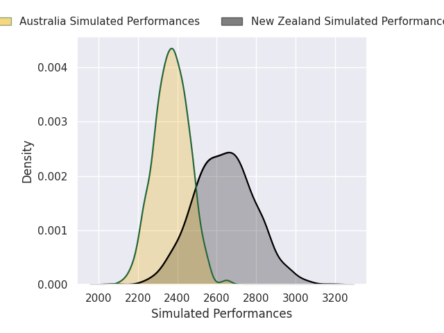
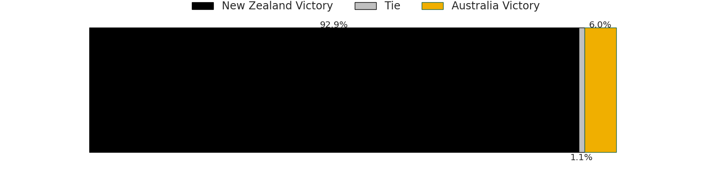
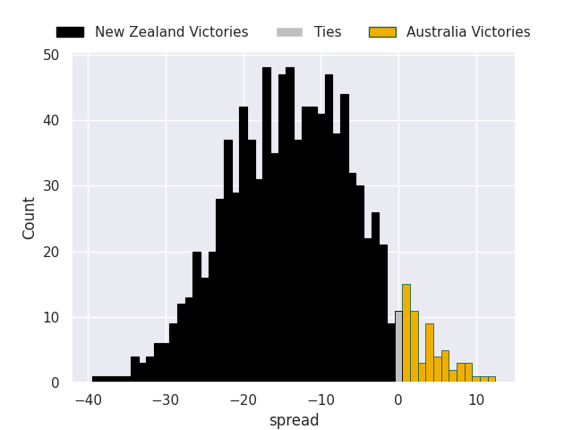

### Week 9
#### Peru V Cayman Islands on 2026/11/21

Average Margin: Peru by 17.1

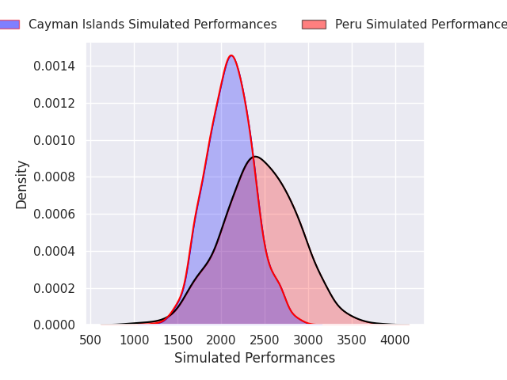
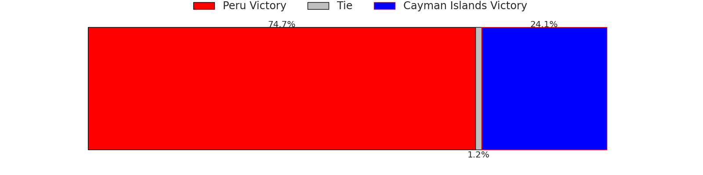
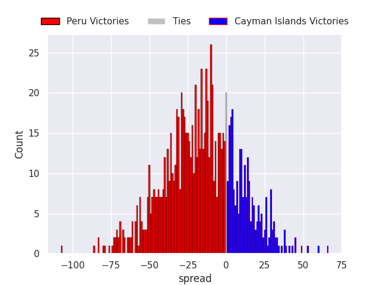

#### Tunisia V Switzerland on 2026/11/21

Average Margin: Switzerland by 4.8

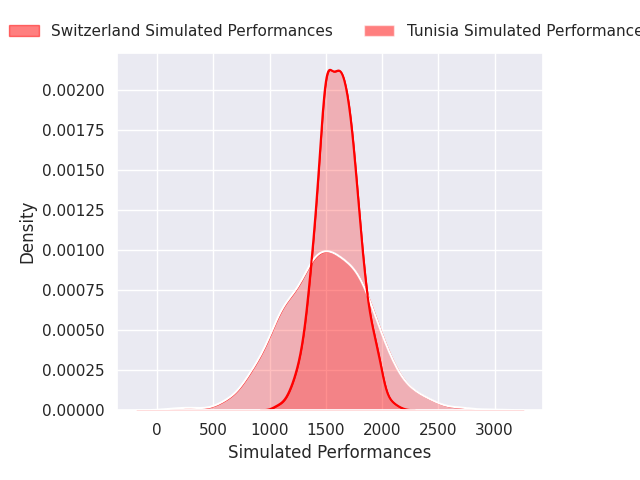

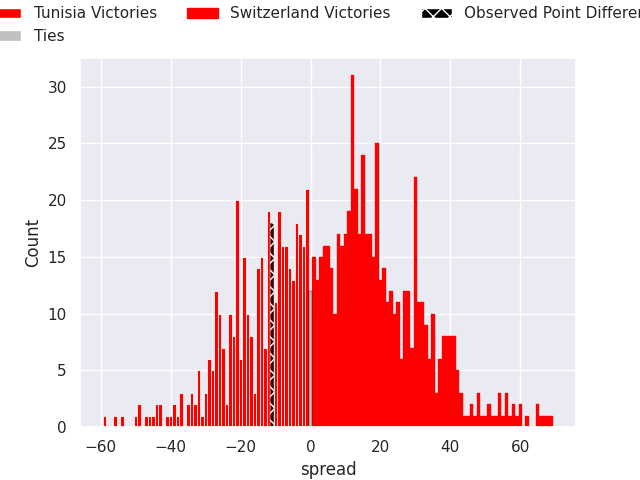

### Week 10
#### Tunisia V Poland on 2026/11/24

Average Margin: Poland by 56.0

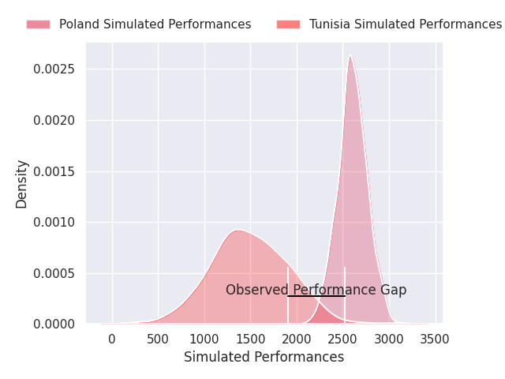

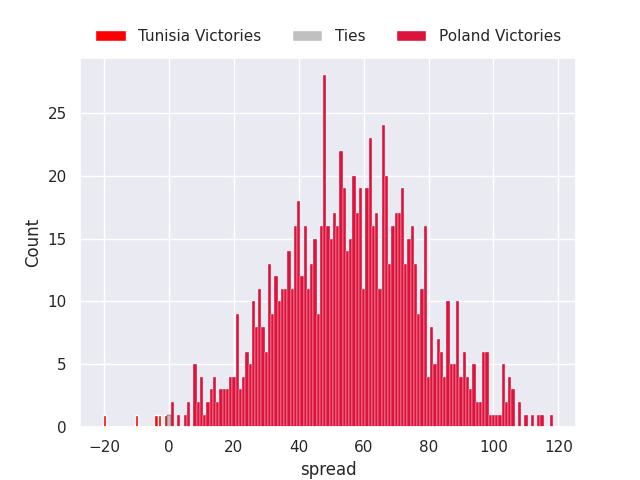

