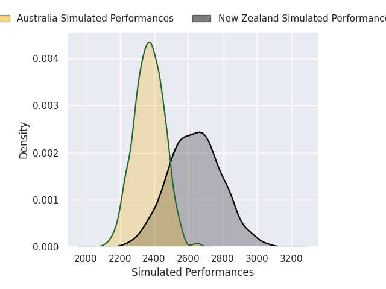
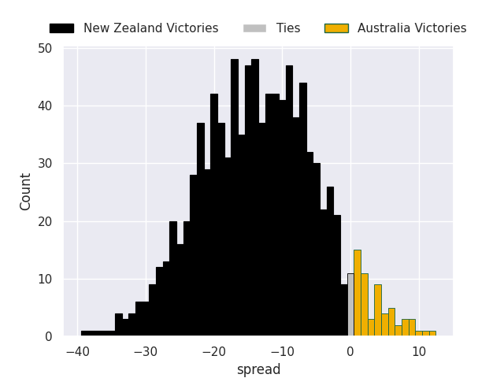
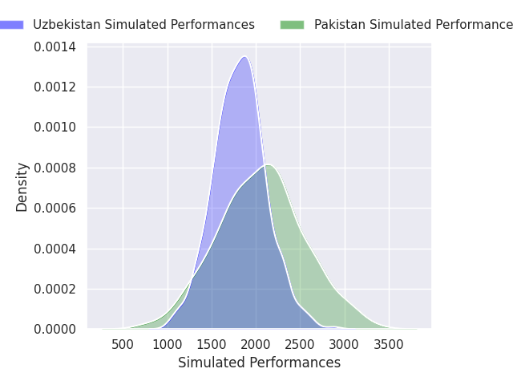
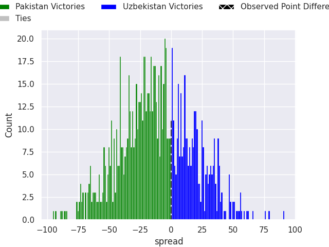

## Team Rankings

## Completed Match Review

| Model | Percent Correct Predictions | Spread Error |
| ------ | ------ | ------ |
| Club Level | 84.6% | 12.4 |
| Player Level: Lineup | nan% | nan |
| Player Level: Minutes | nan% | nan |

## Future Predictions
### Week 8
#### New Zealand V Australia on 2026/10/01

Average Margin: New Zealand by 11.6

### Week 9
#### Pakistan V Uzbekistan on 2026/11/09

Average Margin: Pakistan by 11.9

#### Paraguay V Brazil on 2026/11/13

Average Margin: Paraguay by 22.0

### Week 10
#### Peru V Cayman Islands on 2026/11/21

Average Margin: Peru by 16.1

