## Team Rankings

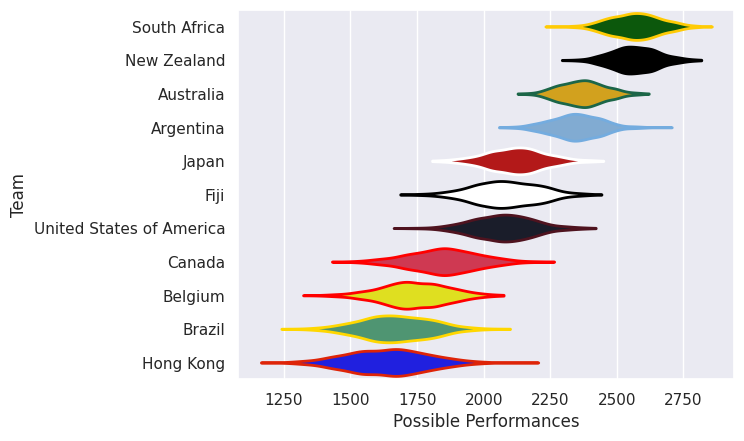
## Completed Match Review

| Model | Percent Correct Predictions | Spread Error |
| ------ | ------ | ------ |
| Club Level | 71.4% | 11.4 |
| Player Level: Lineup | nan% | nan |
| Player Level: Minutes | nan% | nan |

## Future Predictions
### Week 10
#### New Zealand V Australia on 2026/10/01

Average Margin: New Zealand by 11.5

### Week 11
#### Belgium V Hong Kong on 2026/10/31

Average Margin: Belgium by 7.6

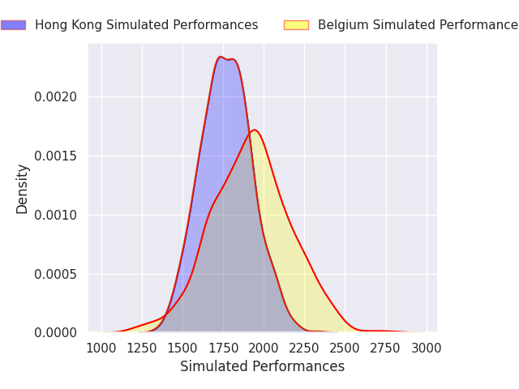
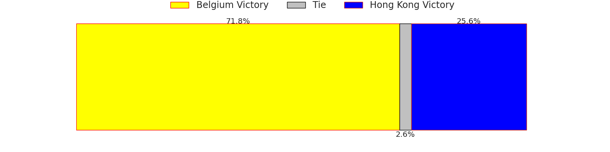
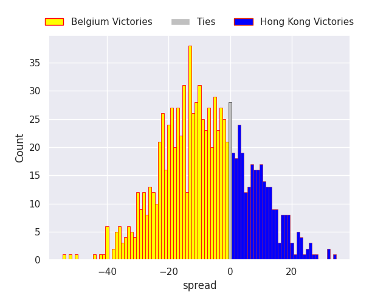

#### United States of America V Australia A on 2026/10/31

Average Margin: Australia A by 19.3

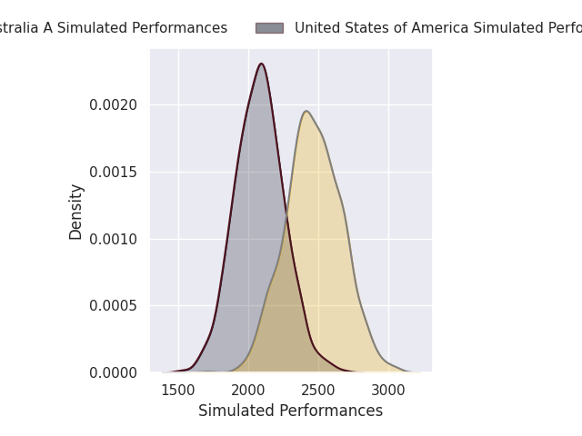
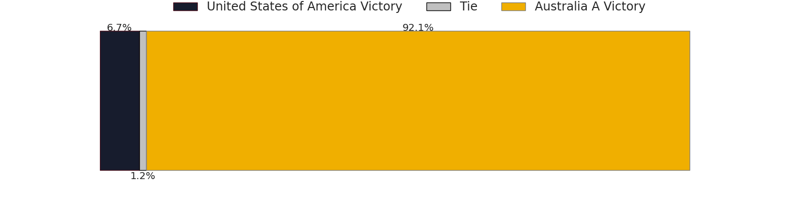
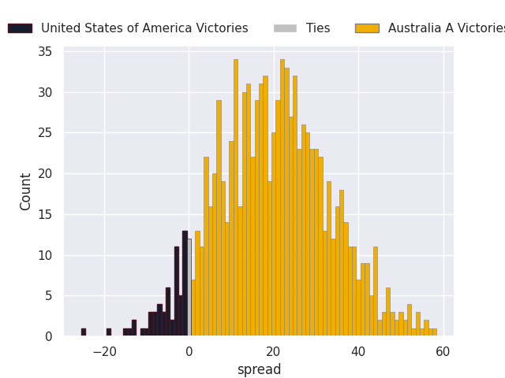

### Week 12
#### England A V Argentina A on 2026/11/06

Average Margin: England A by 12.5

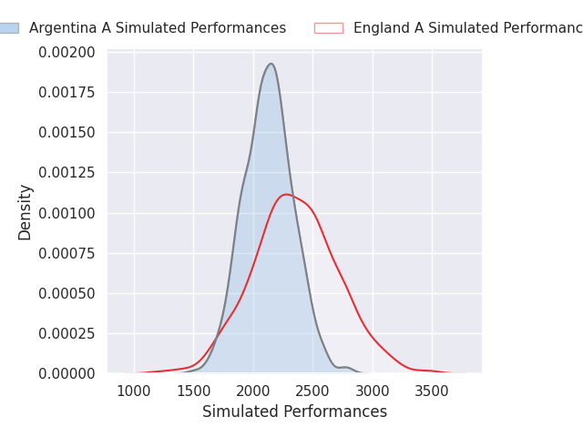
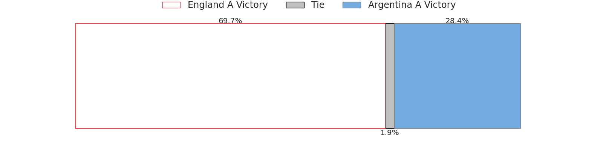
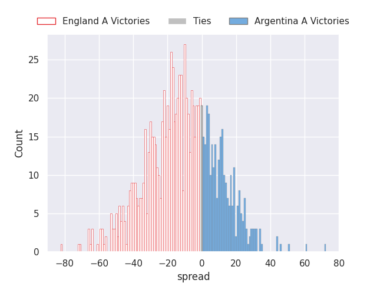

#### Pakistan V Uzbekistan on 2026/11/08

Average Margin: Pakistan by 10.8

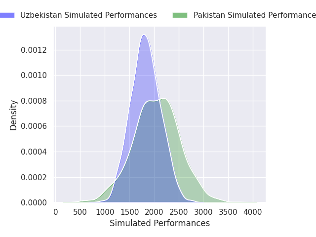
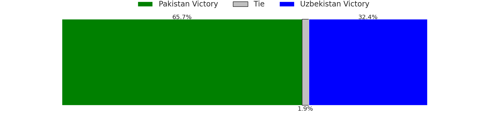
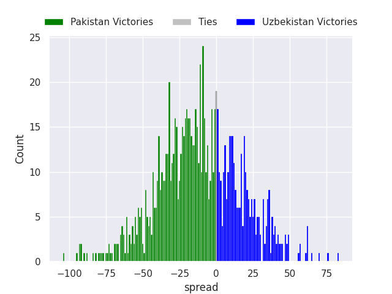

### Week 13
#### Pakistan V Uzbekistan on 2026/11/12

Average Margin: Pakistan by 11.0

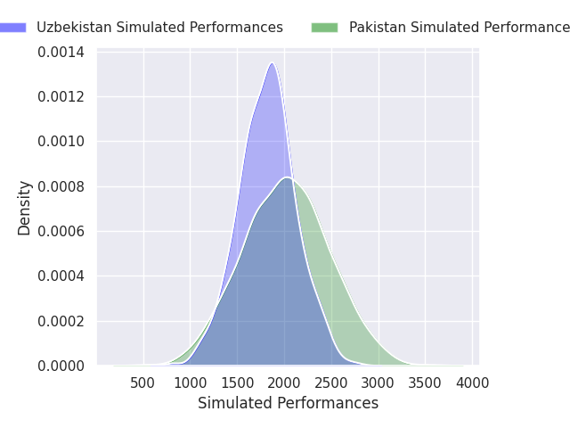

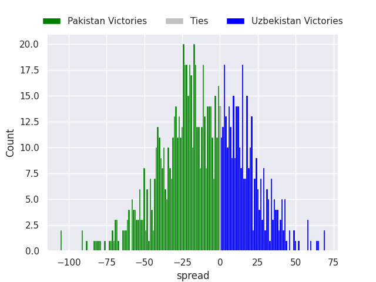

#### Paraguay V Brazil on 2026/11/13

Average Margin: Paraguay by 21.1

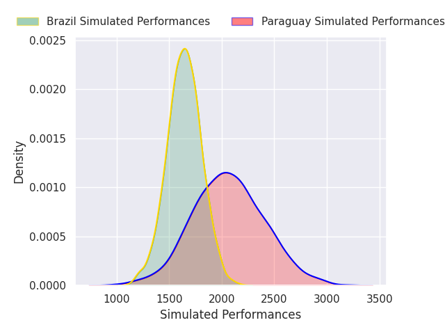
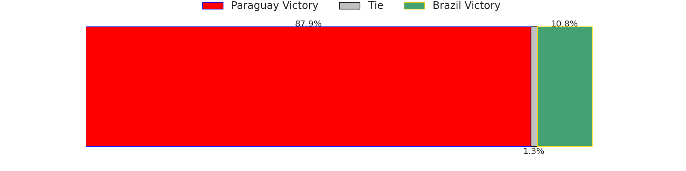
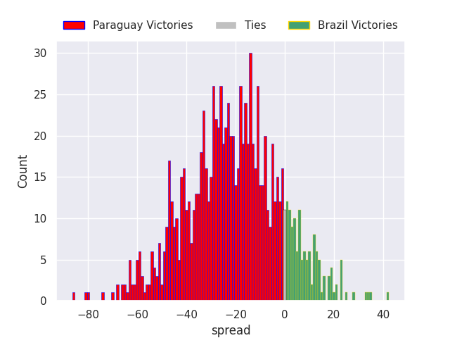

