## Team Rankings

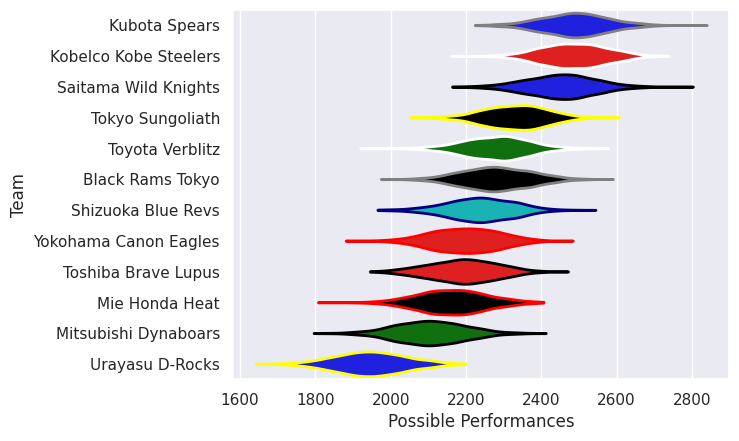
## Standings
### Projected Remaining Table

| Club                  |   To Play |   Projected Wins |   Projected Differential |   Projected Losing Bonus Points | Projected Try Bonus Points   |   Projected Competition Points |
|:----------------------|----------:|-----------------:|-------------------------:|--------------------------------:|:-----------------------------|-------------------------------:|
| Saitama Wild Knights  |         1 |            0.989 |                   23.48  |                           0.008 |                              |                          3.968 |
| Kobelco Kobe Steelers |         1 |            0.96  |                   18.292 |                           0.027 |                              |                          3.889 |
| Kubota Spears         |         1 |            0.926 |                   14.89  |                           0.044 |                              |                          3.78  |
| Tokyo Sungoliath      |         1 |            0.781 |                    8.154 |                           0.13  |                              |                          3.316 |
| Mie Honda Heat        |         1 |            0.653 |                    4.715 |                           0.179 |                              |                          2.883 |
| Mitsubishi Dynaboars  |         1 |            0.494 |                    0.535 |                           0.273 |                              |                          2.343 |
| Yokohama Canon Eagles |         1 |            0.459 |                   -0.535 |                           0.278 |                              |                          2.208 |
| Toshiba Brave Lupus   |         1 |            0.301 |                   -4.715 |                           0.268 |                              |                          1.564 |
| Black Rams Tokyo      |         1 |            0.188 |                   -8.154 |                           0.254 |                              |                          1.068 |
| Shizuoka Blue Revs    |         1 |            0.058 |                  -14.89  |                           0.142 |                              |                          0.406 |
| Toyota Verblitz       |         1 |            0.029 |                  -18.292 |                           0.106 |                              |                          0.244 |
| Urayasu D-Rocks       |         1 |            0.009 |                  -23.48  |                           0.057 |                              |                          0.097 |

### Projected Total Table

| Club                  |   Played |   Wins |   Point Differential |   Losing Bonus Points | Try Bonus Points   |   Competition Points |
|:----------------------|---------:|-------:|---------------------:|----------------------:|:-------------------|---------------------:|
| Saitama Wild Knights  |        1 |  0.989 |               23.48  |                 0.008 |                    |                3.968 |
| Kobelco Kobe Steelers |        1 |  0.96  |               18.292 |                 0.027 |                    |                3.889 |
| Kubota Spears         |        1 |  0.926 |               14.89  |                 0.044 |                    |                3.78  |
| Tokyo Sungoliath      |        1 |  0.781 |                8.154 |                 0.13  |                    |                3.316 |
| Mie Honda Heat        |        1 |  0.653 |                4.715 |                 0.179 |                    |                2.883 |
| Mitsubishi Dynaboars  |        1 |  0.494 |                0.535 |                 0.273 |                    |                2.343 |
| Yokohama Canon Eagles |        1 |  0.459 |               -0.535 |                 0.278 |                    |                2.208 |
| Toshiba Brave Lupus   |        1 |  0.301 |               -4.715 |                 0.268 |                    |                1.564 |
| Black Rams Tokyo      |        1 |  0.188 |               -8.154 |                 0.254 |                    |                1.068 |
| Shizuoka Blue Revs    |        1 |  0.058 |              -14.89  |                 0.142 |                    |                0.406 |
| Toyota Verblitz       |        1 |  0.029 |              -18.292 |                 0.106 |                    |                0.244 |
| Urayasu D-Rocks       |        1 |  0.009 |              -23.48  |                 0.057 |                    |                0.097 |

## Future Predictions
### Week 1
#### Saitama Wild Knights V Urayasu D-Rocks on 2026/12/12

Average Margin: Saitama Wild Knights by 23.5

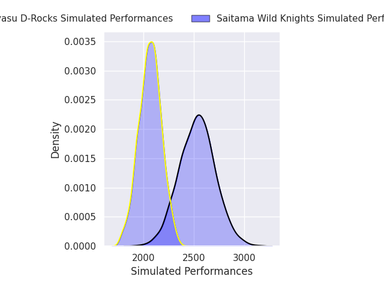
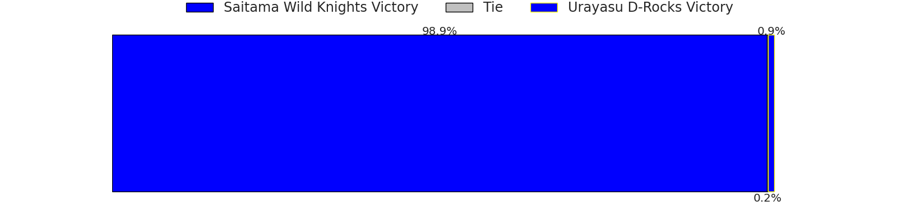
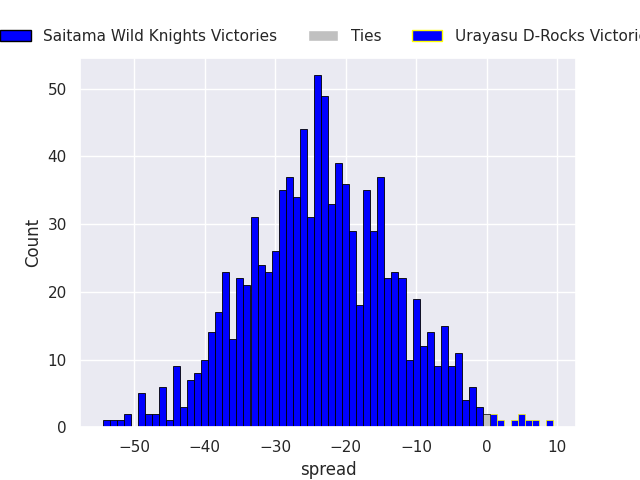

#### Tokyo Sungoliath V Black Rams Tokyo on 2026/12/12

Average Margin: Tokyo Sungoliath by 8.2

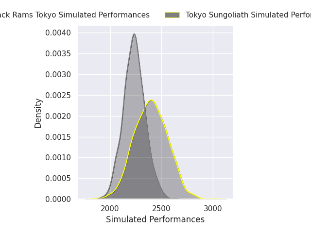

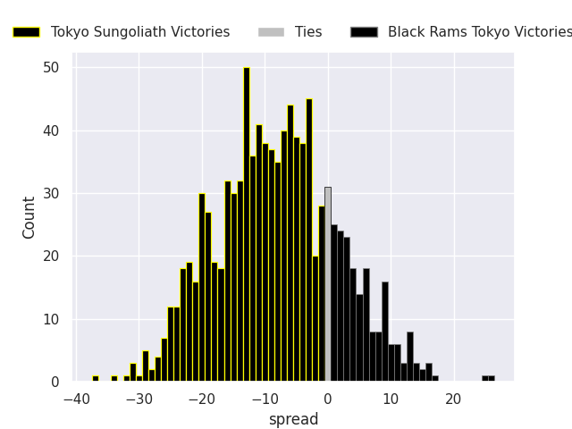

#### Mie Honda Heat V Toshiba Brave Lupus on 2026/12/12

Average Margin: Mie Honda Heat by 4.7

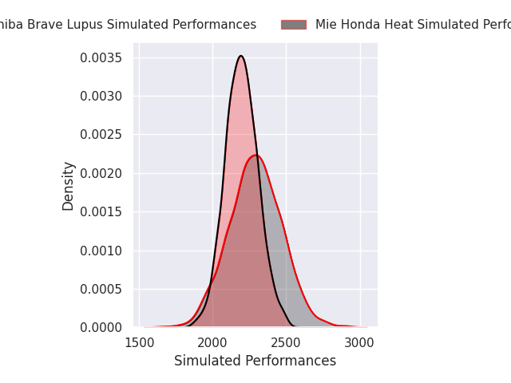
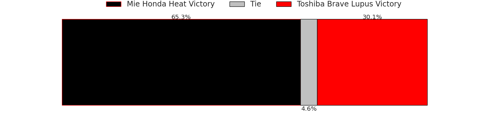
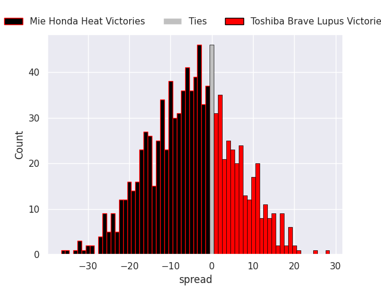

#### Kobelco Kobe Steelers V Toyota Verblitz on 2026/12/12

Average Margin: Kobelco Kobe Steelers by 18.3

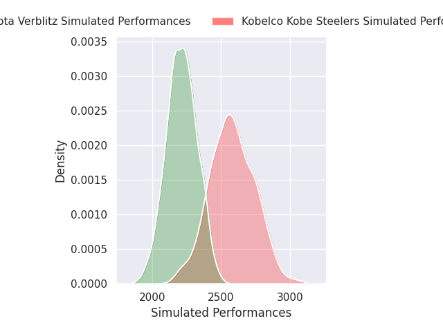
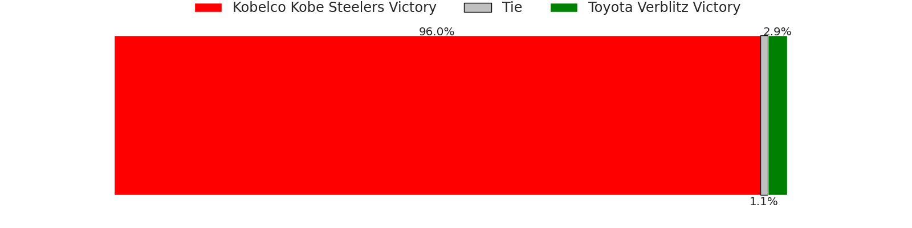
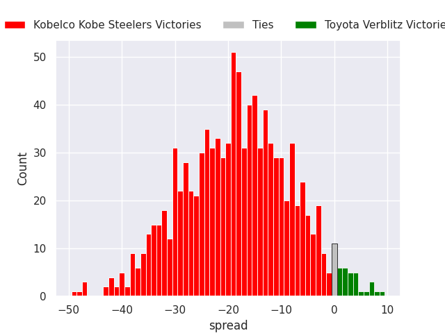

#### Mitsubishi Dynaboars V Yokohama Canon Eagles on 2026/12/13

Average Margin: Mitsubishi Dynaboars by 0.5

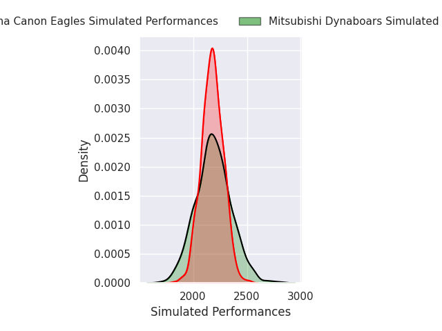
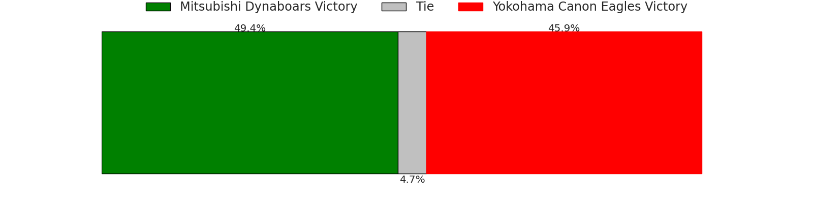
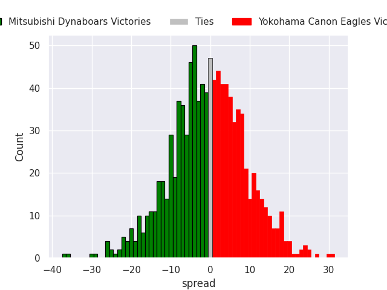

#### Kubota Spears V Shizuoka Blue Revs on 2026/12/13

Average Margin: Kubota Spears by 14.9

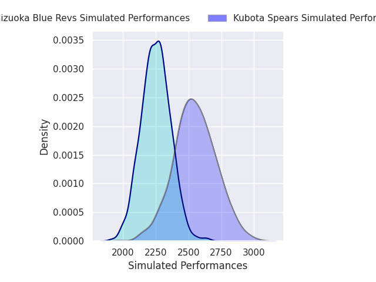
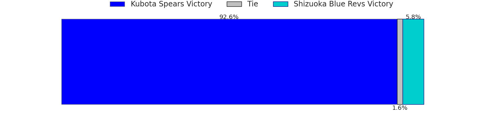
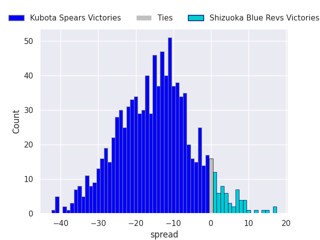

