## Team Rankings

## Standings
### Projected Remaining Table

| Club                  |   To Play |   Projected Wins |   Projected Differential |   Projected Losing Bonus Points | Projected Try Bonus Points   |   Projected Competition Points |
|:----------------------|----------:|-----------------:|-------------------------:|--------------------------------:|:-----------------------------|-------------------------------:|
| Kobelco Kobe Steelers |         6 |            5.154 |                   75.954 |                           0.51  |                              |                         21.384 |
| Saitama Wild Knights  |         6 |            4.988 |                   78.228 |                           0.591 |                              |                         20.769 |
| Kubota Spears         |         6 |            4.381 |                   62.61  |                           0.731 |                              |                         18.485 |
| Shizuoka Blue Revs    |         6 |            3.425 |                   13.029 |                           1.039 |                              |                         15.099 |
| Tokyo Sungoliath      |         6 |            3.177 |                    6.917 |                           1.363 |                              |                         14.571 |
| Mie Honda Heat        |         6 |            3.082 |                    6.031 |                           1.43  |                              |                         14.196 |
| Black Rams Tokyo      |         6 |            2.513 |                  -10.673 |                           1.462 |                              |                         11.936 |
| Yokohama Canon Eagles |         6 |            2.082 |                  -27.933 |                           1.426 |                              |                         10.128 |
| Toshiba Brave Lupus   |         6 |            1.972 |                  -25.15  |                           1.567 |                              |                          9.879 |
| Toyota Verblitz       |         6 |            2.019 |                  -34.843 |                           1.141 |                              |                          9.501 |
| Mitsubishi Dynaboars  |         6 |            1.41  |                  -58.319 |                           1.146 |                              |                          7.11  |
| Urayasu D-Rocks       |         6 |            0.777 |                  -85.851 |                           0.955 |                              |                          4.303 |

### Projected Total Table

| Club                  |   Played |   Wins |   Point Differential |   Losing Bonus Points | Try Bonus Points   |   Competition Points |
|:----------------------|---------:|-------:|---------------------:|----------------------:|:-------------------|---------------------:|
| Kobelco Kobe Steelers |        6 |  5.154 |               75.954 |                 0.51  |                    |               21.384 |
| Saitama Wild Knights  |        6 |  4.988 |               78.228 |                 0.591 |                    |               20.769 |
| Kubota Spears         |        6 |  4.381 |               62.61  |                 0.731 |                    |               18.485 |
| Shizuoka Blue Revs    |        6 |  3.425 |               13.029 |                 1.039 |                    |               15.099 |
| Tokyo Sungoliath      |        6 |  3.177 |                6.917 |                 1.363 |                    |               14.571 |
| Mie Honda Heat        |        6 |  3.082 |                6.031 |                 1.43  |                    |               14.196 |
| Black Rams Tokyo      |        6 |  2.513 |              -10.673 |                 1.462 |                    |               11.936 |
| Yokohama Canon Eagles |        6 |  2.082 |              -27.933 |                 1.426 |                    |               10.128 |
| Toshiba Brave Lupus   |        6 |  1.972 |              -25.15  |                 1.567 |                    |                9.879 |
| Toyota Verblitz       |        6 |  2.019 |              -34.843 |                 1.141 |                    |                9.501 |
| Mitsubishi Dynaboars  |        6 |  1.41  |              -58.319 |                 1.146 |                    |                7.11  |
| Urayasu D-Rocks       |        6 |  0.777 |              -85.851 |                 0.955 |                    |                4.303 |

## Future Predictions
### Week 1
#### Mie Honda Heat V Toshiba Brave Lupus on 2026/12/11

Average Margin: Mie Honda Heat by 5.9

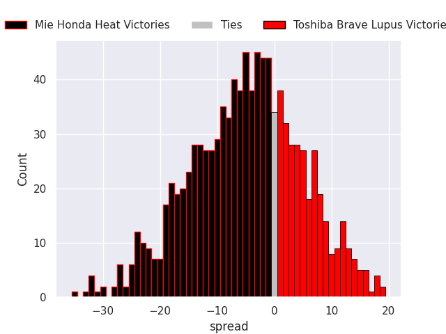

#### Kobelco Kobe Steelers V Toyota Verblitz on 2026/12/11

Average Margin: Kobelco Kobe Steelers by 18.0

#### Saitama Wild Knights V Urayasu D-Rocks on 2026/12/11

Average Margin: Saitama Wild Knights by 24.0

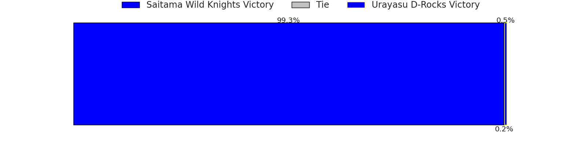

#### Kubota Spears V Shizuoka Blue Revs on 2026/12/12

Average Margin: Kubota Spears by 14.8

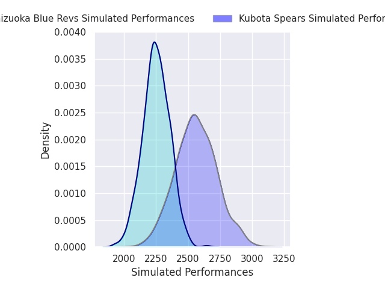
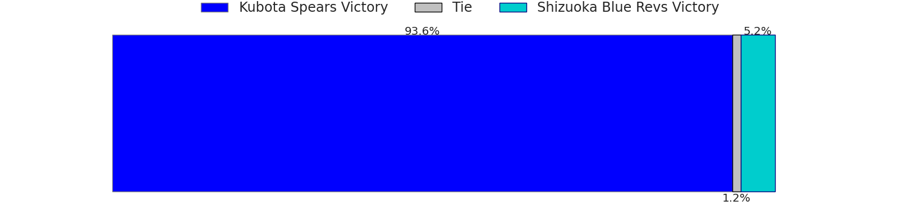
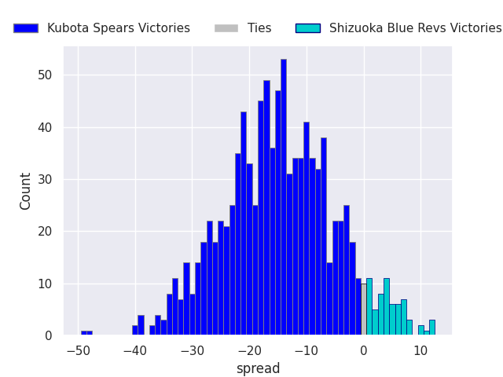

#### Mitsubishi Dynaboars V Yokohama Canon Eagles on 2026/12/12

Average Margin: Mitsubishi Dynaboars by 0.5

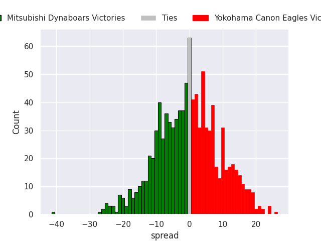

#### Tokyo Sungoliath V Black Rams Tokyo on 2026/12/12

Average Margin: Tokyo Sungoliath by 7.4

### Week 2
#### Black Rams Tokyo V Kobelco Kobe Steelers on 2026/12/19

Average Margin: Kobelco Kobe Steelers by 10.8

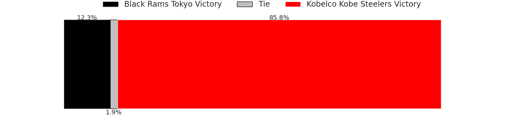

#### Toyota Verblitz V Kubota Spears on 2026/12/19

Average Margin: Kubota Spears by 9.4

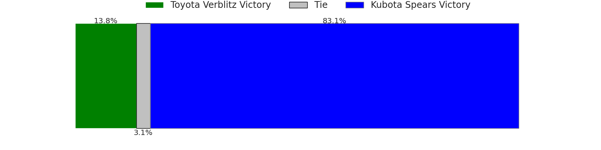

#### Toshiba Brave Lupus V Saitama Wild Knights on 2026/12/19

Average Margin: Saitama Wild Knights by 11.2

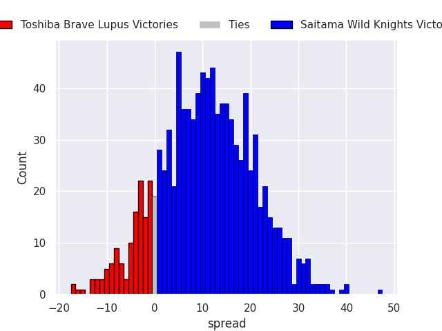

#### Yokohama Canon Eagles V Tokyo Sungoliath on 2026/12/20

Average Margin: Tokyo Sungoliath by 3.4

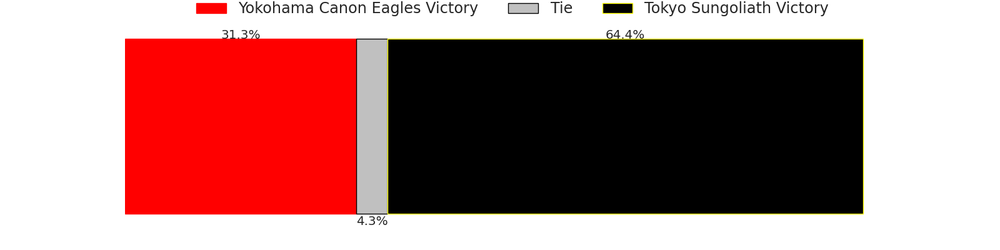
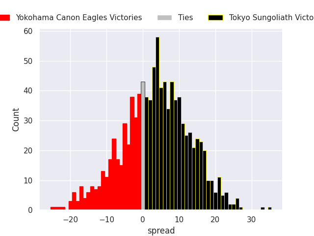

#### Urayasu D-Rocks V Mie Honda Heat on 2026/12/20

Average Margin: Mie Honda Heat by 3.7

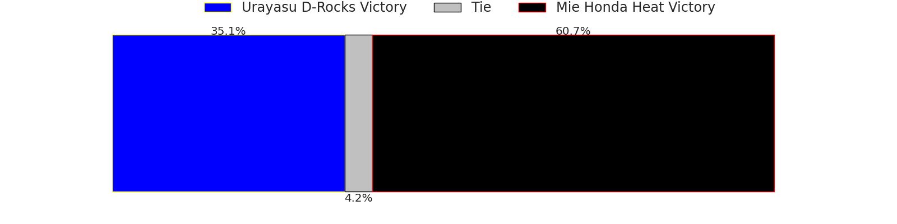
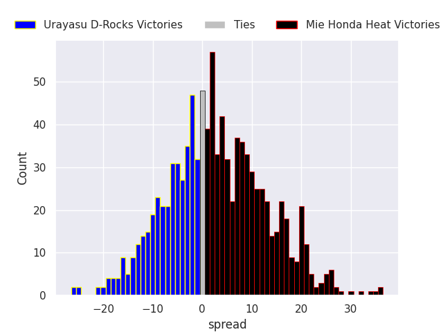

#### Shizuoka Blue Revs V Mitsubishi Dynaboars on 2026/12/20

Average Margin: Shizuoka Blue Revs by 11.7

### Week 3
#### Kubota Spears V Urayasu D-Rocks on 2026/12/26

Average Margin: Kubota Spears by 24.3

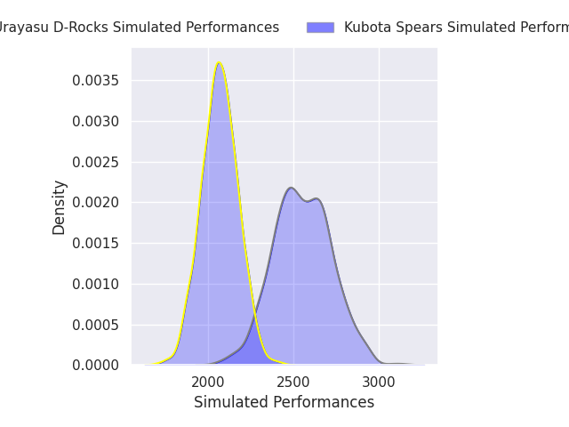

#### Saitama Wild Knights V Toyota Verblitz on 2026/12/26

Average Margin: Saitama Wild Knights by 15.9

#### Shizuoka Blue Revs V Black Rams Tokyo on 2026/12/27

Average Margin: Shizuoka Blue Revs by 4.5

#### Mitsubishi Dynaboars V Toshiba Brave Lupus on 2026/12/27

Average Margin: Toshiba Brave Lupus by 1.0

#### Tokyo Sungoliath V Kobelco Kobe Steelers on 2026/12/27

Average Margin: Kobelco Kobe Steelers by 5.1

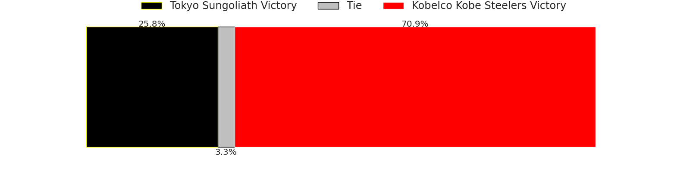

#### Mie Honda Heat V Yokohama Canon Eagles on 2026/12/27

Average Margin: Mie Honda Heat by 6.4

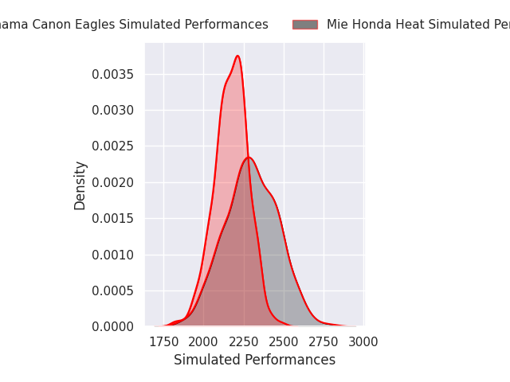

### Week 4
#### Saitama Wild Knights V Mitsubishi Dynaboars on 2027/01/09

Average Margin: Saitama Wild Knights by 21.1

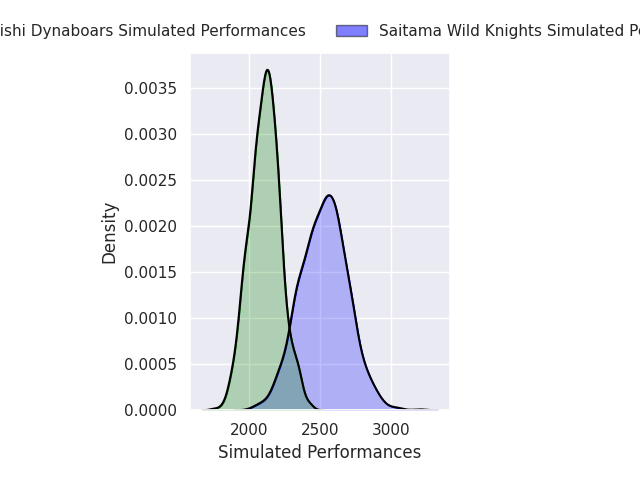

#### Urayasu D-Rocks V Black Rams Tokyo on 2027/01/09

Average Margin: Black Rams Tokyo by 4.2

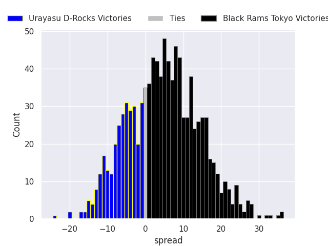

#### Yokohama Canon Eagles V Shizuoka Blue Revs on 2027/01/09

Average Margin: Yokohama Canon Eagles by 0.7

#### Toshiba Brave Lupus V Tokyo Sungoliath on 2027/01/09

Average Margin: Tokyo Sungoliath by 3.5

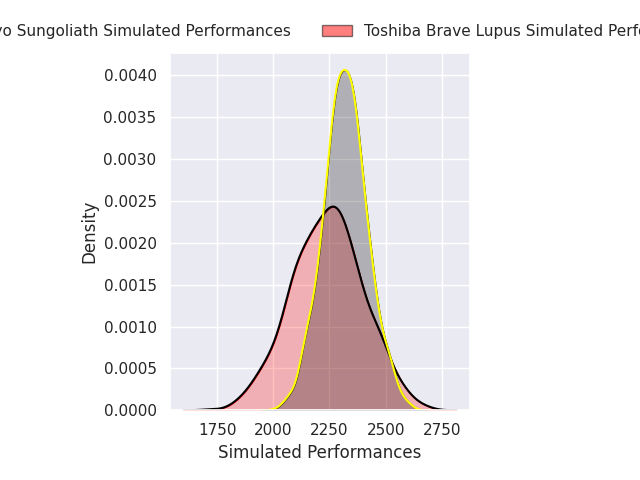
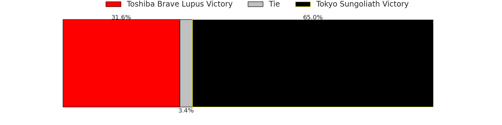

#### Toyota Verblitz V Mie Honda Heat on 2027/01/09

Average Margin: Toyota Verblitz by 4.0

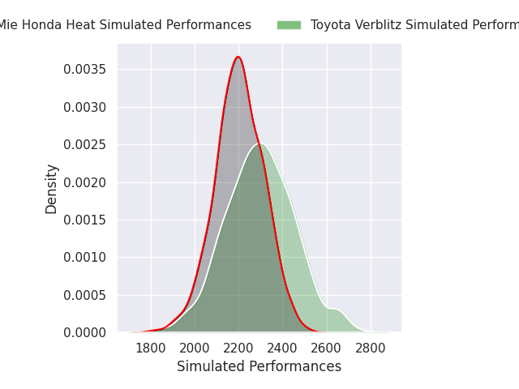

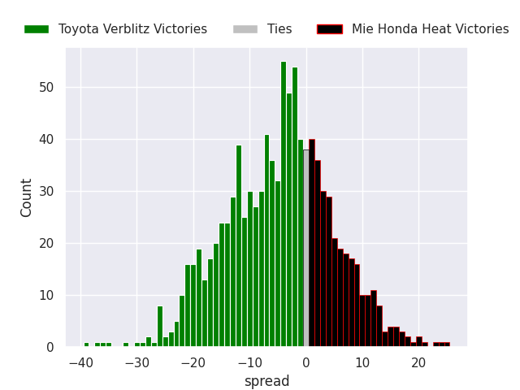

#### Kobelco Kobe Steelers V Kubota Spears on 2027/01/10

Average Margin: Kobelco Kobe Steelers by 5.5

### Week 5
#### Tokyo Sungoliath V Saitama Wild Knights on 2027/01/16

Average Margin: Saitama Wild Knights by 3.5

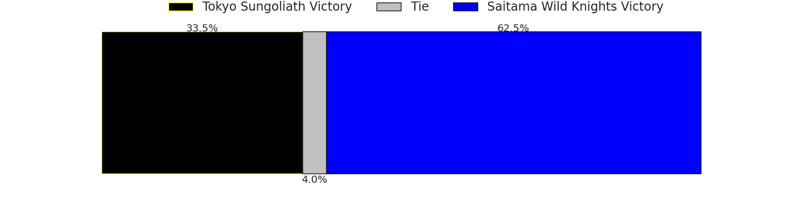

#### Kubota Spears V Mitsubishi Dynaboars on 2027/01/16

Average Margin: Kubota Spears by 22.2

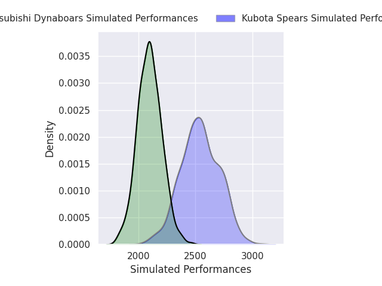

#### Black Rams Tokyo V Mie Honda Heat on 2027/01/16

Average Margin: Black Rams Tokyo by 4.8

#### Toyota Verblitz V Toshiba Brave Lupus on 2027/01/16

Average Margin: Toyota Verblitz by 5.4

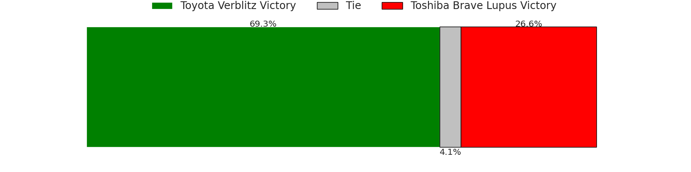
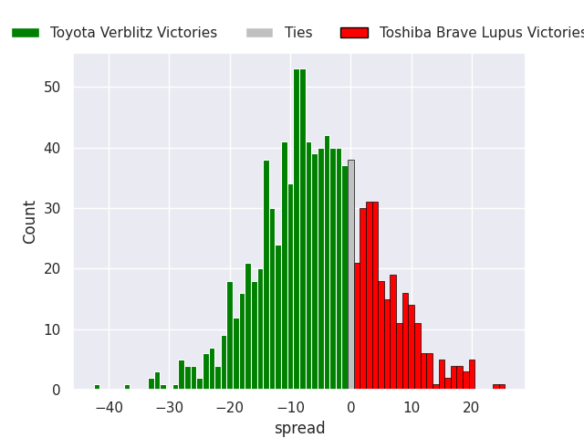

#### Shizuoka Blue Revs V Urayasu D-Rocks on 2027/01/16

Average Margin: Shizuoka Blue Revs by 12.3

#### Kobelco Kobe Steelers V Yokohama Canon Eagles on 2027/01/16

Average Margin: Kobelco Kobe Steelers by 19.3

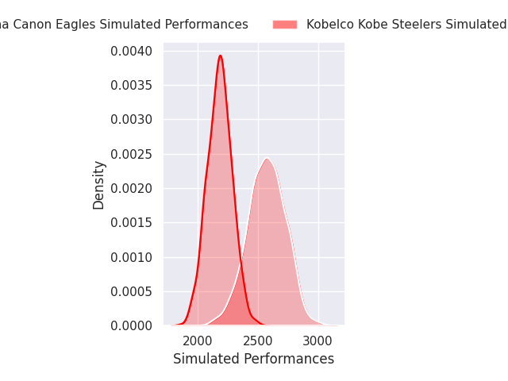

### Week 6
#### Urayasu D-Rocks V Kobelco Kobe Steelers on 2027/01/22

Average Margin: Kobelco Kobe Steelers by 17.3

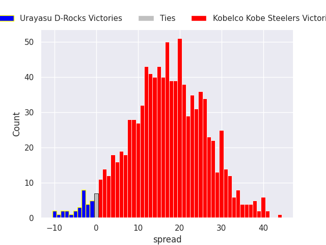

#### Yokohama Canon Eagles V Toyota Verblitz on 2027/01/23

Average Margin: Yokohama Canon Eagles by 1.0

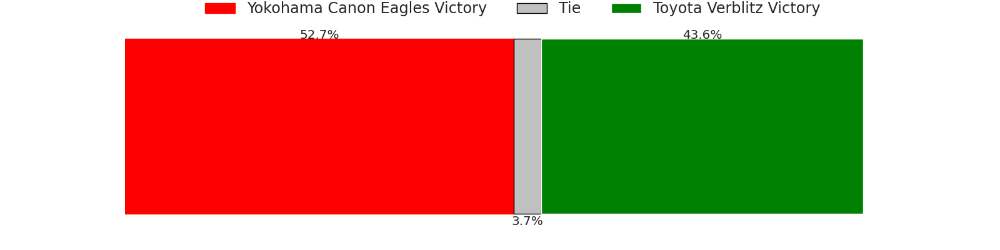
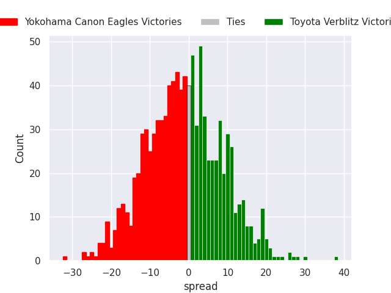

#### Saitama Wild Knights V Kubota Spears on 2027/01/23

Average Margin: Saitama Wild Knights by 2.5

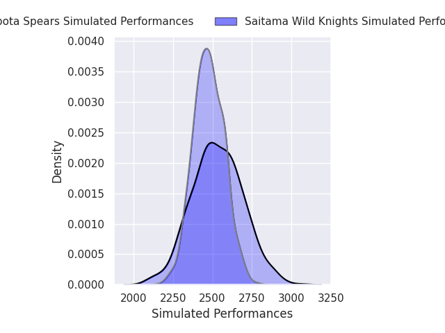

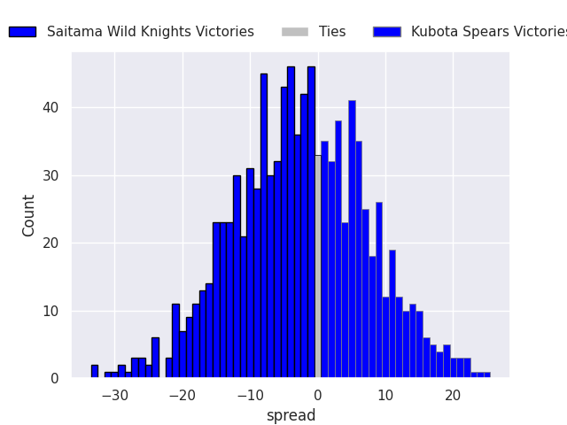

#### Toshiba Brave Lupus V Shizuoka Blue Revs on 2027/01/24

Average Margin: Shizuoka Blue Revs by 0.1

#### Mie Honda Heat V Tokyo Sungoliath on 2027/01/24

Average Margin: Tokyo Sungoliath by 1.2

#### Mitsubishi Dynaboars V Black Rams Tokyo on 2027/01/24

Average Margin: Black Rams Tokyo by 2.9

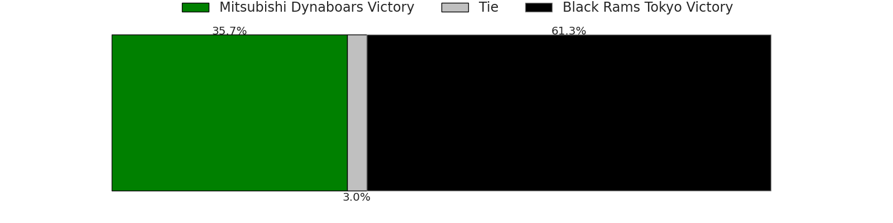

