## Team Rankings

## Standings
### Projected Remaining Table

| Club                  |   To Play |   Projected Wins |   Projected Differential |   Projected Losing Bonus Points | Projected Try Bonus Points   |   Projected Competition Points |
|:----------------------|----------:|-----------------:|-------------------------:|--------------------------------:|:-----------------------------|-------------------------------:|
| Saitama Wild Knights  |         4 |            3.787 |                   71.944 |                           0.146 |                              |                         15.346 |
| Kobelco Kobe Steelers |         4 |            3.177 |                   38.339 |                           0.481 |                              |                         13.399 |
| Kubota Spears         |         4 |            3.076 |                   45.445 |                           0.415 |                              |                         12.871 |
| Mie Honda Heat        |         4 |            2.344 |                    9.64  |                           0.777 |                              |                         10.435 |
| Tokyo Sungoliath      |         4 |            2.254 |                    8.515 |                           0.868 |                              |                         10.182 |
| Shizuoka Blue Revs    |         4 |            2.03  |                    0.806 |                           0.694 |                              |                          9.01  |
| Yokohama Canon Eagles |         4 |            1.585 |                   -8.406 |                           1.078 |                              |                          7.716 |
| Black Rams Tokyo      |         4 |            1.319 |                  -17.565 |                           0.952 |                              |                          6.474 |
| Toshiba Brave Lupus   |         4 |            1.218 |                  -19.461 |                           1.079 |                              |                          6.205 |
| Mitsubishi Dynaboars  |         4 |            1.066 |                  -33.84  |                           0.738 |                              |                          5.21  |
| Toyota Verblitz       |         4 |            0.866 |                  -39.699 |                           0.656 |                              |                          4.288 |
| Urayasu D-Rocks       |         4 |            0.647 |                  -55.718 |                           0.692 |                              |                          3.44  |

### Projected Total Table

| Club                  |   Played |   Wins |   Point Differential |   Losing Bonus Points | Try Bonus Points   |   Competition Points |
|:----------------------|---------:|-------:|---------------------:|----------------------:|:-------------------|---------------------:|
| Saitama Wild Knights  |        4 |  3.787 |               71.944 |                 0.146 |                    |               15.346 |
| Kobelco Kobe Steelers |        4 |  3.177 |               38.339 |                 0.481 |                    |               13.399 |
| Kubota Spears         |        4 |  3.076 |               45.445 |                 0.415 |                    |               12.871 |
| Mie Honda Heat        |        4 |  2.344 |                9.64  |                 0.777 |                    |               10.435 |
| Tokyo Sungoliath      |        4 |  2.254 |                8.515 |                 0.868 |                    |               10.182 |
| Shizuoka Blue Revs    |        4 |  2.03  |                0.806 |                 0.694 |                    |                9.01  |
| Yokohama Canon Eagles |        4 |  1.585 |               -8.406 |                 1.078 |                    |                7.716 |
| Black Rams Tokyo      |        4 |  1.319 |              -17.565 |                 0.952 |                    |                6.474 |
| Toshiba Brave Lupus   |        4 |  1.218 |              -19.461 |                 1.079 |                    |                6.205 |
| Mitsubishi Dynaboars  |        4 |  1.066 |              -33.84  |                 0.738 |                    |                5.21  |
| Toyota Verblitz       |        4 |  0.866 |              -39.699 |                 0.656 |                    |                4.288 |
| Urayasu D-Rocks       |        4 |  0.647 |              -55.718 |                 0.692 |                    |                3.44  |

## Future Predictions
### Week 1
#### Kobelco Kobe Steelers V Toyota Verblitz on 2026/12/12

Average Margin: Kobelco Kobe Steelers by 18.3

#### Tokyo Sungoliath V Black Rams Tokyo on 2026/12/12

Average Margin: Tokyo Sungoliath by 7.0

#### Mie Honda Heat V Toshiba Brave Lupus on 2026/12/12

Average Margin: Mie Honda Heat by 5.2

#### Saitama Wild Knights V Urayasu D-Rocks on 2026/12/12

Average Margin: Saitama Wild Knights by 23.5

#### Mitsubishi Dynaboars V Yokohama Canon Eagles on 2026/12/13

Average Margin: Yokohama Canon Eagles by 0.3

#### Kubota Spears V Shizuoka Blue Revs on 2026/12/13

Average Margin: Kubota Spears by 14.8

### Week 2
#### Toshiba Brave Lupus V Saitama Wild Knights on 2026/12/19

Average Margin: Saitama Wild Knights by 10.8

#### Toyota Verblitz V Kubota Spears on 2026/12/19

Average Margin: Kubota Spears by 10.0

#### Black Rams Tokyo V Kobelco Kobe Steelers on 2026/12/19

Average Margin: Kobelco Kobe Steelers by 10.2

#### Urayasu D-Rocks V Mie Honda Heat on 2026/12/20

Average Margin: Mie Honda Heat by 3.1

#### Shizuoka Blue Revs V Mitsubishi Dynaboars on 2026/12/20

Average Margin: Shizuoka Blue Revs by 11.9

#### Yokohama Canon Eagles V Tokyo Sungoliath on 2026/12/20

Average Margin: Tokyo Sungoliath by 3.4

### Week 3
#### Saitama Wild Knights V Toyota Verblitz on 2026/12/26

Average Margin: Saitama Wild Knights by 16.2

#### Kubota Spears V Urayasu D-Rocks on 2026/12/26

Average Margin: Kubota Spears by 24.9

#### Tokyo Sungoliath V Kobelco Kobe Steelers on 2026/12/27

Average Margin: Kobelco Kobe Steelers by 5.6

#### Mie Honda Heat V Yokohama Canon Eagles on 2026/12/27

Average Margin: Mie Honda Heat by 6.1

#### Mitsubishi Dynaboars V Toshiba Brave Lupus on 2026/12/27

Average Margin: Toshiba Brave Lupus by 0.2

#### Shizuoka Blue Revs V Black Rams Tokyo on 2026/12/27

Average Margin: Shizuoka Blue Revs by 4.5

### Week 4
#### Yokohama Canon Eagles V Shizuoka Blue Revs on 2027/01/09

Average Margin: Yokohama Canon Eagles by 0.9

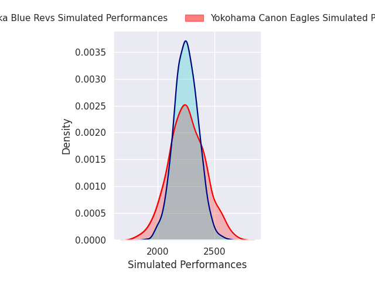
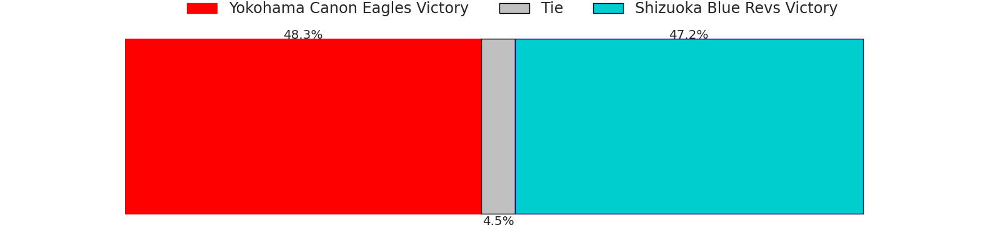
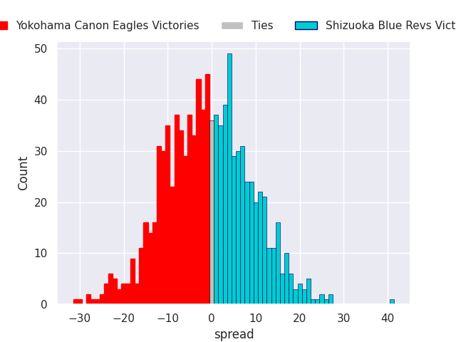

#### Saitama Wild Knights V Mitsubishi Dynaboars on 2027/01/09

Average Margin: Saitama Wild Knights by 21.4

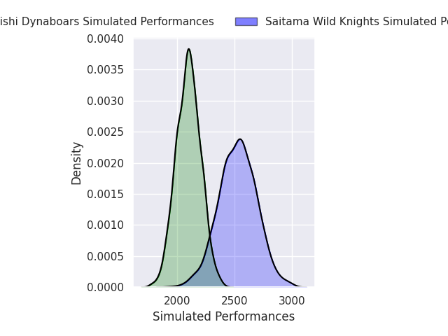
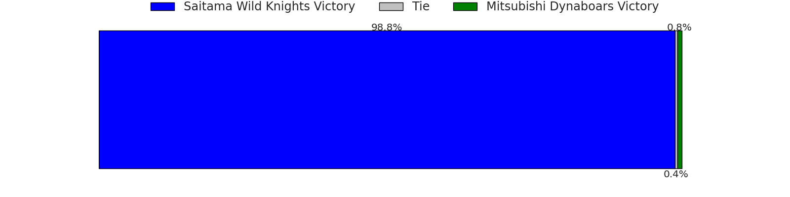
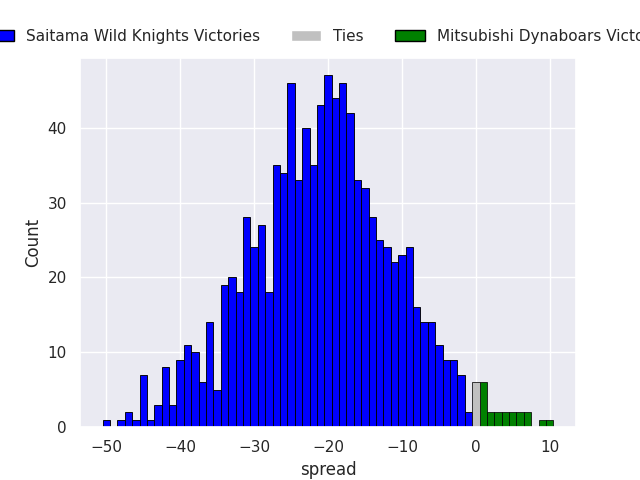

#### Toyota Verblitz V Mie Honda Heat on 2027/01/09

Average Margin: Toyota Verblitz by 4.8

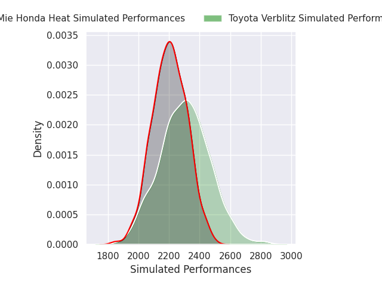
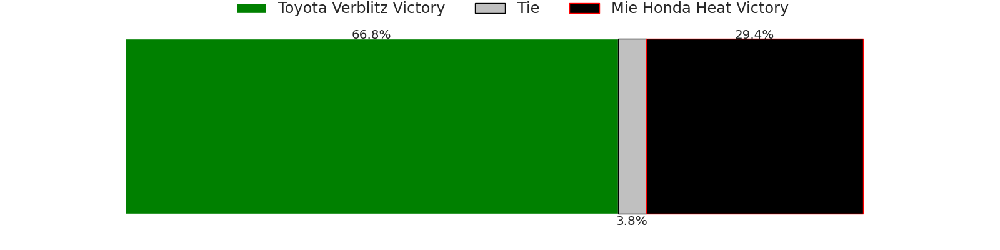
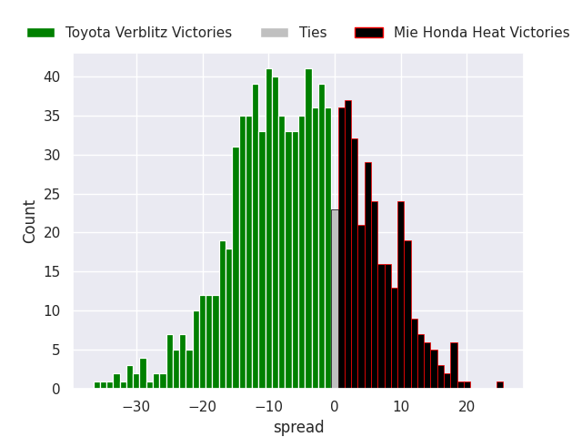

#### Urayasu D-Rocks V Black Rams Tokyo on 2027/01/09

Average Margin: Black Rams Tokyo by 4.1

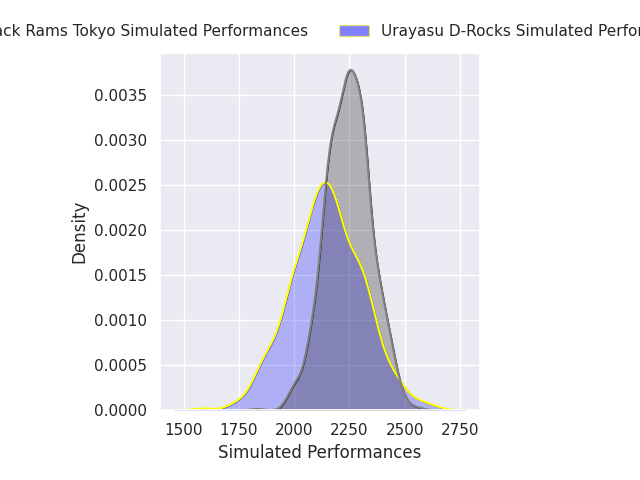
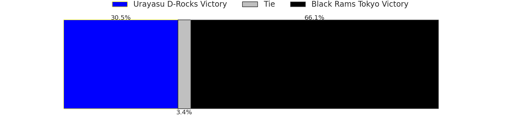
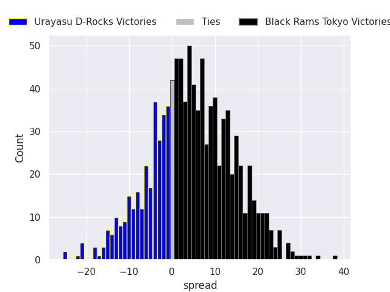

#### Toshiba Brave Lupus V Tokyo Sungoliath on 2027/01/09

Average Margin: Tokyo Sungoliath by 3.7

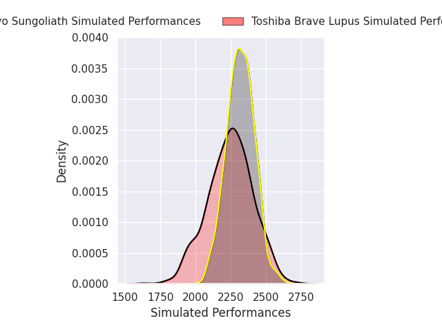
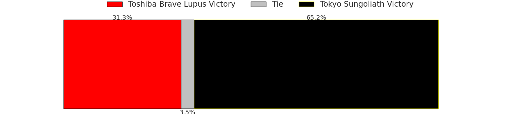
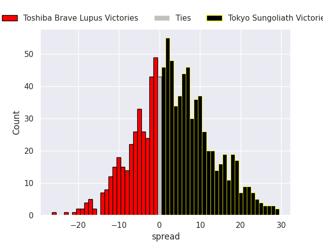

#### Kobelco Kobe Steelers V Kubota Spears on 2027/01/10

Average Margin: Kobelco Kobe Steelers by 4.3

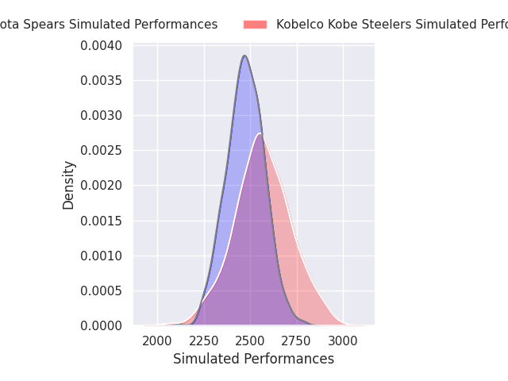
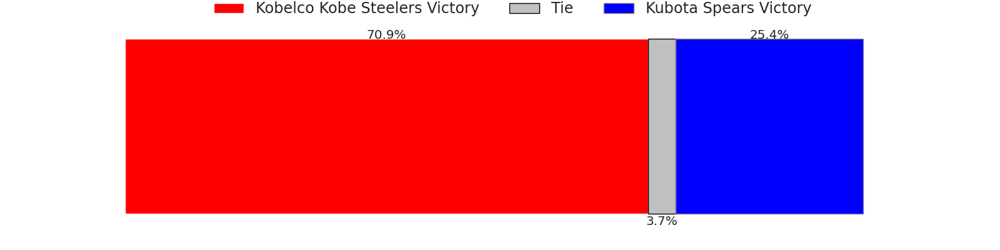
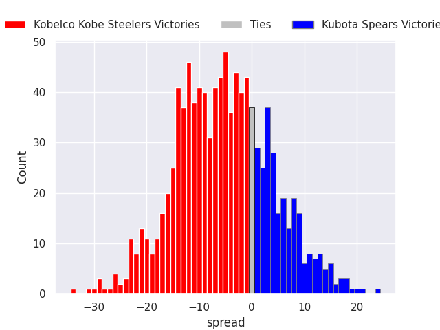

