## Team Rankings

## Standings
### Projected Remaining Table

| Club                  |   To Play |   Projected Wins |   Projected Differential |   Projected Losing Bonus Points | Projected Try Bonus Points   |   Projected Competition Points |
|:----------------------|----------:|-----------------:|-------------------------:|--------------------------------:|:-----------------------------|-------------------------------:|
| Saitama Wild Knights  |         5 |            4.386 |                   75.09  |                           0.364 |                              |                         18.084 |
| Kobelco Kobe Steelers |         5 |            4.173 |                   58.556 |                           0.523 |                              |                         17.443 |
| Kubota Spears         |         5 |            4.018 |                   66.602 |                           0.433 |                              |                         16.671 |
| Shizuoka Blue Revs    |         5 |            3.008 |                   14.503 |                           0.736 |                              |                         12.998 |
| Tokyo Sungoliath      |         5 |            2.688 |                    7.075 |                           1.114 |                              |                         12.246 |
| Mie Honda Heat        |         5 |            2.615 |                    5.13  |                           1.143 |                              |                         11.937 |
| Black Rams Tokyo      |         5 |            1.906 |                  -14.225 |                           1.192 |                              |                          9.112 |
| Toshiba Brave Lupus   |         5 |            1.527 |                  -24.768 |                           1.308 |                              |                          7.744 |
| Yokohama Canon Eagles |         5 |            1.516 |                  -29.153 |                           1.227 |                              |                          7.621 |
| Toyota Verblitz       |         5 |            1.567 |                  -34.809 |                           0.851 |                              |                          7.333 |
| Mitsubishi Dynaboars  |         5 |            1.087 |                  -54.705 |                           0.87  |                              |                          5.444 |
| Urayasu D-Rocks       |         5 |            0.741 |                  -69.296 |                           0.841 |                              |                          3.969 |

### Projected Total Table

| Club                  |   Played |   Wins |   Point Differential |   Losing Bonus Points | Try Bonus Points   |   Competition Points |
|:----------------------|---------:|-------:|---------------------:|----------------------:|:-------------------|---------------------:|
| Saitama Wild Knights  |        5 |  4.386 |               75.09  |                 0.364 |                    |               18.084 |
| Kobelco Kobe Steelers |        5 |  4.173 |               58.556 |                 0.523 |                    |               17.443 |
| Kubota Spears         |        5 |  4.018 |               66.602 |                 0.433 |                    |               16.671 |
| Shizuoka Blue Revs    |        5 |  3.008 |               14.503 |                 0.736 |                    |               12.998 |
| Tokyo Sungoliath      |        5 |  2.688 |                7.075 |                 1.114 |                    |               12.246 |
| Mie Honda Heat        |        5 |  2.615 |                5.13  |                 1.143 |                    |               11.937 |
| Black Rams Tokyo      |        5 |  1.906 |              -14.225 |                 1.192 |                    |                9.112 |
| Toshiba Brave Lupus   |        5 |  1.527 |              -24.768 |                 1.308 |                    |                7.744 |
| Yokohama Canon Eagles |        5 |  1.516 |              -29.153 |                 1.227 |                    |                7.621 |
| Toyota Verblitz       |        5 |  1.567 |              -34.809 |                 0.851 |                    |                7.333 |
| Mitsubishi Dynaboars  |        5 |  1.087 |              -54.705 |                 0.87  |                    |                5.444 |
| Urayasu D-Rocks       |        5 |  0.741 |              -69.296 |                 0.841 |                    |                3.969 |

## Future Predictions
### Week 1
#### Saitama Wild Knights V Urayasu D-Rocks on 2026/12/11

Average Margin: Saitama Wild Knights by 23.8

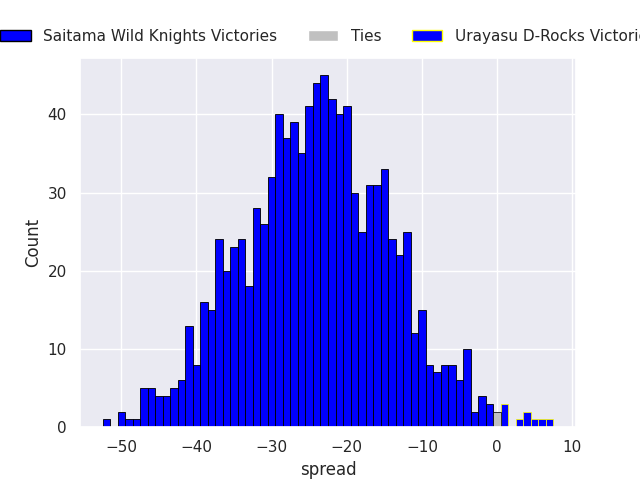

#### Mie Honda Heat V Toshiba Brave Lupus on 2026/12/11

Average Margin: Mie Honda Heat by 4.9

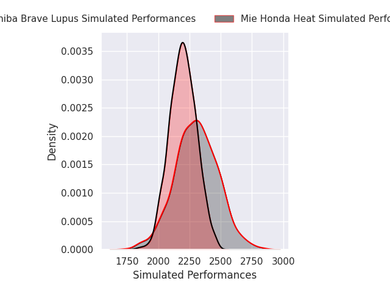
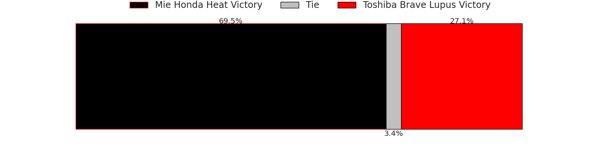

#### Kobelco Kobe Steelers V Toyota Verblitz on 2026/12/11

Average Margin: Kobelco Kobe Steelers by 18.1

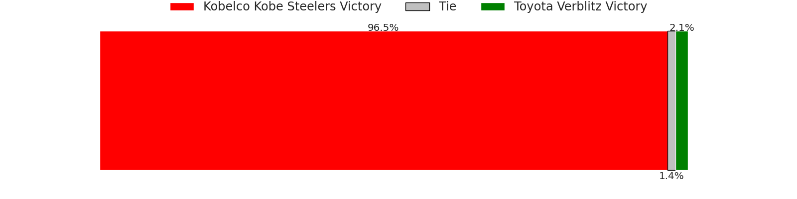

#### Kubota Spears V Shizuoka Blue Revs on 2026/12/12

Average Margin: Kubota Spears by 15.0

#### Mitsubishi Dynaboars V Yokohama Canon Eagles on 2026/12/12

Average Margin: Yokohama Canon Eagles by 0.3

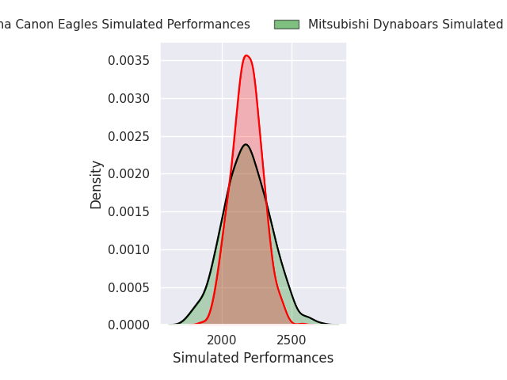
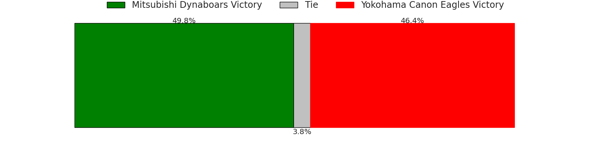

#### Tokyo Sungoliath V Black Rams Tokyo on 2026/12/12

Average Margin: Tokyo Sungoliath by 8.0

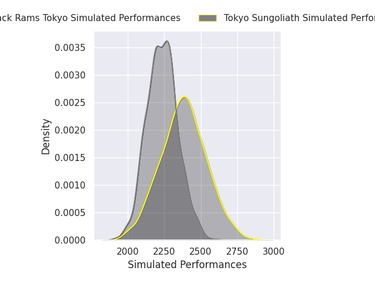

### Week 2
#### Black Rams Tokyo V Kobelco Kobe Steelers on 2026/12/19

Average Margin: Kobelco Kobe Steelers by 10.4

#### Toyota Verblitz V Kubota Spears on 2026/12/19

Average Margin: Kubota Spears by 10.3

#### Toshiba Brave Lupus V Saitama Wild Knights on 2026/12/19

Average Margin: Saitama Wild Knights by 10.9

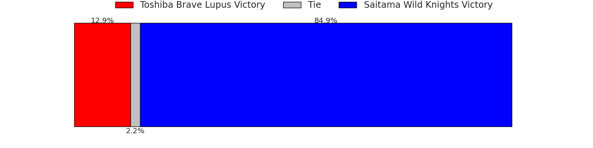

#### Shizuoka Blue Revs V Mitsubishi Dynaboars on 2026/12/20

Average Margin: Shizuoka Blue Revs by 11.2

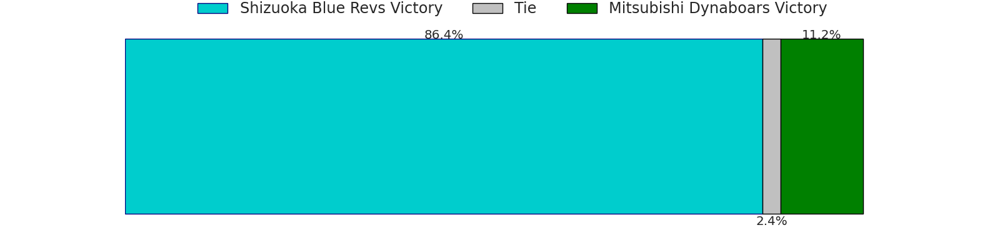

#### Urayasu D-Rocks V Mie Honda Heat on 2026/12/20

Average Margin: Mie Honda Heat by 3.4

#### Yokohama Canon Eagles V Tokyo Sungoliath on 2026/12/20

Average Margin: Tokyo Sungoliath by 3.7

### Week 3
#### Kubota Spears V Urayasu D-Rocks on 2026/12/26

Average Margin: Kubota Spears by 24.7

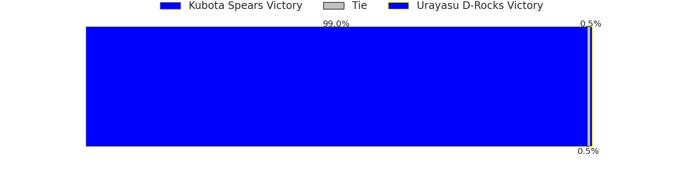
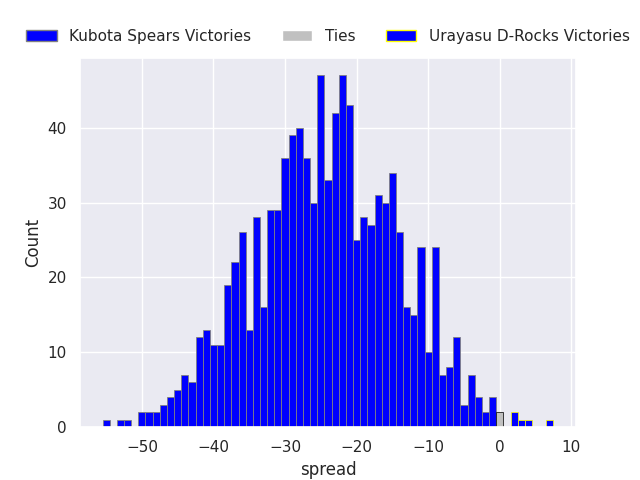

#### Saitama Wild Knights V Toyota Verblitz on 2026/12/26

Average Margin: Saitama Wild Knights by 16.4

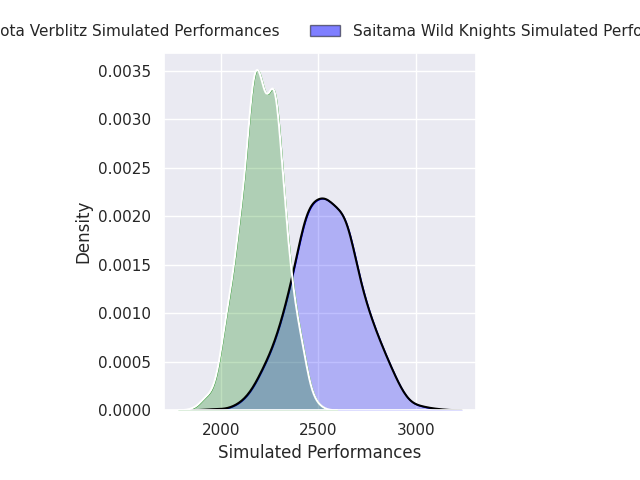
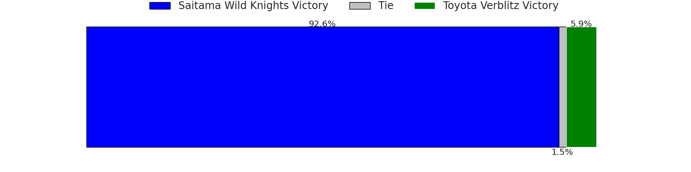

#### Mitsubishi Dynaboars V Toshiba Brave Lupus on 2026/12/27

Average Margin: Toshiba Brave Lupus by 0.5

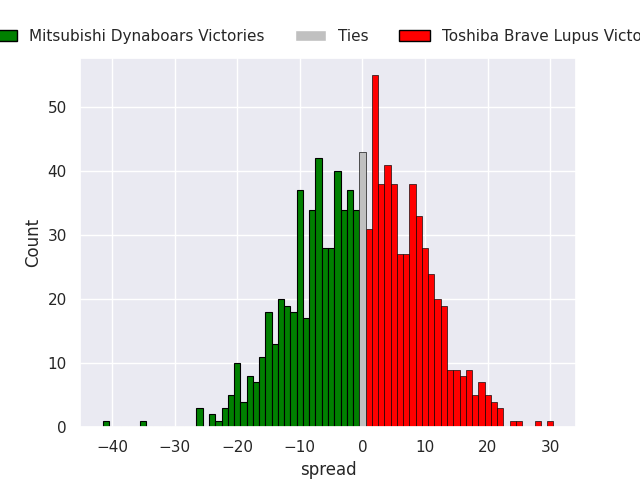

#### Tokyo Sungoliath V Kobelco Kobe Steelers on 2026/12/27

Average Margin: Kobelco Kobe Steelers by 5.5

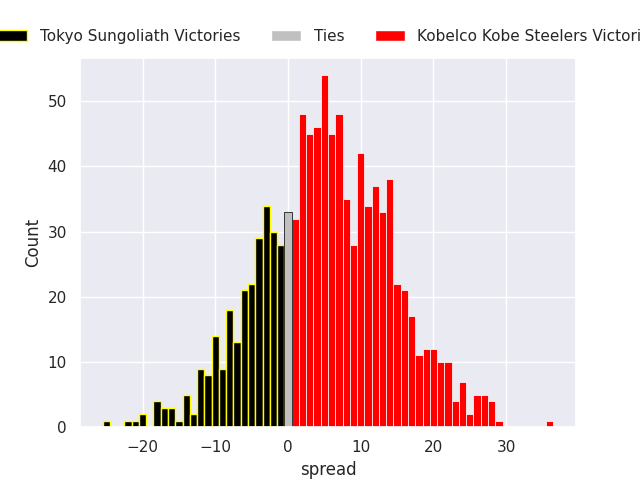

#### Shizuoka Blue Revs V Black Rams Tokyo on 2026/12/27

Average Margin: Shizuoka Blue Revs by 4.9

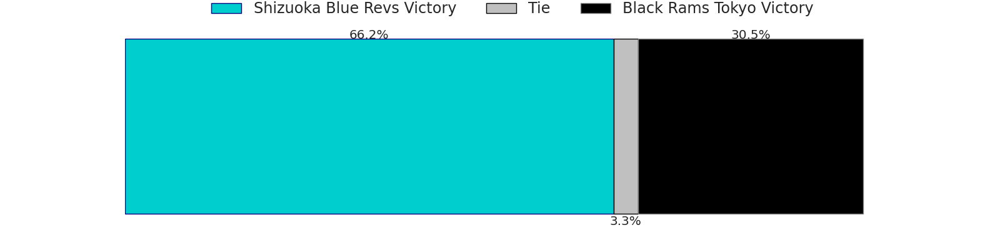
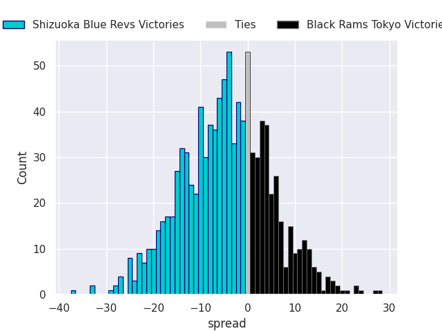

#### Mie Honda Heat V Yokohama Canon Eagles on 2026/12/27

Average Margin: Mie Honda Heat by 6.2

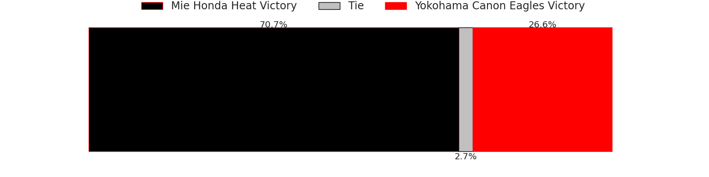

### Week 4
#### Urayasu D-Rocks V Black Rams Tokyo on 2027/01/09

Average Margin: Black Rams Tokyo by 4.3

#### Saitama Wild Knights V Mitsubishi Dynaboars on 2027/01/09

Average Margin: Saitama Wild Knights by 20.8

#### Yokohama Canon Eagles V Shizuoka Blue Revs on 2027/01/09

Average Margin: Shizuoka Blue Revs by 0.3

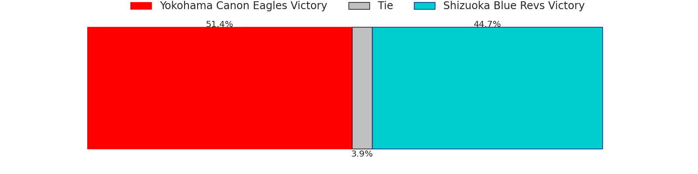
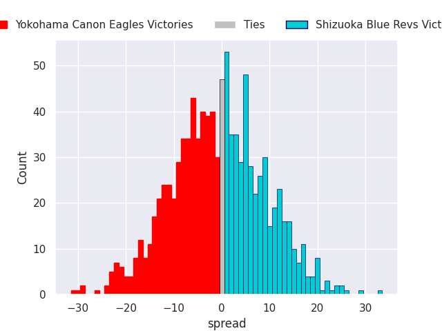

#### Toshiba Brave Lupus V Tokyo Sungoliath on 2027/01/09

Average Margin: Tokyo Sungoliath by 4.1

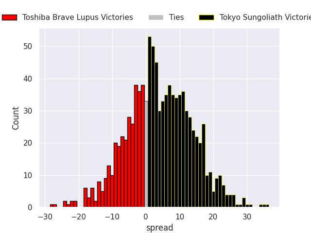

#### Toyota Verblitz V Mie Honda Heat on 2027/01/09

Average Margin: Toyota Verblitz by 4.7

#### Kobelco Kobe Steelers V Kubota Spears on 2027/01/10

Average Margin: Kobelco Kobe Steelers by 5.4

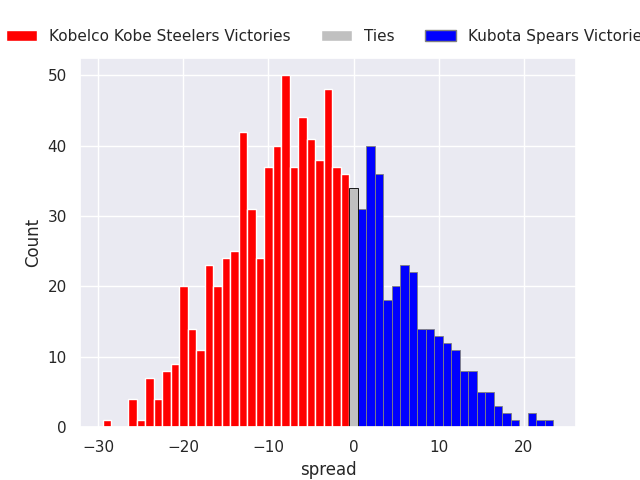

### Week 5
#### Kubota Spears V Mitsubishi Dynaboars on 2027/01/16

Average Margin: Kubota Spears by 22.0

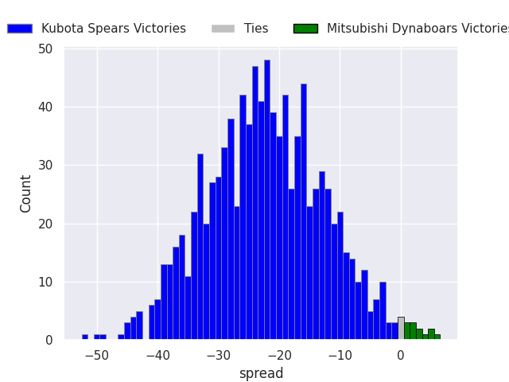

#### Black Rams Tokyo V Mie Honda Heat on 2027/01/16

Average Margin: Black Rams Tokyo by 4.7

#### Shizuoka Blue Revs V Urayasu D-Rocks on 2027/01/16

Average Margin: Shizuoka Blue Revs by 13.0

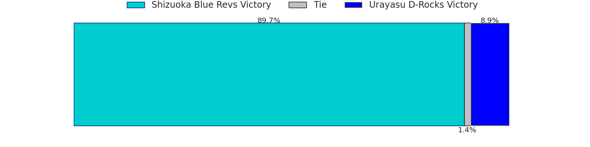
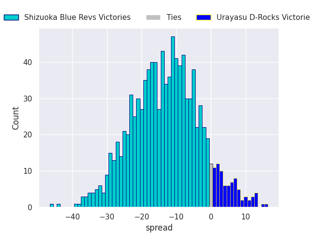

#### Toyota Verblitz V Toshiba Brave Lupus on 2027/01/16

Average Margin: Toyota Verblitz by 5.3

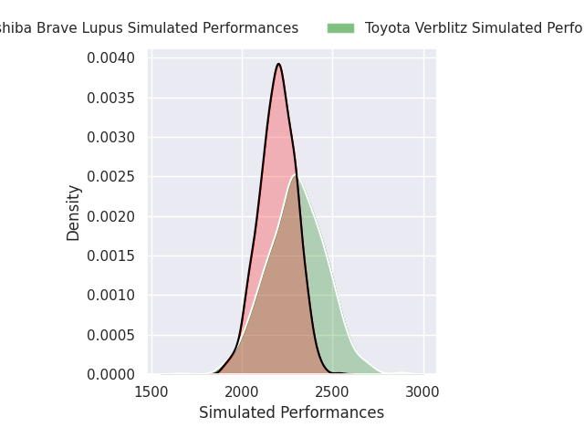

#### Kobelco Kobe Steelers V Yokohama Canon Eagles on 2027/01/16

Average Margin: Kobelco Kobe Steelers by 19.2

#### Tokyo Sungoliath V Saitama Wild Knights on 2027/01/16

Average Margin: Saitama Wild Knights by 3.2

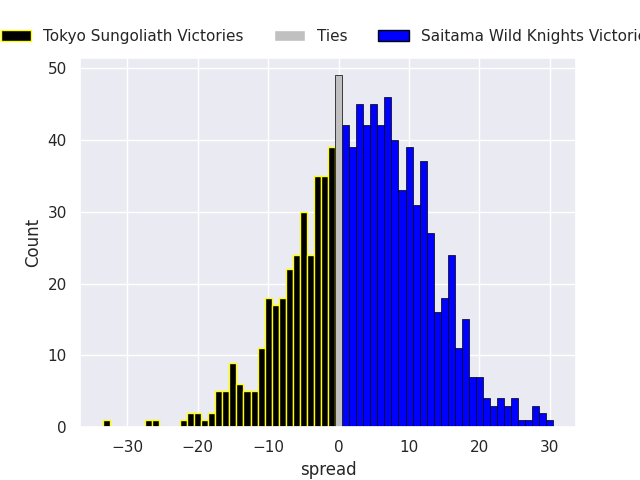

