## Team Rankings

## Standings
### Projected Remaining Table

| Club                     |   To Play |   Projected Wins |   Projected Differential |   Projected Losing Bonus Points | Projected Try Bonus Points   |   Projected Competition Points |
|:-------------------------|----------:|-----------------:|-------------------------:|--------------------------------:|:-----------------------------|-------------------------------:|
| Toyota Shuttles Aichi    |         4 |            2.922 |                   33.789 |                           0.583 |                              |                         12.503 |
| Green Rockets Tokatsu    |         4 |            2.482 |                   15.48  |                           0.76  |                              |                         10.944 |
| Hanazono Kintetsu Liners |         4 |            2.095 |                    4.435 |                           0.743 |                              |                          9.375 |
| Shimizu Blue Sharks      |         4 |            2.051 |                    2.719 |                           0.854 |                              |                          9.372 |
| Kyuden Voltex            |         4 |            1.829 |                   -1.568 |                           0.932 |                              |                          8.536 |
| Sayama Secom Rugguts     |         4 |            1.828 |                   -2.073 |                           0.922 |                              |                          8.508 |
| Skyactivs Hiroshima      |         4 |            1.211 |                  -27.232 |                           0.754 |                              |                          5.828 |
| Red Hurricanes Osaka     |         4 |            1.055 |                  -25.55  |                           0.986 |                              |                          5.468 |

### Projected Total Table

| Club                     |   Played |   Wins |   Point Differential |   Losing Bonus Points | Try Bonus Points   |   Competition Points |
|:-------------------------|---------:|-------:|---------------------:|----------------------:|:-------------------|---------------------:|
| Toyota Shuttles Aichi    |        4 |  2.922 |               33.789 |                 0.583 |                    |               12.503 |
| Green Rockets Tokatsu    |        4 |  2.482 |               15.48  |                 0.76  |                    |               10.944 |
| Hanazono Kintetsu Liners |        4 |  2.095 |                4.435 |                 0.743 |                    |                9.375 |
| Shimizu Blue Sharks      |        4 |  2.051 |                2.719 |                 0.854 |                    |                9.372 |
| Kyuden Voltex            |        4 |  1.829 |               -1.568 |                 0.932 |                    |                8.536 |
| Sayama Secom Rugguts     |        4 |  1.828 |               -2.073 |                 0.922 |                    |                8.508 |
| Skyactivs Hiroshima      |        4 |  1.211 |              -27.232 |                 0.754 |                    |                5.828 |
| Red Hurricanes Osaka     |        4 |  1.055 |              -25.55  |                 0.986 |                    |                5.468 |

## Future Predictions
### Week 1
#### Hanazono Kintetsu Liners V Red Hurricanes Osaka on 2026/12/12

Average Margin: Hanazono Kintetsu Liners by 11.2

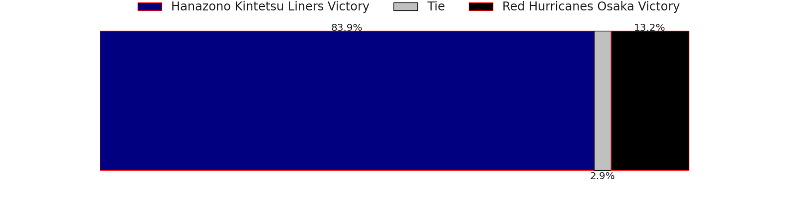

#### Shimizu Blue Sharks V Toyota Shuttles Aichi on 2026/12/12

Average Margin: Toyota Shuttles Aichi by 4.6

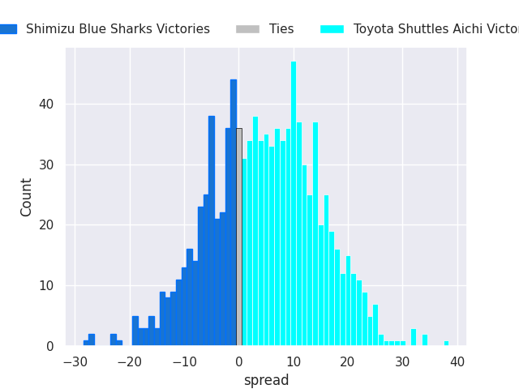

#### Skyactivs Hiroshima V Sayama Secom Rugguts on 2026/12/12

Average Margin: Sayama Secom Rugguts by 3.7

#### Green Rockets Tokatsu V Kyuden Voltex on 2026/12/13

Average Margin: Green Rockets Tokatsu by 7.4

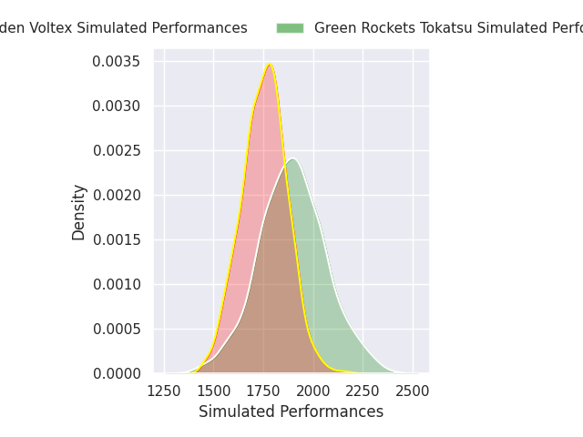
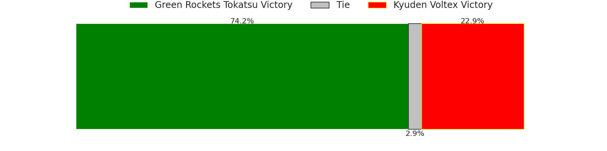

### Week 2
#### Red Hurricanes Osaka V Shimizu Blue Sharks on 2026/12/19

Average Margin: Shimizu Blue Sharks by 4.2

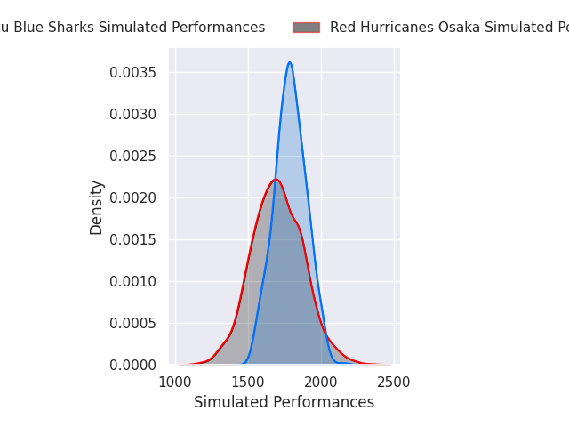

#### Toyota Shuttles Aichi V Skyactivs Hiroshima on 2026/12/19

Average Margin: Toyota Shuttles Aichi by 18.7

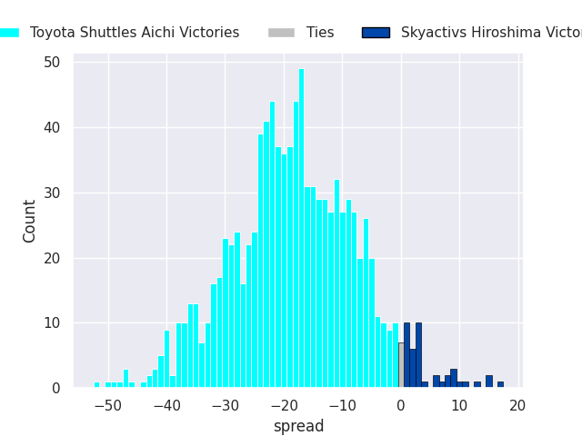

#### Kyuden Voltex V Hanazono Kintetsu Liners on 2026/12/20

Average Margin: Kyuden Voltex by 1.9

### Week 3
#### Sayama Secom Rugguts V Green Rockets Tokatsu on 2026/12/27

Average Margin: Green Rockets Tokatsu by 2.0

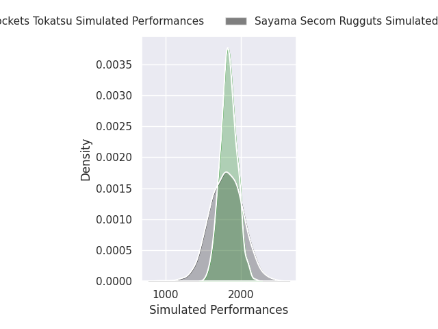
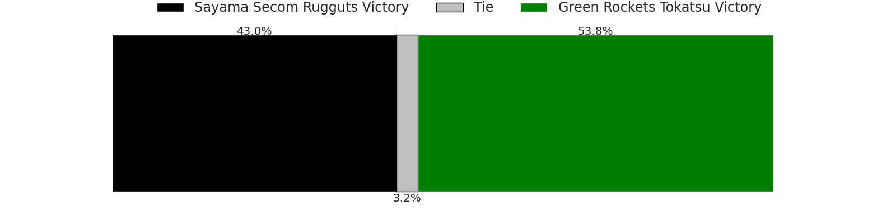

### Week 4
#### Shimizu Blue Sharks V Kyuden Voltex on 2027/01/09

Average Margin: Shimizu Blue Sharks by 4.1

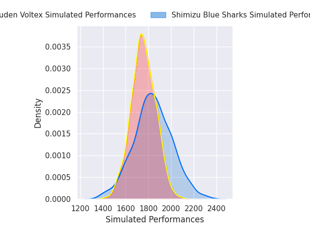
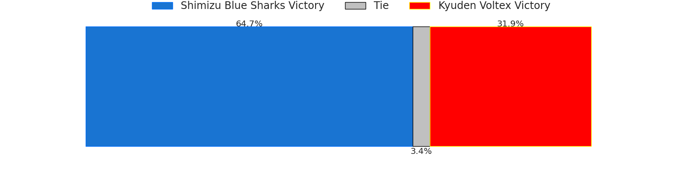
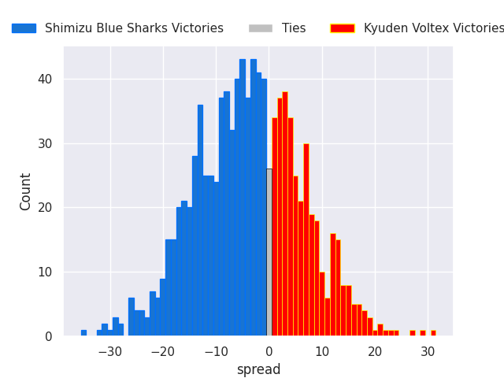

#### Hanazono Kintetsu Liners V Sayama Secom Rugguts on 2027/01/09

Average Margin: Hanazono Kintetsu Liners by 4.7

#### Skyactivs Hiroshima V Red Hurricanes Osaka on 2027/01/09

Average Margin: Skyactivs Hiroshima by 2.1

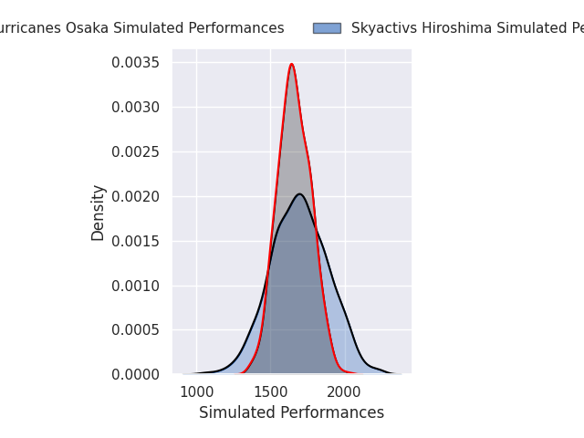

#### Green Rockets Tokatsu V Toyota Shuttles Aichi on 2027/01/10

Average Margin: Toyota Shuttles Aichi by 0.8

### Week 5
#### Skyactivs Hiroshima V Green Rockets Tokatsu on 2027/01/16

Average Margin: Green Rockets Tokatsu by 6.9

#### Sayama Secom Rugguts V Shimizu Blue Sharks on 2027/01/16

Average Margin: Sayama Secom Rugguts by 1.0

#### Toyota Shuttles Aichi V Hanazono Kintetsu Liners on 2027/01/17

Average Margin: Toyota Shuttles Aichi by 9.7

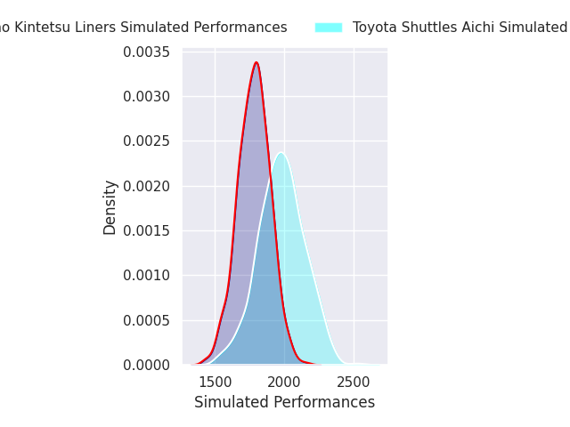

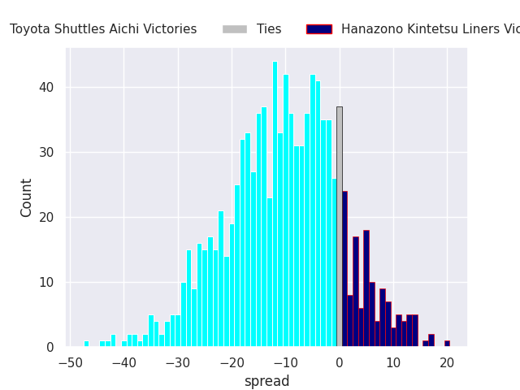

#### Kyuden Voltex V Red Hurricanes Osaka on 2027/01/17

Average Margin: Kyuden Voltex by 8.1

