## Team Rankings

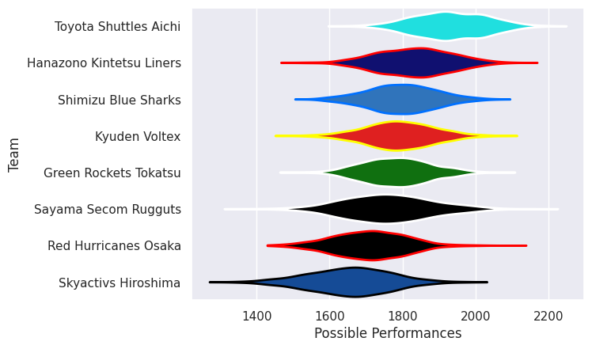
## Standings
### Projected Remaining Table

| Club                     |   To Play |   Projected Wins |   Projected Differential |   Projected Losing Bonus Points | Projected Try Bonus Points   |   Projected Competition Points |
|:-------------------------|----------:|-----------------:|-------------------------:|--------------------------------:|:-----------------------------|-------------------------------:|
| Toyota Shuttles Aichi    |         2 |            1.608 |                   23.573 |                           0.223 |                              |                          6.735 |
| Hanazono Kintetsu Liners |         2 |            1.242 |                    9.16  |                           0.356 |                              |                          5.442 |
| Shimizu Blue Sharks      |         2 |            0.97  |                   -0.15  |                           0.451 |                              |                          4.461 |
| Kyuden Voltex            |         2 |            0.785 |                   -5.185 |                           0.46  |                              |                          3.758 |
| Green Rockets Tokatsu    |         1 |            0.736 |                    6.957 |                           0.158 |                              |                          3.172 |
| Sayama Secom Rugguts     |         1 |            0.611 |                    4.16  |                           0.21  |                              |                          2.73  |
| Red Hurricanes Osaka     |         2 |            0.462 |                  -15.286 |                           0.502 |                              |                          2.444 |
| Skyactivs Hiroshima      |         2 |            0.382 |                  -23.229 |                           0.319 |                              |                          1.937 |

### Projected Total Table

| Club                     |   Played |   Wins |   Point Differential |   Losing Bonus Points | Try Bonus Points   |   Competition Points |
|:-------------------------|---------:|-------:|---------------------:|----------------------:|:-------------------|---------------------:|
| Toyota Shuttles Aichi    |        2 |  1.608 |               23.573 |                 0.223 |                    |                6.735 |
| Hanazono Kintetsu Liners |        2 |  1.242 |                9.16  |                 0.356 |                    |                5.442 |
| Shimizu Blue Sharks      |        2 |  0.97  |               -0.15  |                 0.451 |                    |                4.461 |
| Kyuden Voltex            |        2 |  0.785 |               -5.185 |                 0.46  |                    |                3.758 |
| Green Rockets Tokatsu    |        1 |  0.736 |                6.957 |                 0.158 |                    |                3.172 |
| Sayama Secom Rugguts     |        1 |  0.611 |                4.16  |                 0.21  |                    |                2.73  |
| Red Hurricanes Osaka     |        2 |  0.462 |              -15.286 |                 0.502 |                    |                2.444 |
| Skyactivs Hiroshima      |        2 |  0.382 |              -23.229 |                 0.319 |                    |                1.937 |

## Future Predictions
### Week 1
#### Skyactivs Hiroshima V Sayama Secom Rugguts on 2026/12/12

Average Margin: Sayama Secom Rugguts by 4.2

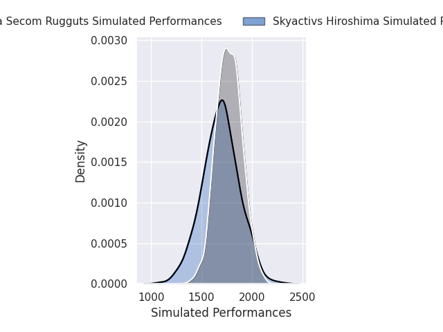
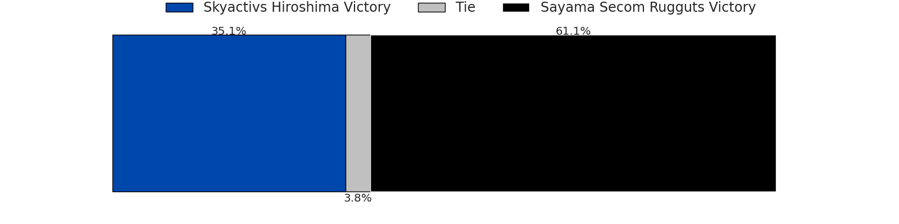
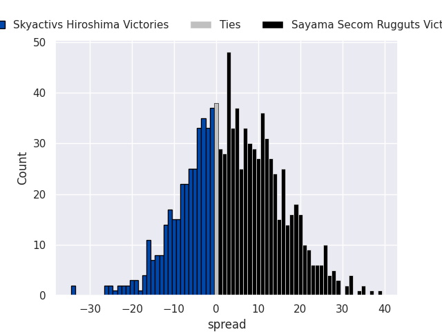

#### Hanazono Kintetsu Liners V Red Hurricanes Osaka on 2026/12/12

Average Margin: Hanazono Kintetsu Liners by 10.9

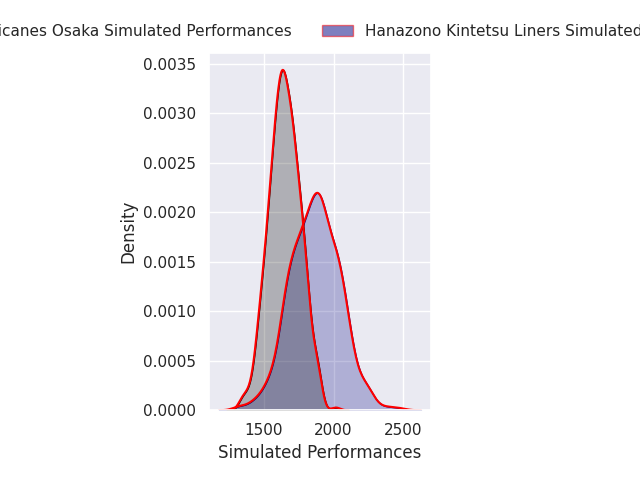
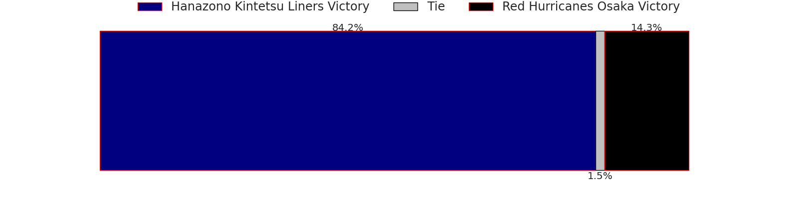
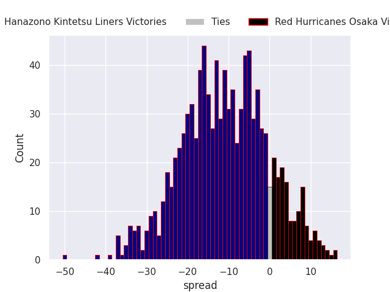

#### Shimizu Blue Sharks V Toyota Shuttles Aichi on 2026/12/12

Average Margin: Toyota Shuttles Aichi by 4.5

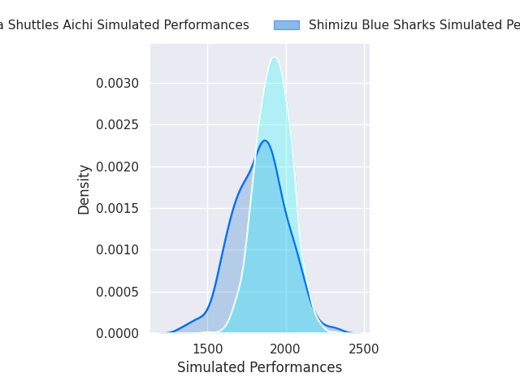
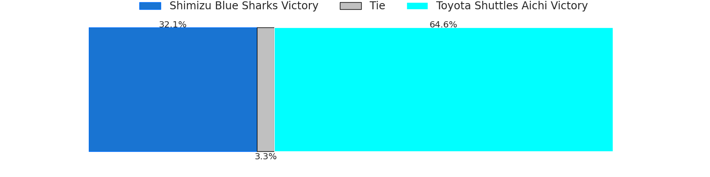
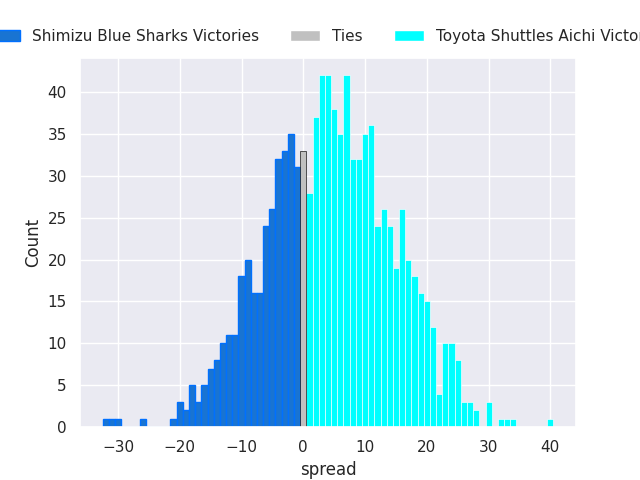

#### Green Rockets Tokatsu V Kyuden Voltex on 2026/12/13

Average Margin: Green Rockets Tokatsu by 7.0

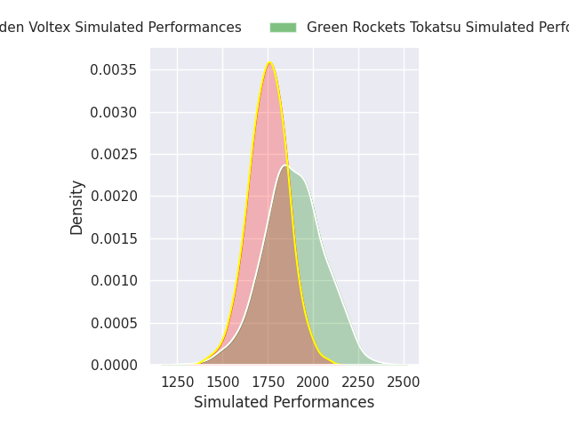
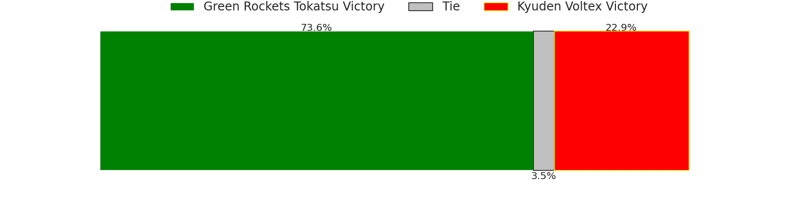
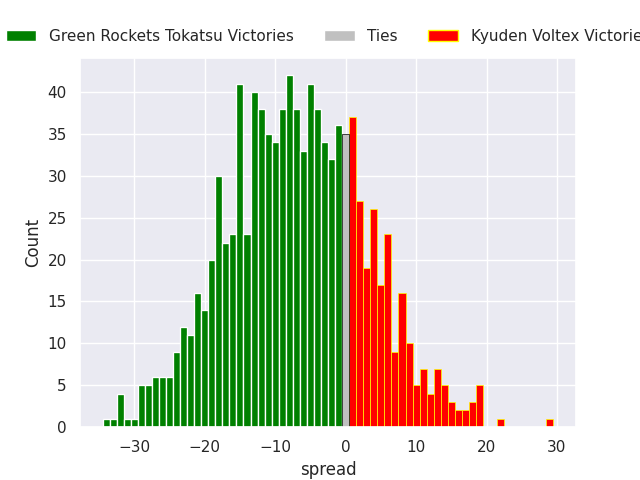

### Week 2
#### Toyota Shuttles Aichi V Skyactivs Hiroshima on 2026/12/19

Average Margin: Toyota Shuttles Aichi by 19.1

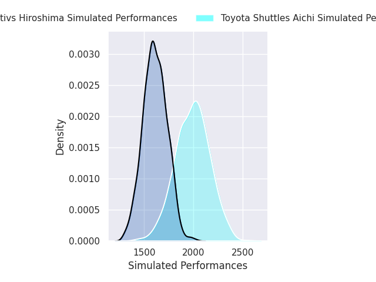
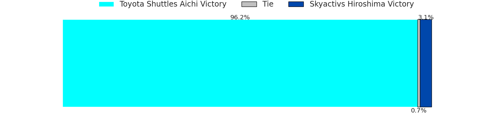
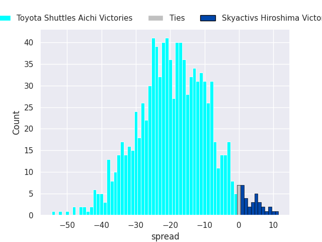

#### Red Hurricanes Osaka V Shimizu Blue Sharks on 2026/12/19

Average Margin: Shimizu Blue Sharks by 4.4

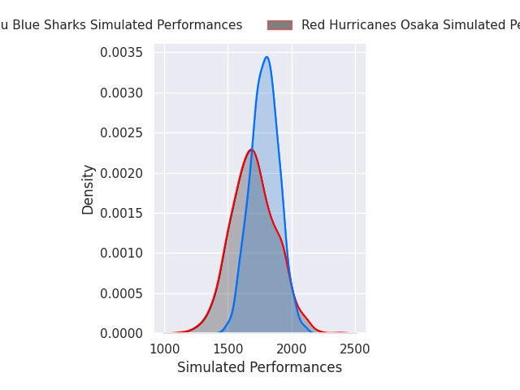
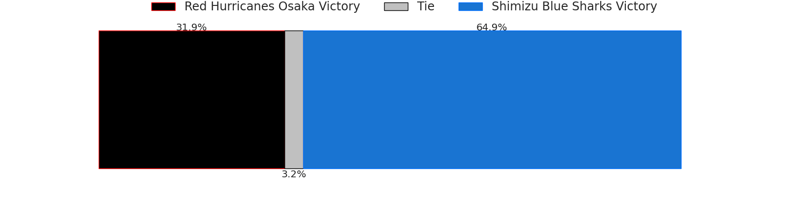
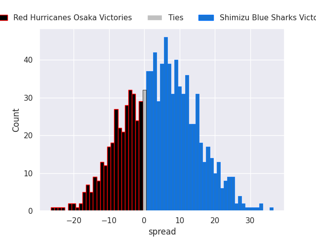

#### Kyuden Voltex V Hanazono Kintetsu Liners on 2026/12/20

Average Margin: Kyuden Voltex by 1.8

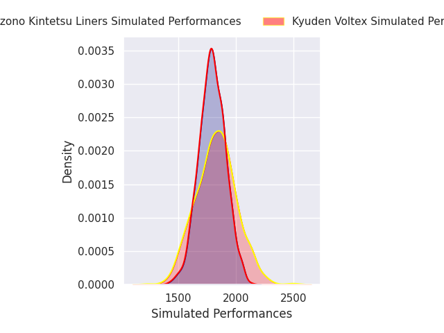
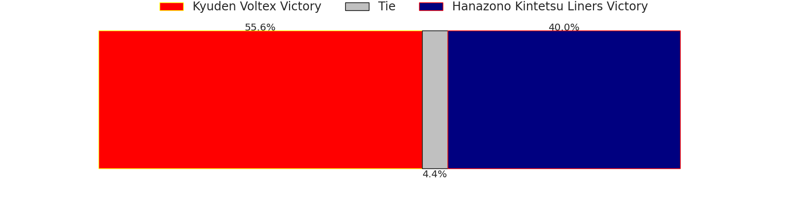
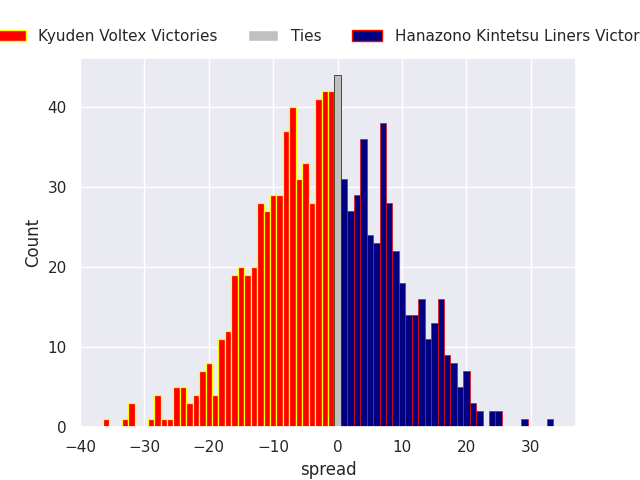

