## Team Rankings

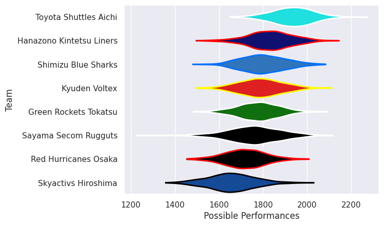
## Standings
### Projected Remaining Table

| Club                     |   To Play |   Projected Wins |   Projected Differential |   Projected Losing Bonus Points | Projected Try Bonus Points   |   Projected Competition Points |
|:-------------------------|----------:|-----------------:|-------------------------:|--------------------------------:|:-----------------------------|-------------------------------:|
| Toyota Shuttles Aichi    |         2 |            1.62  |                   23.456 |                           0.211 |                              |                          6.773 |
| Green Rockets Tokatsu    |         2 |            1.252 |                    8.458 |                           0.403 |                              |                          5.539 |
| Hanazono Kintetsu Liners |         2 |            1.234 |                    8.897 |                           0.376 |                              |                          5.448 |
| Sayama Secom Rugguts     |         2 |            1.056 |                    2.586 |                           0.416 |                              |                          4.786 |
| Shimizu Blue Sharks      |         2 |            0.926 |                   -0.695 |                           0.491 |                              |                          4.323 |
| Kyuden Voltex            |         2 |            0.815 |                   -4.833 |                           0.458 |                              |                          3.862 |
| Red Hurricanes Osaka     |         2 |            0.484 |                  -14.83  |                           0.47  |                              |                          2.512 |
| Skyactivs Hiroshima      |         2 |            0.374 |                  -23.039 |                           0.347 |                              |                          1.929 |

### Projected Total Table

| Club                     |   Played |   Wins |   Point Differential |   Losing Bonus Points | Try Bonus Points   |   Competition Points |
|:-------------------------|---------:|-------:|---------------------:|----------------------:|:-------------------|---------------------:|
| Toyota Shuttles Aichi    |        2 |  1.62  |               23.456 |                 0.211 |                    |                6.773 |
| Green Rockets Tokatsu    |        2 |  1.252 |                8.458 |                 0.403 |                    |                5.539 |
| Hanazono Kintetsu Liners |        2 |  1.234 |                8.897 |                 0.376 |                    |                5.448 |
| Sayama Secom Rugguts     |        2 |  1.056 |                2.586 |                 0.416 |                    |                4.786 |
| Shimizu Blue Sharks      |        2 |  0.926 |               -0.695 |                 0.491 |                    |                4.323 |
| Kyuden Voltex            |        2 |  0.815 |               -4.833 |                 0.458 |                    |                3.862 |
| Red Hurricanes Osaka     |        2 |  0.484 |              -14.83  |                 0.47  |                    |                2.512 |
| Skyactivs Hiroshima      |        2 |  0.374 |              -23.039 |                 0.347 |                    |                1.929 |

## Future Predictions
### Week 1
#### Skyactivs Hiroshima V Sayama Secom Rugguts on 2026/12/12

Average Margin: Sayama Secom Rugguts by 4.3

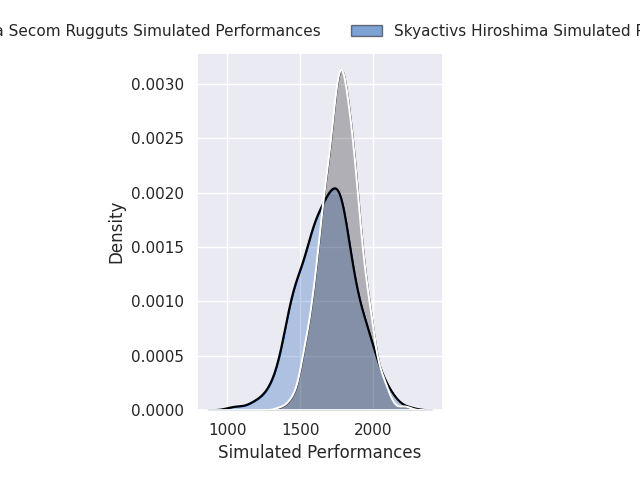
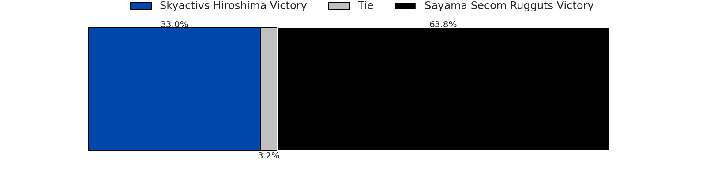
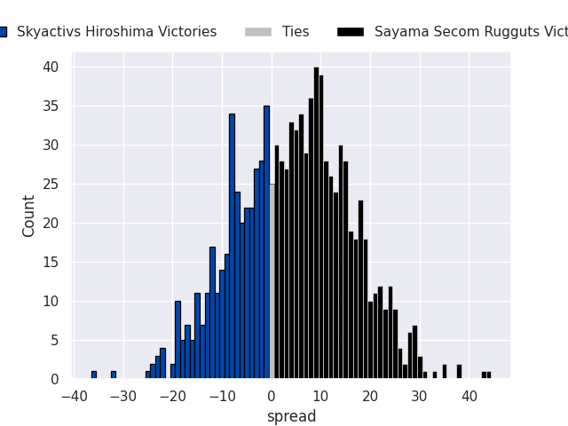

#### Shimizu Blue Sharks V Toyota Shuttles Aichi on 2026/12/12

Average Margin: Toyota Shuttles Aichi by 4.7

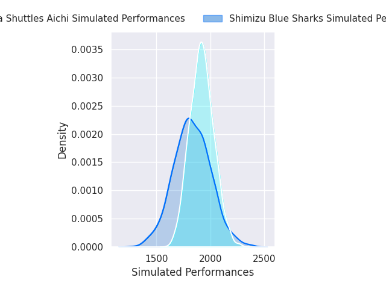
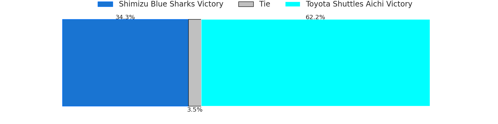
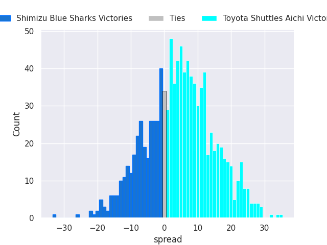

#### Hanazono Kintetsu Liners V Red Hurricanes Osaka on 2026/12/12

Average Margin: Hanazono Kintetsu Liners by 10.8

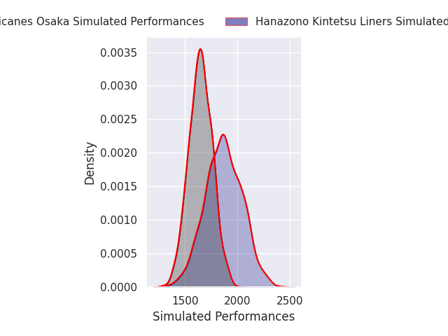
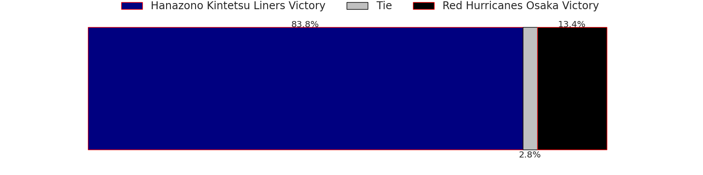
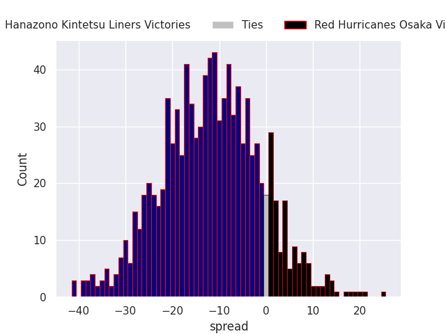

#### Green Rockets Tokatsu V Kyuden Voltex on 2026/12/13

Average Margin: Green Rockets Tokatsu by 6.8

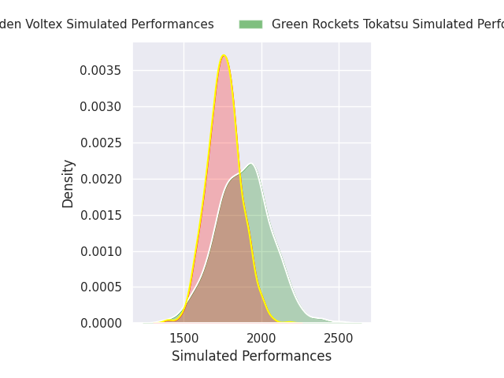
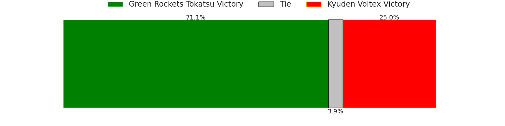
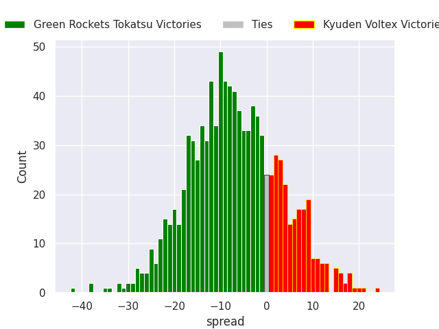

### Week 2
#### Red Hurricanes Osaka V Shimizu Blue Sharks on 2026/12/19

Average Margin: Shimizu Blue Sharks by 4.0

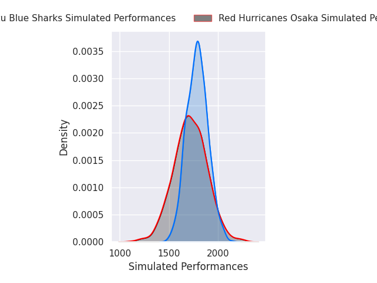
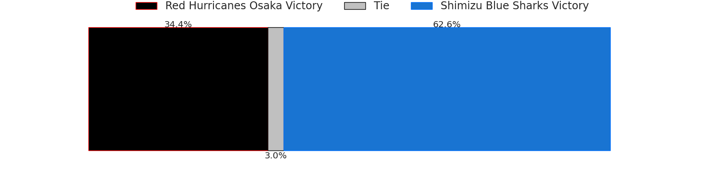
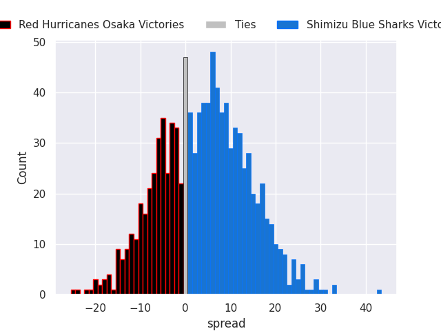

#### Toyota Shuttles Aichi V Skyactivs Hiroshima on 2026/12/19

Average Margin: Toyota Shuttles Aichi by 18.8

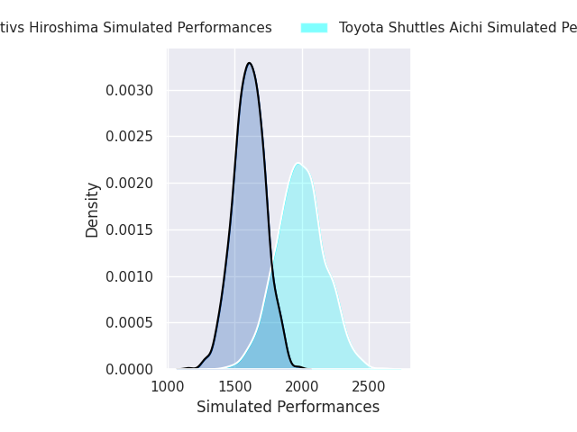
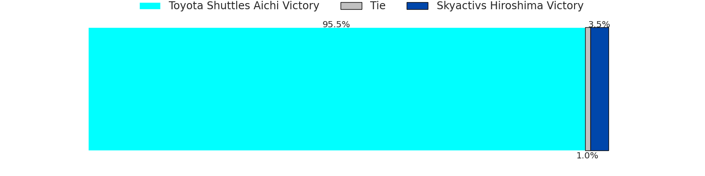
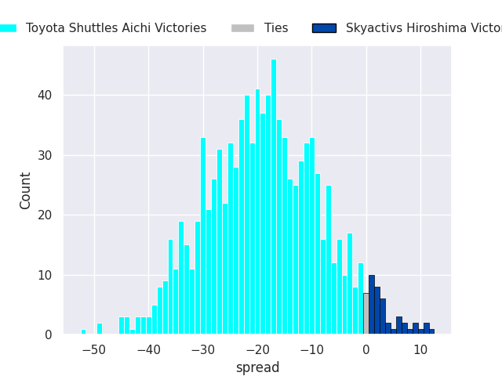

#### Kyuden Voltex V Hanazono Kintetsu Liners on 2026/12/20

Average Margin: Kyuden Voltex by 1.9

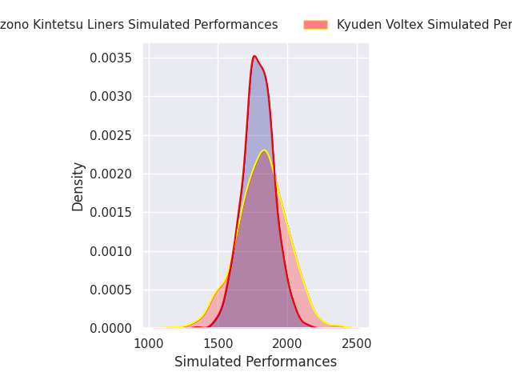
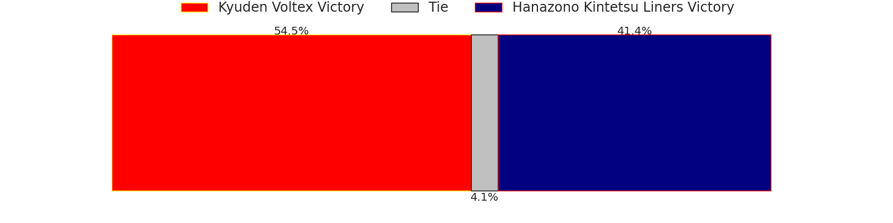
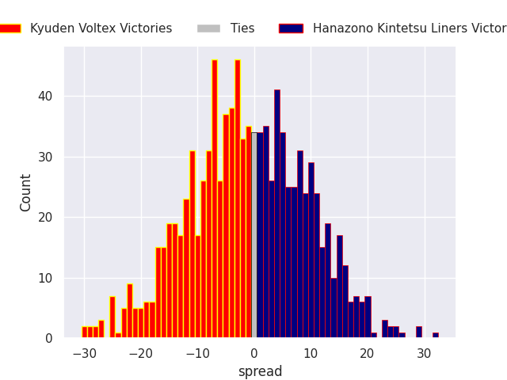

### Week 3
#### Sayama Secom Rugguts V Green Rockets Tokatsu on 2026/12/27

Average Margin: Green Rockets Tokatsu by 1.7

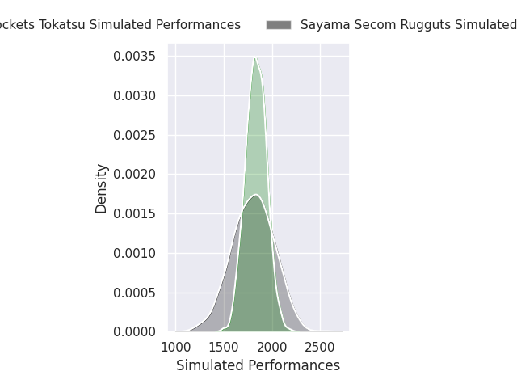
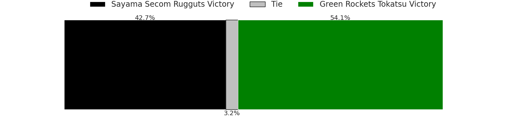
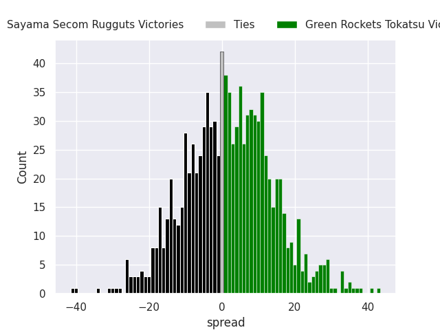

