## Team Rankings

## Standings
### Projected Remaining Table

| Club                     |   To Play |   Projected Wins |   Projected Differential |   Projected Losing Bonus Points | Projected Try Bonus Points   |   Projected Competition Points |
|:-------------------------|----------:|-----------------:|-------------------------:|--------------------------------:|:-----------------------------|-------------------------------:|
| Toyota Shuttles Aichi    |         4 |            2.952 |                   34.044 |                           0.572 |                              |                         12.598 |
| Green Rockets Tokatsu    |         4 |            2.43  |                   13.656 |                           0.781 |                              |                         10.791 |
| Shimizu Blue Sharks      |         4 |            2.044 |                    3.437 |                           0.897 |                              |                          9.371 |
| Hanazono Kintetsu Liners |         4 |            2.09  |                    4.936 |                           0.756 |                              |                          9.334 |
| Kyuden Voltex            |         4 |            1.872 |                   -1.065 |                           0.934 |                              |                          8.72  |
| Sayama Secom Rugguts     |         4 |            1.871 |                   -0.967 |                           0.906 |                              |                          8.656 |
| Skyactivs Hiroshima      |         4 |            1.19  |                  -28.064 |                           0.801 |                              |                          5.759 |
| Red Hurricanes Osaka     |         4 |            1.049 |                  -25.977 |                           0.959 |                              |                          5.377 |

### Projected Total Table

| Club                     |   Played |   Wins |   Point Differential |   Losing Bonus Points | Try Bonus Points   |   Competition Points |
|:-------------------------|---------:|-------:|---------------------:|----------------------:|:-------------------|---------------------:|
| Toyota Shuttles Aichi    |        4 |  2.952 |               34.044 |                 0.572 |                    |               12.598 |
| Green Rockets Tokatsu    |        4 |  2.43  |               13.656 |                 0.781 |                    |               10.791 |
| Shimizu Blue Sharks      |        4 |  2.044 |                3.437 |                 0.897 |                    |                9.371 |
| Hanazono Kintetsu Liners |        4 |  2.09  |                4.936 |                 0.756 |                    |                9.334 |
| Kyuden Voltex            |        4 |  1.872 |               -1.065 |                 0.934 |                    |                8.72  |
| Sayama Secom Rugguts     |        4 |  1.871 |               -0.967 |                 0.906 |                    |                8.656 |
| Skyactivs Hiroshima      |        4 |  1.19  |              -28.064 |                 0.801 |                    |                5.759 |
| Red Hurricanes Osaka     |        4 |  1.049 |              -25.977 |                 0.959 |                    |                5.377 |

## Future Predictions
### Week 1
#### Shimizu Blue Sharks V Toyota Shuttles Aichi on 2026/12/12

Average Margin: Toyota Shuttles Aichi by 4.1

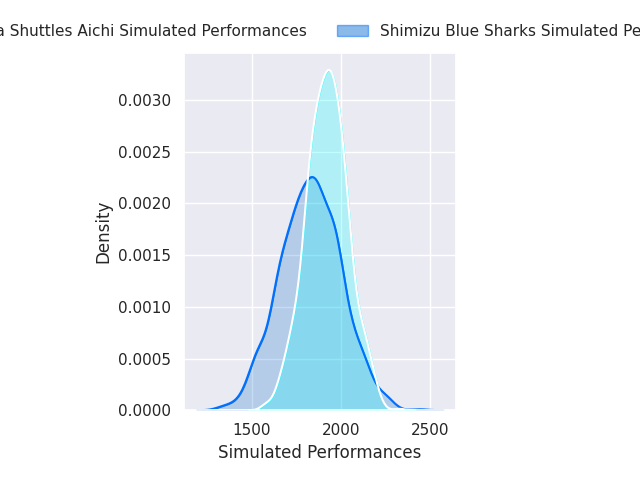

#### Hanazono Kintetsu Liners V Red Hurricanes Osaka on 2026/12/12

Average Margin: Hanazono Kintetsu Liners by 11.4

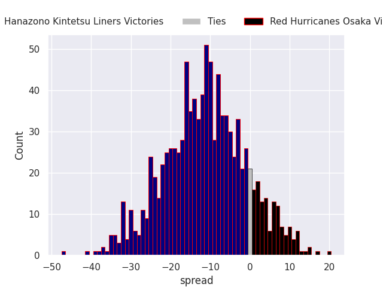

#### Skyactivs Hiroshima V Sayama Secom Rugguts on 2026/12/12

Average Margin: Sayama Secom Rugguts by 4.5

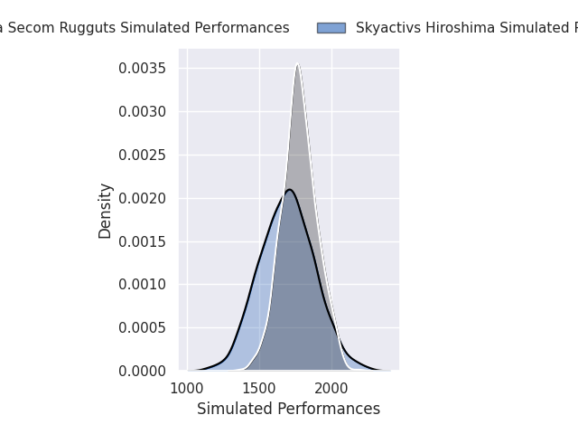
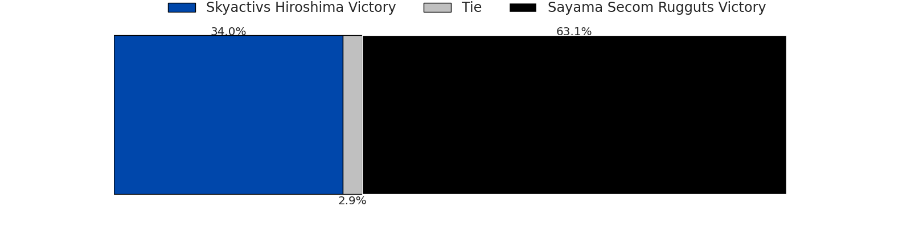
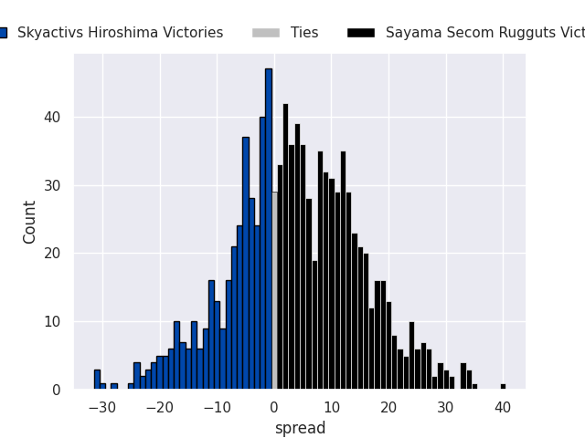

#### Green Rockets Tokatsu V Kyuden Voltex on 2026/12/13

Average Margin: Green Rockets Tokatsu by 6.8

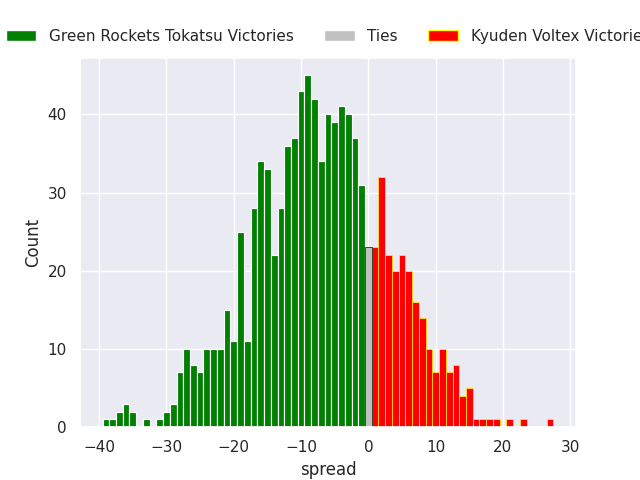

### Week 2
#### Toyota Shuttles Aichi V Skyactivs Hiroshima on 2026/12/19

Average Margin: Toyota Shuttles Aichi by 19.1

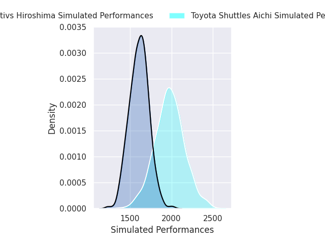
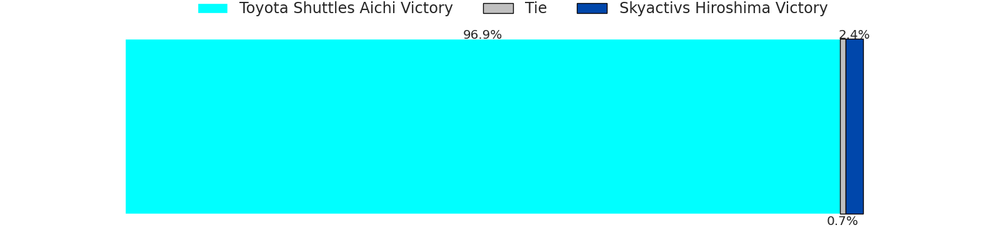

#### Red Hurricanes Osaka V Shimizu Blue Sharks on 2026/12/19

Average Margin: Shimizu Blue Sharks by 4.4

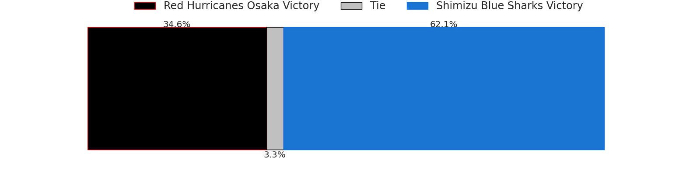
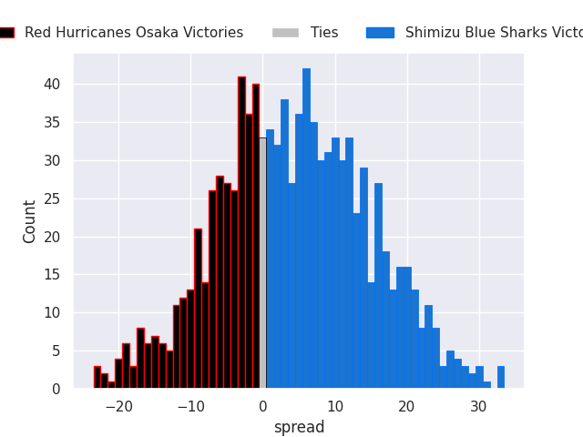

#### Kyuden Voltex V Hanazono Kintetsu Liners on 2026/12/20

Average Margin: Kyuden Voltex by 1.7

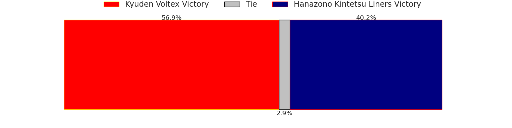

### Week 3
#### Sayama Secom Rugguts V Green Rockets Tokatsu on 2026/12/27

Average Margin: Green Rockets Tokatsu by 1.4

### Week 4
#### Shimizu Blue Sharks V Kyuden Voltex on 2027/01/09

Average Margin: Shimizu Blue Sharks by 4.0

#### Skyactivs Hiroshima V Red Hurricanes Osaka on 2027/01/09

Average Margin: Skyactivs Hiroshima by 2.2

#### Hanazono Kintetsu Liners V Sayama Secom Rugguts on 2027/01/09

Average Margin: Hanazono Kintetsu Liners by 5.0

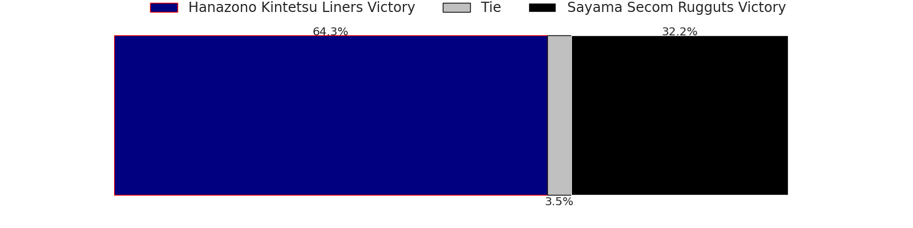

#### Green Rockets Tokatsu V Toyota Shuttles Aichi on 2027/01/10

Average Margin: Toyota Shuttles Aichi by 1.1

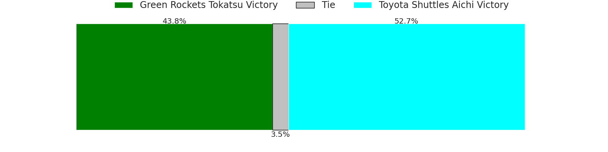
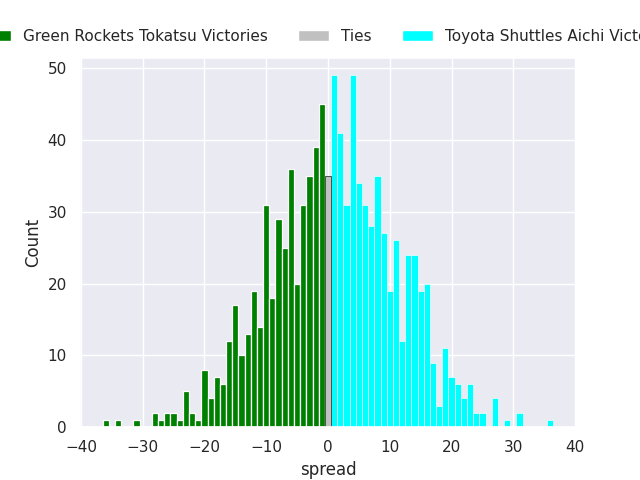

### Week 5
#### Sayama Secom Rugguts V Shimizu Blue Sharks on 2027/01/16

Average Margin: Sayama Secom Rugguts by 0.8

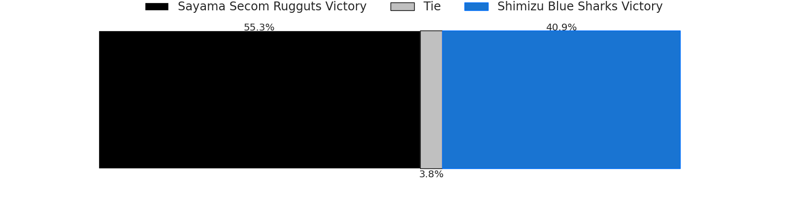

#### Skyactivs Hiroshima V Green Rockets Tokatsu on 2027/01/16

Average Margin: Green Rockets Tokatsu by 6.6

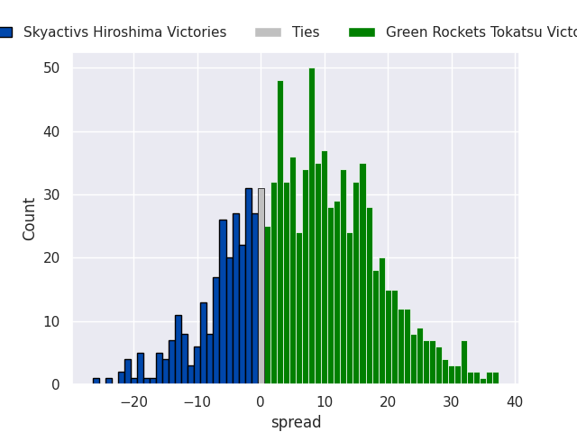

#### Toyota Shuttles Aichi V Hanazono Kintetsu Liners on 2027/01/17

Average Margin: Toyota Shuttles Aichi by 9.7

#### Kyuden Voltex V Red Hurricanes Osaka on 2027/01/17

Average Margin: Kyuden Voltex by 8.0

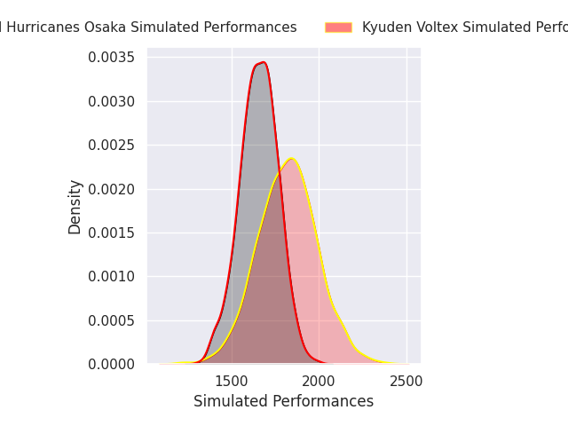

