## Team Rankings

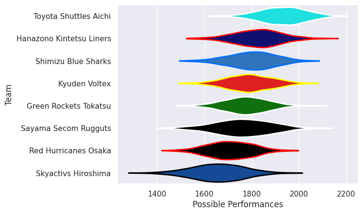
## Standings
### Projected Remaining Table

| Club                     |   To Play |   Projected Wins |   Projected Differential |   Projected Losing Bonus Points | Projected Try Bonus Points   |   Projected Competition Points |
|:-------------------------|----------:|-----------------:|-------------------------:|--------------------------------:|:-----------------------------|-------------------------------:|
| Toyota Shuttles Aichi    |         5 |            3.606 |                   38.792 |                           0.774 |                              |                         15.528 |
| Hanazono Kintetsu Liners |         5 |            3.015 |                   18.385 |                           0.834 |                              |                         13.162 |
| Sayama Secom Rugguts     |         5 |            2.472 |                    1.039 |                           1.122 |                              |                         11.33  |
| Green Rockets Tokatsu    |         4 |            2.412 |                   13.842 |                           0.809 |                              |                         10.733 |
| Kyuden Voltex            |         5 |            2.124 |                   -6.274 |                           1.234 |                              |                         10.042 |
| Shimizu Blue Sharks      |         4 |            2.026 |                    2.521 |                           0.905 |                              |                          9.311 |
| Red Hurricanes Osaka     |         5 |            1.451 |                  -28.538 |                           1.191 |                              |                          7.305 |
| Skyactivs Hiroshima      |         5 |            1.3   |                  -39.767 |                           0.981 |                              |                          6.439 |

### Projected Total Table

| Club                     |   Played |   Wins |   Point Differential |   Losing Bonus Points | Try Bonus Points   |   Competition Points |
|:-------------------------|---------:|-------:|---------------------:|----------------------:|:-------------------|---------------------:|
| Toyota Shuttles Aichi    |        5 |  3.606 |               38.792 |                 0.774 |                    |               15.528 |
| Hanazono Kintetsu Liners |        5 |  3.015 |               18.385 |                 0.834 |                    |               13.162 |
| Sayama Secom Rugguts     |        5 |  2.472 |                1.039 |                 1.122 |                    |               11.33  |
| Green Rockets Tokatsu    |        4 |  2.412 |               13.842 |                 0.809 |                    |               10.733 |
| Kyuden Voltex            |        5 |  2.124 |               -6.274 |                 1.234 |                    |               10.042 |
| Shimizu Blue Sharks      |        4 |  2.026 |                2.521 |                 0.905 |                    |                9.311 |
| Red Hurricanes Osaka     |        5 |  1.451 |              -28.538 |                 1.191 |                    |                7.305 |
| Skyactivs Hiroshima      |        5 |  1.3   |              -39.767 |                 0.981 |                    |                6.439 |

## Future Predictions
### Week 1
#### Hanazono Kintetsu Liners V Red Hurricanes Osaka on 2026/12/12

Average Margin: Hanazono Kintetsu Liners by 11.2

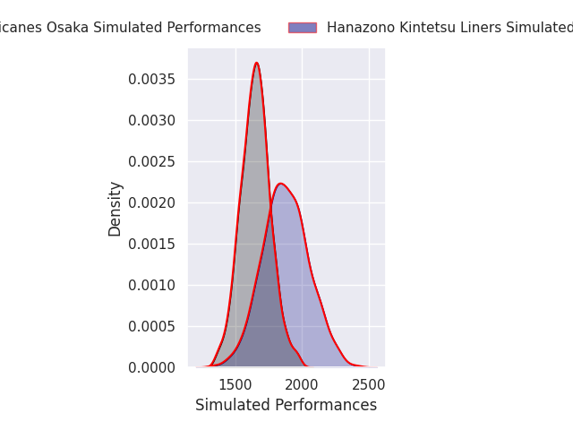

#### Shimizu Blue Sharks V Toyota Shuttles Aichi on 2026/12/12

Average Margin: Toyota Shuttles Aichi by 4.9

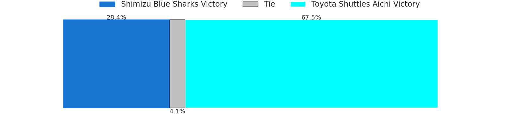

#### Skyactivs Hiroshima V Sayama Secom Rugguts on 2026/12/12

Average Margin: Sayama Secom Rugguts by 3.9

#### Green Rockets Tokatsu V Kyuden Voltex on 2026/12/13

Average Margin: Green Rockets Tokatsu by 7.1

### Week 2
#### Toyota Shuttles Aichi V Skyactivs Hiroshima on 2026/12/19

Average Margin: Toyota Shuttles Aichi by 18.3

#### Red Hurricanes Osaka V Shimizu Blue Sharks on 2026/12/19

Average Margin: Shimizu Blue Sharks by 4.3

#### Kyuden Voltex V Hanazono Kintetsu Liners on 2026/12/20

Average Margin: Kyuden Voltex by 1.4

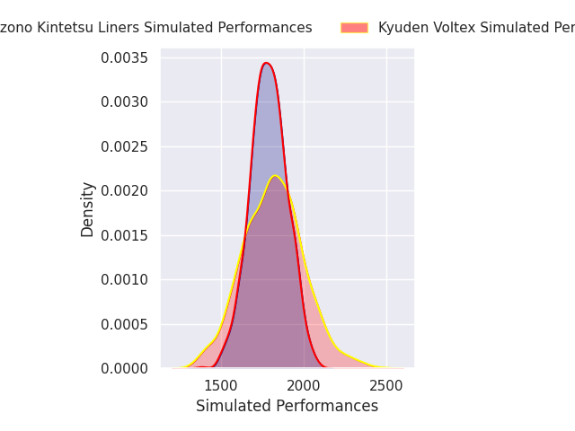

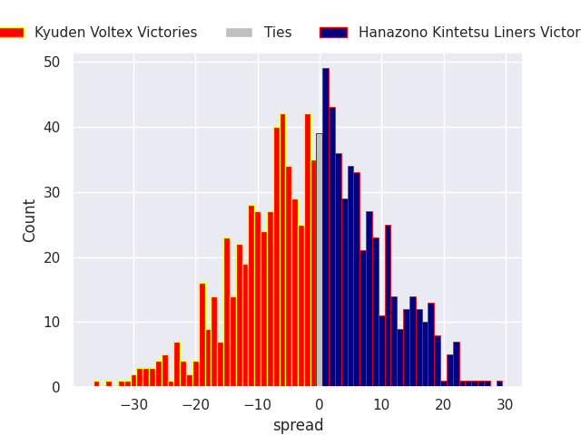

### Week 3
#### Sayama Secom Rugguts V Green Rockets Tokatsu on 2026/12/27

Average Margin: Green Rockets Tokatsu by 1.5

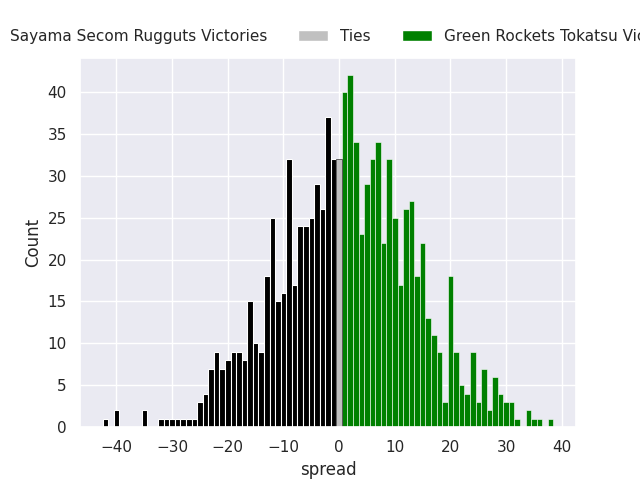

### Week 4
#### Shimizu Blue Sharks V Kyuden Voltex on 2027/01/09

Average Margin: Shimizu Blue Sharks by 4.0

#### Hanazono Kintetsu Liners V Sayama Secom Rugguts on 2027/01/09

Average Margin: Hanazono Kintetsu Liners by 5.2

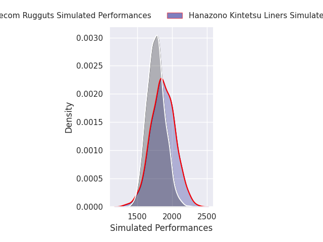

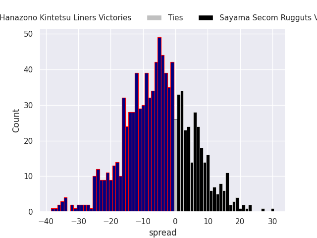

#### Skyactivs Hiroshima V Red Hurricanes Osaka on 2027/01/09

Average Margin: Skyactivs Hiroshima by 1.8

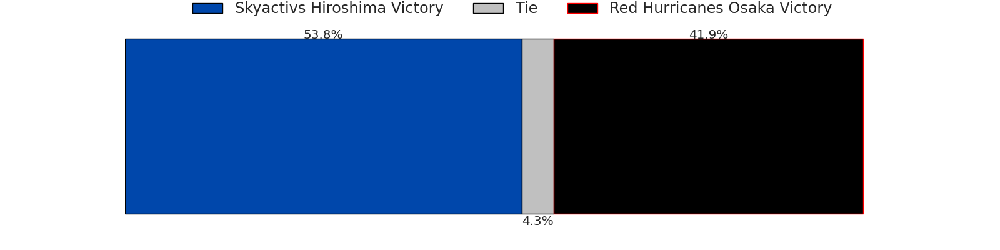
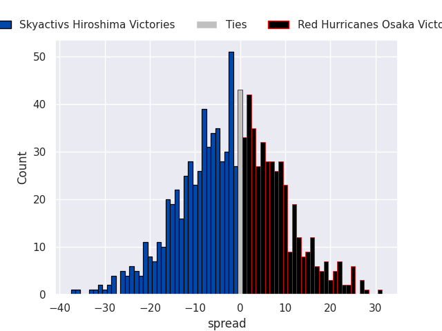

#### Green Rockets Tokatsu V Toyota Shuttles Aichi on 2027/01/10

Average Margin: Toyota Shuttles Aichi by 1.4

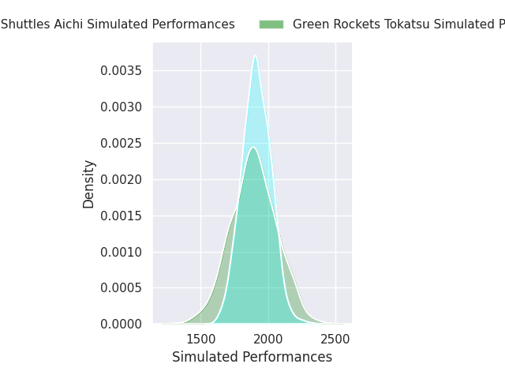

### Week 5
#### Skyactivs Hiroshima V Green Rockets Tokatsu on 2027/01/16

Average Margin: Green Rockets Tokatsu by 6.6

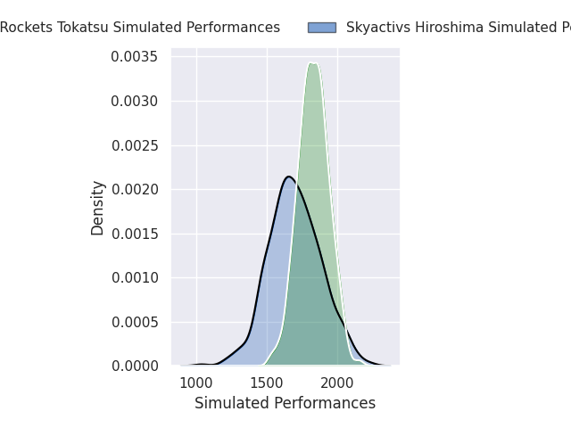
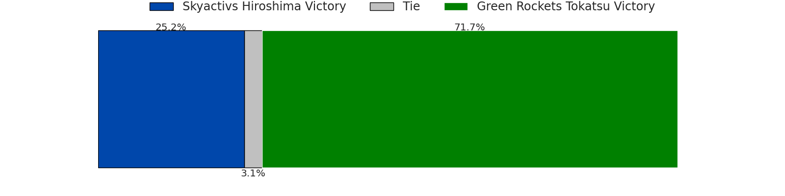

#### Sayama Secom Rugguts V Shimizu Blue Sharks on 2027/01/16

Average Margin: Sayama Secom Rugguts by 0.8

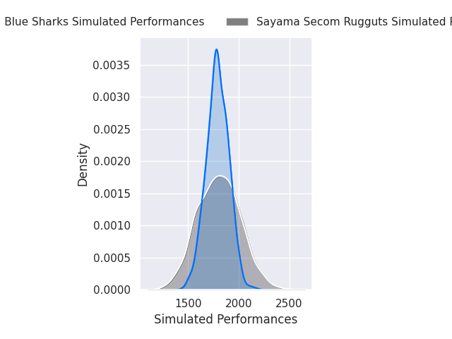

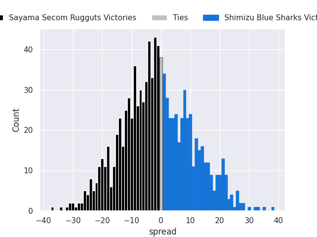

#### Toyota Shuttles Aichi V Hanazono Kintetsu Liners on 2027/01/17

Average Margin: Toyota Shuttles Aichi by 9.4

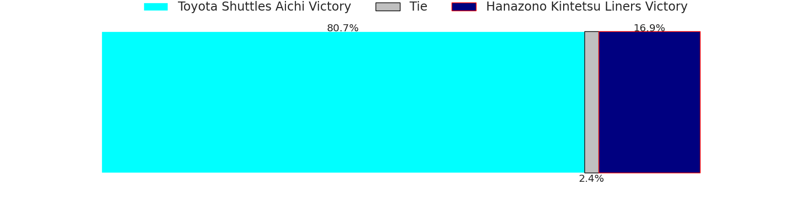

#### Kyuden Voltex V Red Hurricanes Osaka on 2027/01/17

Average Margin: Kyuden Voltex by 8.2

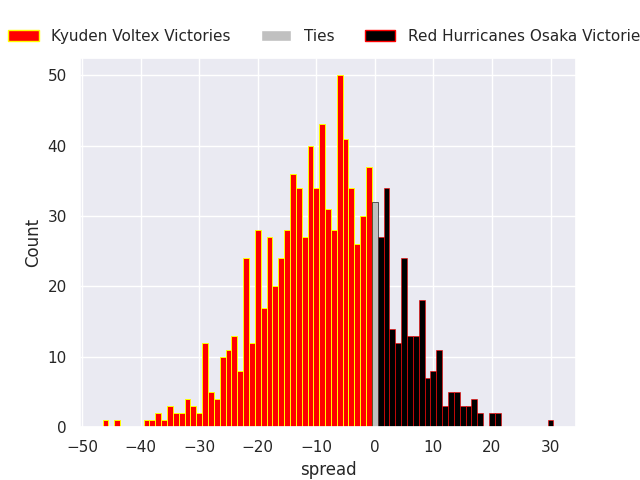

### Week 6
#### Red Hurricanes Osaka V Sayama Secom Rugguts on 2027/01/23

Average Margin: Sayama Secom Rugguts by 3.0

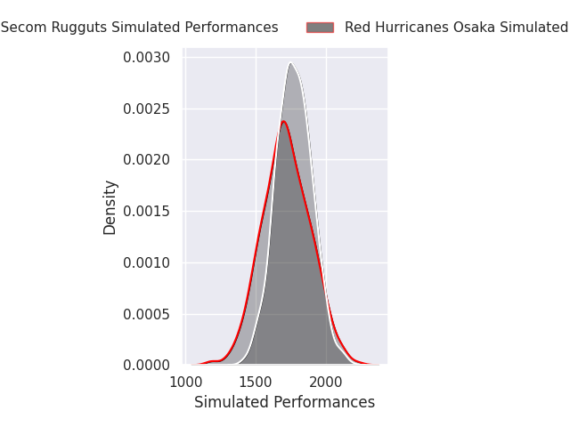
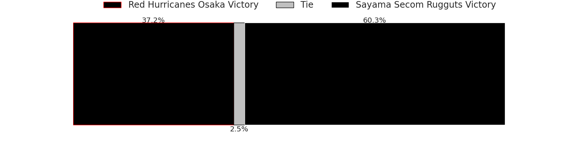
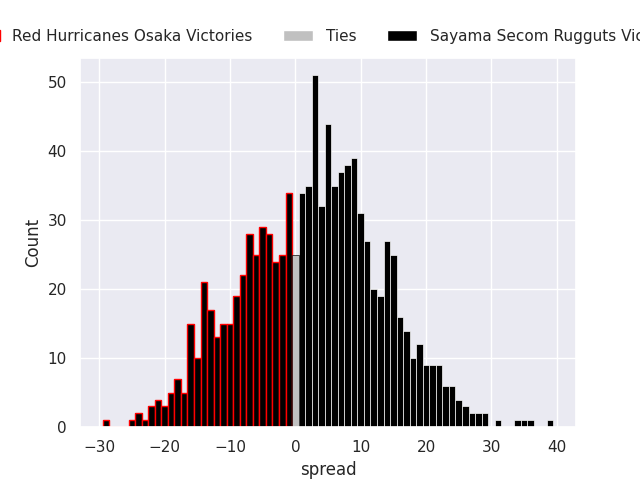

#### Kyuden Voltex V Toyota Shuttles Aichi on 2027/01/24

Average Margin: Toyota Shuttles Aichi by 4.8

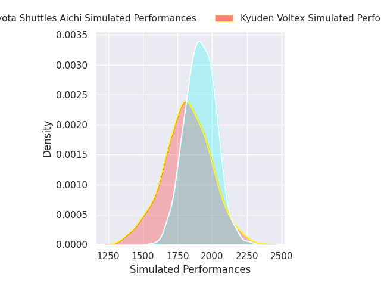
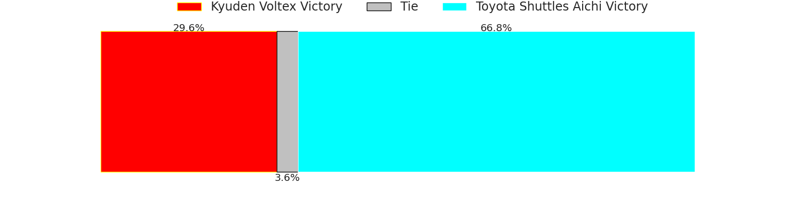
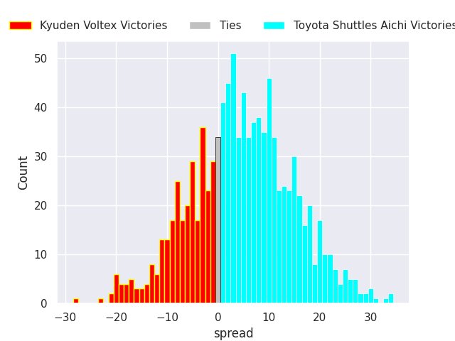

#### Hanazono Kintetsu Liners V Skyactivs Hiroshima on 2027/01/24

Average Margin: Hanazono Kintetsu Liners by 12.9

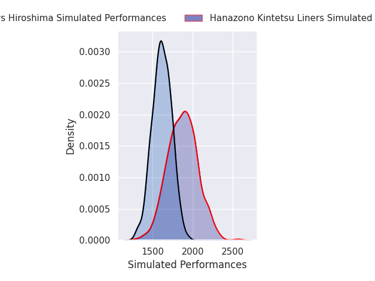
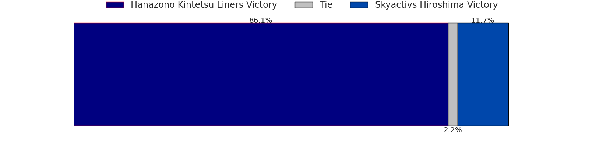
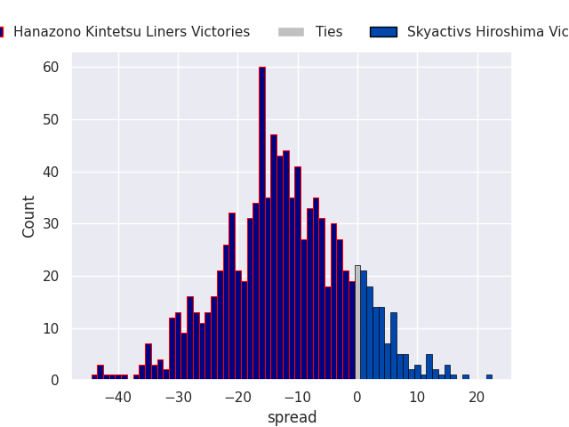

