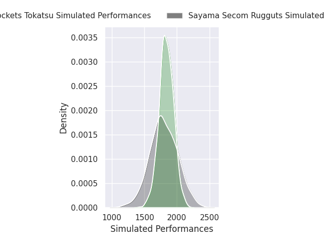
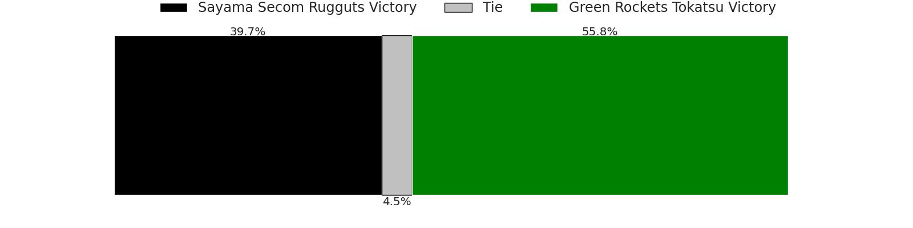
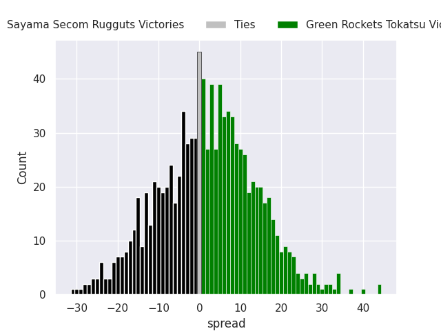

## Team Rankings

## Standings
### Projected Remaining Table

| Club                     |   To Play |   Projected Wins |   Projected Differential |   Projected Losing Bonus Points | Projected Try Bonus Points   |   Projected Competition Points |
|:-------------------------|----------:|-----------------:|-------------------------:|--------------------------------:|:-----------------------------|-------------------------------:|
| Toyota Shuttles Aichi    |         2 |            1.636 |                   23.786 |                           0.204 |                              |                          6.83  |
| Green Rockets Tokatsu    |         2 |            1.302 |                    9.422 |                           0.333 |                              |                          5.697 |
| Hanazono Kintetsu Liners |         2 |            1.283 |                    9.816 |                           0.347 |                              |                          5.593 |
| Sayama Secom Rugguts     |         2 |            1.013 |                    1.541 |                           0.431 |                              |                          4.641 |
| Shimizu Blue Sharks      |         2 |            0.907 |                   -1.002 |                           0.513 |                              |                          4.289 |
| Kyuden Voltex            |         2 |            0.739 |                   -6.447 |                           0.482 |                              |                          3.56  |
| Red Hurricanes Osaka     |         2 |            0.493 |                  -14.336 |                           0.458 |                              |                          2.564 |
| Skyactivs Hiroshima      |         2 |            0.379 |                  -22.78  |                           0.347 |                              |                          1.941 |

### Projected Total Table

| Club                     |   Played |   Wins |   Point Differential |   Losing Bonus Points | Try Bonus Points   |   Competition Points |
|:-------------------------|---------:|-------:|---------------------:|----------------------:|:-------------------|---------------------:|
| Toyota Shuttles Aichi    |        2 |  1.636 |               23.786 |                 0.204 |                    |                6.83  |
| Green Rockets Tokatsu    |        2 |  1.302 |                9.422 |                 0.333 |                    |                5.697 |
| Hanazono Kintetsu Liners |        2 |  1.283 |                9.816 |                 0.347 |                    |                5.593 |
| Sayama Secom Rugguts     |        2 |  1.013 |                1.541 |                 0.431 |                    |                4.641 |
| Shimizu Blue Sharks      |        2 |  0.907 |               -1.002 |                 0.513 |                    |                4.289 |
| Kyuden Voltex            |        2 |  0.739 |               -6.447 |                 0.482 |                    |                3.56  |
| Red Hurricanes Osaka     |        2 |  0.493 |              -14.336 |                 0.458 |                    |                2.564 |
| Skyactivs Hiroshima      |        2 |  0.379 |              -22.78  |                 0.347 |                    |                1.941 |

## Future Predictions
### Week 1
#### Skyactivs Hiroshima V Sayama Secom Rugguts on 2026/12/12

Average Margin: Sayama Secom Rugguts by 3.6

#### Shimizu Blue Sharks V Toyota Shuttles Aichi on 2026/12/12

Average Margin: Toyota Shuttles Aichi by 4.6

#### Hanazono Kintetsu Liners V Red Hurricanes Osaka on 2026/12/12

Average Margin: Hanazono Kintetsu Liners by 10.8

#### Green Rockets Tokatsu V Kyuden Voltex on 2026/12/13

Average Margin: Green Rockets Tokatsu by 7.4

### Week 2
#### Toyota Shuttles Aichi V Skyactivs Hiroshima on 2026/12/19

Average Margin: Toyota Shuttles Aichi by 19.2

#### Red Hurricanes Osaka V Shimizu Blue Sharks on 2026/12/19

Average Margin: Shimizu Blue Sharks by 3.6

#### Kyuden Voltex V Hanazono Kintetsu Liners on 2026/12/20

Average Margin: Kyuden Voltex by 0.9

### Week 3
#### Sayama Secom Rugguts V Green Rockets Tokatsu on 2026/12/27

Average Margin: Green Rockets Tokatsu by 2.0

