## Team Rankings

## Standings
### Projected Remaining Table

| Club                     |   To Play |   Projected Wins |   Projected Differential |   Projected Losing Bonus Points | Projected Try Bonus Points   |   Projected Competition Points |
|:-------------------------|----------:|-----------------:|-------------------------:|--------------------------------:|:-----------------------------|-------------------------------:|
| Toyota Shuttles Aichi    |         3 |            2.091 |                   23.567 |                           0.481 |                              |                          9.005 |
| Hanazono Kintetsu Liners |         3 |            1.945 |                   14.13  |                           0.532 |                              |                          8.5   |
| Green Rockets Tokatsu    |         3 |            1.712 |                    7.734 |                           0.633 |                              |                          7.679 |
| Shimizu Blue Sharks      |         3 |            1.596 |                    3.481 |                           0.684 |                              |                          7.288 |
| Sayama Secom Rugguts     |         3 |            1.388 |                   -1.542 |                           0.675 |                              |                          6.405 |
| Kyuden Voltex            |         3 |            1.07  |                   -9.524 |                           0.771 |                              |                          5.287 |
| Red Hurricanes Osaka     |         3 |            0.909 |                  -15.75  |                           0.745 |                              |                          4.545 |
| Skyactivs Hiroshima      |         3 |            0.92  |                  -22.096 |                           0.525 |                              |                          4.337 |

### Projected Total Table

| Club                     |   Played |   Wins |   Point Differential |   Losing Bonus Points | Try Bonus Points   |   Competition Points |
|:-------------------------|---------:|-------:|---------------------:|----------------------:|:-------------------|---------------------:|
| Toyota Shuttles Aichi    |        3 |  2.091 |               23.567 |                 0.481 |                    |                9.005 |
| Hanazono Kintetsu Liners |        3 |  1.945 |               14.13  |                 0.532 |                    |                8.5   |
| Green Rockets Tokatsu    |        3 |  1.712 |                7.734 |                 0.633 |                    |                7.679 |
| Shimizu Blue Sharks      |        3 |  1.596 |                3.481 |                 0.684 |                    |                7.288 |
| Sayama Secom Rugguts     |        3 |  1.388 |               -1.542 |                 0.675 |                    |                6.405 |
| Kyuden Voltex            |        3 |  1.07  |               -9.524 |                 0.771 |                    |                5.287 |
| Red Hurricanes Osaka     |        3 |  0.909 |              -15.75  |                 0.745 |                    |                4.545 |
| Skyactivs Hiroshima      |        3 |  0.92  |              -22.096 |                 0.525 |                    |                4.337 |

## Future Predictions
### Week 1
#### Hanazono Kintetsu Liners V Red Hurricanes Osaka on 2026/12/12

Average Margin: Hanazono Kintetsu Liners by 11.2

#### Skyactivs Hiroshima V Sayama Secom Rugguts on 2026/12/12

Average Margin: Sayama Secom Rugguts by 4.6

#### Shimizu Blue Sharks V Toyota Shuttles Aichi on 2026/12/12

Average Margin: Toyota Shuttles Aichi by 3.9

#### Green Rockets Tokatsu V Kyuden Voltex on 2026/12/13

Average Margin: Green Rockets Tokatsu by 6.7

### Week 2
#### Red Hurricanes Osaka V Shimizu Blue Sharks on 2026/12/19

Average Margin: Shimizu Blue Sharks by 3.3

#### Toyota Shuttles Aichi V Skyactivs Hiroshima on 2026/12/19

Average Margin: Toyota Shuttles Aichi by 18.8

#### Kyuden Voltex V Hanazono Kintetsu Liners on 2026/12/20

Average Margin: Kyuden Voltex by 1.3

### Week 3
#### Sayama Secom Rugguts V Green Rockets Tokatsu on 2026/12/27

Average Margin: Green Rockets Tokatsu by 1.9

### Week 4
#### Shimizu Blue Sharks V Kyuden Voltex on 2027/01/09

Average Margin: Shimizu Blue Sharks by 4.2

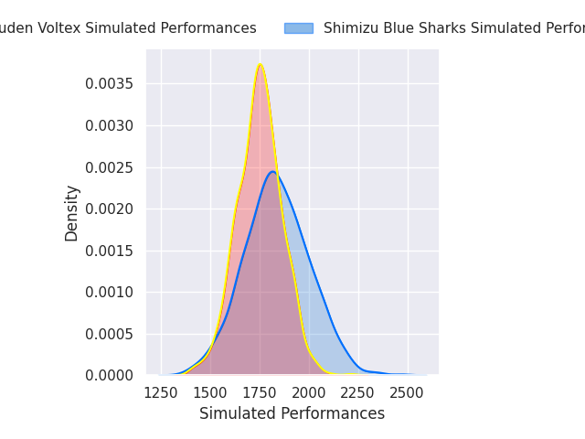
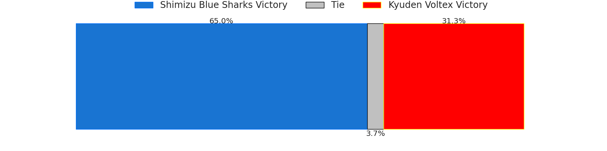
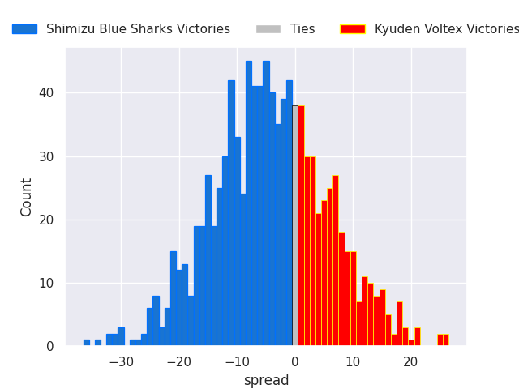

#### Skyactivs Hiroshima V Red Hurricanes Osaka on 2027/01/09

Average Margin: Skyactivs Hiroshima by 1.3

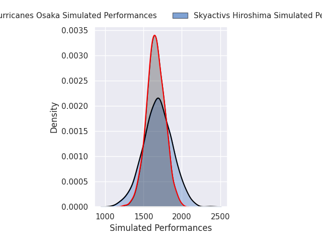
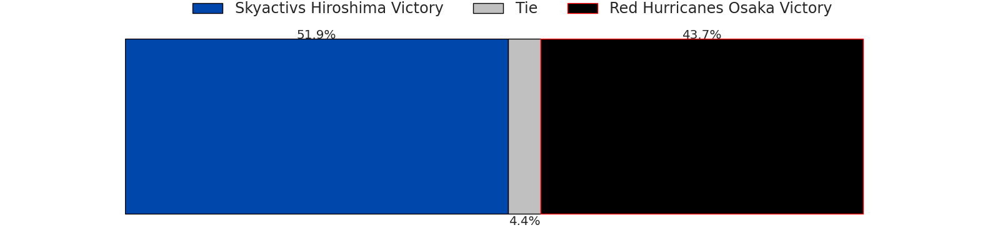
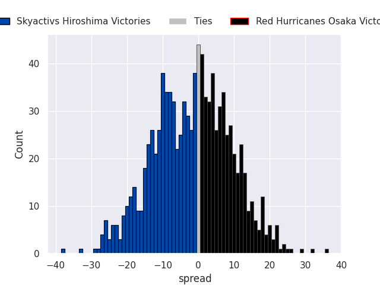

#### Hanazono Kintetsu Liners V Sayama Secom Rugguts on 2027/01/09

Average Margin: Hanazono Kintetsu Liners by 4.3

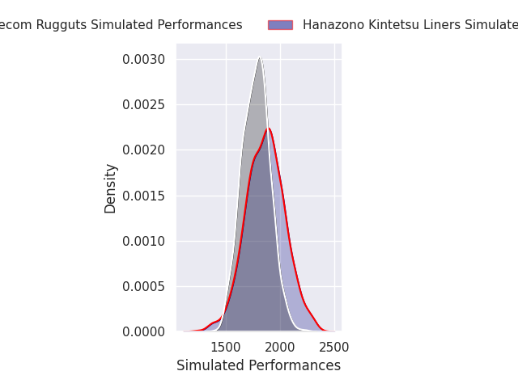
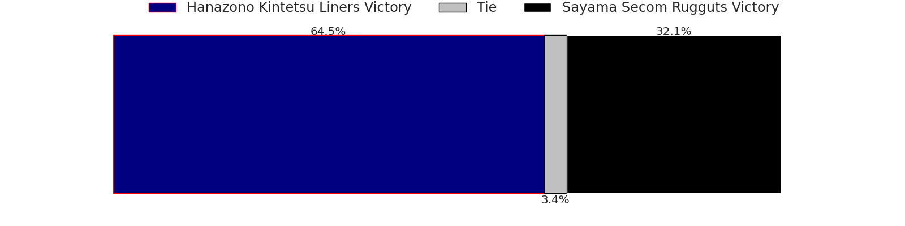
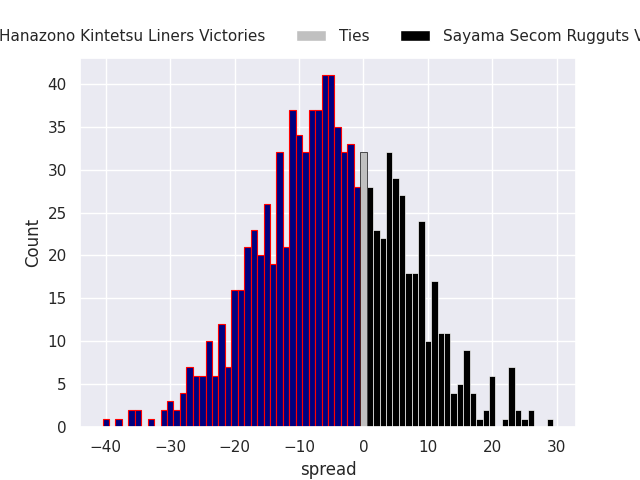

#### Green Rockets Tokatsu V Toyota Shuttles Aichi on 2027/01/10

Average Margin: Toyota Shuttles Aichi by 0.8

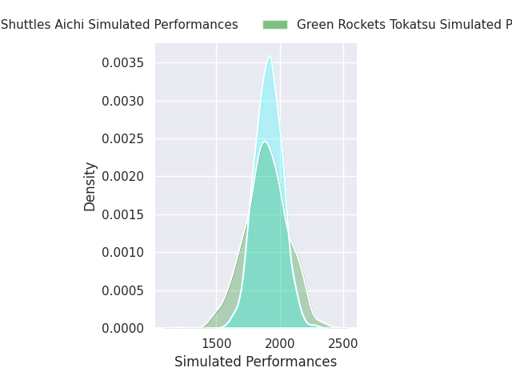
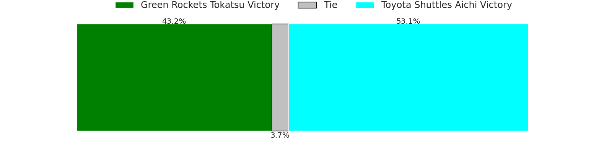
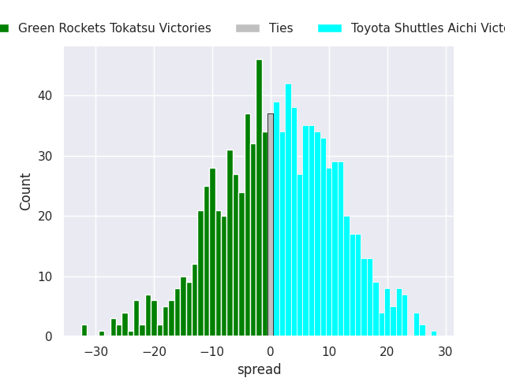

