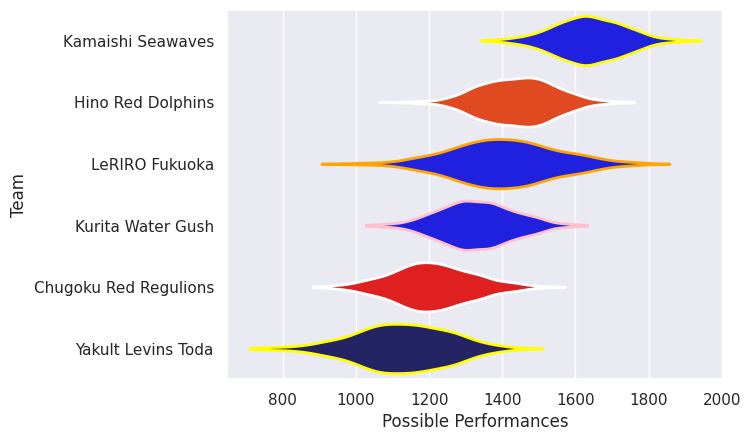
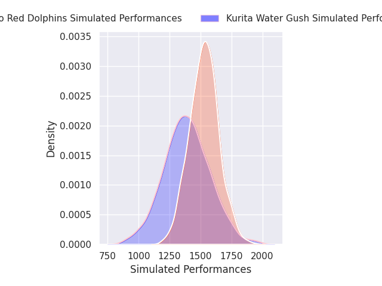
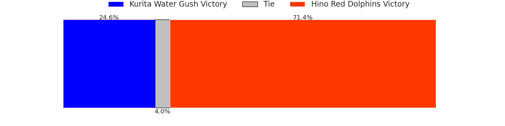
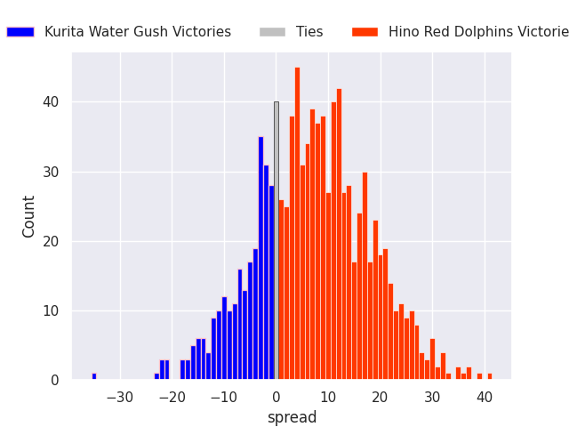
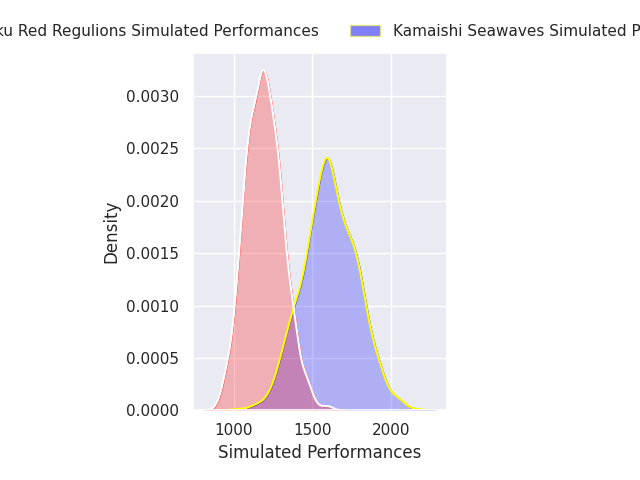
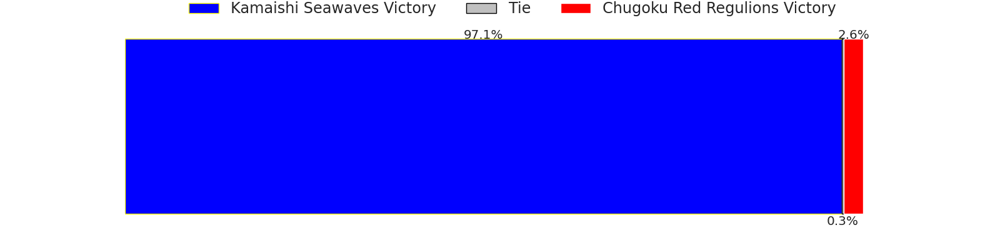
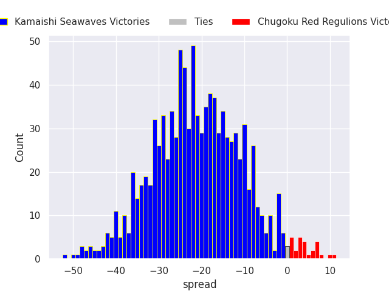
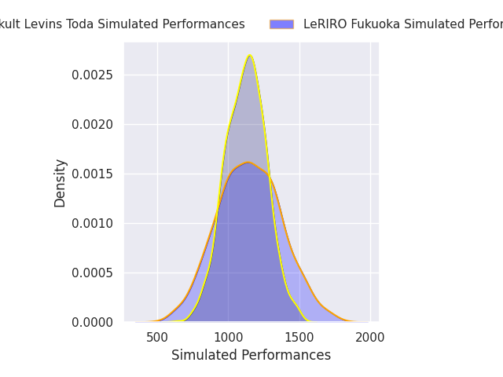
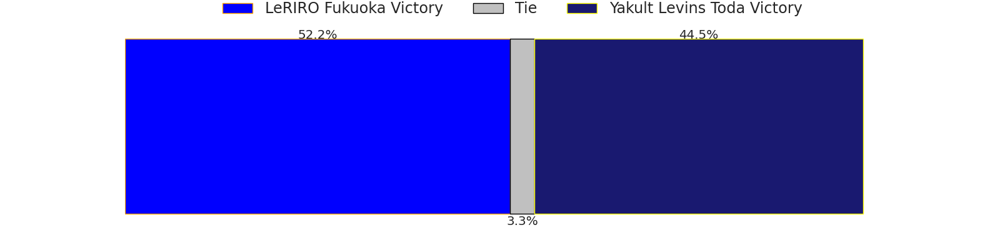
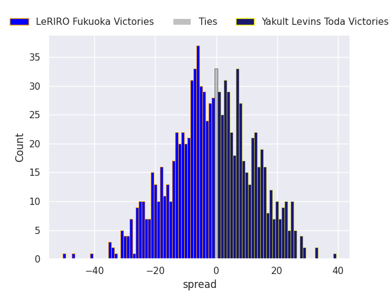

## Team Rankings

## Standings
### Projected Remaining Table

| Club                  |   To Play |   Projected Wins |   Projected Differential |   Projected Losing Bonus Points | Projected Try Bonus Points   |   Projected Competition Points |
|:----------------------|----------:|-----------------:|-------------------------:|--------------------------------:|:-----------------------------|-------------------------------:|
| Kamaishi Seawaves     |         1 |            0.971 |                   20.903 |                           0.023 |                              |                          3.913 |
| Hino Red Dolphins     |         1 |            0.714 |                    6.953 |                           0.159 |                              |                          3.095 |
| LeRIRO Fukuoka        |         1 |            0.522 |                    1.374 |                           0.187 |                              |                          2.341 |
| Yakult Levins Toda    |         1 |            0.445 |                   -1.374 |                           0.208 |                              |                          2.054 |
| Kurita Water Gush     |         1 |            0.246 |                   -6.953 |                           0.238 |                              |                          1.302 |
| Chugoku Red Regulions |         1 |            0.026 |                  -20.903 |                           0.061 |                              |                          0.171 |

### Projected Total Table

| Club                  |   Played |   Wins |   Point Differential |   Losing Bonus Points | Try Bonus Points   |   Competition Points |
|:----------------------|---------:|-------:|---------------------:|----------------------:|:-------------------|---------------------:|
| Kamaishi Seawaves     |        1 |  0.971 |               20.903 |                 0.023 |                    |                3.913 |
| Hino Red Dolphins     |        1 |  0.714 |                6.953 |                 0.159 |                    |                3.095 |
| LeRIRO Fukuoka        |        1 |  0.522 |                1.374 |                 0.187 |                    |                2.341 |
| Yakult Levins Toda    |        1 |  0.445 |               -1.374 |                 0.208 |                    |                2.054 |
| Kurita Water Gush     |        1 |  0.246 |               -6.953 |                 0.238 |                    |                1.302 |
| Chugoku Red Regulions |        1 |  0.026 |              -20.903 |                 0.061 |                    |                0.171 |

## Future Predictions
### Week 1
#### Kurita Water Gush V Hino Red Dolphins on 2026/12/12

Average Margin: Hino Red Dolphins by 7.0

#### Kamaishi Seawaves V Chugoku Red Regulions on 2026/12/12

Average Margin: Kamaishi Seawaves by 20.9

#### LeRIRO Fukuoka V Yakult Levins Toda on 2026/12/13

Average Margin: LeRIRO Fukuoka by 1.4

