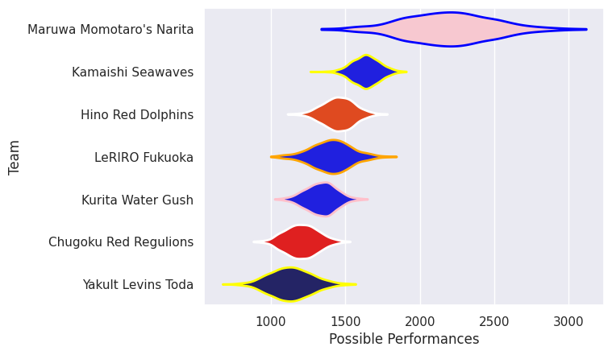
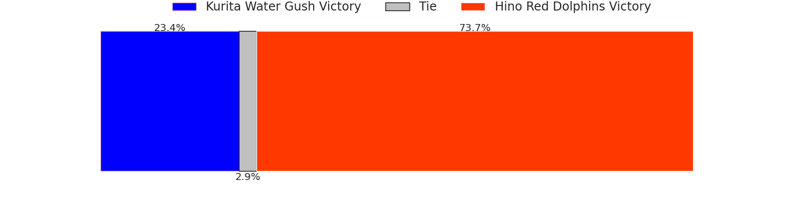
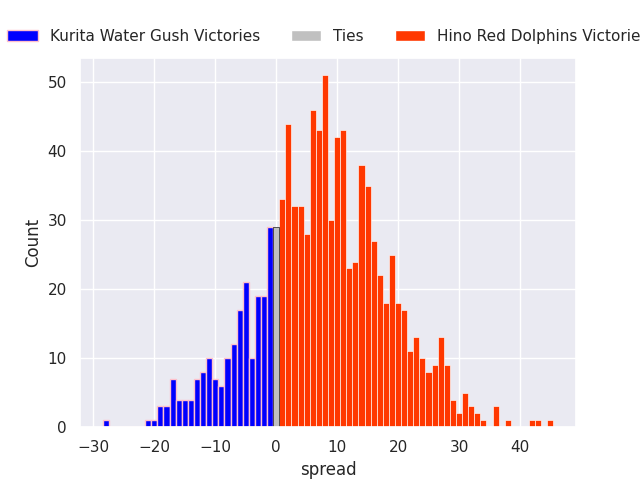
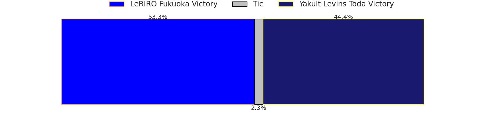
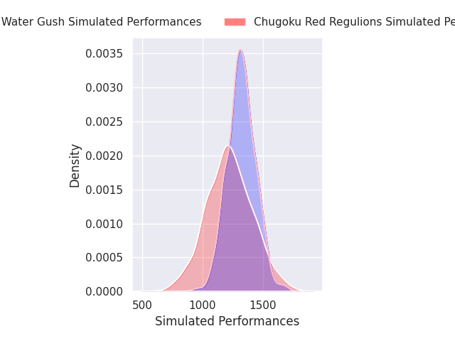
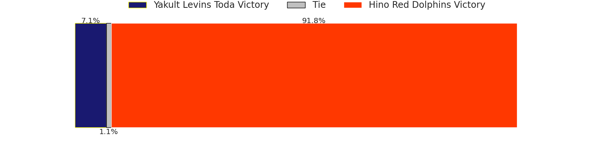
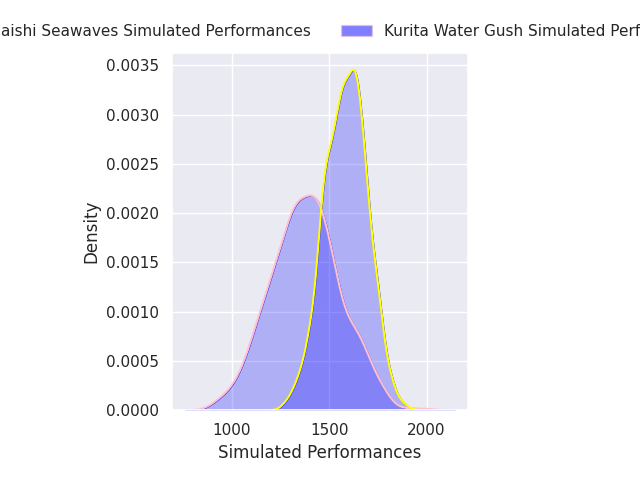
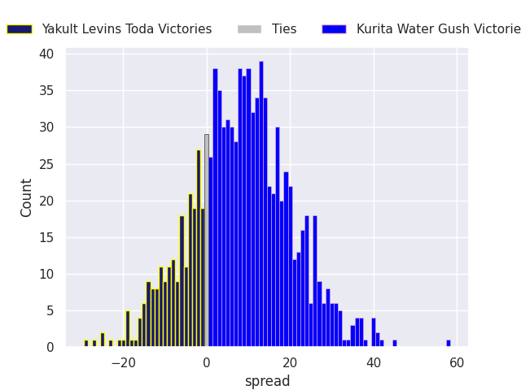

## Team Rankings

## Standings
### Projected Remaining Table

| Club                     |   To Play |   Projected Wins |   Projected Differential |   Projected Losing Bonus Points | Projected Try Bonus Points   |   Projected Competition Points |
|:-------------------------|----------:|-----------------:|-------------------------:|--------------------------------:|:-----------------------------|-------------------------------:|
| Maruwa Momotaro's Narita |         3 |            2.842 |                  107.732 |                           0.063 |                              |                         11.451 |
| Kurita Water Gush        |         4 |            1.782 |                   -4.3   |                           0.809 |                              |                          8.157 |
| Kamaishi Seawaves        |         3 |            1.851 |                   -8.093 |                           0.191 |                              |                          7.675 |
| Hino Red Dolphins        |         3 |            1.695 |                   -3.471 |                           0.242 |                              |                          7.104 |
| Chugoku Red Regulions    |         4 |            0.978 |                  -61.582 |                           0.546 |                              |                          4.598 |
| LeRIRO Fukuoka           |         2 |            0.926 |                   -1.184 |                           0.403 |                              |                          4.219 |
| Yakult Levins Toda       |         3 |            0.731 |                  -29.102 |                           0.499 |                              |                          3.549 |

### Projected Total Table

| Club                     |   Played |   Wins |   Point Differential |   Losing Bonus Points | Try Bonus Points   |   Competition Points |
|:-------------------------|---------:|-------:|---------------------:|----------------------:|:-------------------|---------------------:|
| Maruwa Momotaro's Narita |        3 |  2.842 |              107.732 |                 0.063 |                    |               11.451 |
| Kurita Water Gush        |        4 |  1.782 |               -4.3   |                 0.809 |                    |                8.157 |
| Kamaishi Seawaves        |        3 |  1.851 |               -8.093 |                 0.191 |                    |                7.675 |
| Hino Red Dolphins        |        3 |  1.695 |               -3.471 |                 0.242 |                    |                7.104 |
| Chugoku Red Regulions    |        4 |  0.978 |              -61.582 |                 0.546 |                    |                4.598 |
| LeRIRO Fukuoka           |        2 |  0.926 |               -1.184 |                 0.403 |                    |                4.219 |
| Yakult Levins Toda       |        3 |  0.731 |              -29.102 |                 0.499 |                    |                3.549 |

## Future Predictions
### Week 1
#### Kurita Water Gush V Hino Red Dolphins on 2026/12/12

Average Margin: Hino Red Dolphins by 7.3

#### Kamaishi Seawaves V Chugoku Red Regulions on 2026/12/12

Average Margin: Kamaishi Seawaves by 19.8

#### LeRIRO Fukuoka V Yakult Levins Toda on 2026/12/13

Average Margin: LeRIRO Fukuoka by 2.0

### Week 2
#### Chugoku Red Regulions V Kurita Water Gush on 2026/12/19

Average Margin: Kurita Water Gush by 3.9

#### Maruwa Momotaro's Narita V Kamaishi Seawaves on 2026/12/20

Average Margin: Maruwa Momotaro's Narita by 37.3

#### Yakult Levins Toda V Hino Red Dolphins on 2026/12/20

Average Margin: Hino Red Dolphins by 18.7

### Week 3
#### Hino Red Dolphins V Maruwa Momotaro's Narita on 2026/12/26

Average Margin: Maruwa Momotaro's Narita by 29.5

### Week 4
#### Kurita Water Gush V Kamaishi Seawaves on 2027/01/09

Average Margin: Kamaishi Seawaves by 9.3

#### LeRIRO Fukuoka V Chugoku Red Regulions on 2027/01/10

Average Margin: Chugoku Red Regulions by 3.2

### Week 5
#### Chugoku Red Regulions V Maruwa Momotaro's Narita on 2027/01/17

Average Margin: Maruwa Momotaro's Narita by 41.0

#### Yakult Levins Toda V Kurita Water Gush on 2027/01/17

Average Margin: Kurita Water Gush by 8.4

