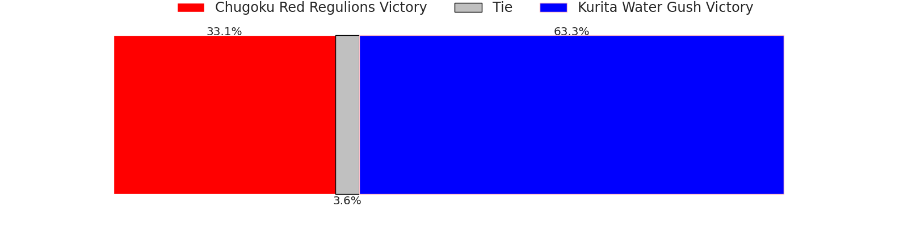
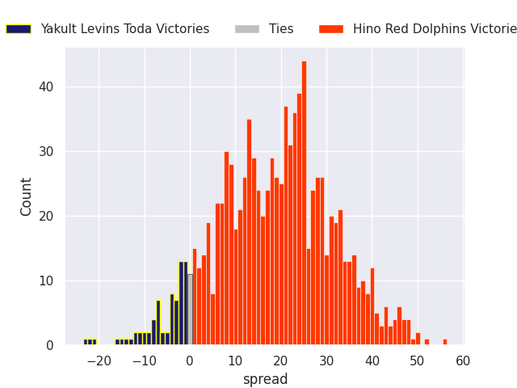
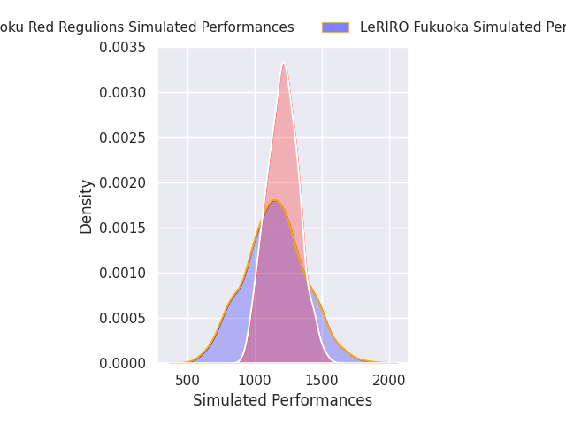
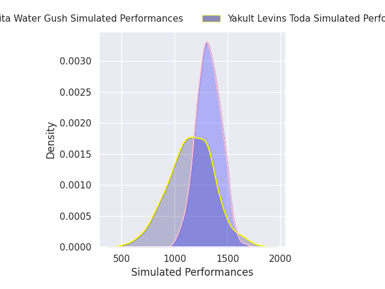
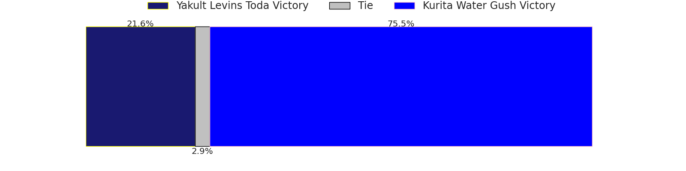
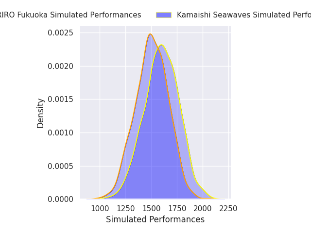
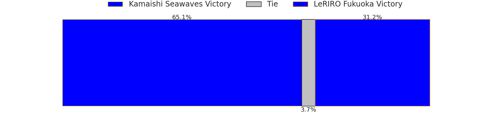
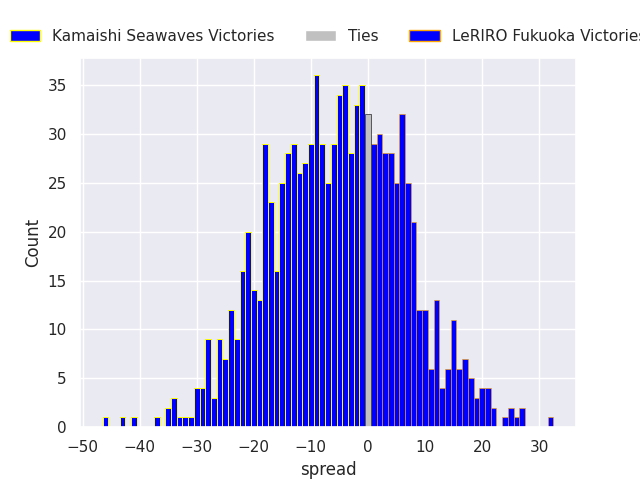

## Team Rankings

## Standings
### Projected Remaining Table

| Club                     |   To Play |   Projected Wins |   Projected Differential |   Projected Losing Bonus Points | Projected Try Bonus Points   |   Projected Competition Points |
|:-------------------------|----------:|-----------------:|-------------------------:|--------------------------------:|:-----------------------------|-------------------------------:|
| Maruwa Momotaro's Narita |         3 |            2.827 |                  107.714 |                           0.065 |                              |                         11.399 |
| Kamaishi Seawaves        |         4 |            2.527 |                   -2.622 |                           0.345 |                              |                         10.607 |
| Kurita Water Gush        |         4 |            1.757 |                   -5.082 |                           0.778 |                              |                          8.04  |
| Hino Red Dolphins        |         3 |            1.71  |                   -3.2   |                           0.291 |                              |                          7.203 |
| LeRIRO Fukuoka           |         3 |            1.293 |                   -4.775 |                           0.614 |                              |                          5.984 |
| Chugoku Red Regulions    |         4 |            0.905 |                  -62.513 |                           0.571 |                              |                          4.351 |
| Yakult Levins Toda       |         3 |            0.734 |                  -29.522 |                           0.494 |                              |                          3.574 |

### Projected Total Table

| Club                     |   Played |   Wins |   Point Differential |   Losing Bonus Points | Try Bonus Points   |   Competition Points |
|:-------------------------|---------:|-------:|---------------------:|----------------------:|:-------------------|---------------------:|
| Maruwa Momotaro's Narita |        3 |  2.827 |              107.714 |                 0.065 |                    |               11.399 |
| Kamaishi Seawaves        |        4 |  2.527 |               -2.622 |                 0.345 |                    |               10.607 |
| Kurita Water Gush        |        4 |  1.757 |               -5.082 |                 0.778 |                    |                8.04  |
| Hino Red Dolphins        |        3 |  1.71  |               -3.2   |                 0.291 |                    |                7.203 |
| LeRIRO Fukuoka           |        3 |  1.293 |               -4.775 |                 0.614 |                    |                5.984 |
| Chugoku Red Regulions    |        4 |  0.905 |              -62.513 |                 0.571 |                    |                4.351 |
| Yakult Levins Toda       |        3 |  0.734 |              -29.522 |                 0.494 |                    |                3.574 |

## Future Predictions
### Week 1
#### Kurita Water Gush V Hino Red Dolphins on 2026/12/12

Average Margin: Hino Red Dolphins by 7.8

#### Kamaishi Seawaves V Chugoku Red Regulions on 2026/12/12

Average Margin: Kamaishi Seawaves by 20.1

#### LeRIRO Fukuoka V Yakult Levins Toda on 2026/12/13

Average Margin: LeRIRO Fukuoka by 2.2

### Week 2
#### Chugoku Red Regulions V Kurita Water Gush on 2026/12/19

Average Margin: Kurita Water Gush by 4.8

#### Yakult Levins Toda V Hino Red Dolphins on 2026/12/20

Average Margin: Hino Red Dolphins by 19.1

#### Maruwa Momotaro's Narita V Kamaishi Seawaves on 2026/12/20

Average Margin: Maruwa Momotaro's Narita by 37.7

### Week 3
#### Hino Red Dolphins V Maruwa Momotaro's Narita on 2026/12/26

Average Margin: Maruwa Momotaro's Narita by 30.1

### Week 4
#### Kurita Water Gush V Kamaishi Seawaves on 2027/01/09

Average Margin: Kamaishi Seawaves by 10.3

#### LeRIRO Fukuoka V Chugoku Red Regulions on 2027/01/10

Average Margin: Chugoku Red Regulions by 2.3

### Week 5
#### Yakult Levins Toda V Kurita Water Gush on 2027/01/17

Average Margin: Kurita Water Gush by 8.2

#### Chugoku Red Regulions V Maruwa Momotaro's Narita on 2027/01/17

Average Margin: Maruwa Momotaro's Narita by 39.9

### Week 6
#### Kamaishi Seawaves V LeRIRO Fukuoka on 2027/01/23

Average Margin: Kamaishi Seawaves by 4.8

