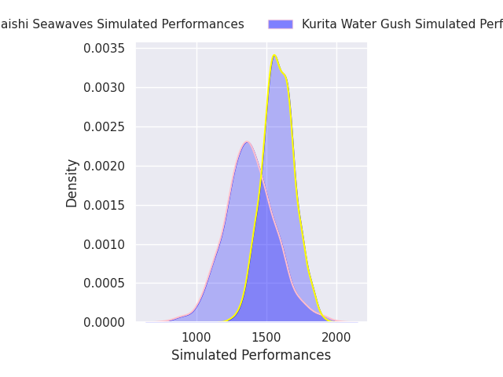
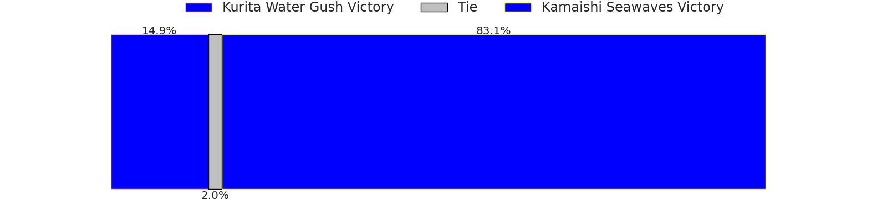
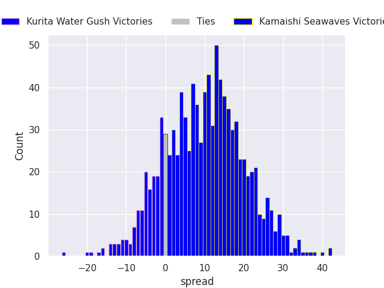
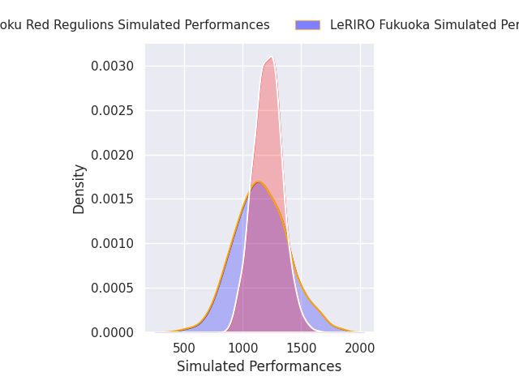
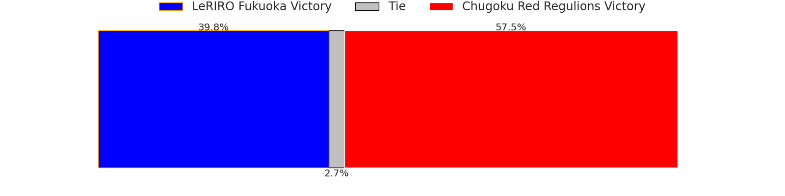
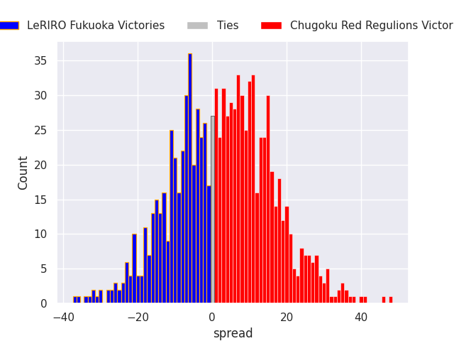

## Team Rankings

## Standings
### Projected Remaining Table

| Club                     |   To Play |   Projected Wins |   Projected Differential |   Projected Losing Bonus Points | Projected Try Bonus Points   |   Projected Competition Points |
|:-------------------------|----------:|-----------------:|-------------------------:|--------------------------------:|:-----------------------------|-------------------------------:|
| Kamaishi Seawaves        |         3 |            1.881 |                   -7.963 |                           0.156 |                              |                          7.746 |
| Maruwa Momotaro's Narita |         2 |            1.867 |                   68.139 |                           0.048 |                              |                          7.536 |
| Hino Red Dolphins        |         3 |            1.694 |                   -3.534 |                           0.263 |                              |                          7.125 |
| Kurita Water Gush        |         3 |            1.034 |                  -13.379 |                           0.637 |                              |                          4.925 |
| Chugoku Red Regulions    |         3 |            0.925 |                  -21.77  |                           0.504 |                              |                          4.328 |
| LeRIRO Fukuoka           |         2 |            0.94  |                   -0.985 |                           0.394 |                              |                          4.256 |
| Yakult Levins Toda       |         2 |            0.504 |                  -20.508 |                           0.308 |                              |                          2.394 |

### Projected Total Table

| Club                     |   Played |   Wins |   Point Differential |   Losing Bonus Points | Try Bonus Points   |   Competition Points |
|:-------------------------|---------:|-------:|---------------------:|----------------------:|:-------------------|---------------------:|
| Kamaishi Seawaves        |        3 |  1.881 |               -7.963 |                 0.156 |                    |                7.746 |
| Maruwa Momotaro's Narita |        2 |  1.867 |               68.139 |                 0.048 |                    |                7.536 |
| Hino Red Dolphins        |        3 |  1.694 |               -3.534 |                 0.263 |                    |                7.125 |
| Kurita Water Gush        |        3 |  1.034 |              -13.379 |                 0.637 |                    |                4.925 |
| Chugoku Red Regulions    |        3 |  0.925 |              -21.77  |                 0.504 |                    |                4.328 |
| LeRIRO Fukuoka           |        2 |  0.94  |               -0.985 |                 0.394 |                    |                4.256 |
| Yakult Levins Toda       |        2 |  0.504 |              -20.508 |                 0.308 |                    |                2.394 |

## Future Predictions
### Week 1
#### Kurita Water Gush V Hino Red Dolphins on 2026/12/12

Average Margin: Hino Red Dolphins by 7.5

#### Kamaishi Seawaves V Chugoku Red Regulions on 2026/12/12

Average Margin: Kamaishi Seawaves by 20.2

#### LeRIRO Fukuoka V Yakult Levins Toda on 2026/12/13

Average Margin: LeRIRO Fukuoka by 1.9

### Week 2
#### Chugoku Red Regulions V Kurita Water Gush on 2026/12/19

Average Margin: Kurita Water Gush by 4.4

#### Yakult Levins Toda V Hino Red Dolphins on 2026/12/20

Average Margin: Hino Red Dolphins by 18.6

#### Maruwa Momotaro's Narita V Kamaishi Seawaves on 2026/12/20

Average Margin: Maruwa Momotaro's Narita by 38.5

### Week 3
#### Hino Red Dolphins V Maruwa Momotaro's Narita on 2026/12/26

Average Margin: Maruwa Momotaro's Narita by 29.6

### Week 4
#### Kurita Water Gush V Kamaishi Seawaves on 2027/01/09

Average Margin: Kamaishi Seawaves by 10.4

#### LeRIRO Fukuoka V Chugoku Red Regulions on 2027/01/10

Average Margin: Chugoku Red Regulions by 2.8

