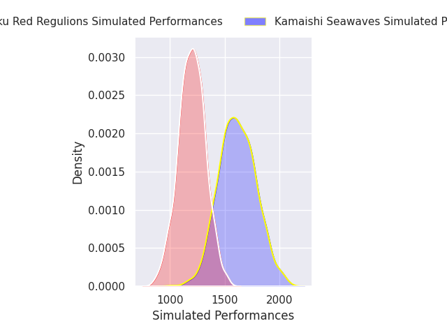
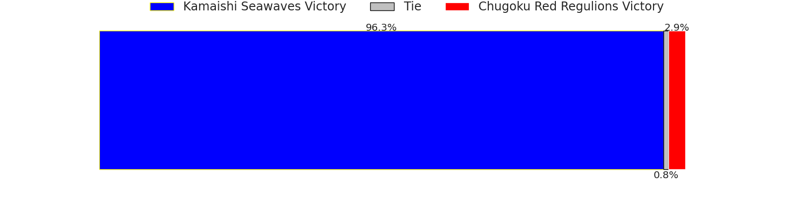
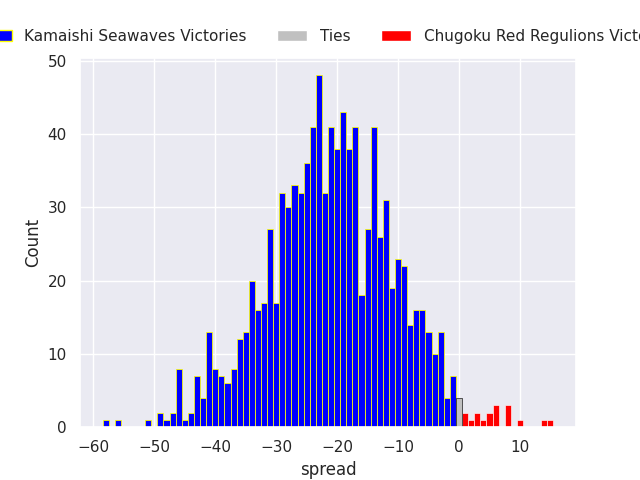
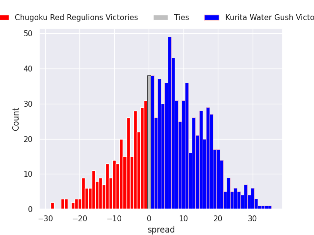
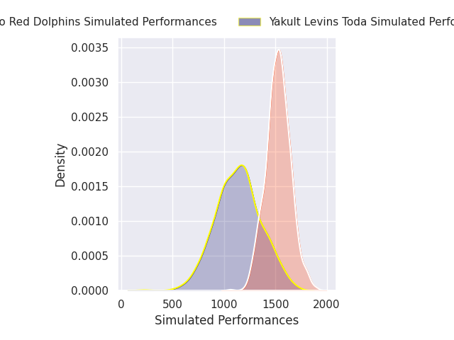
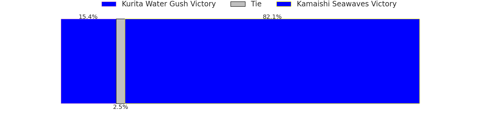
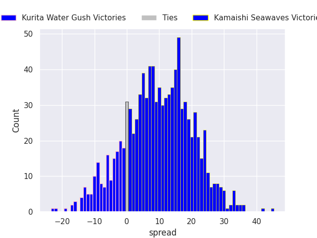
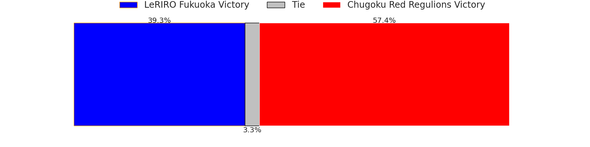
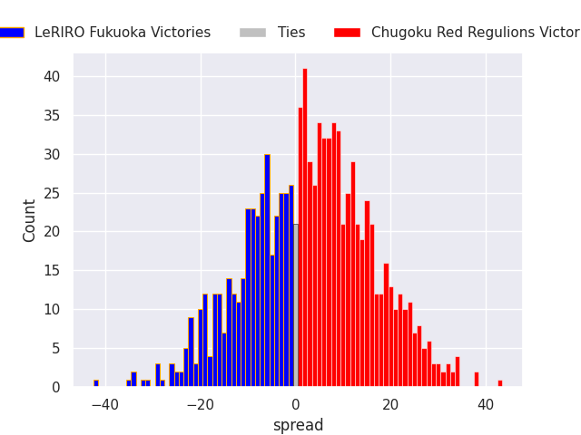

## Team Rankings

## Standings
### Projected Remaining Table

| Club                     |   To Play |   Projected Wins |   Projected Differential |   Projected Losing Bonus Points | Projected Try Bonus Points   |   Projected Competition Points |
|:-------------------------|----------:|-----------------:|-------------------------:|--------------------------------:|:-----------------------------|-------------------------------:|
| Maruwa Momotaro's Narita |         3 |            2.837 |                  107.493 |                           0.055 |                              |                         11.437 |
| Kurita Water Gush        |         4 |            1.727 |                   -5.525 |                           0.813 |                              |                          7.927 |
| Kamaishi Seawaves        |         3 |            1.889 |                   -6.636 |                           0.16  |                              |                          7.776 |
| Hino Red Dolphins        |         3 |            1.691 |                   -2.47  |                           0.253 |                              |                          7.113 |
| Chugoku Red Regulions    |         4 |            0.963 |                  -62.695 |                           0.544 |                              |                          4.536 |
| LeRIRO Fukuoka           |         2 |            0.95  |                   -0.725 |                           0.404 |                              |                          4.306 |
| Yakult Levins Toda       |         3 |            0.755 |                  -29.442 |                           0.488 |                              |                          3.622 |

### Projected Total Table

| Club                     |   Played |   Wins |   Point Differential |   Losing Bonus Points | Try Bonus Points   |   Competition Points |
|:-------------------------|---------:|-------:|---------------------:|----------------------:|:-------------------|---------------------:|
| Maruwa Momotaro's Narita |        3 |  2.837 |              107.493 |                 0.055 |                    |               11.437 |
| Kurita Water Gush        |        4 |  1.727 |               -5.525 |                 0.813 |                    |                7.927 |
| Kamaishi Seawaves        |        3 |  1.889 |               -6.636 |                 0.16  |                    |                7.776 |
| Hino Red Dolphins        |        3 |  1.691 |               -2.47  |                 0.253 |                    |                7.113 |
| Chugoku Red Regulions    |        4 |  0.963 |              -62.695 |                 0.544 |                    |                4.536 |
| LeRIRO Fukuoka           |        2 |  0.95  |               -0.725 |                 0.404 |                    |                4.306 |
| Yakult Levins Toda       |        3 |  0.755 |              -29.442 |                 0.488 |                    |                3.622 |

## Future Predictions
### Week 1
#### Kamaishi Seawaves V Chugoku Red Regulions on 2026/12/12

Average Margin: Kamaishi Seawaves by 20.8

#### Kurita Water Gush V Hino Red Dolphins on 2026/12/12

Average Margin: Hino Red Dolphins by 7.4

#### LeRIRO Fukuoka V Yakult Levins Toda on 2026/12/13

Average Margin: LeRIRO Fukuoka by 2.0

### Week 2
#### Chugoku Red Regulions V Kurita Water Gush on 2026/12/19

Average Margin: Kurita Water Gush by 3.8

#### Yakult Levins Toda V Hino Red Dolphins on 2026/12/20

Average Margin: Hino Red Dolphins by 19.4

#### Maruwa Momotaro's Narita V Kamaishi Seawaves on 2026/12/20

Average Margin: Maruwa Momotaro's Narita by 37.4

### Week 3
#### Hino Red Dolphins V Maruwa Momotaro's Narita on 2026/12/26

Average Margin: Maruwa Momotaro's Narita by 29.3

### Week 4
#### Kurita Water Gush V Kamaishi Seawaves on 2027/01/09

Average Margin: Kamaishi Seawaves by 9.9

#### LeRIRO Fukuoka V Chugoku Red Regulions on 2027/01/10

Average Margin: Chugoku Red Regulions by 2.7

### Week 5
#### Chugoku Red Regulions V Maruwa Momotaro's Narita on 2027/01/17

Average Margin: Maruwa Momotaro's Narita by 40.8

#### Yakult Levins Toda V Kurita Water Gush on 2027/01/17

Average Margin: Kurita Water Gush by 8.0

