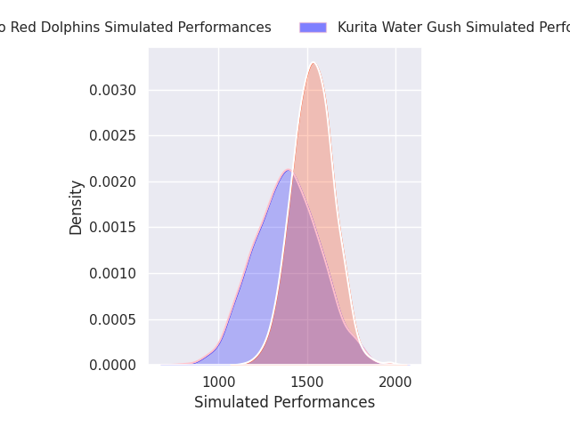
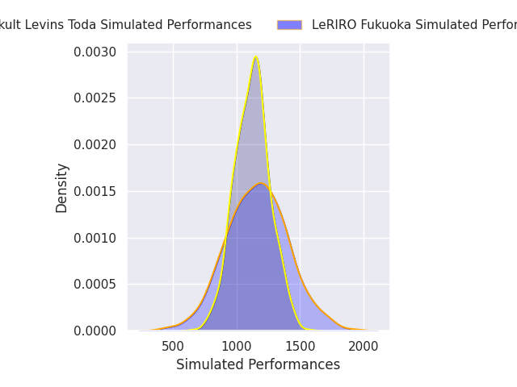
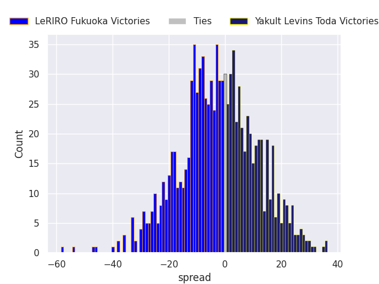

## Team Rankings

## Standings
### Projected Remaining Table

| Club                     |   To Play |   Projected Wins |   Projected Differential |   Projected Losing Bonus Points | Projected Try Bonus Points   |   Projected Competition Points |
|:-------------------------|----------:|-----------------:|-------------------------:|--------------------------------:|:-----------------------------|-------------------------------:|
| Maruwa Momotaro's Narita |         3 |            2.84  |                  108.191 |                           0.067 |                              |                         11.463 |
| Kurita Water Gush        |         4 |            1.746 |                   -4.608 |                           0.817 |                              |                          8.009 |
| Kamaishi Seawaves        |         3 |            1.886 |                   -7.698 |                           0.162 |                              |                          7.768 |
| Hino Red Dolphins        |         3 |            1.702 |                   -2.412 |                           0.252 |                              |                          7.144 |
| Chugoku Red Regulions    |         4 |            0.933 |                  -62.292 |                           0.57  |                              |                          4.466 |
| LeRIRO Fukuoka           |         2 |            0.936 |                   -1.385 |                           0.378 |                              |                          4.264 |
| Yakult Levins Toda       |         3 |            0.748 |                  -29.796 |                           0.466 |                              |                          3.598 |

### Projected Total Table

| Club                     |   Played |   Wins |   Point Differential |   Losing Bonus Points | Try Bonus Points   |   Competition Points |
|:-------------------------|---------:|-------:|---------------------:|----------------------:|:-------------------|---------------------:|
| Maruwa Momotaro's Narita |        3 |  2.84  |              108.191 |                 0.067 |                    |               11.463 |
| Kurita Water Gush        |        4 |  1.746 |               -4.608 |                 0.817 |                    |                8.009 |
| Kamaishi Seawaves        |        3 |  1.886 |               -7.698 |                 0.162 |                    |                7.768 |
| Hino Red Dolphins        |        3 |  1.702 |               -2.412 |                 0.252 |                    |                7.144 |
| Chugoku Red Regulions    |        4 |  0.933 |              -62.292 |                 0.57  |                    |                4.466 |
| LeRIRO Fukuoka           |        2 |  0.936 |               -1.385 |                 0.378 |                    |                4.264 |
| Yakult Levins Toda       |        3 |  0.748 |              -29.796 |                 0.466 |                    |                3.598 |

## Future Predictions
### Week 1
#### Kurita Water Gush V Hino Red Dolphins on 2026/12/12

Average Margin: Hino Red Dolphins by 7.0

#### Kamaishi Seawaves V Chugoku Red Regulions on 2026/12/12

Average Margin: Kamaishi Seawaves by 20.5

#### LeRIRO Fukuoka V Yakult Levins Toda on 2026/12/13

Average Margin: LeRIRO Fukuoka by 1.5

### Week 2
#### Chugoku Red Regulions V Kurita Water Gush on 2026/12/19

Average Margin: Kurita Water Gush by 3.7

#### Yakult Levins Toda V Hino Red Dolphins on 2026/12/20

Average Margin: Hino Red Dolphins by 19.7

#### Maruwa Momotaro's Narita V Kamaishi Seawaves on 2026/12/20

Average Margin: Maruwa Momotaro's Narita by 38.2

### Week 3
#### Hino Red Dolphins V Maruwa Momotaro's Narita on 2026/12/26

Average Margin: Maruwa Momotaro's Narita by 29.1

### Week 4
#### Kurita Water Gush V Kamaishi Seawaves on 2027/01/09

Average Margin: Kamaishi Seawaves by 10.0

#### LeRIRO Fukuoka V Chugoku Red Regulions on 2027/01/10

Average Margin: Chugoku Red Regulions by 2.9

### Week 5
#### Chugoku Red Regulions V Maruwa Momotaro's Narita on 2027/01/17

Average Margin: Maruwa Momotaro's Narita by 40.9

#### Yakult Levins Toda V Kurita Water Gush on 2027/01/17

Average Margin: Kurita Water Gush by 8.6

