## Team Rankings

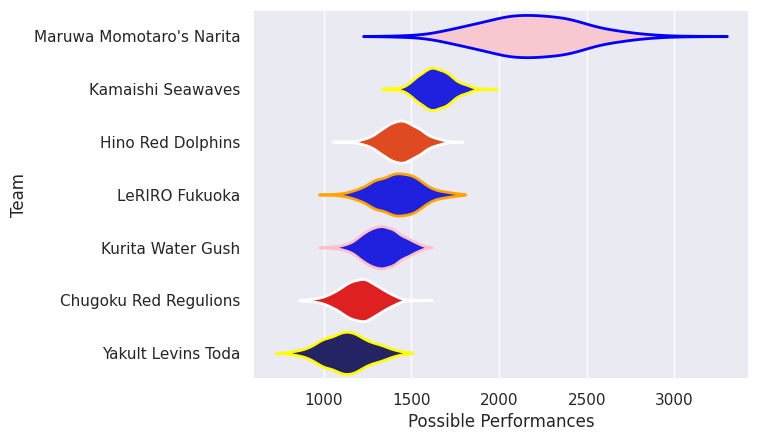
## Standings
### Projected Remaining Table

| Club                     |   To Play |   Projected Wins |   Projected Differential |   Projected Losing Bonus Points | Projected Try Bonus Points   |   Projected Competition Points |
|:-------------------------|----------:|-----------------:|-------------------------:|--------------------------------:|:-----------------------------|-------------------------------:|
| Maruwa Momotaro's Narita |         2 |            1.892 |                   68.959 |                           0.043 |                              |                          7.629 |
| Hino Red Dolphins        |         3 |            1.712 |                   -3.041 |                           0.235 |                              |                          7.163 |
| Kamaishi Seawaves        |         2 |            1.045 |                  -18.007 |                           0.061 |                              |                          4.261 |
| Kurita Water Gush        |         2 |            0.87  |                   -3.628 |                           0.446 |                              |                          4.056 |
| LeRIRO Fukuoka           |         1 |            0.568 |                    2.715 |                           0.151 |                              |                          2.483 |
| Yakult Levins Toda       |         2 |            0.454 |                  -22.546 |                           0.287 |                              |                          2.179 |
| Chugoku Red Regulions    |         2 |            0.341 |                  -24.452 |                           0.338 |                              |                          1.79  |

### Projected Total Table

| Club                     |   Played |   Wins |   Point Differential |   Losing Bonus Points | Try Bonus Points   |   Competition Points |
|:-------------------------|---------:|-------:|---------------------:|----------------------:|:-------------------|---------------------:|
| Maruwa Momotaro's Narita |        2 |  1.892 |               68.959 |                 0.043 |                    |                7.629 |
| Hino Red Dolphins        |        3 |  1.712 |               -3.041 |                 0.235 |                    |                7.163 |
| Kamaishi Seawaves        |        2 |  1.045 |              -18.007 |                 0.061 |                    |                4.261 |
| Kurita Water Gush        |        2 |  0.87  |               -3.628 |                 0.446 |                    |                4.056 |
| LeRIRO Fukuoka           |        1 |  0.568 |                2.715 |                 0.151 |                    |                2.483 |
| Yakult Levins Toda       |        2 |  0.454 |              -22.546 |                 0.287 |                    |                2.179 |
| Chugoku Red Regulions    |        2 |  0.341 |              -24.452 |                 0.338 |                    |                1.79  |

## Future Predictions
### Week 1
#### Kurita Water Gush V Hino Red Dolphins on 2026/12/12

Average Margin: Hino Red Dolphins by 7.9

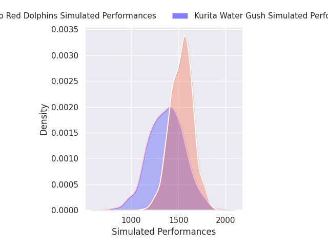
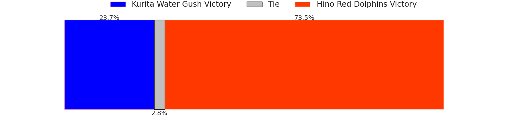
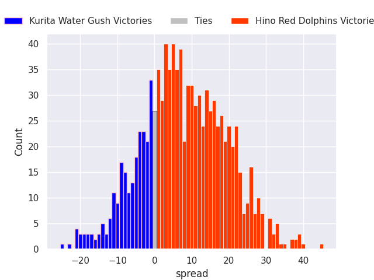

#### Kamaishi Seawaves V Chugoku Red Regulions on 2026/12/12

Average Margin: Kamaishi Seawaves by 20.2

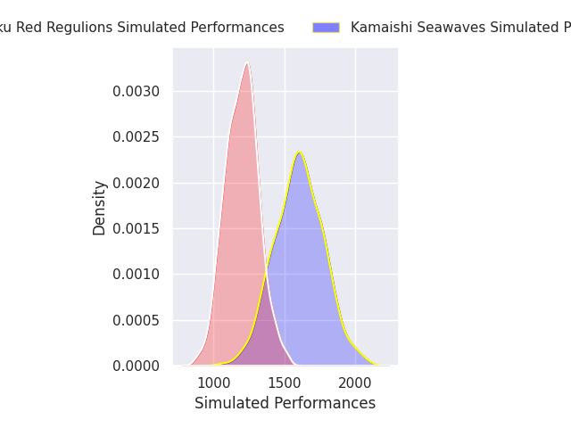
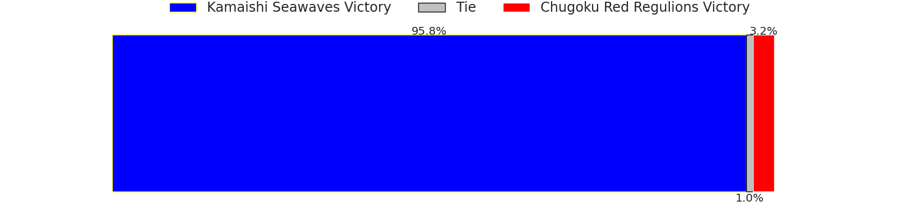
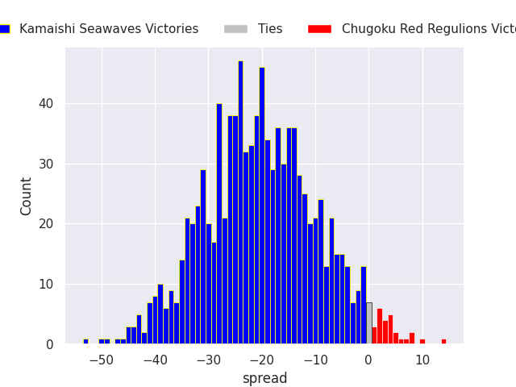

#### LeRIRO Fukuoka V Yakult Levins Toda on 2026/12/13

Average Margin: LeRIRO Fukuoka by 2.7

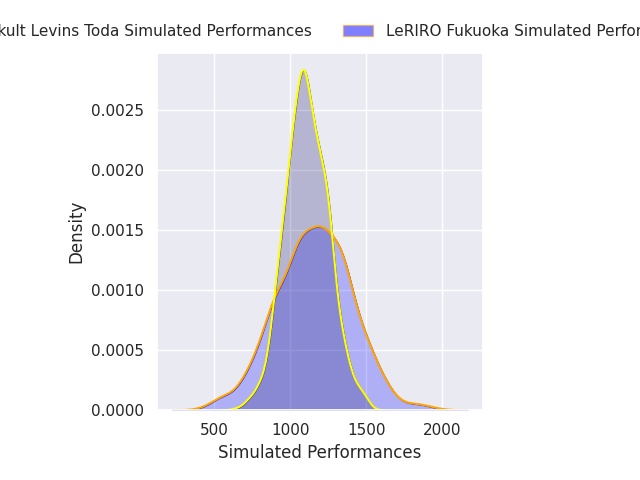
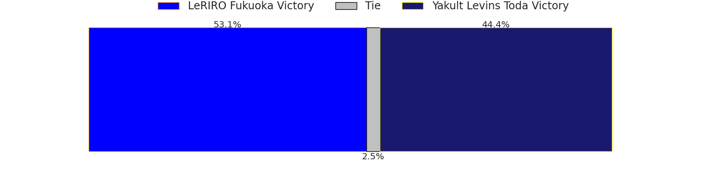
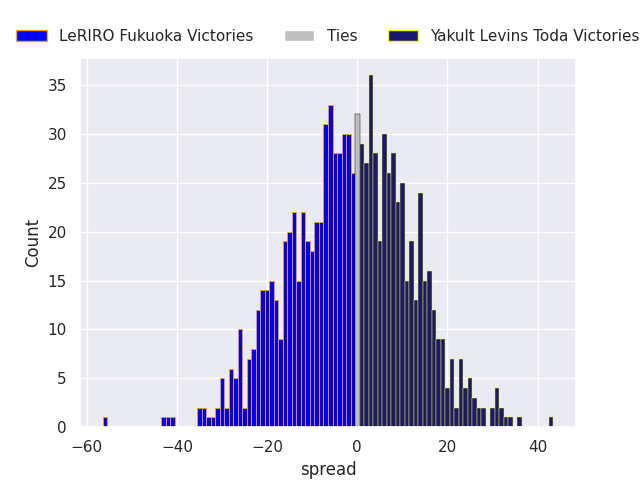

### Week 2
#### Chugoku Red Regulions V Kurita Water Gush on 2026/12/19

Average Margin: Kurita Water Gush by 4.3

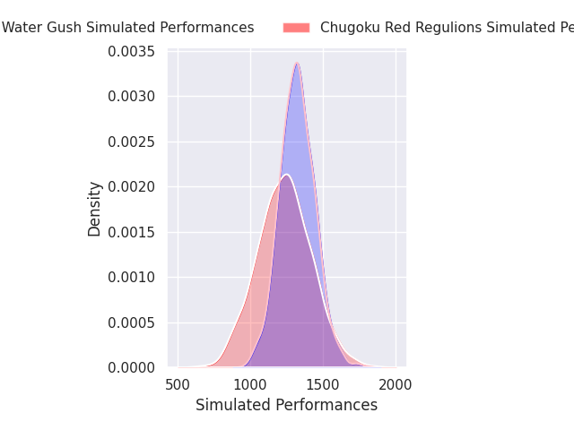
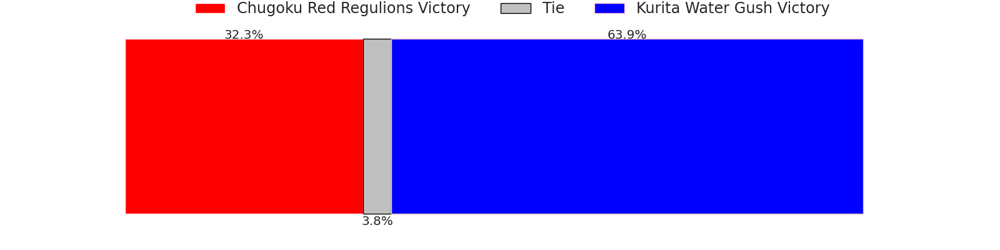
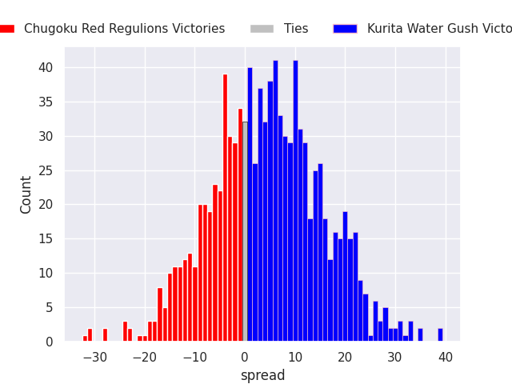

#### Maruwa Momotaro's Narita V Kamaishi Seawaves on 2026/12/20

Average Margin: Maruwa Momotaro's Narita by 38.2

#### Yakult Levins Toda V Hino Red Dolphins on 2026/12/20

Average Margin: Hino Red Dolphins by 19.8

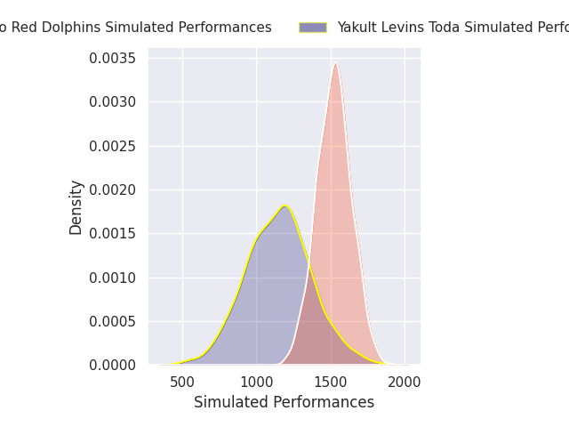
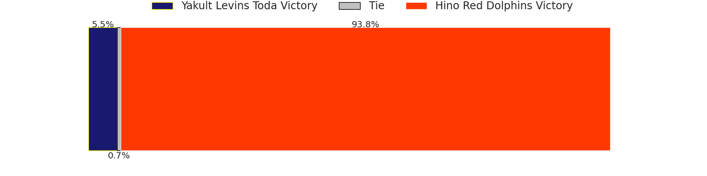
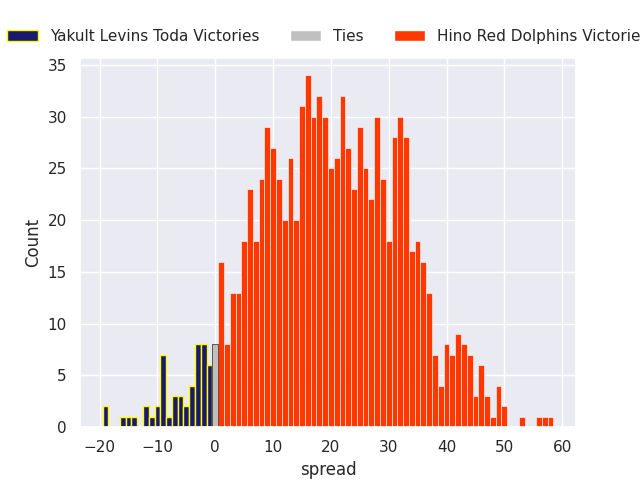

### Week 3
#### Hino Red Dolphins V Maruwa Momotaro's Narita on 2026/12/26

Average Margin: Maruwa Momotaro's Narita by 30.8

