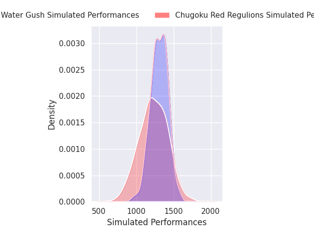
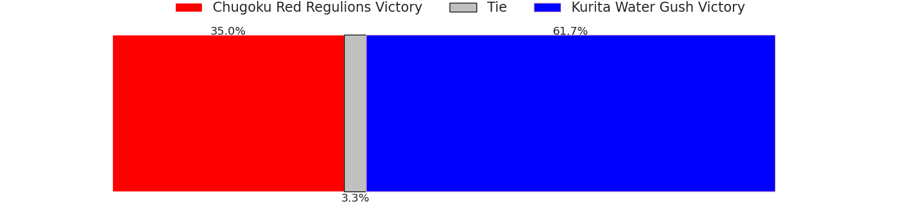
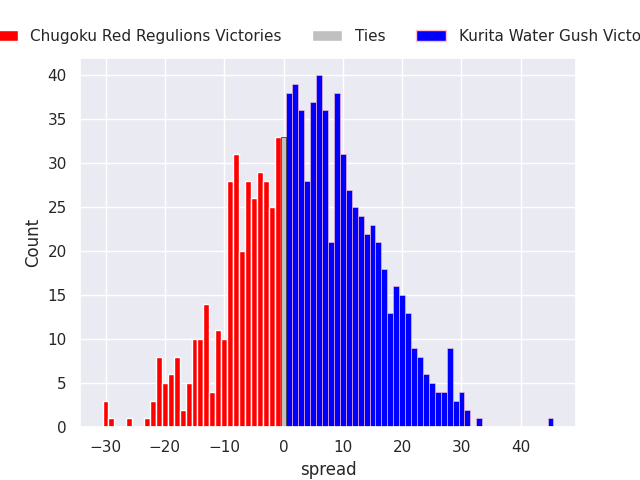
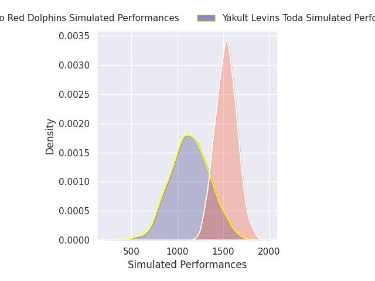
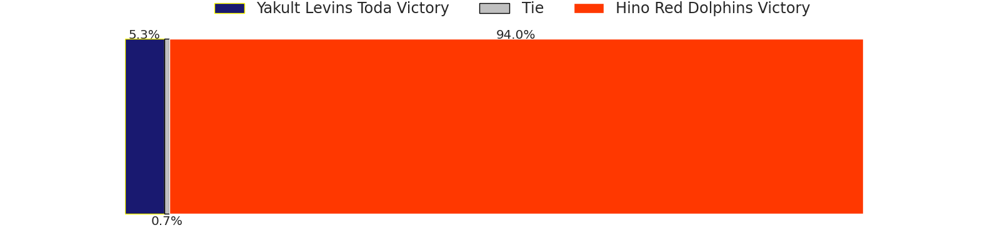
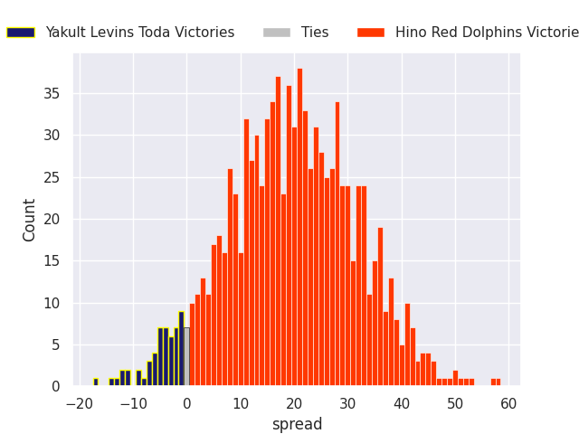

## Team Rankings

## Standings
### Projected Remaining Table

| Club                     |   To Play |   Projected Wins |   Projected Differential |   Projected Losing Bonus Points | Projected Try Bonus Points   |   Projected Competition Points |
|:-------------------------|----------:|-----------------:|-------------------------:|--------------------------------:|:-----------------------------|-------------------------------:|
| Hino Red Dolphins        |         2 |            1.668 |                   26.82  |                           0.207 |                              |                          6.949 |
| Kamaishi Seawaves        |         2 |            1.047 |                  -17.063 |                           0.073 |                              |                          4.289 |
| Kurita Water Gush        |         2 |            0.861 |                   -3.468 |                           0.424 |                              |                          3.99  |
| Maruwa Momotaro's Narita |         1 |            0.915 |                   37.247 |                           0.035 |                              |                          3.707 |
| LeRIRO Fukuoka           |         1 |            0.556 |                    2.124 |                           0.174 |                              |                          2.46  |
| Yakult Levins Toda       |         2 |            0.466 |                  -21.702 |                           0.305 |                              |                          2.245 |
| Chugoku Red Regulions    |         2 |            0.374 |                  -23.958 |                           0.323 |                              |                          1.901 |

### Projected Total Table

| Club                     |   Played |   Wins |   Point Differential |   Losing Bonus Points | Try Bonus Points   |   Competition Points |
|:-------------------------|---------:|-------:|---------------------:|----------------------:|:-------------------|---------------------:|
| Hino Red Dolphins        |        2 |  1.668 |               26.82  |                 0.207 |                    |                6.949 |
| Kamaishi Seawaves        |        2 |  1.047 |              -17.063 |                 0.073 |                    |                4.289 |
| Kurita Water Gush        |        2 |  0.861 |               -3.468 |                 0.424 |                    |                3.99  |
| Maruwa Momotaro's Narita |        1 |  0.915 |               37.247 |                 0.035 |                    |                3.707 |
| LeRIRO Fukuoka           |        1 |  0.556 |                2.124 |                 0.174 |                    |                2.46  |
| Yakult Levins Toda       |        2 |  0.466 |              -21.702 |                 0.305 |                    |                2.245 |
| Chugoku Red Regulions    |        2 |  0.374 |              -23.958 |                 0.323 |                    |                1.901 |

## Future Predictions
### Week 1
#### Kamaishi Seawaves V Chugoku Red Regulions on 2026/12/12

Average Margin: Kamaishi Seawaves by 20.2

#### Kurita Water Gush V Hino Red Dolphins on 2026/12/12

Average Margin: Hino Red Dolphins by 7.2

#### LeRIRO Fukuoka V Yakult Levins Toda on 2026/12/13

Average Margin: LeRIRO Fukuoka by 2.1

### Week 2
#### Chugoku Red Regulions V Kurita Water Gush on 2026/12/19

Average Margin: Kurita Water Gush by 3.8

#### Yakult Levins Toda V Hino Red Dolphins on 2026/12/20

Average Margin: Hino Red Dolphins by 19.6

#### Maruwa Momotaro's Narita V Kamaishi Seawaves on 2026/12/20

Average Margin: Maruwa Momotaro's Narita by 37.2

