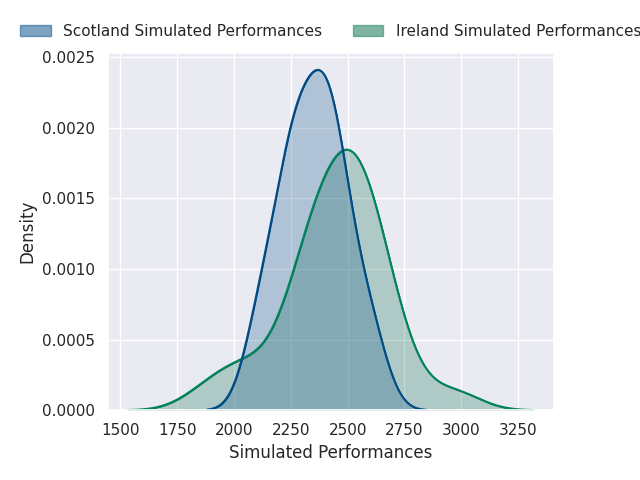
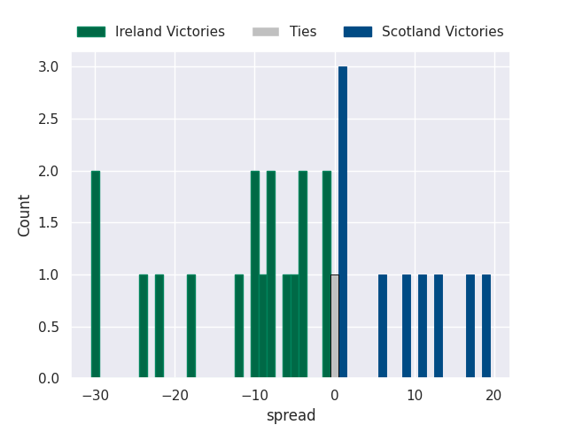
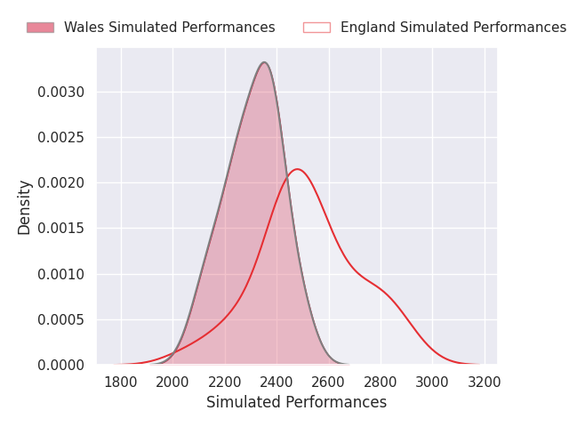
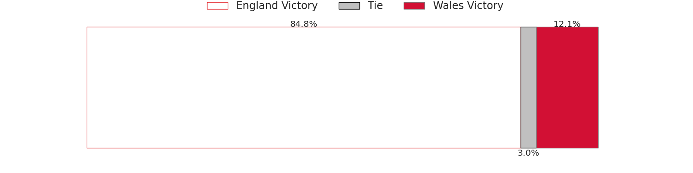
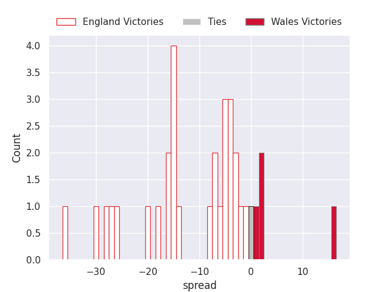
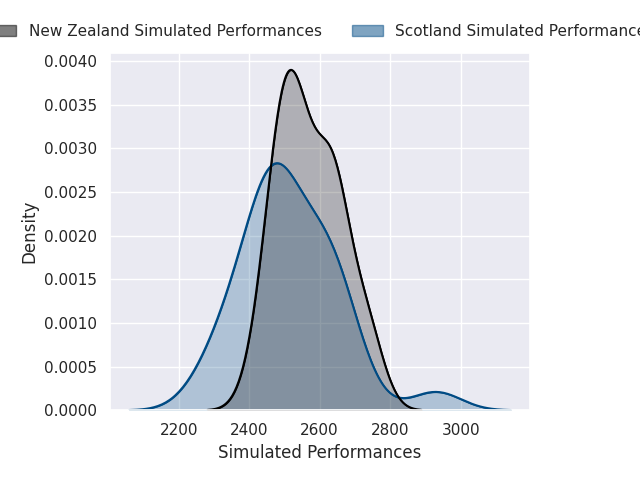
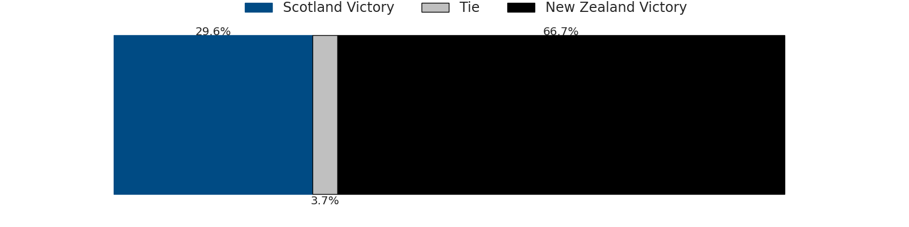
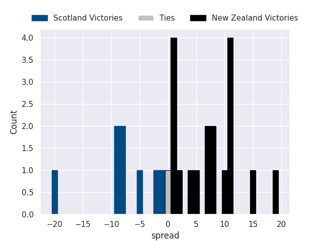

## Team Rankings

## Standings
### Current Standings
#### Pool A

| Club   | Played   | Wins   | Point Differential   | Losing Bonus Points   | Try Bonus Points   | Competition Points   |
|--------|----------|--------|----------------------|-----------------------|--------------------|----------------------|

#### Pool B

| Club   | Played   | Wins   | Point Differential   | Losing Bonus Points   | Try Bonus Points   | Competition Points   |
|--------|----------|--------|----------------------|-----------------------|--------------------|----------------------|

#### Pool C

| Club   | Played   | Wins   | Point Differential   | Losing Bonus Points   | Try Bonus Points   | Competition Points   |
|--------|----------|--------|----------------------|-----------------------|--------------------|----------------------|

#### Pool D

| Club   | Played   | Wins   | Point Differential   | Losing Bonus Points   | Try Bonus Points   | Competition Points   |
|--------|----------|--------|----------------------|-----------------------|--------------------|----------------------|

#### Pool E

| Club   | Played   | Wins   | Point Differential   | Losing Bonus Points   | Try Bonus Points   | Competition Points   |
|--------|----------|--------|----------------------|-----------------------|--------------------|----------------------|

#### Pool F

| Club   | Played   | Wins   | Point Differential   | Losing Bonus Points   | Try Bonus Points   | Competition Points   |
|--------|----------|--------|----------------------|-----------------------|--------------------|----------------------|

### Projected Remaining Table
#### Pool A

| Club        |   To Play |   Projected Wins |   Projected Differential |   Projected Losing Bonus Points | Projected Try Bonus Points   |   Projected Competition Points |
|:------------|----------:|-----------------:|-------------------------:|--------------------------------:|:-----------------------------|-------------------------------:|
| New Zealand |         3 |            2.692 |                   82.164 |                           0.164 |                              |                         11.038 |
| Australia   |         3 |            2.219 |                   51.44  |                           0.299 |                              |                          9.289 |
| Chile       |         3 |            0.896 |                  -36.231 |                           0.159 |                              |                          3.781 |
| Hong Kong   |         3 |            0.121 |                  -97.373 |                           0.128 |                              |                          0.642 |

#### Pool B

| Club         |   To Play |   Projected Wins |   Projected Differential |   Projected Losing Bonus Points | Projected Try Bonus Points   |   Projected Competition Points |
|:-------------|----------:|-----------------:|-------------------------:|--------------------------------:|:-----------------------------|-------------------------------:|
| South Africa |         3 |            2.964 |                   85.374 |                           0.024 |                              |                         11.9   |
| Italy        |         3 |            1.482 |                   -4.623 |                           0.295 |                              |                          6.341 |
| Georgia      |         3 |            1.401 |                   -1.064 |                           0.364 |                              |                          6.086 |
| Romania      |         3 |            0.083 |                  -79.687 |                           0.2   |                              |                          0.556 |

#### Pool C

| Club      |   To Play |   Projected Wins |   Projected Differential |   Projected Losing Bonus Points | Projected Try Bonus Points   |   Projected Competition Points |
|:----------|----------:|-----------------:|-------------------------:|--------------------------------:|:-----------------------------|-------------------------------:|
| Argentina |         3 |            2.884 |                   62.597 |                           0.074 |                              |                         11.654 |
| Fiji      |         3 |            1.677 |                    7.403 |                           0.339 |                              |                          7.163 |
| Spain     |         3 |            1.08  |                  -17.316 |                           0.423 |                              |                          4.863 |
| Canada    |         3 |            0.268 |                  -52.684 |                           0.385 |                              |                          1.541 |

#### Pool D

| Club     |   To Play |   Projected Wins |   Projected Differential |   Projected Losing Bonus Points | Projected Try Bonus Points   |   Projected Competition Points |
|:---------|----------:|-----------------:|-------------------------:|--------------------------------:|:-----------------------------|-------------------------------:|
| Ireland  |         3 |            2.706 |                   54.362 |                           0.17  |                              |                         11.06  |
| Scotland |         3 |            2.173 |                   35.287 |                           0.293 |                              |                          9.063 |
| Portugal |         3 |            0.529 |                  -39.382 |                           0.381 |                              |                          2.591 |
| Uruguay  |         3 |            0.518 |                  -50.267 |                           0.287 |                              |                          2.417 |

#### Pool E

| Club                     |   To Play |   Projected Wins |   Projected Differential |   Projected Losing Bonus Points | Projected Try Bonus Points   |   Projected Competition Points |
|:-------------------------|----------:|-----------------:|-------------------------:|--------------------------------:|:-----------------------------|-------------------------------:|
| France                   |         3 |            2.946 |                   81.559 |                           0.039 |                              |                         11.845 |
| Japan                    |         3 |            1.871 |                   15.774 |                           0.206 |                              |                          7.762 |
| United States of America |         3 |            0.927 |                  -28.957 |                           0.321 |                              |                          4.089 |
| Samoa                    |         3 |            0.206 |                  -68.376 |                           0.253 |                              |                          1.123 |

#### Pool F

| Club     |   To Play |   Projected Wins |   Projected Differential |   Projected Losing Bonus Points | Projected Try Bonus Points   |   Projected Competition Points |
|:---------|----------:|-----------------:|-------------------------:|--------------------------------:|:-----------------------------|-------------------------------:|
| England  |         3 |            2.861 |                   75.455 |                           0.082 |                              |                         11.57  |
| Wales    |         3 |            2.032 |                   32.424 |                           0.217 |                              |                          8.423 |
| Tonga    |         3 |            0.706 |                  -43.922 |                           0.228 |                              |                          3.108 |
| Zimbabwe |         3 |            0.34  |                  -63.957 |                           0.278 |                              |                          1.704 |

### Projected Total Table
#### Pool A

| Club        |   Played |   Wins |   Point Differential |   Losing Bonus Points | Try Bonus Points   |   Competition Points |
|:------------|---------:|-------:|---------------------:|----------------------:|:-------------------|---------------------:|
| New Zealand |        3 |  2.692 |               82.164 |                 0.164 |                    |               11.038 |
| Australia   |        3 |  2.219 |               51.44  |                 0.299 |                    |                9.289 |
| Chile       |        3 |  0.896 |              -36.231 |                 0.159 |                    |                3.781 |
| Hong Kong   |        3 |  0.121 |              -97.373 |                 0.128 |                    |                0.642 |

#### Pool B

| Club         |   Played |   Wins |   Point Differential |   Losing Bonus Points | Try Bonus Points   |   Competition Points |
|:-------------|---------:|-------:|---------------------:|----------------------:|:-------------------|---------------------:|
| South Africa |        3 |  2.964 |               85.374 |                 0.024 |                    |               11.9   |
| Italy        |        3 |  1.482 |               -4.623 |                 0.295 |                    |                6.341 |
| Georgia      |        3 |  1.401 |               -1.064 |                 0.364 |                    |                6.086 |
| Romania      |        3 |  0.083 |              -79.687 |                 0.2   |                    |                0.556 |

#### Pool C

| Club      |   Played |   Wins |   Point Differential |   Losing Bonus Points | Try Bonus Points   |   Competition Points |
|:----------|---------:|-------:|---------------------:|----------------------:|:-------------------|---------------------:|
| Argentina |        3 |  2.884 |               62.597 |                 0.074 |                    |               11.654 |
| Fiji      |        3 |  1.677 |                7.403 |                 0.339 |                    |                7.163 |
| Spain     |        3 |  1.08  |              -17.316 |                 0.423 |                    |                4.863 |
| Canada    |        3 |  0.268 |              -52.684 |                 0.385 |                    |                1.541 |

#### Pool D

| Club     |   Played |   Wins |   Point Differential |   Losing Bonus Points | Try Bonus Points   |   Competition Points |
|:---------|---------:|-------:|---------------------:|----------------------:|:-------------------|---------------------:|
| Ireland  |        3 |  2.706 |               54.362 |                 0.17  |                    |               11.06  |
| Scotland |        3 |  2.173 |               35.287 |                 0.293 |                    |                9.063 |
| Portugal |        3 |  0.529 |              -39.382 |                 0.381 |                    |                2.591 |
| Uruguay  |        3 |  0.518 |              -50.267 |                 0.287 |                    |                2.417 |

#### Pool E

| Club                     |   Played |   Wins |   Point Differential |   Losing Bonus Points | Try Bonus Points   |   Competition Points |
|:-------------------------|---------:|-------:|---------------------:|----------------------:|:-------------------|---------------------:|
| France                   |        3 |  2.946 |               81.559 |                 0.039 |                    |               11.845 |
| Japan                    |        3 |  1.871 |               15.774 |                 0.206 |                    |                7.762 |
| United States of America |        3 |  0.927 |              -28.957 |                 0.321 |                    |                4.089 |
| Samoa                    |        3 |  0.206 |              -68.376 |                 0.253 |                    |                1.123 |

#### Pool F

| Club     |   Played |   Wins |   Point Differential |   Losing Bonus Points | Try Bonus Points   |   Competition Points |
|:---------|---------:|-------:|---------------------:|----------------------:|:-------------------|---------------------:|
| England  |        3 |  2.861 |               75.455 |                 0.082 |                    |               11.57  |
| Wales    |        3 |  2.032 |               32.424 |                 0.217 |                    |                8.423 |
| Tonga    |        3 |  0.706 |              -43.922 |                 0.228 |                    |                3.108 |
| Zimbabwe |        3 |  0.34  |              -63.957 |                 0.278 |                    |                1.704 |

### Projected Playoff Results

|                          | Reach Round of 16   | Win Round of 16   | Reach Quarterfinal   | Win Quarterfinal   | Reach Semifinal   | Win Semifinal   | Reach Final   | Win Final   |
|:-------------------------|:--------------------|:------------------|:---------------------|:-------------------|:------------------|:----------------|:--------------|:------------|
| New Zealand              | 100.0 %             | 99.3 %            | 99.3 %               | 70.2 %             | 70.2 %            | 60.3 %          | 60.3 %        | 40.5 %      |
| South Africa             | 100.0 %             | 98.5 %            | 98.5 %               | 44.6 %             | 44.6 %            | 37.7 %          | 37.7 %        | 32.7 %      |
| France                   | 100.0 %             | 81.5 %            | 81.5 %               | 62.6 %             | 62.6 %            | 13.6 %          | 13.6 %        | 9.6 %       |
| England                  | 100.0 %             | 90.9 %            | 90.9 %               | 44.1 %             | 44.1 %            | 29.9 %          | 29.9 %        | 5.3 %       |
| Australia                | 100.0 %             | 89.4 %            | 89.4 %               | 39.7 %             | 39.7 %            | 22.4 %          | 22.4 %        | 5.3 %       |
| Ireland                  | 100.0 %             | 76.8 %            | 76.8 %               | 48.6 %             | 48.6 %            | 17.3 %          | 17.3 %        | 3.8 %       |
| Scotland                 | 99.9 %              | 37.7 %            | 37.7 %               | 23.7 %             | 23.7 %            | 6.2 %           | 6.2 %         | 1.7 %       |
| Argentina                | 100.0 %             | 88.5 %            | 88.5 %               | 37.1 %             | 37.1 %            | 7.9 %           | 7.9 %         | 0.5 %       |
| Wales                    | 99.8 %              | 67.3 %            | 67.3 %               | 19.8 %             | 19.8 %            | 2.3 %           | 2.3 %         | 0.4 %       |
| Georgia                  | 94.4 %              | 12.5 %            | 12.5 %               | 2.3 %              | 2.3 %             | 0.9 %           | 0.9 %         | 0.1 %       |
| Japan                    | 99.0 %              | 9.8 %             | 9.8 %                | 2.3 %              | 2.3 %             | 0.7 %           | 0.7 %         | 0.1 %       |
| Italy                    | 95.1 %              | 8.7 %             | 8.7 %                | 1.6 %              | 1.6 %             | 0.6 %           | 0.6 %         | 0.0 %       |
| Chile                    | 49.5 %              | 2.2 %             | 2.2 %                | 0.3 %              | 0.3 %             | 0.1 %           | 0.1 %         | 0.0 %       |
| Portugal                 | 33.7 %              | 1.3 %             | 1.3 %                | 0.1 %              | 0.1 %             | 0.1 %           | 0.1 %         | 0.0 %       |
| Fiji                     | 95.2 %              | 24.2 %            | 24.2 %               | 2.1 %              | 2.1 %             | 0.0 %           | 0.0 %         | 0.0 %       |
| Spain                    | 74.9 %              | 7.4 %             | 7.4 %                | 0.4 %              | 0.4 %             | 0.0 %           | 0.0 %         | 0.0 %       |
| United States of America | 62.3 %              | 1.3 %             | 1.3 %                | 0.2 %              | 0.2 %             | 0.0 %           | 0.0 %         | 0.0 %       |
| Zimbabwe                 | 14.2 %              | 0.7 %             | 0.7 %                | 0.2 %              | 0.2 %             | 0.0 %           | 0.0 %         | 0.0 %       |
| Uruguay                  | 24.3 %              | 0.6 %             | 0.6 %                | 0.1 %              | 0.1 %             | 0.0 %           | 0.0 %         | 0.0 %       |
| Tonga                    | 34.7 %              | 0.9 %             | 0.9 %                | 0.0 %              | 0.0 %             | 0.0 %           | 0.0 %         | 0.0 %       |
| Canada                   | 14.0 %              | 0.4 %             | 0.4 %                | 0.0 %              | 0.0 %             | 0.0 %           | 0.0 %         | 0.0 %       |
| Samoa                    | 6.6 %               | 0.1 %             | 0.1 %                | 0.0 %              | 0.0 %             | 0.0 %           | 0.0 %         | 0.0 %       |
| Romania                  | 1.8 %               | 0.0 %             | 0.0 %                | 0.0 %              | 0.0 %             | 0.0 %           | 0.0 %         | 0.0 %       |
| Hong Kong                | 0.6 %               | 0.0 %             | 0.0 %                | 0.0 %              | 0.0 %             | 0.0 %           | 0.0 %         | 0.0 %       |

## Future Predictions
### Week 1
#### Australia V New Zealand on 2027/10/01

Average Margin: New Zealand by 5.6

#### England V Wales on 2027/10/01

Average Margin: England by 12.9

#### United States of America V Samoa on 2027/10/01

Average Margin: United States of America by 11.8

#### France V Japan on 2027/10/01

Average Margin: France by 18.5

#### Uruguay V Portugal on 2027/10/01

Average Margin: Portugal by 0.1

#### Ireland V Scotland on 2027/10/01

Average Margin: Ireland by 7.0

#### Argentina V Fiji on 2027/10/01

Average Margin: Argentina by 16.4

#### Georgia V Romania on 2027/10/01

Average Margin: Georgia by 21.7

#### Spain V Canada on 2027/10/01

Average Margin: Spain by 11.2

#### Tonga V Zimbabwe on 2027/10/01

Average Margin: Tonga by 7.2

#### South Africa V Italy on 2027/10/01

Average Margin: South Africa by 24.0

#### Chile V Hong Kong on 2027/10/01

Average Margin: Chile by 16.6

### Week 2
#### England V Tonga on 2027/10/08

Average Margin: England by 29.8

#### Australia V Chile on 2027/10/08

Average Margin: Australia by 21.5

#### Japan V Samoa on 2027/10/08

Average Margin: Japan by 21.1

#### France V United States of America on 2027/10/08

Average Margin: France by 27.6

#### New Zealand V Hong Kong on 2027/10/08

Average Margin: New Zealand by 45.3

#### Ireland V Uruguay on 2027/10/08

Average Margin: Ireland by 26.5

#### Scotland V Portugal on 2027/10/08

Average Margin: Scotland by 18.7

#### Fiji V Canada on 2027/10/08

Average Margin: Fiji by 15.0

#### Italy V Romania on 2027/10/08

Average Margin: Italy by 18.4

#### South Africa V Georgia on 2027/10/08

Average Margin: South Africa by 21.8

#### Argentina V Spain on 2027/10/08

Average Margin: Argentina by 19.7

#### Wales V Zimbabwe on 2027/10/08

Average Margin: Wales by 24.0

### Week 3
#### Wales V Tonga on 2027/10/15

Average Margin: Wales by 21.4

#### England V Zimbabwe on 2027/10/15

Average Margin: England by 32.8

#### Australia V Hong Kong on 2027/10/15

Average Margin: Australia by 35.5

#### Japan V United States of America on 2027/10/15

Average Margin: Japan by 13.1

#### Argentina V Canada on 2027/10/15

Average Margin: Argentina by 26.4

#### New Zealand V Chile on 2027/10/15

Average Margin: New Zealand by 31.3

#### Fiji V Spain on 2027/10/15

Average Margin: Fiji by 8.8

#### South Africa V Romania on 2027/10/15

Average Margin: South Africa by 39.5

#### Scotland V Uruguay on 2027/10/15

Average Margin: Scotland by 23.7

#### Ireland V Portugal on 2027/10/15

Average Margin: Ireland by 20.9

#### France V Samoa on 2027/10/15

Average Margin: France by 35.5

#### Italy V Georgia on 2027/10/15

Average Margin: Italy by 1.0

### Week 4
#### Australia V Tonga on 2027-10-22

Average Margin: Australia by 26.7

#### Argentina V Italy on 2027-10-22

Average Margin: Argentina by 10.7

#### Argentina V Portugal on 2027-10-22

Average Margin: Argentina by 13.2

#### Argentina V Japan on 2027-10-22

Average Margin: Argentina by 13.6

#### Argentina V Canada on 2027-10-22

Average Margin: Argentina by 25.1

#### Argentina V Zimbabwe on 2027-10-22

Average Margin: Argentina by 21.7

#### Argentina V Scotland on 2027-10-22

Average Margin: Argentina by 3.8

#### Fiji V Uruguay on 2027-10-22

Average Margin: Uruguay by 11.0

#### Fiji V Italy on 2027-10-22

Average Margin: Fiji by 2.1

#### Argentina V Samoa on 2027-10-22

Average Margin: Argentina by 16.5

#### Fiji V Scotland on 2027-10-22

Average Margin: Scotland by 19.0

#### Argentina V Romania on 2027-10-22

Average Margin: Argentina by 22.5

#### Spain V Georgia on 2027-10-22

Average Margin: Georgia by 8.0

#### Fiji V Japan on 2027-10-22

Average Margin: Fiji by 1.0

#### Fiji V Chile on 2027-10-22

Average Margin: Fiji by 6.7

#### Fiji V Georgia on 2027-10-22

Average Margin: Georgia by 15.0

#### Argentina V Australia on 2027-10-22

Average Margin: Australia by 1.0

#### Fiji V United States of America on 2027-10-22

Average Margin: Fiji by 9.6

#### Fiji V Portugal on 2027-10-22

Average Margin: Portugal by 0.7

#### Canada V Portugal on 2027-10-22

Average Margin: Portugal by 11.0

#### Argentina V Uruguay on 2027-10-22

Average Margin: Argentina by 21.5

#### Australia V France on 2027-10-22

Average Margin: Australia by 1.8

#### Hong Kong V Japan on 2027-10-22

Average Margin: Japan by 6.0

#### New Zealand V France on 2027-10-22

Average Margin: New Zealand by 11.5

#### Chile V United States of America on 2027-10-22

Average Margin: United States of America by 4.5

#### England V South Africa on 2027-10-22

Average Margin: England by 2.8

#### England V Georgia on 2027-10-22

Average Margin: England by 15.2

#### England V Italy on 2027-10-22

Average Margin: England by 17.9

#### Argentina V Georgia on 2027-10-22

Average Margin: Argentina by 7.2

#### Wales V Italy on 2027-10-22

Average Margin: Wales by 11.0

#### Wales V South Africa on 2027-10-22

Average Margin: South Africa by 20.0

#### England V Romania on 2027-10-22

Average Margin: England by 32.0

#### Argentina V Fiji on 2027-10-22

Average Margin: Argentina by 16.1

#### Argentina V Chile on 2027-10-22

Average Margin: Argentina by 16.7

#### Argentina V Spain on 2027-10-22

Average Margin: Argentina by 18.6

#### Fiji V Spain on 2027-10-22

Average Margin: Fiji by 9.2

#### Argentina V United States of America on 2027-10-22

Average Margin: Argentina by 17.8

#### Wales V Georgia on 2027-10-22

Average Margin: Wales by 7.1

#### Fiji V Canada on 2027-10-22

Average Margin: Fiji by 10.0

#### Spain V Italy on 2027-10-22

Average Margin: Spain by 19.0

#### Spain V United States of America on 2027-10-22

Average Margin: Spain by 15.5

#### Scotland V Spain on 2027-10-22

Average Margin: Scotland by 25.3

#### Scotland V Fiji on 2027-10-22

Average Margin: Scotland by 20.6

#### Ireland V Romania on 2027-10-22

Average Margin: Ireland by 19.0

#### Ireland V Uruguay on 2027-10-22

Average Margin: Ireland by 22.1

#### Scotland V Tonga on 2027-10-22

Average Margin: Scotland by 32.9

#### Scotland V Zimbabwe on 2027-10-22

Average Margin: Scotland by 26.4

#### Scotland V Japan on 2027-10-22

Average Margin: Scotland by 19.0

#### Ireland V Japan on 2027-10-22

Average Margin: Ireland by 16.4

#### Ireland V Wales on 2027-10-22

Average Margin: Ireland by 16.8

#### Ireland V Argentina on 2027-10-22

Average Margin: Ireland by 1.0

#### Scotland V Wales on 2027-10-22

Average Margin: Scotland by 9.0

#### Scotland V Samoa on 2027-10-22

Average Margin: Scotland by 36.0

#### Ireland V Samoa on 2027-10-22

Average Margin: Ireland by 33.2

#### Scotland V Australia on 2027-10-22

Average Margin: Scotland by 8.2

#### Ireland V England on 2027-10-22

Average Margin: Ireland by 9.0

#### Scotland V New Zealand on 2027-10-22

Average Margin: New Zealand by 1.0

#### Scotland V Portugal on 2027-10-22

Average Margin: Scotland by 20.1

#### Ireland V United States of America on 2027-10-22

Average Margin: Ireland by 25.9

#### Scotland V United States of America on 2027-10-22

Average Margin: Scotland by 24.8

#### Ireland V Portugal on 2027-10-22

Average Margin: Ireland by 18.5

#### Argentina V Ireland on 2027-10-22

Average Margin: Argentina by 6.5

#### Spain V Uruguay on 2027-10-22

Average Margin: Spain by 11.0

#### Spain V Portugal on 2027-10-22

Average Margin: Spain by 8.0

#### Scotland V Georgia on 2027-10-22

Average Margin: Scotland by 13.5

#### Ireland V Italy on 2027-10-22

Average Margin: Ireland by 17.4

#### Ireland V Georgia on 2027-10-22

Average Margin: Ireland by 13.9

#### Ireland V Spain on 2027-10-22

Average Margin: Ireland by 25.3

#### Ireland V Canada on 2027-10-22

Average Margin: Ireland by 30.5

#### Ireland V Tonga on 2027-10-22

Average Margin: Ireland by 24.9

#### Ireland V Fiji on 2027-10-22

Average Margin: Ireland by 22.2

#### Scotland V Chile on 2027-10-22

Average Margin: Scotland by 23.7

#### Scotland V Italy on 2027-10-22

Average Margin: Scotland by 14.1

#### Ireland V Australia on 2027-10-22

Average Margin: Ireland by 10.4

#### Ireland V Scotland on 2027-10-22

Average Margin: Ireland by 8.0

#### Ireland V Zimbabwe on 2027-10-22

Average Margin: Ireland by 26.4

#### Scotland V Uruguay on 2027-10-22

Average Margin: Scotland by 25.1

#### Ireland V Chile on 2027-10-22

Average Margin: Ireland by 24.8

#### Chile V Japan on 2027-10-22

Average Margin: Japan by 0.9

#### Japan V Ireland on 2027-10-22

Average Margin: Ireland by 2.9

#### France V Portugal on 2027-10-22

Average Margin: France by 24.2

#### Japan V Scotland on 2027-10-22

Average Margin: Scotland by 4.8

#### New Zealand V Japan on 2027-10-22

Average Margin: New Zealand by 23.1

#### Australia V Hong Kong on 2027-10-22

Average Margin: Australia by 44.0

#### Australia V Fiji on 2027-10-22

Average Margin: Australia by 16.0

#### Australia V Japan on 2027-10-22

Average Margin: Australia by 29.0

#### Australia V Italy on 2027-10-22

Average Margin: Australia by 19.6

#### New Zealand V Wales on 2027-10-22

Average Margin: New Zealand by 21.5

#### New Zealand V Romania on 2027-10-22

Average Margin: New Zealand by 34.0

#### New Zealand V Fiji on 2027-10-22

Average Margin: New Zealand by 29.8

#### Australia V Romania on 2027-10-22

Average Margin: Australia by 41.5

#### New Zealand V Australia on 2027-10-22

Average Margin: New Zealand by 23.0

#### New Zealand V Hong Kong on 2027-10-22

Average Margin: New Zealand by 51.0

#### Italy V United States of America on 2027-10-22

Average Margin: Italy by 17.5

#### South Africa V Spain on 2027-10-22

Average Margin: South Africa by 32.9

#### South Africa V Canada on 2027-10-22

Average Margin: South Africa by 38.6

#### South Africa V Chile on 2027-10-22

Average Margin: South Africa by 31.5

#### South Africa V Tonga on 2027-10-22

Average Margin: South Africa by 34.4

#### Australia V Scotland on 2027-10-22

Average Margin: Australia by 6.0

#### Australia V Samoa on 2027-10-22

Average Margin: Australia by 25.6

#### Australia V Georgia on 2027-10-22

Average Margin: Australia by 13.0

#### Australia V Spain on 2027-10-22

Average Margin: Australia by 22.0

#### Australia V United States of America on 2027-10-22

Average Margin: Australia by 21.4

#### Australia V Portugal on 2027-10-22

Average Margin: Australia by 16.8

#### New Zealand V Uruguay on 2027-10-22

Average Margin: New Zealand by 32.6

#### New Zealand V Italy on 2027-10-22

Average Margin: New Zealand by 23.4

#### New Zealand V Portugal on 2027-10-22

Average Margin: New Zealand by 26.1

#### New Zealand V United States of America on 2027-10-22

Average Margin: New Zealand by 31.4

#### Australia V Zimbabwe on 2027-10-22

Average Margin: Australia by 14.6

#### New Zealand V Samoa on 2027-10-22

Average Margin: New Zealand by 38.3

#### New Zealand V Chile on 2027-10-22

Average Margin: New Zealand by 32.7

#### New Zealand V Spain on 2027-10-22

Average Margin: New Zealand by 34.0

#### Australia V Chile on 2027-10-22

Average Margin: Australia by 19.8

#### New Zealand V Georgia on 2027-10-22

Average Margin: New Zealand by 22.2

#### New Zealand V Tonga on 2027-10-22

Average Margin: New Zealand by 35.0

#### Australia V Uruguay on 2027-10-22

Average Margin: Australia by 26.0

#### New Zealand V Zimbabwe on 2027-10-22

Average Margin: New Zealand by 34.5

#### Australia V Canada on 2027-10-22

Average Margin: Australia by 25.7

#### New Zealand V Canada on 2027-10-22

Average Margin: New Zealand by 34.5

#### South Africa V United States of America on 2027-10-22

Average Margin: South Africa by 33.2

#### Ireland V Hong Kong on 2027-10-22

Average Margin: Ireland by 15.0

#### South Africa V Georgia on 2027-10-22

Average Margin: South Africa by 20.4

#### South Africa V Uruguay on 2027-10-22

Average Margin: South Africa by 32.3

#### Argentina V Wales on 2027-10-22

Average Margin: Argentina by 5.6

#### Fiji V England on 2027-10-22

Average Margin: England by 11.3

#### Spain V Wales on 2027-10-22

Average Margin: Wales by 7.1

#### Spain V England on 2027-10-22

Average Margin: England by 14.0

#### Fiji V Tonga on 2027-10-22

Average Margin: Fiji by 9.6

#### Spain V Tonga on 2027-10-22

Average Margin: Tonga by 0.5

#### Fiji V Zimbabwe on 2027-10-22

Average Margin: Fiji by 15.8

#### Fiji V Wales on 2027-10-22

Average Margin: Wales by 5.2

#### Spain V Zimbabwe on 2027-10-22

Average Margin: Spain by 9.5

#### Canada V Zimbabwe on 2027-10-22

Average Margin: Zimbabwe by 10.0

#### Argentina V Tonga on 2027-10-22

Average Margin: Argentina by 36.0

#### Canada V England on 2027-10-22

Average Margin: England by 25.5

#### France V Ireland on 2027-10-22

Average Margin: France by 8.1

#### France V Scotland on 2027-10-22

Average Margin: France by 10.2

#### Japan V Portugal on 2027-10-22

Average Margin: Japan by 1.5

#### France V Uruguay on 2027-10-22

Average Margin: France by 23.9

#### Argentina V England on 2027-10-22

Average Margin: England by 2.2

#### Canada V Wales on 2027-10-22

Average Margin: Wales by 12.3

#### Georgia V United States of America on 2027-10-22

Average Margin: Georgia by 17.0

#### Italy V Spain on 2027-10-22

Average Margin: Italy by 11.0

#### South Africa V Portugal on 2027-10-22

Average Margin: South Africa by 27.2

#### Georgia V Italy on 2027-10-22

Average Margin: Georgia by 12.8

#### South Africa V Italy on 2027-10-22

Average Margin: South Africa by 25.3

#### South Africa V Romania on 2027-10-22

Average Margin: South Africa by 41.5

#### South Africa V Japan on 2027-10-22

Average Margin: South Africa by 20.7

#### South Africa V Samoa on 2027-10-22

Average Margin: South Africa by 38.2

#### South Africa V Fiji on 2027-10-22

Average Margin: South Africa by 26.9

#### South Africa V Wales on 2027-10-22

Average Margin: South Africa by 19.4

#### Georgia V Chile on 2027-10-22

Average Margin: Georgia by 6.0

#### Italy V Fiji on 2027-10-22

Average Margin: Italy by 28.0

#### South Africa V Scotland on 2027-10-22

Average Margin: South Africa by 8.0

#### Italy V Chile on 2027-10-22

Average Margin: Italy by 24.5

#### South Africa V Australia on 2027-10-22

Average Margin: South Africa by 10.5

#### Georgia V Uruguay on 2027-10-22

Average Margin: Georgia by 19.0

#### Georgia V Portugal on 2027-10-22

Average Margin: Georgia by 28.0

#### Italy V Portugal on 2027-10-22

Average Margin: Portugal by 5.0

#### Georgia V Spain on 2027-10-22

Average Margin: Georgia by 9.0

#### South Africa V Zimbabwe on 2027-10-22

Average Margin: South Africa by 35.3

#### Scotland V Canada on 2027-10-22

Average Margin: Scotland by 20.0

### Week 5
#### Australia V Italy on 2027-10-29

Average Margin: Australia by 10.5

#### Italy V Ireland on 2027-10-29

Average Margin: Ireland by 6.9

#### United States of America V Scotland on 2027-10-29

Average Margin: Scotland by 17.6

#### Argentina V Georgia on 2027-10-29

Average Margin: Argentina by 12.5

#### United States of America V Ireland on 2027-10-29

Average Margin: Ireland by 38.0

#### Portugal V Ireland on 2027-10-29

Average Margin: Ireland by 7.5

#### Argentina V Ireland on 2027-10-29

Average Margin: Ireland by 1.9

#### France V South Africa on 2027-10-29

Average Margin: France by 2.0

#### Japan V Wales on 2027-10-29

Average Margin: Japan by 5.3

#### Chile V Wales on 2027-10-29

Average Margin: Wales by 29.0

#### France V Wales on 2027-10-29

Average Margin: Wales by 16.0

#### United States of America V England on 2027-10-29

Average Margin: United States of America by 2.0

#### United States of America V Georgia on 2027-10-29

Average Margin: Georgia by 8.5

#### Chile V England on 2027-10-29

Average Margin: England by 6.5

#### New Zealand V Wales on 2027-10-29

Average Margin: New Zealand by 19.7

#### Japan V Georgia on 2027-10-29

Average Margin: Georgia by 3.0

#### Japan V Italy on 2027-10-29

Average Margin: Japan by 1.2

#### France V England on 2027-10-29

Average Margin: France by 2.1

#### Chile V Ireland on 2027-10-29

Average Margin: Ireland by 19.1

#### Georgia V Scotland on 2027-10-29

Average Margin: Scotland by 5.4

#### Scotland V Ireland on 2027-10-29

Average Margin: Scotland by 1.8

#### Georgia V Ireland on 2027-10-29

Average Margin: Ireland by 7.4

#### Australia V Ireland on 2027-10-29

Average Margin: Australia by 18.0

#### Argentina V Australia on 2027-10-29

Average Margin: Australia by 4.0

#### Argentina V Zimbabwe on 2027-10-29

Average Margin: Argentina by 14.0

#### Argentina V Fiji on 2027-10-29

Average Margin: Argentina by 19.0

#### Georgia V New Zealand on 2027-10-29

Average Margin: New Zealand by 28.0

#### Portugal V Scotland on 2027-10-29

Average Margin: Scotland by 6.5

#### Japan V Scotland on 2027-10-29

Average Margin: Japan by 2.0

#### Tonga V Scotland on 2027-10-29

Average Margin: Scotland by 9.0

#### Japan V England on 2027-10-29

Average Margin: England by 6.7

#### Samoa V Ireland on 2027-10-29

Average Margin: Ireland by 31.0

#### Japan V Ireland on 2027-10-29

Average Margin: Ireland by 10.0

#### Argentina V Chile on 2027-10-29

Average Margin: Argentina by 21.0

#### Argentina V Portugal on 2027-10-29

Average Margin: Argentina by 11.7

#### Italy V Scotland on 2027-10-29

Average Margin: Italy by 1.3

#### Spain V Italy on 2027-10-29

Average Margin: Spain by 4.0

#### Uruguay V Ireland on 2027-10-29

Average Margin: Ireland by 23.3

#### United States of America V Italy on 2027-10-29

Average Margin: Italy by 4.0

#### Argentina V Italy on 2027-10-29

Average Margin: Argentina by 5.2

#### Fiji V Georgia on 2027-10-29

Average Margin: Georgia by 3.0

#### Tonga V Ireland on 2027-10-29

Average Margin: Ireland by 20.0

#### Australia V Wales on 2027-10-29

Average Margin: Australia by 5.4

#### New Zealand V England on 2027-10-29

Average Margin: New Zealand by 9.6

#### Wales V France on 2027-10-29

Average Margin: France by 6.7

#### Wales V Ireland on 2027-10-29

Average Margin: Ireland by 4.5

#### Chile V South Africa on 2027-10-29

Average Margin: South Africa by 7.0

#### Uruguay V Georgia on 2027-10-29

Average Margin: Uruguay by 1.0

#### New Zealand V Portugal on 2027-10-29

Average Margin: New Zealand by 36.5

#### Australia V Georgia on 2027-10-29

Average Margin: Australia by 12.3

#### New Zealand V Chile on 2027-10-29

Average Margin: New Zealand by 37.0

#### United States of America V South Africa on 2027-10-29

Average Margin: South Africa by 24.0

#### New Zealand V Georgia on 2027-10-29

Average Margin: New Zealand by 24.9

#### Portugal V South Africa on 2027-10-29

Average Margin: South Africa by 29.0

#### Georgia V South Africa on 2027-10-29

Average Margin: South Africa by 27.0

#### New Zealand V Italy on 2027-10-29

Average Margin: New Zealand by 21.6

#### Uruguay V South Africa on 2027-10-29

Average Margin: South Africa by 11.0

#### Italy V South Africa on 2027-10-29

Average Margin: South Africa by 14.5

#### Zimbabwe V South Africa on 2027-10-29

Average Margin: South Africa by 23.0

#### New Zealand V South Africa on 2027-10-29

Average Margin: New Zealand by 4.5

#### Australia V South Africa on 2027-10-29

Average Margin: South Africa by 6.5

#### Argentina V France on 2027-10-29

Average Margin: France by 5.2

#### England V France on 2027-10-29

Average Margin: England by 1.7

#### Spain V France on 2027-10-29

Average Margin: France by 18.7

#### Wales V Scotland on 2027-10-29

Average Margin: Scotland by 2.0

#### Argentina V Japan on 2027-10-29

Average Margin: Argentina by 14.0

#### Fiji V Japan on 2027-10-29

Average Margin: Japan by 4.5

#### Zimbabwe V France on 2027-10-29

Average Margin: France by 16.0

#### Canada V Scotland on 2027-10-29

Average Margin: Scotland by 26.5

#### Zimbabwe V Scotland on 2027-10-29

Average Margin: Zimbabwe by 3.3

#### Canada V France on 2027-10-29

Average Margin: France by 29.5

#### England V Japan on 2027-10-29

Average Margin: England by 14.5

#### Spain V Scotland on 2027-10-29

Average Margin: Scotland by 14.8

#### Australia V England on 2027-10-29

Average Margin: England by 0.7

#### England V Scotland on 2027-10-29

Average Margin: England by 1.7

#### Wales V Japan on 2027-10-29

Average Margin: Wales by 11.4

#### Fiji V Ireland on 2027-10-29

Average Margin: Ireland by 15.1

#### Argentina V Scotland on 2027-10-29

Average Margin: Scotland by 5.0

#### England V Ireland on 2027-10-29

Average Margin: England by 12.4

#### Fiji V Scotland on 2027-10-29

Average Margin: Scotland by 9.4

#### Spain V Ireland on 2027-10-29

Average Margin: Ireland by 13.3

#### Fiji V Portugal on 2027-10-29

Average Margin: Fiji by 14.0

#### Fiji V France on 2027-10-29

Average Margin: France by 16.4

#### Tonga V France on 2027-10-29

Average Margin: France by 21.3

#### Georgia V Japan on 2027-10-29

Average Margin: Georgia by 1.0

### Week 6
#### Australia V Ireland on 2027-11-05

Average Margin: Ireland by 1.3

#### France V Scotland on 2027-11-05

Average Margin: France by 4.0

#### Japan V Argentina on 2027-11-05

Average Margin: Japan by 3.9

#### Italy V Argentina on 2027-11-05

Average Margin: Argentina by 3.0

#### England V Scotland on 2027-11-05

Average Margin: England by 5.4

#### Wales V Ireland on 2027-11-05

Average Margin: Wales by 0.2

#### Australia V Italy on 2027-11-05

Average Margin: Australia by 15.0

#### Japan V Ireland on 2027-11-05

Average Margin: Ireland by 3.3

#### England V Georgia on 2027-11-05

Average Margin: England by 11.7

#### Georgia V Ireland on 2027-11-05

Average Margin: Georgia by 8.2

#### England V Italy on 2027-11-05

Average Margin: England by 17.2

#### England V Portugal on 2027-11-05

Average Margin: Portugal by 0.0

#### New Zealand V Georgia on 2027-11-05

Average Margin: New Zealand by 20.5

#### Wales V Argentina on 2027-11-05

Average Margin: Wales by 10.4

#### France V Georgia on 2027-11-05

Average Margin: France by 6.0

#### Chile V Argentina on 2027-11-05

Average Margin: Argentina by 14.0

#### United States of America V Argentina on 2027-11-05

Average Margin: Argentina by 12.0

#### Australia V Georgia on 2027-11-05

Average Margin: Australia by 7.0

#### United States of America V Ireland on 2027-11-05

Average Margin: Ireland by 9.0

#### France V Ireland on 2027-11-05

Average Margin: Ireland by 2.7

#### England V Chile on 2027-11-05

Average Margin: England by 9.0

#### England V Fiji on 2027-11-05

Average Margin: England by 19.5

#### Italy V Ireland on 2027-11-05

Average Margin: Ireland by 0.7

#### England V Wales on 2027-11-05

Average Margin: England by 17.0

#### England V New Zealand on 2027-11-05

Average Margin: New Zealand by 12.0

#### France V Argentina on 2027-11-05

Average Margin: France by 4.0

#### Georgia V Argentina on 2027-11-05

Average Margin: Georgia by 1.3

#### Wales V Scotland on 2027-11-05

Average Margin: Scotland by 5.6

#### England V Argentina on 2027-11-05

Average Margin: England by 10.9

#### Australia V Argentina on 2027-11-05

Average Margin: Australia by 4.4

#### South Africa V France on 2027-11-05

Average Margin: South Africa by 8.4

#### Australia V France on 2027-11-05

Average Margin: Australia by 3.2

#### Australia V Wales on 2027-11-05

Average Margin: Australia by 10.7

#### New Zealand V France on 2027-11-05

Average Margin: New Zealand by 8.9

#### New Zealand V England on 2027-11-05

Average Margin: New Zealand by 15.8

#### New Zealand V Scotland on 2027-11-05

Average Margin: New Zealand by 12.0

#### New Zealand V Argentina on 2027-11-05

Average Margin: New Zealand by 11.2

#### South Africa V Wales on 2027-11-05

Average Margin: South Africa by 16.9

#### South Africa V Fiji on 2027-11-05

Average Margin: South Africa by 31.8

#### New Zealand V Wales on 2027-11-05

Average Margin: New Zealand by 16.9

#### South Africa V Scotland on 2027-11-05

Average Margin: South Africa by 11.6

#### New Zealand V Ireland on 2027-11-05

Average Margin: New Zealand by 12.2

#### Australia V Chile on 2027-11-05

Average Margin: Chile by 4.0

#### South Africa V Argentina on 2027-11-05

Average Margin: South Africa by 16.5

#### South Africa V Ireland on 2027-11-05

Average Margin: South Africa by 13.4

#### Australia V Fiji on 2027-11-05

Average Margin: Australia by 22.5

#### Australia V England on 2027-11-05

Average Margin: Australia by 6.5

#### Australia V Scotland on 2027-11-05

Average Margin: Scotland by 1.6

#### New Zealand V Spain on 2027-11-05

Average Margin: New Zealand by 31.5

#### New Zealand V Japan on 2027-11-05

Average Margin: New Zealand by 7.5

#### South Africa V England on 2027-11-05

Average Margin: South Africa by 12.9

#### South Africa V Zimbabwe on 2027-11-05

Average Margin: South Africa by 23.0

#### Uruguay V France on 2027-11-05

Average Margin: France by 10.0

#### Australia V Japan on 2027-11-05

Average Margin: Australia by 25.0

#### South Africa V Japan on 2027-11-05

Average Margin: South Africa by 30.0

#### England V Ireland on 2027-11-05

Average Margin: England by 4.9

#### New Zealand V Fiji on 2027-11-05

Average Margin: New Zealand by 21.4

#### England V Australia on 2027-11-05

Average Margin: England by 16.5

### Week 7
#### Ireland V Argentina on 2027-11-12

Average Margin: Ireland by 8.2

#### New Zealand V Fiji on 2027-11-12

Average Margin: New Zealand by 24.0

#### South Africa V Italy on 2027-11-12

Average Margin: South Africa by 17.0

#### Fiji V Australia on 2027-11-12

Average Margin: Australia by 1.0

#### South Africa V England on 2027-11-12

Average Margin: South Africa by 28.0

#### Scotland V Italy on 2027-11-12

Average Margin: Italy by 6.0

#### South Africa V Australia on 2027-11-12

Average Margin: South Africa by 14.7

#### France V Japan on 2027-11-12

Average Margin: France by 13.8

#### Japan V Australia on 2027-11-12

Average Margin: Australia by 7.0

#### South Africa V New Zealand on 2027-11-12

Average Margin: South Africa by 8.0

#### Scotland V Japan on 2027-11-12

Average Margin: Scotland by 9.5

#### Wales V Japan on 2027-11-12

Average Margin: Wales by 18.5

#### Spain V England on 2027-11-12

Average Margin: England by 6.0

#### France V Fiji on 2027-11-12

Average Margin: France by 16.7

#### Fiji V Georgia on 2027-11-12

Average Margin: Fiji by 13.0

#### Scotland V Georgia on 2027-11-12

Average Margin: Scotland by 7.0

#### Scotland V United States of America on 2027-11-12

Average Margin: Scotland by 15.0

#### New Zealand V Georgia on 2027-11-12

Average Margin: New Zealand by 26.0

#### Zimbabwe V England on 2027-11-12

Average Margin: England by 6.0

#### Wales V Georgia on 2027-11-12

Average Margin: Wales by 2.0

#### England V Japan on 2027-11-12

Average Margin: England by 18.0

#### Zimbabwe V Argentina on 2027-11-12

Average Margin: Argentina by 2.0

#### Wales V England on 2027-11-12

Average Margin: England by 14.0

#### South Africa V Japan on 2027-11-12

Average Margin: South Africa by 20.0

#### Scotland V England on 2027-11-12

Average Margin: Scotland by 2.0

#### South Africa V Wales on 2027-11-12

Average Margin: South Africa by 19.8

#### Australia V Argentina on 2027-11-12

Average Margin: Australia by 7.0

#### New Zealand V Portugal on 2027-11-12

Average Margin: New Zealand by 24.0

#### South Africa V France on 2027-11-12

Average Margin: South Africa by 9.0

#### New Zealand V Scotland on 2027-11-12

Average Margin: New Zealand by 6.6

#### Australia V England on 2027-11-12

Average Margin: Australia by 3.0

#### Australia V New Zealand on 2027-11-12

Average Margin: New Zealand by 5.2

#### Spain V Ireland on 2027-11-12

Average Margin: Spain by 3.0

#### South Africa V Georgia on 2027-11-12

Average Margin: South Africa by 35.0

#### South Africa V Spain on 2027-11-12

Average Margin: South Africa by 29.0

#### Japan V Argentina on 2027-11-12

Average Margin: Argentina by 17.0

#### Wales V Italy on 2027-11-12

Average Margin: Wales by 8.0

#### New Zealand V Japan on 2027-11-12

Average Margin: New Zealand by 28.0

#### New Zealand V Italy on 2027-11-12

Average Margin: New Zealand by 18.0

#### Uruguay V Argentina on 2027-11-12

Average Margin: Argentina by 10.0

#### England V United States of America on 2027-11-12

Average Margin: England by 21.0

#### France V Chile on 2027-11-12

Average Margin: France by 5.5

#### Ireland V Georgia on 2027-11-12

Average Margin: Ireland by 14.0

#### New Zealand V Ireland on 2027-11-12

Average Margin: New Zealand by 11.4

#### Australia V Scotland on 2027-11-12

Average Margin: Australia by 3.2

#### Wales V Australia on 2027-11-12

Average Margin: Wales by 0.5

#### South Africa V Argentina on 2027-11-12

Average Margin: South Africa by 12.3

#### Fiji V Scotland on 2027-11-12

Average Margin: Fiji by 11.0

#### Wales V Argentina on 2027-11-12

Average Margin: Wales by 0.7

#### France V Wales on 2027-11-12

Average Margin: France by 11.8

#### France V Argentina on 2027-11-12

Average Margin: France by 10.2

#### Argentina V Australia on 2027-11-12

Average Margin: Argentina by 4.0

#### Scotland V Argentina on 2027-11-12

Average Margin: Scotland by 7.2

#### Scotland V Ireland on 2027-11-12

Average Margin: Scotland by 0.6

#### France V Australia on 2027-11-12

Average Margin: France by 10.2

#### New Zealand V Argentina on 2027-11-12

Average Margin: New Zealand by 14.9

#### England V Scotland on 2027-11-12

Average Margin: England by 1.9

#### Wales V Ireland on 2027-11-12

Average Margin: Ireland by 2.7

#### France V Ireland on 2027-11-12

Average Margin: France by 9.1

#### South Africa V Ireland on 2027-11-12

Average Margin: South Africa by 8.4

#### France V Italy on 2027-11-12

Average Margin: France by 20.8

#### France V Scotland on 2027-11-12

Average Margin: France by 7.4

#### France V England on 2027-11-12

Average Margin: France by 6.6

#### England V Wales on 2027-11-12

Average Margin: England by 10.5

#### Fiji V England on 2027-11-12

Average Margin: England by 8.2

#### South Africa V Scotland on 2027-11-12

Average Margin: South Africa by 12.6

#### Fiji V Argentina on 2027-11-12

Average Margin: Fiji by 0.8

#### England V Ireland on 2027-11-12

Average Margin: England by 5.2

#### Australia V Georgia on 2027-11-12

Average Margin: Australia by 18.0

#### France V New Zealand on 2027-11-12

Average Margin: France by 5.5

#### Fiji V Spain on 2027-11-12

Average Margin: Spain by 8.0

#### Fiji V Ireland on 2027-11-12

Average Margin: Ireland by 7.5

#### England V Argentina on 2027-11-12

Average Margin: Argentina by 8.0

#### Argentina V England on 2027-11-12

Average Margin: Argentina by 10.4

#### Ireland V Japan on 2027-11-12

Average Margin: Ireland by 19.5

#### Scotland V New Zealand on 2027-11-12

Average Margin: New Zealand by 1.9

#### France V Georgia on 2027-11-12

Average Margin: France by 7.2

#### England V Australia on 2027-11-12

Average Margin: England by 5.4

#### New Zealand V Australia on 2027-11-12

Average Margin: New Zealand by 12.2

#### New Zealand V England on 2027-11-12

Average Margin: New Zealand by 7.8

#### Wales V Scotland on 2027-11-12

Average Margin: Scotland by 1.4

#### Australia V Ireland on 2027-11-12

Average Margin: Ireland by 0.2

#### Wales V New Zealand on 2027-11-12

Average Margin: New Zealand by 7.6

#### South Africa V Chile on 2027-11-12

Average Margin: South Africa by 26.0

