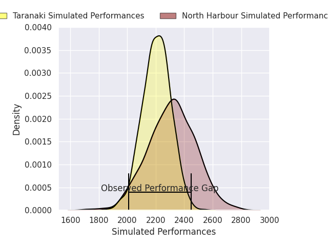
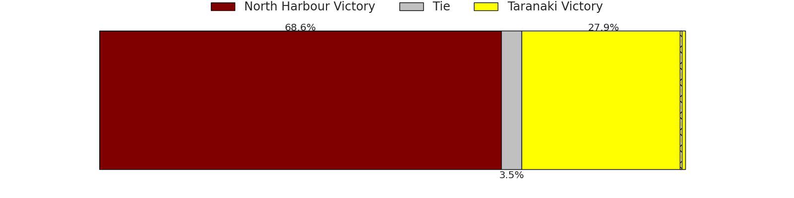
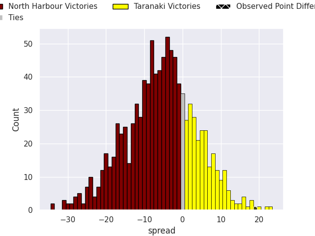
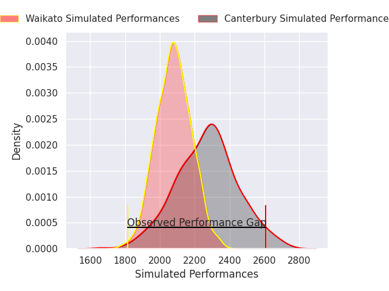
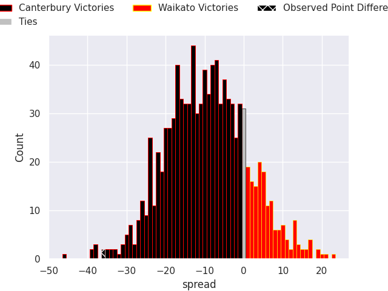

## Team Rankings

## Standings
### Current Standings

| Club             |   Played |   Wins |   Point Differential |   Losing Bonus Points |   Try Bonus Points |   Competition Points |
|:-----------------|---------:|-------:|---------------------:|----------------------:|-------------------:|---------------------:|
| Northland        |       12 |      9 |                  155 |                     2 |                  9 |                   47 |
| Canterbury       |       11 |      9 |                   81 |                     0 |                  8 |                   44 |
| Otago            |       11 |      8 |                  106 |                     1 |                  8 |                   41 |
| Taranaki         |       11 |      7 |                  147 |                     3 |                  7 |                   38 |
| Tasman           |       12 |      7 |                   41 |                     2 |                  7 |                   37 |
| North Harbour    |       11 |      6 |                   81 |                     3 |                  9 |                   36 |
| Hawke's Bay      |       11 |      6 |                   63 |                     3 |                  6 |                   33 |
| Bay of Plenty    |       11 |      6 |                  -25 |                     1 |                  7 |                   32 |
| Waikato          |       11 |      5 |                    5 |                     2 |                  8 |                   30 |
| Manawatu         |       11 |      5 |                  -70 |                     1 |                  4 |                   25 |
| Counties Manukau |       11 |      5 |                  -95 |                     0 |                  4 |                   24 |
| Auckland         |       11 |      3 |                  -44 |                     5 |                  6 |                   23 |
| Southland        |       11 |      2 |                 -140 |                     1 |                  4 |                   13 |
| Wellington       |       11 |      0 |                 -305 |                     1 |                  6 |                    7 |

### Projected Remaining Table

| Club          |   To Play |   Projected Wins |   Projected Differential |   Projected Losing Bonus Points | Projected Try Bonus Points   |   Projected Competition Points |
|:--------------|----------:|-----------------:|-------------------------:|--------------------------------:|:-----------------------------|-------------------------------:|
| Canterbury    |         2 |            1.733 |                   22.649 |                           0.165 |                              |                          7.175 |
| North Harbour |         2 |            1.312 |                    8.986 |                           0.356 |                              |                          5.748 |
| Otago         |         1 |            0.818 |                    9.385 |                           0.103 |                              |                          3.429 |
| Taranaki      |         2 |            0.616 |                   -8.986 |                           0.525 |                              |                          3.133 |
| Waikato       |         2 |            0.228 |                  -22.649 |                           0.448 |                              |                          1.438 |
| Hawke's Bay   |         1 |            0.155 |                   -9.385 |                           0.257 |                              |                          0.931 |

### Projected Total Table

| Club             |   Played |   Wins |   Point Differential |   Losing Bonus Points |   Try Bonus Points |   Competition Points |
|:-----------------|---------:|-------:|---------------------:|----------------------:|-------------------:|---------------------:|
| Canterbury       |       13 | 10.733 |              103.649 |                 0.165 |                  8 |               51.175 |
| Northland        |       12 |  9     |              155     |                 2     |                  9 |               47     |
| Otago            |       12 |  8.818 |              115.385 |                 1.103 |                  8 |               44.429 |
| North Harbour    |       13 |  7.312 |               89.986 |                 3.356 |                  9 |               41.748 |
| Taranaki         |       13 |  7.616 |              138.014 |                 3.525 |                  7 |               41.133 |
| Tasman           |       12 |  7     |               41     |                 2     |                  7 |               37     |
| Hawke's Bay      |       12 |  6.155 |               53.615 |                 3.257 |                  6 |               33.931 |
| Bay of Plenty    |       11 |  6     |              -25     |                 1     |                  7 |               32     |
| Waikato          |       13 |  5.228 |              -17.649 |                 2.448 |                  8 |               31.438 |
| Manawatu         |       11 |  5     |              -70     |                 1     |                  4 |               25     |
| Counties Manukau |       11 |  5     |              -95     |                 0     |                  4 |               24     |
| Auckland         |       11 |  3     |              -44     |                 5     |                  6 |               23     |
| Southland        |       11 |  2     |             -140     |                 1     |                  4 |               13     |
| Wellington       |       11 |  0     |             -305     |                 1     |                  6 |                7     |

## Completed Match Review

| Model | Percent Correct Predictions | Spread Error |
| ------ | ------ | ------ |
| Club Level | 67.5% | 14.1 |
| Player Level: Lineup | nan% | nan |
| Player Level: Minutes | nan% | nan |

## Future Predictions
### Week 13
#### North Harbour V Taranaki on 2026/09/01

Average Margin: North Harbour by 3.1

### Week 14
#### Canterbury V Waikato on 2026/10/01

Average Margin: Canterbury by 9.4

### Week 15
#### North Harbour V Taranaki on 2026/10/09

Average Margin: North Harbour by 5.8

#### Otago V Hawke's Bay on 2026/10/09

Average Margin: Otago by 9.4

#### Canterbury V Waikato on 2026/10/10

Average Margin: Canterbury by 13.2

