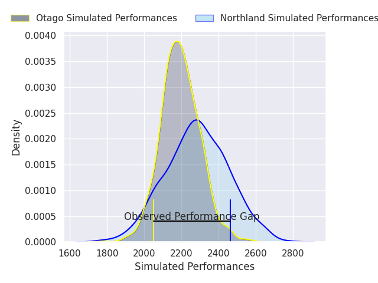
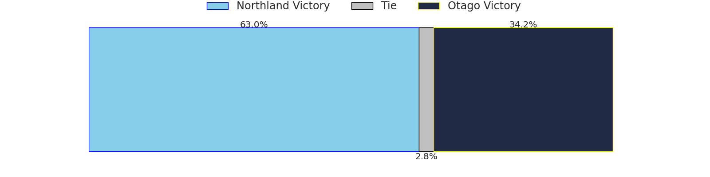
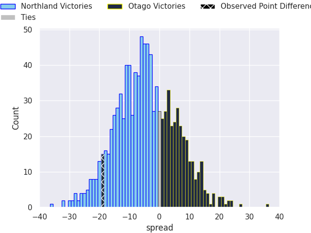
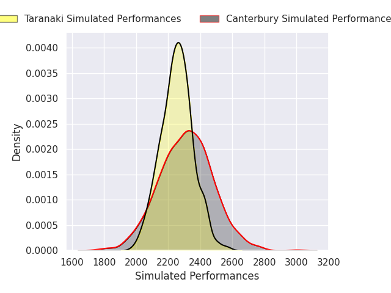
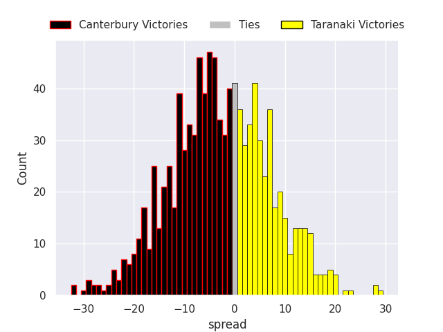

## Team Rankings

## Standings
### Current Standings

| Club             |   Played |   Wins |   Point Differential |   Losing Bonus Points |   Try Bonus Points |   Competition Points |
|:-----------------|---------:|-------:|---------------------:|----------------------:|-------------------:|---------------------:|
| Canterbury       |       12 |     10 |                  117 |                     0 |                  9 |                   49 |
| Northland        |       12 |      9 |                  155 |                     2 |                  9 |                   47 |
| Otago            |       12 |      9 |                  142 |                     1 |                  9 |                   46 |
| Taranaki         |       12 |      8 |                  166 |                     3 |                  8 |                   43 |
| North Harbour    |       12 |      6 |                   62 |                     3 |                 10 |                   37 |
| Tasman           |       12 |      7 |                   41 |                     2 |                  7 |                   37 |
| Hawke's Bay      |       12 |      6 |                   27 |                     3 |                  6 |                   33 |
| Bay of Plenty    |       11 |      6 |                  -25 |                     1 |                  7 |                   32 |
| Waikato          |       12 |      5 |                  -31 |                     2 |                  9 |                   31 |
| Manawatu         |       11 |      5 |                  -70 |                     1 |                  4 |                   25 |
| Counties Manukau |       11 |      5 |                  -95 |                     0 |                  4 |                   24 |
| Auckland         |       11 |      3 |                  -44 |                     5 |                  6 |                   23 |
| Southland        |       11 |      2 |                 -140 |                     1 |                  4 |                   13 |
| Wellington       |       11 |      0 |                 -305 |                     1 |                  6 |                    7 |

### Projected Remaining Table

| Club          |   To Play |   Projected Wins |   Projected Differential |   Projected Losing Bonus Points | Projected Try Bonus Points   |   Projected Competition Points |
|:--------------|----------:|-----------------:|-------------------------:|--------------------------------:|:-----------------------------|-------------------------------:|
| Canterbury    |         2 |            1.422 |                   12.384 |                           0.335 |                              |                          6.155 |
| Taranaki      |         2 |            0.735 |                   -5.921 |                           0.54  |                              |                          3.646 |
| Northland     |         1 |            0.66  |                    4.519 |                           0.16  |                              |                          2.874 |
| North Harbour |         1 |            0.588 |                    3.053 |                           0.207 |                              |                          2.643 |
| Otago         |         1 |            0.303 |                   -4.519 |                           0.246 |                              |                          1.532 |
| Waikato       |         1 |            0.147 |                   -9.516 |                           0.253 |                              |                          0.891 |

### Projected Total Table

| Club             |   Played |   Wins |   Point Differential |   Losing Bonus Points |   Try Bonus Points |   Competition Points |
|:-----------------|---------:|-------:|---------------------:|----------------------:|-------------------:|---------------------:|
| Canterbury       |       14 | 11.422 |              129.384 |                 0.335 |                  9 |               55.155 |
| Northland        |       13 |  9.66  |              159.519 |                 2.16  |                  9 |               49.874 |
| Otago            |       13 |  9.303 |              137.481 |                 1.246 |                  9 |               47.532 |
| Taranaki         |       14 |  8.735 |              160.079 |                 3.54  |                  8 |               46.646 |
| North Harbour    |       13 |  6.588 |               65.053 |                 3.207 |                 10 |               39.643 |
| Tasman           |       12 |  7     |               41     |                 2     |                  7 |               37     |
| Hawke's Bay      |       12 |  6     |               27     |                 3     |                  6 |               33     |
| Bay of Plenty    |       11 |  6     |              -25     |                 1     |                  7 |               32     |
| Waikato          |       13 |  5.147 |              -40.516 |                 2.253 |                  9 |               31.891 |
| Manawatu         |       11 |  5     |              -70     |                 1     |                  4 |               25     |
| Counties Manukau |       11 |  5     |              -95     |                 0     |                  4 |               24     |
| Auckland         |       11 |  3     |              -44     |                 5     |                  6 |               23     |
| Southland        |       11 |  2     |             -140     |                 1     |                  4 |               13     |
| Wellington       |       11 |  0     |             -305     |                 1     |                  6 |                7     |

## Completed Match Review

| Model | Percent Correct Predictions | Spread Error |
| ------ | ------ | ------ |
| Club Level | 65.9% | 15.0 |
| Player Level: Lineup | nan% | nan |
| Player Level: Minutes | nan% | nan |

## Future Predictions
### Week 13
#### North Harbour V Taranaki on 2026/09/01

Average Margin: North Harbour by 3.1

### Week 14
#### Canterbury V Waikato on 2026/10/01

Average Margin: Canterbury by 9.5

### Week 15
#### Northland V Otago on 2026/10/16

Average Margin: Northland by 4.5

#### Canterbury V Taranaki on 2026/10/18

Average Margin: Canterbury by 2.9

