## Team Rankings

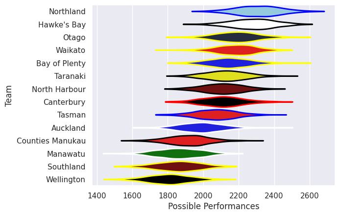
## Standings
### Current Standings

| Club             |   Played |   Wins |   Point Differential |   Losing Bonus Points |   Try Bonus Points |   Competition Points |
|:-----------------|---------:|-------:|---------------------:|----------------------:|-------------------:|---------------------:|
| Northland        |       10 |      7 |                  136 |                     2 |                  8 |                   38 |
| Otago            |       10 |      7 |                  103 |                     1 |                  8 |                   37 |
| North Harbour    |        9 |      6 |                  115 |                     3 |                  9 |                   36 |
| Canterbury       |        9 |      7 |                   61 |                     0 |                  7 |                   35 |
| Hawke's Bay      |        9 |      6 |                   73 |                     1 |                  6 |                   31 |
| Taranaki         |        9 |      5 |                   63 |                     3 |                  6 |                   29 |
| Waikato          |        9 |      5 |                   39 |                     2 |                  7 |                   29 |
| Tasman           |        9 |      5 |                   12 |                     1 |                  6 |                   27 |
| Manawatu         |        9 |      5 |                  -50 |                     1 |                  4 |                   25 |
| Bay of Plenty    |        9 |      4 |                  -59 |                     1 |                  6 |                   23 |
| Auckland         |       10 |      3 |                  -41 |                     4 |                  6 |                   22 |
| Counties Manukau |        9 |      3 |                 -105 |                     0 |                  4 |                   16 |
| Southland        |       10 |      2 |                 -126 |                     1 |                  4 |                   13 |
| Wellington       |        9 |      0 |                 -221 |                     1 |                  5 |                    6 |

### Projected Remaining Table

| Club             |   To Play |   Projected Wins |   Projected Differential |   Projected Losing Bonus Points | Projected Try Bonus Points   |   Projected Competition Points |
|:-----------------|----------:|-----------------:|-------------------------:|--------------------------------:|:-----------------------------|-------------------------------:|
| Taranaki         |         1 |            0.989 |                   25.353 |                           0.008 |                              |                          3.968 |
| North Harbour    |         1 |            0.758 |                    7.411 |                           0.129 |                              |                          3.215 |
| Waikato          |         1 |            0.673 |                    5.426 |                           0.168 |                              |                          2.94  |
| Hawke's Bay      |         1 |            0.557 |                    1.88  |                           0.243 |                              |                          2.555 |
| Canterbury       |         1 |            0.557 |                    1.877 |                           0.215 |                              |                          2.505 |
| Manawatu         |         1 |            0.412 |                   -1.877 |                           0.253 |                              |                          1.963 |
| Counties Manukau |         1 |            0.401 |                   -1.88  |                           0.275 |                              |                          1.963 |
| Tasman           |         1 |            0.287 |                   -5.426 |                           0.247 |                              |                          1.475 |
| Bay of Plenty    |         1 |            0.215 |                   -7.411 |                           0.276 |                              |                          1.19  |
| Wellington       |         1 |            0.009 |                  -25.353 |                           0.036 |                              |                          0.076 |

### Projected Total Table

| Club             |   Played |   Wins |   Point Differential |   Losing Bonus Points |   Try Bonus Points |   Competition Points |
|:-----------------|---------:|-------:|---------------------:|----------------------:|-------------------:|---------------------:|
| North Harbour    |       10 |  6.758 |              122.411 |                 3.129 |                  9 |               39.215 |
| Northland        |       10 |  7     |              136     |                 2     |                  8 |               38     |
| Canterbury       |       10 |  7.557 |               62.877 |                 0.215 |                  7 |               37.505 |
| Otago            |       10 |  7     |              103     |                 1     |                  8 |               37     |
| Hawke's Bay      |       10 |  6.557 |               74.88  |                 1.243 |                  6 |               33.555 |
| Taranaki         |       10 |  5.989 |               88.353 |                 3.008 |                  6 |               32.968 |
| Waikato          |       10 |  5.673 |               44.426 |                 2.168 |                  7 |               31.94  |
| Tasman           |       10 |  5.287 |                6.574 |                 1.247 |                  6 |               28.475 |
| Manawatu         |       10 |  5.412 |              -51.877 |                 1.253 |                  4 |               26.963 |
| Bay of Plenty    |       10 |  4.215 |              -66.411 |                 1.276 |                  6 |               24.19  |
| Auckland         |       10 |  3     |              -41     |                 4     |                  6 |               22     |
| Counties Manukau |       10 |  3.401 |             -106.88  |                 0.275 |                  4 |               17.963 |
| Southland        |       10 |  2     |             -126     |                 1     |                  4 |               13     |
| Wellington       |       10 |  0.009 |             -246.353 |                 1.036 |                  5 |                6.076 |

## Completed Match Review

| Model | Percent Correct Predictions | Spread Error |
| ------ | ------ | ------ |
| Club Level | 61.4% | 15.0 |
| Player Level: Lineup | nan% | nan |
| Player Level: Minutes | nan% | nan |

## Future Predictions
### Week 11
#### Counties Manukau V Hawke's Bay on 2026/10/03

Average Margin: Hawke's Bay by 1.9

#### Manawatu V Canterbury on 2026/10/03

Average Margin: Canterbury by 1.9

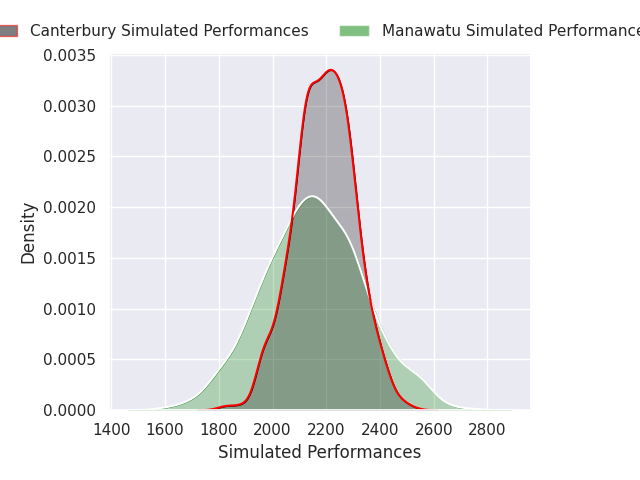

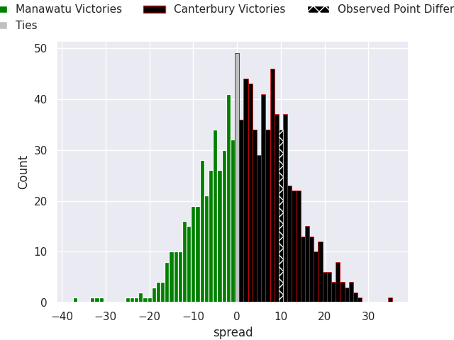

#### Waikato V Tasman on 2026/10/03

Average Margin: Waikato by 5.4

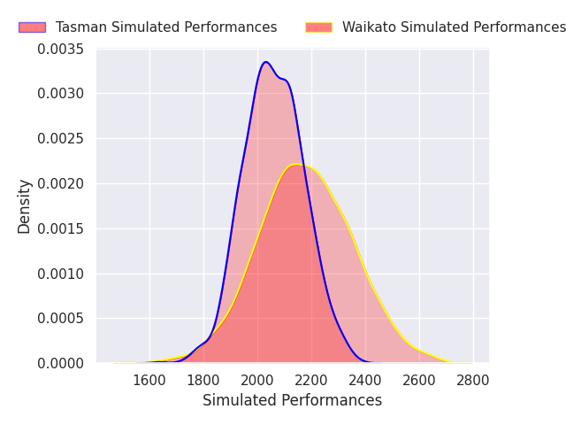
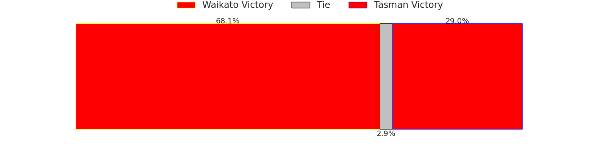
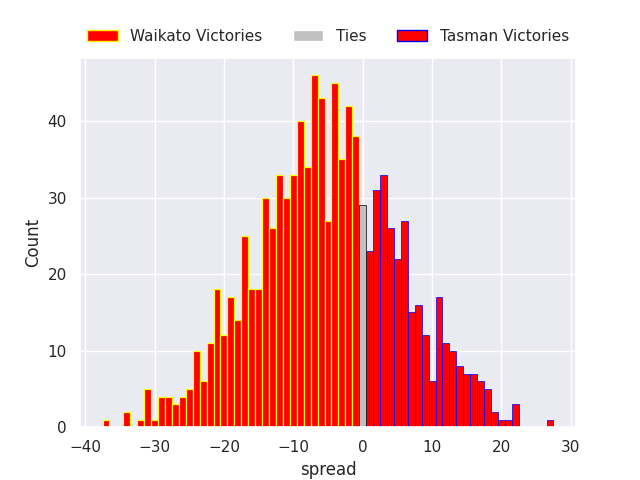

#### Bay of Plenty V North Harbour on 2026/10/04

Average Margin: North Harbour by 7.4

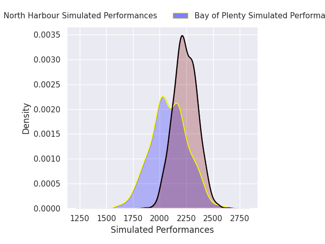
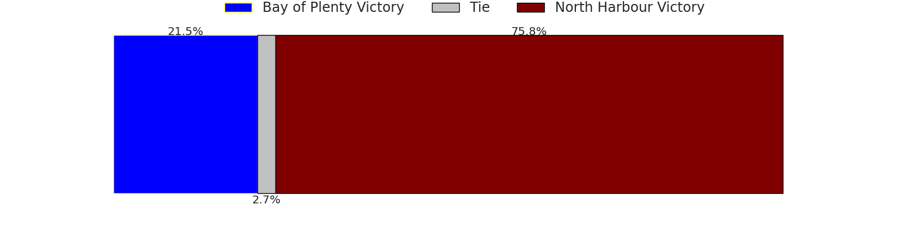
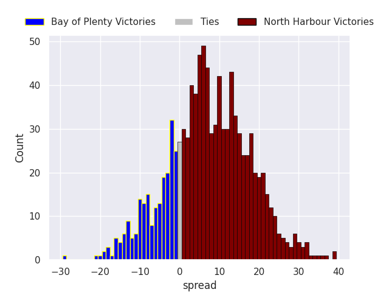

#### Taranaki V Wellington on 2026/10/04

Average Margin: Taranaki by 25.4

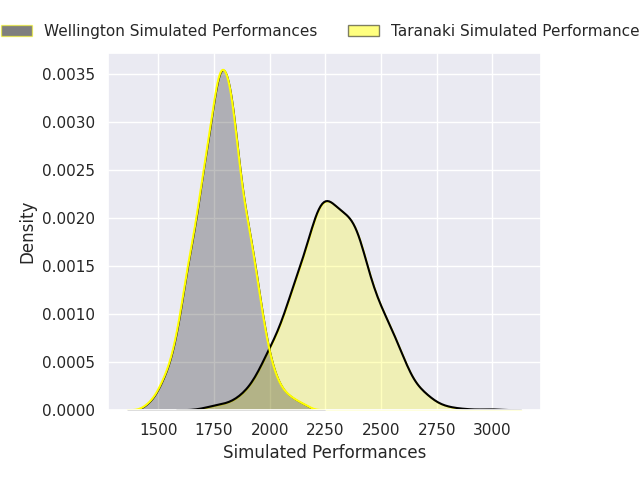
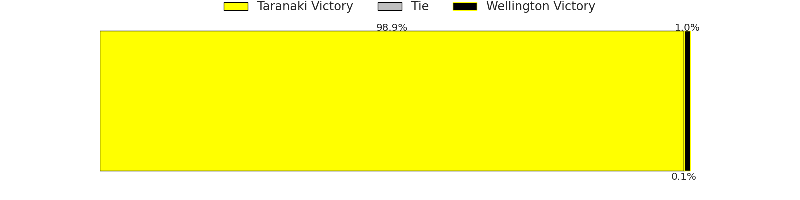
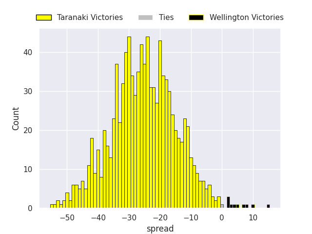

