## Team Rankings

## Standings
### Current Standings

| Club             |   Played |   Wins |   Point Differential |   Losing Bonus Points |   Try Bonus Points |   Competition Points |
|:-----------------|---------:|-------:|---------------------:|----------------------:|-------------------:|---------------------:|
| Massy            |        9 |      9 |                   97 |                     0 |                  4 |                   40 |
| Chambery         |        9 |      7 |                  125 |                     1 |                  5 |                   36 |
| Carcassonne      |        9 |      7 |                  110 |                     0 |                  5 |                   33 |
| Albi             |        9 |      6 |                   21 |                     1 |                  4 |                   29 |
| Rouen            |        9 |      6 |                   37 |                     0 |                  4 |                   28 |
| Mont-de-Marsan   |        9 |      4 |                   37 |                     3 |                  4 |                   23 |
| Orleans          |        9 |      4 |                   13 |                     4 |                  2 |                   22 |
| Perigueux        |        9 |      4 |                  -25 |                     3 |                  3 |                   22 |
| Bourgoin-Jallieu |        9 |      3 |                   -7 |                     3 |                  3 |                   20 |
| Suresnes         |        9 |      4 |                  -66 |                     2 |                    |                   18 |
| Rennes           |        9 |      2 |                  -37 |                     4 |                  3 |                   17 |
| Vienne           |        9 |      3 |                 -110 |                     2 |                    |                   14 |
| Marcq-en-Baroeul |        9 |      1 |                  -48 |                     5 |                    |                    9 |
| US Bressane      |        9 |      1 |                 -147 |                     0 |                    |                    6 |

### Projected Remaining Table

| Club             |   To Play |   Projected Wins |   Projected Differential |   Projected Losing Bonus Points | Projected Try Bonus Points   |   Projected Competition Points |
|:-----------------|----------:|-----------------:|-------------------------:|--------------------------------:|:-----------------------------|-------------------------------:|
| Chambery         |        17 |           14.111 |                  167.793 |                           1.83  |                              |                         59.086 |
| Massy            |        17 |           12.214 |                  116.373 |                           2.777 |                              |                         52.539 |
| Albi             |        17 |           10.628 |                   51.942 |                           3.351 |                              |                         47.133 |
| Mont-de-Marsan   |        17 |           10.189 |                   42.764 |                           3.577 |                              |                         45.653 |
| Orleans          |        17 |           10.234 |                   75.913 |                           3.17  |                              |                         45.088 |
| Carcassonne      |        17 |            9.379 |                   35.392 |                           3.716 |                              |                         42.416 |
| Perigueux        |        17 |            8.353 |                    6.955 |                           3.864 |                              |                         38.424 |
| Bourgoin-Jallieu |        17 |            7.904 |                  -10.95  |                           4.195 |                              |                         37.099 |
| Rouen            |        17 |            7.454 |                  -22.463 |                           4.134 |                              |                         35.2   |
| Suresnes         |        17 |            6.729 |                  -42.071 |                           4.168 |                              |                         32.276 |
| Vienne           |        17 |            5.5   |                  -82.724 |                           4.134 |                              |                         27.3   |
| Marcq-en-Baroeul |        17 |            4.446 |                  -98.118 |                           4.761 |                              |                         23.787 |
| Rennes           |        17 |            4.359 |                 -106.534 |                           4.326 |                              |                         22.842 |
| US Bressane      |        17 |            3.542 |                 -134.272 |                           4.186 |                              |                         19.346 |

### Projected Total Table

| Club             |   Played |   Wins |   Point Differential |   Losing Bonus Points |   Try Bonus Points |   Competition Points |
|:-----------------|---------:|-------:|---------------------:|----------------------:|-------------------:|---------------------:|
| Chambery         |       26 | 21.111 |              292.793 |                 2.83  |                  5 |               95.086 |
| Massy            |       26 | 21.214 |              213.373 |                 2.777 |                  4 |               92.539 |
| Albi             |       26 | 16.628 |               72.942 |                 4.351 |                  4 |               76.133 |
| Carcassonne      |       26 | 16.379 |              145.392 |                 3.716 |                  5 |               75.416 |
| Mont-de-Marsan   |       26 | 14.189 |               79.764 |                 6.577 |                  4 |               68.653 |
| Orleans          |       26 | 14.234 |               88.913 |                 7.17  |                  2 |               67.088 |
| Rouen            |       26 | 13.454 |               14.537 |                 4.134 |                  4 |               63.2   |
| Perigueux        |       26 | 12.353 |              -18.045 |                 6.864 |                  3 |               60.424 |
| Bourgoin-Jallieu |       26 | 10.904 |              -17.95  |                 7.195 |                  3 |               57.099 |
| Suresnes         |       26 | 10.729 |             -108.071 |                 6.168 |                    |               50.276 |
| Vienne           |       26 |  8.5   |             -192.724 |                 6.134 |                    |               41.3   |
| Rennes           |       26 |  6.359 |             -143.534 |                 8.326 |                  3 |               39.842 |
| Marcq-en-Baroeul |       26 |  5.446 |             -146.118 |                 9.761 |                    |               32.787 |
| US Bressane      |       26 |  4.542 |             -281.272 |                 4.186 |                    |               25.346 |

## Completed Match Review

| Model | Percent Correct Predictions | Spread Error |
| ------ | ------ | ------ |
| Club Level | 73.1% | 7.9 |
| Player Level: Lineup | nan% | nan |
| Player Level: Minutes | nan% | nan |

## Future Predictions
### Week 10
#### Orleans V Carcassonne on 2026/11/06

Average Margin: Orleans by 9.2

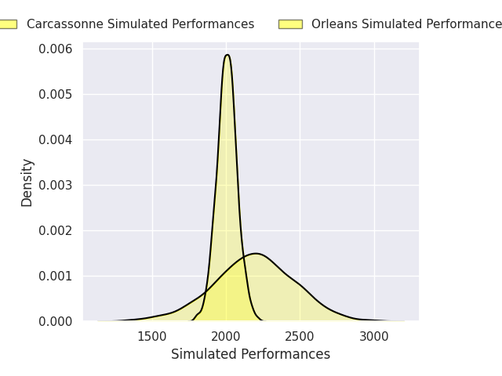
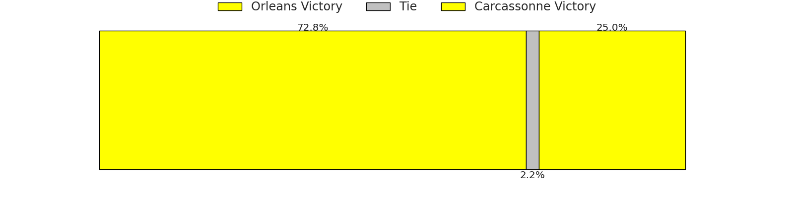
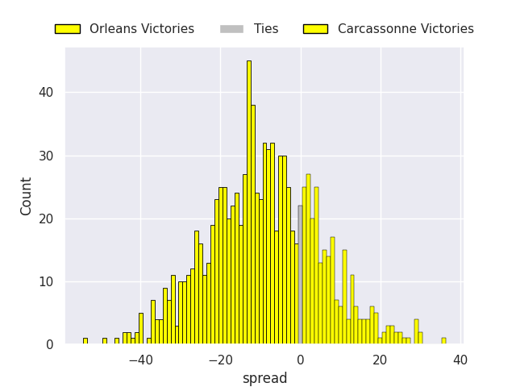

#### Suresnes V Mont-de-Marsan on 2026/11/06

Average Margin: Suresnes by 0.5

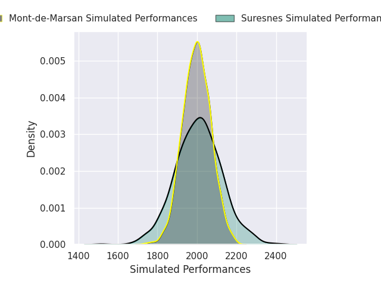

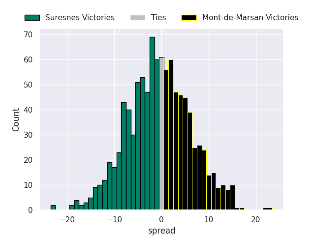

#### Massy V Rouen on 2026/11/06

Average Margin: Massy by 11.8

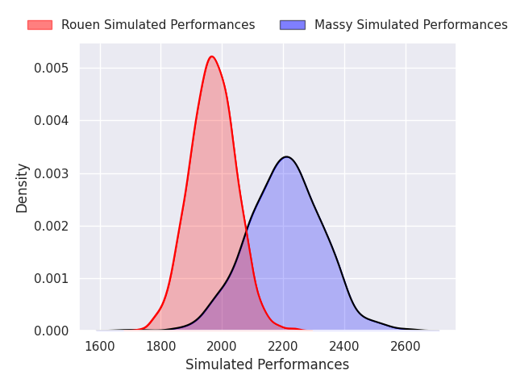
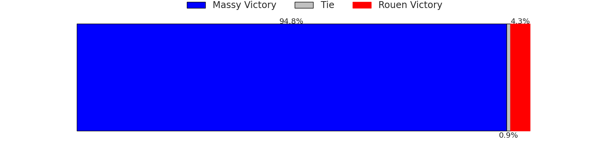
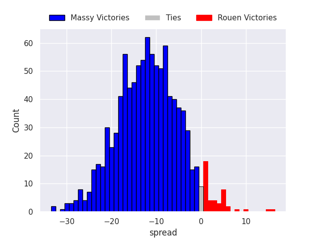

#### Chambery V US Bressane on 2026/11/06

Average Margin: Chambery by 21.6

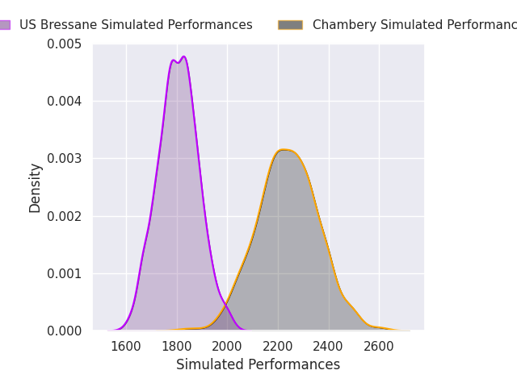
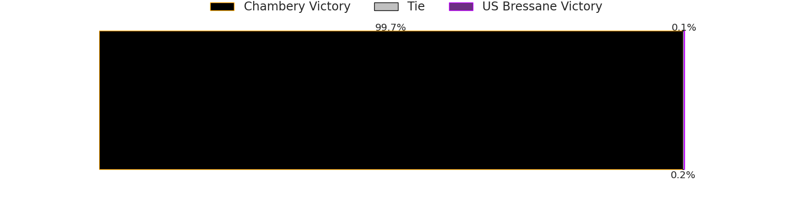
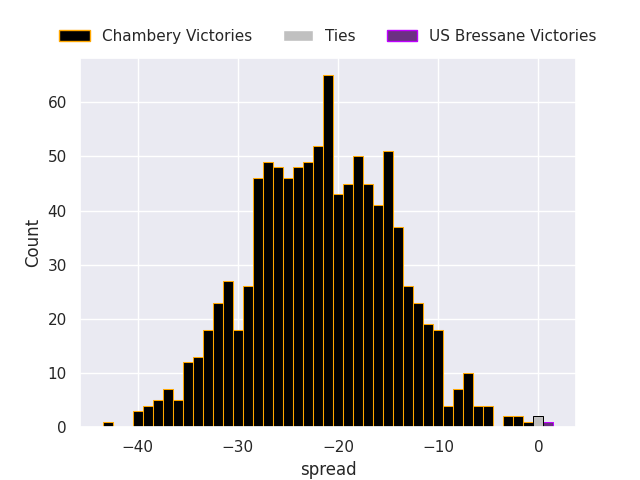

#### Bourgoin-Jallieu V Vienne on 2026/11/07

Average Margin: Bourgoin-Jallieu by 3.5

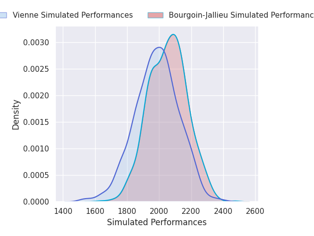

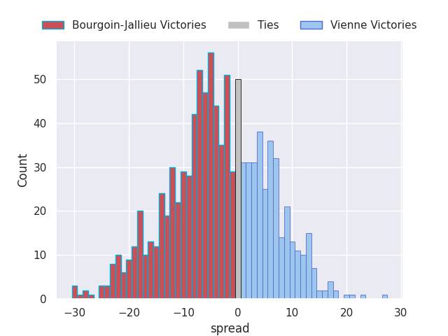

#### Perigueux V Albi on 2026/11/07

Average Margin: Perigueux by 2.8

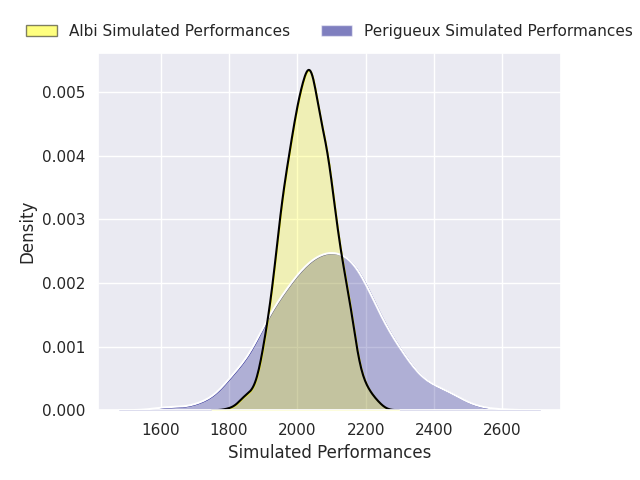
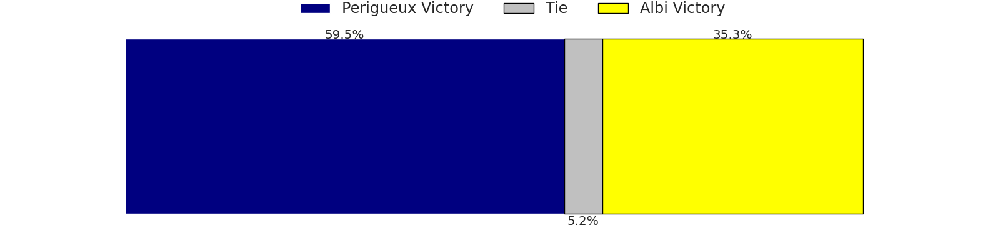
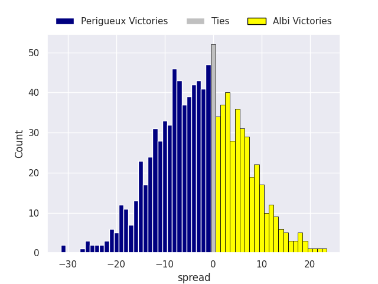

#### Marcq-en-Baroeul V Rennes on 2026/11/07

Average Margin: Marcq-en-Baroeul by 2.9

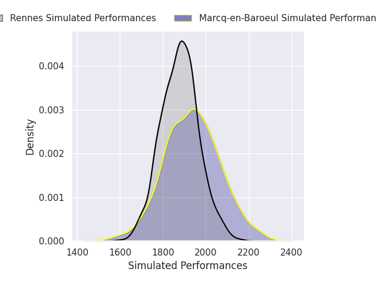

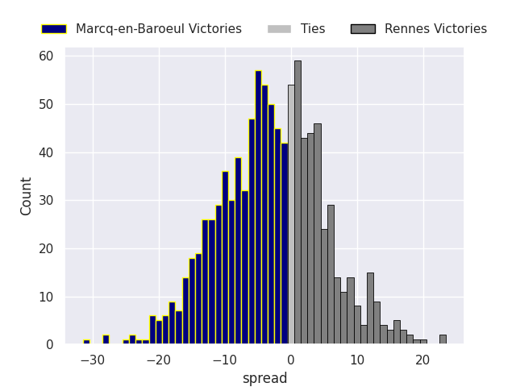

### Week 11
#### Albi V Bourgoin-Jallieu on 2026/11/13

Average Margin: Albi by 11.3

#### US Bressane V Perigueux on 2026/11/13

Average Margin: Perigueux by 1.9

#### Rouen V Chambery on 2026/11/13

Average Margin: Chambery by 3.3

#### Mont-de-Marsan V Orleans on 2026/11/13

Average Margin: Mont-de-Marsan by 3.7

#### Vienne V Suresnes on 2026/11/14

Average Margin: Suresnes by 5.0

#### Rennes V Carcassonne on 2026/11/14

Average Margin: Carcassonne by 2.5

#### Marcq-en-Baroeul V Massy on 2026/11/14

Average Margin: Massy by 7.6

### Week 12
#### Suresnes V Albi on 2026/11/20

Average Margin: Albi by 1.2

#### Chambery V Marcq-en-Baroeul on 2026/11/20

Average Margin: Chambery by 19.1

#### Massy V Rennes on 2026/11/20

Average Margin: Massy by 16.4

#### Carcassonne V Mont-de-Marsan on 2026/11/20

Average Margin: Carcassonne by 5.8

#### Perigueux V Rouen on 2026/11/21

Average Margin: Perigueux by 5.8

#### Orleans V Vienne on 2026/11/21

Average Margin: Orleans by 10.2

#### Bourgoin-Jallieu V US Bressane on 2026/11/21

Average Margin: Bourgoin-Jallieu by 12.2

### Week 13
#### Massy V Chambery on 2026/12/04

Average Margin: Massy by 3.8

#### Rouen V Bourgoin-Jallieu on 2026/12/04

Average Margin: Rouen by 7.7

#### Albi V Orleans on 2026/12/04

Average Margin: Albi by 5.8

#### US Bressane V Suresnes on 2026/12/04

Average Margin: US Bressane by 0.8

#### Rennes V Mont-de-Marsan on 2026/12/05

Average Margin: Mont-de-Marsan by 2.8

#### Vienne V Carcassonne on 2026/12/05

Average Margin: Carcassonne by 9.1

#### Marcq-en-Baroeul V Perigueux on 2026/12/05

Average Margin: Perigueux by 0.4

### Week 14
#### Albi V Carcassonne on 2026/12/11

Average Margin: Albi by 7.2

#### Rouen V Suresnes on 2026/12/11

Average Margin: Rouen by 8.3

#### Chambery V Rennes on 2026/12/11

Average Margin: Chambery by 17.6

#### US Bressane V Orleans on 2026/12/11

Average Margin: Orleans by 5.5

#### Massy V Perigueux on 2026/12/11

Average Margin: Massy by 12.8

#### Vienne V Mont-de-Marsan on 2026/12/12

Average Margin: Mont-de-Marsan by 9.3

#### Marcq-en-Baroeul V Bourgoin-Jallieu on 2026/12/12

Average Margin: Marcq-en-Baroeul by 1.5

### Week 15
#### Suresnes V Marcq-en-Baroeul on 2027/01/08

Average Margin: Suresnes by 7.6

#### Carcassonne V US Bressane on 2027/01/08

Average Margin: Carcassonne by 15.2

#### Orleans V Rouen on 2027/01/08

Average Margin: Orleans by 9.9

#### Mont-de-Marsan V Albi on 2027/01/08

Average Margin: Mont-de-Marsan by 4.6

#### Perigueux V Chambery on 2027/01/09

Average Margin: Chambery by 2.2

#### Rennes V Vienne on 2027/01/09

Average Margin: Vienne by 3.8

#### Bourgoin-Jallieu V Massy on 2027/01/09

Average Margin: Massy by 2.0

### Week 16
#### Massy V Suresnes on 2027/01/15

Average Margin: Massy by 14.7

#### Chambery V Bourgoin-Jallieu on 2027/01/15

Average Margin: Chambery by 15.8

#### Rouen V Carcassonne on 2027/01/15

Average Margin: Rouen by 3.2

#### US Bressane V Mont-de-Marsan on 2027/01/15

Average Margin: Mont-de-Marsan by 4.2

#### Albi V Vienne on 2027/01/15

Average Margin: Albi by 5.9

#### Perigueux V Rennes on 2027/01/16

Average Margin: Perigueux by 9.8

#### Marcq-en-Baroeul V Orleans on 2027/01/16

Average Margin: Orleans by 4.5

### Week 17
#### Orleans V Massy on 2027/01/22

Average Margin: Orleans by 4.3

#### Suresnes V Chambery on 2027/01/22

Average Margin: Chambery by 6.4

#### Mont-de-Marsan V Rouen on 2027/01/22

Average Margin: Mont-de-Marsan by 7.6

#### Carcassonne V Marcq-en-Baroeul on 2027/01/22

Average Margin: Carcassonne by 13.0

#### Vienne V US Bressane on 2027/01/23

Average Margin: Vienne by 0.4

#### Rennes V Albi on 2027/01/23

Average Margin: Albi by 3.9

#### Bourgoin-Jallieu V Perigueux on 2027/01/23

Average Margin: Bourgoin-Jallieu by 4.6

### Week 18
#### Rouen V Vienne on 2027/01/29

Average Margin: Rouen by 1.9

#### Massy V Carcassonne on 2027/01/29

Average Margin: Massy by 10.0

#### Chambery V Orleans on 2027/01/29

Average Margin: Chambery by 10.2

#### US Bressane V Albi on 2027/01/29

Average Margin: Albi by 5.4

#### Bourgoin-Jallieu V Rennes on 2027/01/30

Average Margin: Bourgoin-Jallieu by 8.6

#### Perigueux V Suresnes on 2027/01/30

Average Margin: Perigueux by 8.7

#### Marcq-en-Baroeul V Mont-de-Marsan on 2027/01/30

Average Margin: Mont-de-Marsan by 2.3

### Week 19
#### Mont-de-Marsan V Massy on 2027/02/12

Average Margin: Mont-de-Marsan by 1.2

#### Orleans V Perigueux on 2027/02/12

Average Margin: Orleans by 10.5

#### Suresnes V Bourgoin-Jallieu on 2027/02/12

Average Margin: Suresnes by 4.6

#### Albi V Rouen on 2027/02/12

Average Margin: Albi by 8.4

#### Carcassonne V Chambery on 2027/02/12

Average Margin: Chambery by 0.7

#### Rennes V US Bressane on 2027/02/13

Average Margin: Rennes by 6.9

#### Vienne V Marcq-en-Baroeul on 2027/02/13

Average Margin: Marcq-en-Baroeul by 1.7

### Week 20
#### Rouen V US Bressane on 2027/02/19

Average Margin: Rouen by 12.6

#### Suresnes V Rennes on 2027/02/19

Average Margin: Suresnes by 6.1

#### Chambery V Mont-de-Marsan on 2027/02/19

Average Margin: Chambery by 11.6

#### Marcq-en-Baroeul V Albi on 2027/02/20

Average Margin: Albi by 4.2

#### Massy V Vienne on 2027/02/20

Average Margin: Massy by 8.5

#### Bourgoin-Jallieu V Orleans on 2027/02/20

Average Margin: Bourgoin-Jallieu by 1.5

#### Perigueux V Carcassonne on 2027/02/20

Average Margin: Perigueux by 3.7

### Week 21
#### Mont-de-Marsan V Perigueux on 2027/02/26

Average Margin: Mont-de-Marsan by 8.1

#### Carcassonne V Bourgoin-Jallieu on 2027/02/26

Average Margin: Carcassonne by 10.0

#### US Bressane V Marcq-en-Baroeul on 2027/02/26

Average Margin: US Bressane by 3.4

#### Albi V Massy on 2027/02/26

Average Margin: Albi by 2.5

#### Orleans V Suresnes on 2027/02/26

Average Margin: Orleans by 12.7

#### Vienne V Chambery on 2027/02/27

Average Margin: Chambery by 14.6

#### Rennes V Rouen on 2027/02/27

Average Margin: Rouen by 0.9

### Week 22
#### Chambery V Albi on 2027/03/05

Average Margin: Chambery by 10.2

#### Suresnes V Carcassonne on 2027/03/05

Average Margin: Suresnes by 0.3

#### Orleans V Rennes on 2027/03/05

Average Margin: Orleans by 13.7

#### Marcq-en-Baroeul V Rouen on 2027/03/05

Average Margin: Rouen by 1.2

#### Massy V US Bressane on 2027/03/06

Average Margin: Massy by 19.3

#### Perigueux V Vienne on 2027/03/06

Average Margin: Perigueux by 2.4

#### Bourgoin-Jallieu V Mont-de-Marsan on 2027/03/06

Average Margin: Bourgoin-Jallieu by 3.0

### Week 23
#### Carcassonne V Orleans on 2027/03/19

Average Margin: Carcassonne by 5.4

#### US Bressane V Chambery on 2027/03/19

Average Margin: Chambery by 10.1

#### Rouen V Massy on 2027/03/19

Average Margin: Massy by 1.2

#### Albi V Perigueux on 2027/03/19

Average Margin: Albi by 9.5

#### Mont-de-Marsan V Suresnes on 2027/03/19

Average Margin: Mont-de-Marsan by 10.2

#### Rennes V Marcq-en-Baroeul on 2027/03/20

Average Margin: Rennes by 4.3

#### Vienne V Bourgoin-Jallieu on 2027/03/20

Average Margin: Bourgoin-Jallieu by 4.1

### Week 24
#### Orleans V Mont-de-Marsan on 2027/03/26

Average Margin: Orleans by 7.7

#### Chambery V Rouen on 2027/03/26

Average Margin: Chambery by 12.8

#### Carcassonne V Rennes on 2027/03/26

Average Margin: Carcassonne by 10.8

#### Massy V Marcq-en-Baroeul on 2027/03/26

Average Margin: Massy by 16.9

#### Perigueux V US Bressane on 2027/03/27

Average Margin: Perigueux by 13.8

#### Bourgoin-Jallieu V Albi on 2027/03/27

Average Margin: Bourgoin-Jallieu by 1.3

#### Suresnes V Vienne on 2027/03/27

Average Margin: Vienne by 1.4

### Week 25
#### Albi V Suresnes on 2027/04/09

Average Margin: Albi by 11.2

#### US Bressane V Bourgoin-Jallieu on 2027/04/09

Average Margin: US Bressane by 0.2

#### Marcq-en-Baroeul V Chambery on 2027/04/09

Average Margin: Chambery by 8.4

#### Mont-de-Marsan V Carcassonne on 2027/04/09

Average Margin: Mont-de-Marsan by 5.7

#### Rouen V Perigueux on 2027/04/09

Average Margin: Rouen by 6.0

#### Vienne V Orleans on 2027/04/10

Average Margin: Orleans by 8.5

#### Rennes V Massy on 2027/04/10

Average Margin: Massy by 6.0

### Week 26
#### Suresnes V US Bressane on 2027/04/17

Average Margin: Suresnes by 9.5

#### Orleans V Albi on 2027/04/17

Average Margin: Orleans by 5.8

#### Chambery V Massy on 2027/04/17

Average Margin: Chambery by 6.8

#### Carcassonne V Vienne on 2027/04/17

Average Margin: Carcassonne by 3.7

#### Mont-de-Marsan V Rennes on 2027/04/17

Average Margin: Mont-de-Marsan by 11.7

#### Perigueux V Marcq-en-Baroeul on 2027/04/17

Average Margin: Perigueux by 11.2

#### Bourgoin-Jallieu V Rouen on 2027/04/17

Average Margin: Bourgoin-Jallieu by 3.5

