## Team Rankings

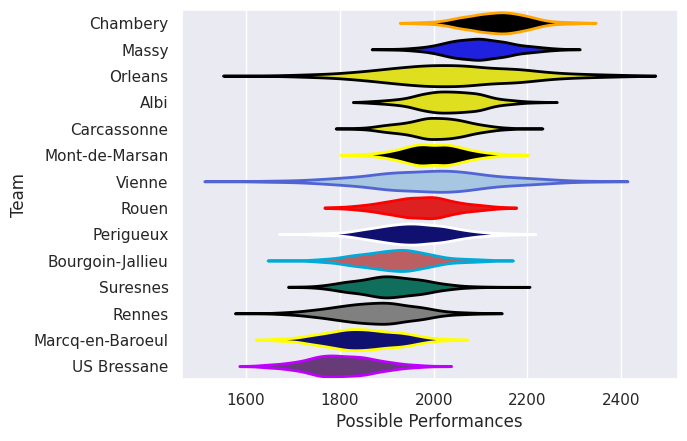
## Standings
### Current Standings

| Club             |   Played |   Wins |   Point Differential |   Losing Bonus Points |   Try Bonus Points |   Competition Points |
|:-----------------|---------:|-------:|---------------------:|----------------------:|-------------------:|---------------------:|
| Chambery         |       11 |      9 |                  150 |                     1 |                  6 |                   45 |
| Massy            |       11 |      9 |                   89 |                     2 |                  4 |                   42 |
| Carcassonne      |       11 |      8 |                  114 |                     1 |                  5 |                   38 |
| Rouen            |       11 |      7 |                   37 |                     1 |                  4 |                   33 |
| Albi             |       11 |      7 |                   10 |                     1 |                  4 |                   33 |
| Perigueux        |       11 |      6 |                   18 |                     3 |                  5 |                   32 |
| Mont-de-Marsan   |       11 |      5 |                   36 |                     4 |                  5 |                   29 |
| Orleans          |       11 |      5 |                   11 |                     5 |                  3 |                   28 |
| Suresnes         |       11 |      6 |                  -53 |                     2 |                  1 |                   27 |
| Bourgoin-Jallieu |       11 |      4 |                   -8 |                     3 |                  3 |                   24 |
| Marcq-en-Baroeul |       11 |      3 |                  -28 |                     5 |                  2 |                   19 |
| Rennes           |       11 |      2 |                  -60 |                     5 |                  3 |                   18 |
| Vienne           |       11 |      3 |                 -126 |                     3 |                    |                   15 |
| US Bressane      |       11 |      1 |                 -190 |                     0 |                    |                    6 |

### Projected Remaining Table

| Club             |   To Play |   Projected Wins |   Projected Differential |   Projected Losing Bonus Points | Projected Try Bonus Points   |   Projected Competition Points |
|:-----------------|----------:|-----------------:|-------------------------:|--------------------------------:|:-----------------------------|-------------------------------:|
| Chambery         |        15 |           12.562 |                  148.906 |                           1.589 |                              |                         52.553 |
| Massy            |        15 |            9.785 |                   73.226 |                           2.849 |                              |                         43.009 |
| Mont-de-Marsan   |        15 |            9.14  |                   39.654 |                           2.992 |                              |                         40.708 |
| Albi             |        15 |            8.891 |                   33.049 |                           3.263 |                              |                         40.177 |
| Carcassonne      |        15 |            8.754 |                   50.589 |                           3.31  |                              |                         39.37  |
| Orleans          |        15 |            8.751 |                   52.204 |                           2.843 |                              |                         38.839 |
| Perigueux        |        15 |            8.274 |                   40.363 |                           3.368 |                              |                         37.416 |
| Bourgoin-Jallieu |        15 |            7.709 |                    7.784 |                           3.513 |                              |                         35.439 |
| Rouen            |        15 |            7.523 |                    5.773 |                           3.584 |                              |                         34.784 |
| Suresnes         |        15 |            6.035 |                  -34.66  |                           3.545 |                              |                         28.699 |
| Marcq-en-Baroeul |        15 |            4.543 |                  -69.406 |                           4.175 |                              |                         23.495 |
| Vienne           |        15 |            3.833 |                  -98.423 |                           3.876 |                              |                         20.112 |
| Rennes           |        15 |            3.106 |                 -118.057 |                           3.559 |                              |                         16.801 |
| US Bressane      |        15 |            2.544 |                 -131.002 |                           3.698 |                              |                         14.762 |

### Projected Total Table

| Club             |   Played |   Wins |   Point Differential |   Losing Bonus Points |   Try Bonus Points |   Competition Points |
|:-----------------|---------:|-------:|---------------------:|----------------------:|-------------------:|---------------------:|
| Chambery         |       26 | 21.562 |              298.906 |                 2.589 |                  6 |               97.553 |
| Massy            |       26 | 18.785 |              162.226 |                 4.849 |                  4 |               85.009 |
| Carcassonne      |       26 | 16.754 |              164.589 |                 4.31  |                  5 |               77.37  |
| Albi             |       26 | 15.891 |               43.049 |                 4.263 |                  4 |               73.177 |
| Mont-de-Marsan   |       26 | 14.14  |               75.654 |                 6.992 |                  5 |               69.708 |
| Perigueux        |       26 | 14.274 |               58.363 |                 6.368 |                  5 |               69.416 |
| Rouen            |       26 | 14.523 |               42.773 |                 4.584 |                  4 |               67.784 |
| Orleans          |       26 | 13.751 |               63.204 |                 7.843 |                  3 |               66.839 |
| Bourgoin-Jallieu |       26 | 11.709 |               -0.216 |                 6.513 |                  3 |               59.439 |
| Suresnes         |       26 | 12.035 |              -87.66  |                 5.545 |                  1 |               55.699 |
| Marcq-en-Baroeul |       26 |  7.543 |              -97.406 |                 9.175 |                  2 |               42.495 |
| Vienne           |       26 |  6.833 |             -224.423 |                 6.876 |                    |               35.112 |
| Rennes           |       26 |  5.106 |             -178.057 |                 8.559 |                  3 |               34.801 |
| US Bressane      |       26 |  3.544 |             -321.002 |                 3.698 |                    |               20.762 |

## Completed Match Review

| Model | Percent Correct Predictions | Spread Error |
| ------ | ------ | ------ |
| Club Level | 77.5% | 7.8 |
| Player Level: Lineup | nan% | nan |
| Player Level: Minutes | nan% | nan |

## Future Predictions
### Week 12
#### Carcassonne V Mont-de-Marsan on 2026/11/20

Average Margin: Carcassonne by 6.2

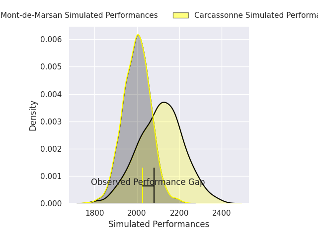
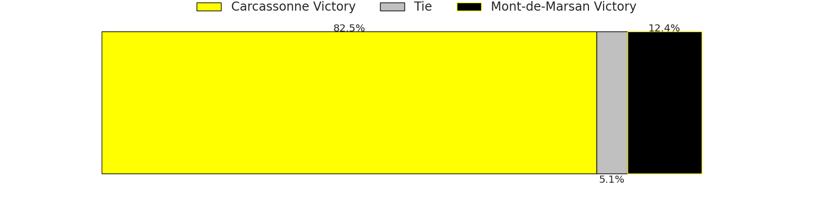

#### Suresnes V Albi on 2026/11/20

Average Margin: Albi by 0.2

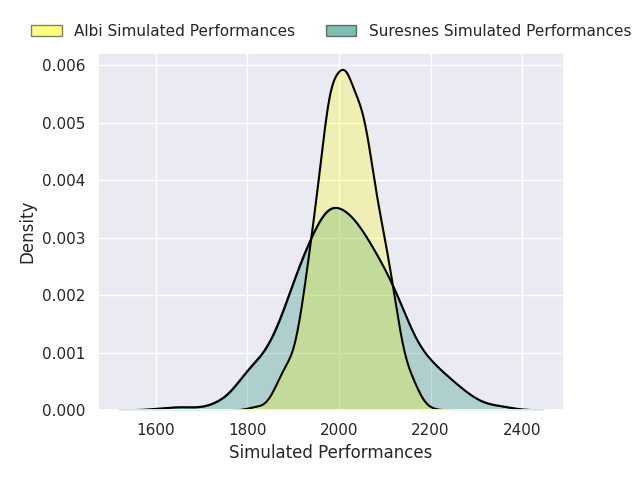

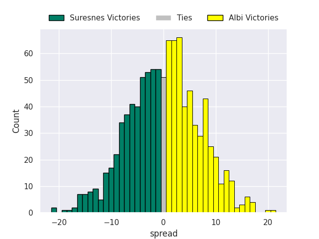

#### Massy V Rennes on 2026/11/20

Average Margin: Massy by 15.6

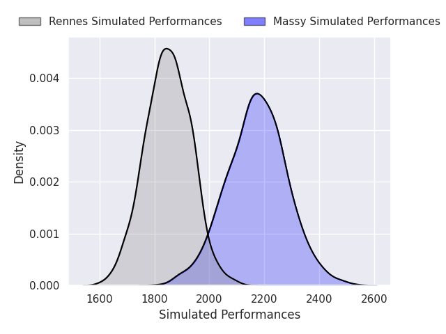

#### Chambery V Marcq-en-Baroeul on 2026/11/20

Average Margin: Chambery by 17.5

#### Bourgoin-Jallieu V US Bressane on 2026/11/21

Average Margin: Bourgoin-Jallieu by 13.8

#### Perigueux V Rouen on 2026/11/21

Average Margin: Perigueux by 6.9

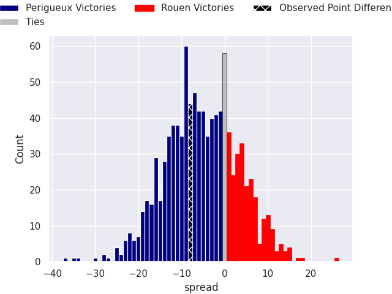

#### Orleans V Vienne on 2026/11/21

Average Margin: Orleans by 9.5

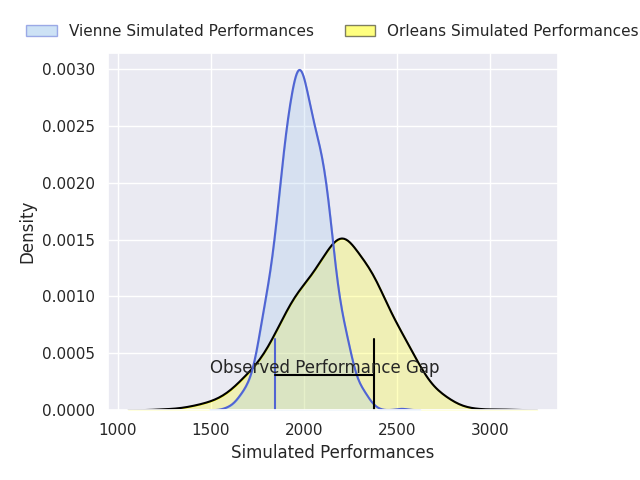

### Week 13
#### US Bressane V Suresnes on 2026/12/04

Average Margin: Suresnes by 1.3

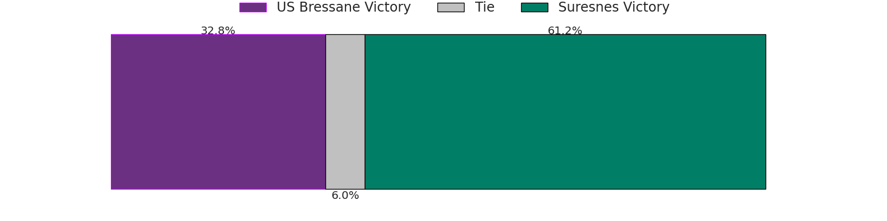

#### Massy V Chambery on 2026/12/04

Average Margin: Massy by 1.2

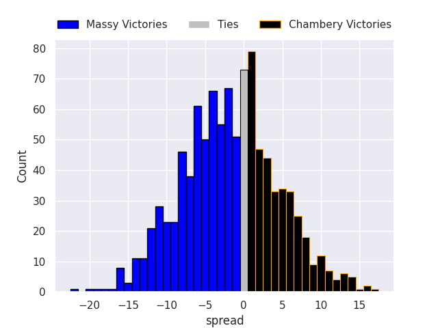

#### Albi V Orleans on 2026/12/04

Average Margin: Albi by 6.0

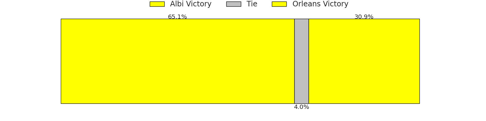

#### Rouen V Bourgoin-Jallieu on 2026/12/04

Average Margin: Rouen by 8.2

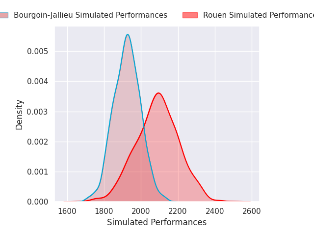

#### Rennes V Mont-de-Marsan on 2026/12/05

Average Margin: Mont-de-Marsan by 4.0

#### Vienne V Carcassonne on 2026/12/05

Average Margin: Carcassonne by 11.0

#### Marcq-en-Baroeul V Perigueux on 2026/12/05

Average Margin: Perigueux by 1.2

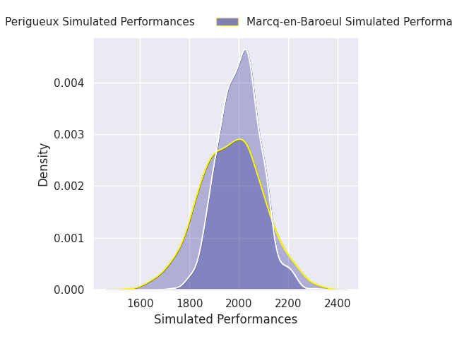

### Week 14
#### Rouen V Suresnes on 2026/12/11

Average Margin: Rouen by 8.6

#### Albi V Carcassonne on 2026/12/11

Average Margin: Albi by 5.7

#### US Bressane V Orleans on 2026/12/11

Average Margin: Orleans by 5.5

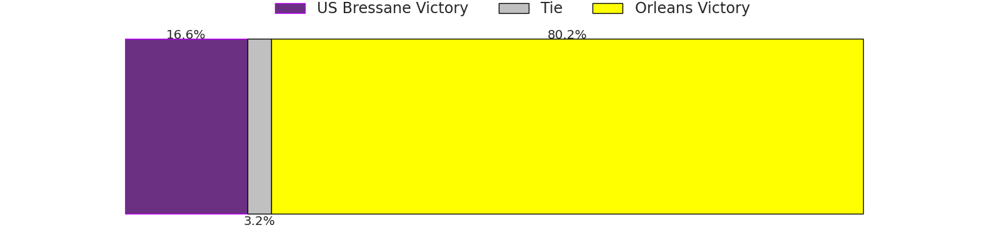

#### Chambery V Rennes on 2026/12/11

Average Margin: Chambery by 19.4

#### Massy V Perigueux on 2026/12/11

Average Margin: Massy by 8.5

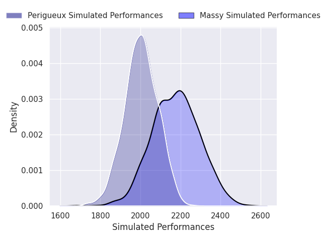

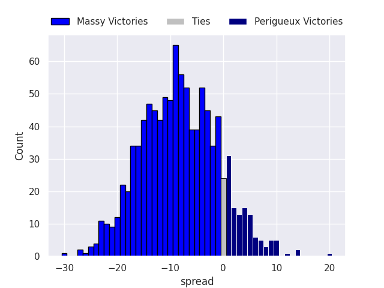

#### Marcq-en-Baroeul V Bourgoin-Jallieu on 2026/12/12

Average Margin: Marcq-en-Baroeul by 2.4

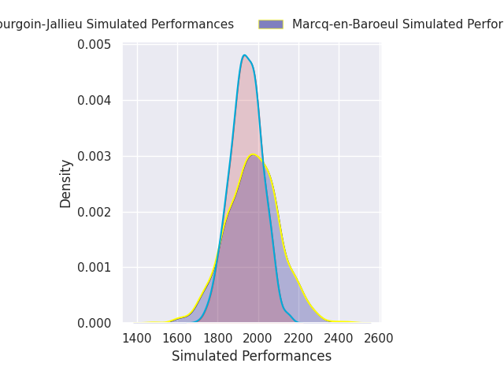
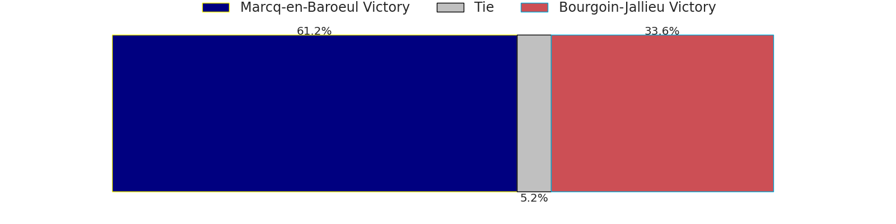

#### Vienne V Mont-de-Marsan on 2026/12/12

Average Margin: Mont-de-Marsan by 11.0

### Week 15
#### Suresnes V Marcq-en-Baroeul on 2027/01/08

Average Margin: Suresnes by 6.3

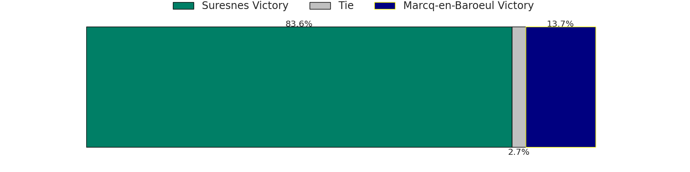

#### Mont-de-Marsan V Albi on 2027/01/08

Average Margin: Mont-de-Marsan by 5.2

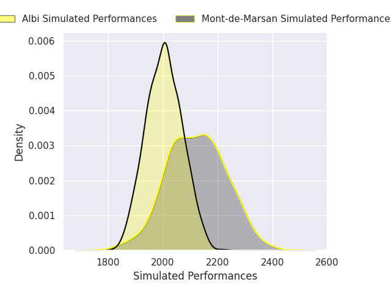

#### Carcassonne V US Bressane on 2027/01/08

Average Margin: Carcassonne by 16.9

#### Orleans V Rouen on 2027/01/08

Average Margin: Orleans by 7.8

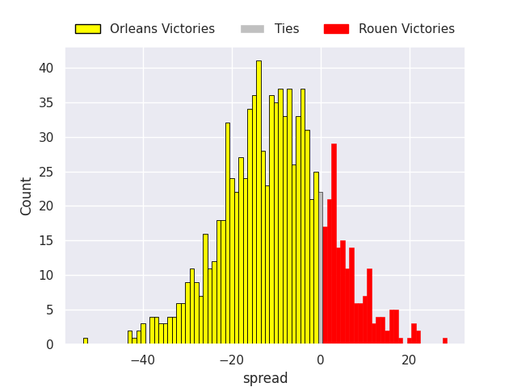

#### Perigueux V Chambery on 2027/01/09

Average Margin: Perigueux by 0.5

#### Bourgoin-Jallieu V Massy on 2027/01/09

Average Margin: Massy by 0.0

#### Rennes V Vienne on 2027/01/09

Average Margin: Vienne by 2.7

### Week 16
#### Massy V Suresnes on 2027/01/15

Average Margin: Massy by 12.3

#### Rouen V Carcassonne on 2027/01/15

Average Margin: Rouen by 3.8

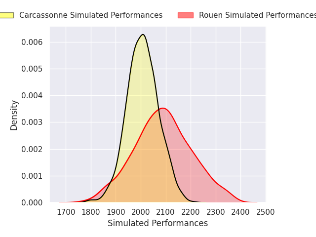

#### US Bressane V Mont-de-Marsan on 2027/01/15

Average Margin: Mont-de-Marsan by 4.5

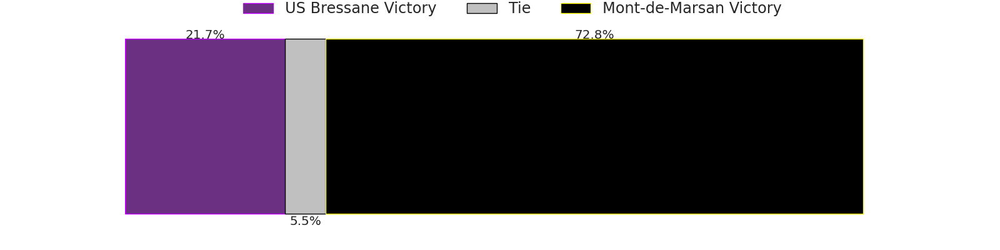

#### Chambery V Bourgoin-Jallieu on 2027/01/15

Average Margin: Chambery by 15.6

#### Albi V Vienne on 2027/01/15

Average Margin: Albi by 7.1

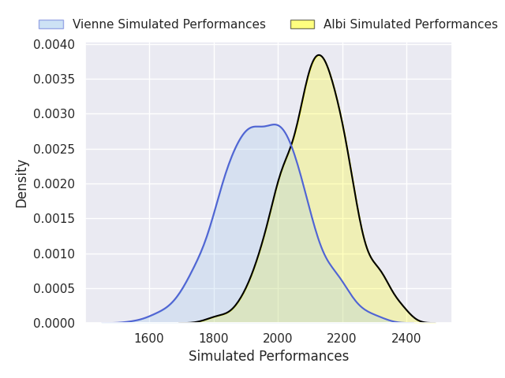

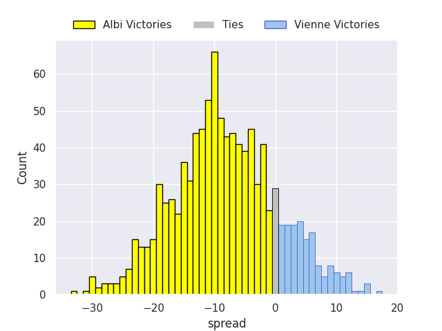

#### Perigueux V Rennes on 2027/01/16

Average Margin: Perigueux by 14.3

#### Marcq-en-Baroeul V Orleans on 2027/01/16

Average Margin: Orleans by 1.4

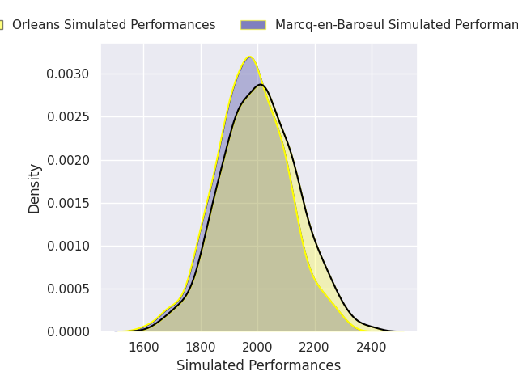

### Week 17
#### Carcassonne V Marcq-en-Baroeul on 2027/01/22

Average Margin: Carcassonne by 12.0

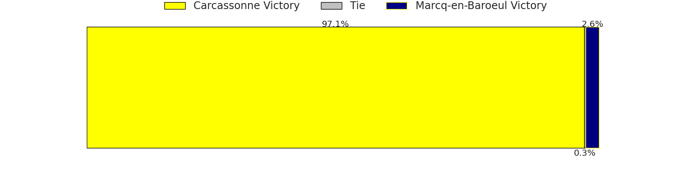

#### Suresnes V Chambery on 2027/01/22

Average Margin: Chambery by 6.0

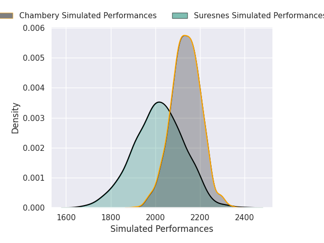

#### Mont-de-Marsan V Rouen on 2027/01/22

Average Margin: Mont-de-Marsan by 6.5

#### Orleans V Massy on 2027/01/22

Average Margin: Orleans by 3.8

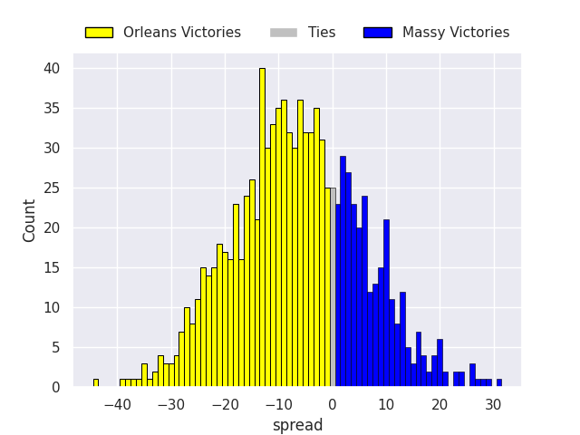

#### Bourgoin-Jallieu V Perigueux on 2027/01/23

Average Margin: Bourgoin-Jallieu by 3.6

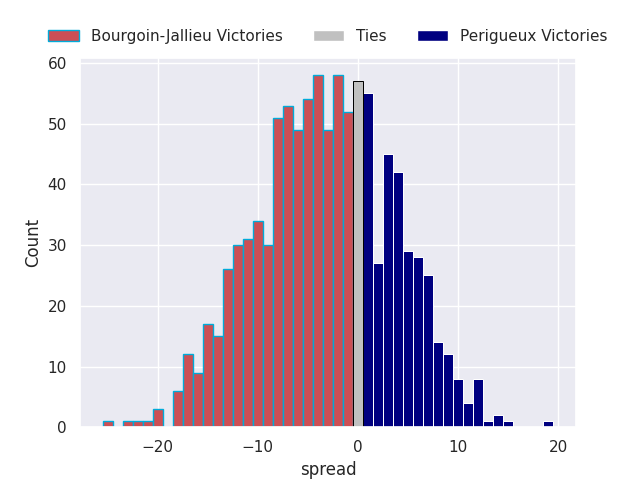

#### Vienne V US Bressane on 2027/01/23

Average Margin: Vienne by 1.1

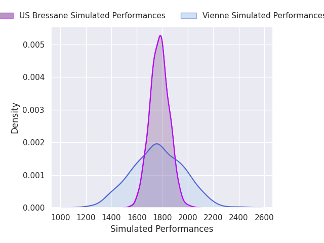

#### Rennes V Albi on 2027/01/23

Average Margin: Albi by 4.9

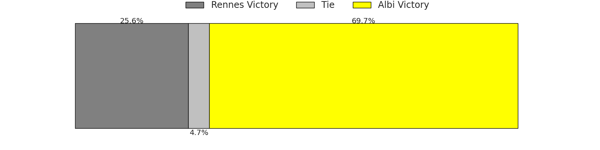

### Week 18
#### US Bressane V Albi on 2027/01/29

Average Margin: Albi by 6.0

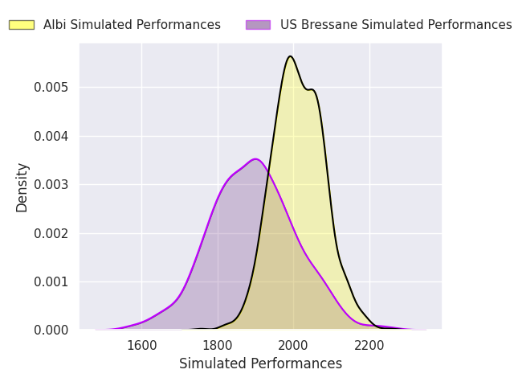

#### Chambery V Orleans on 2027/01/29

Average Margin: Chambery by 11.7

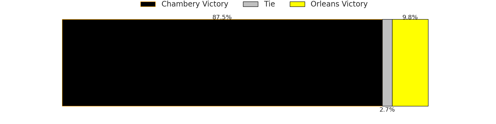

#### Massy V Carcassonne on 2027/01/29

Average Margin: Massy by 8.1

#### Rouen V Vienne on 2027/01/29

Average Margin: Rouen by 5.1

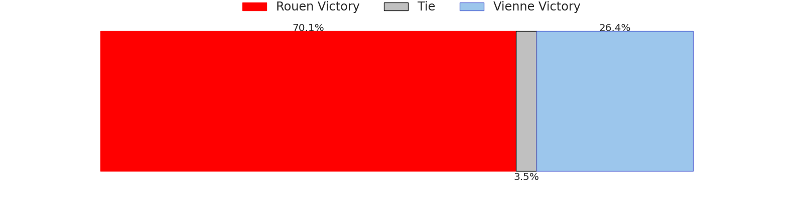

#### Bourgoin-Jallieu V Rennes on 2027/01/30

Average Margin: Bourgoin-Jallieu by 10.1

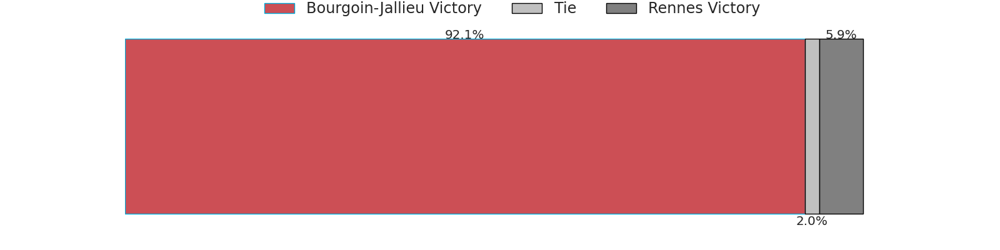

#### Marcq-en-Baroeul V Mont-de-Marsan on 2027/01/30

Average Margin: Mont-de-Marsan by 0.9

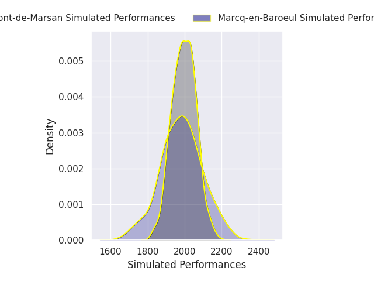

#### Perigueux V Suresnes on 2027/01/30

Average Margin: Perigueux by 11.2

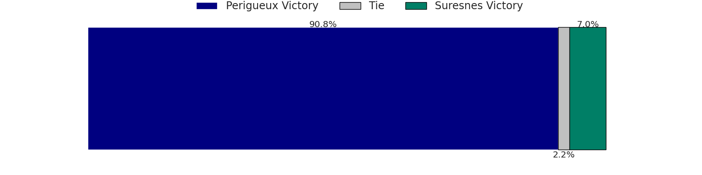

### Week 19
#### Albi V Rouen on 2027/02/12

Average Margin: Albi by 6.7

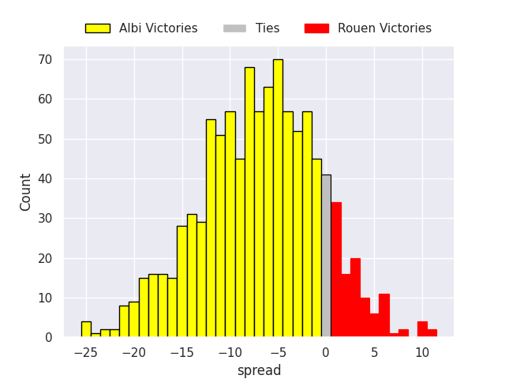

#### Mont-de-Marsan V Massy on 2027/02/12

Average Margin: Mont-de-Marsan by 3.0

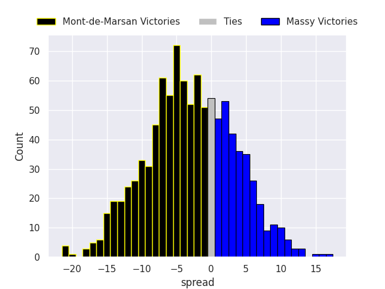

#### Orleans V Perigueux on 2027/02/12

Average Margin: Orleans by 6.7

#### Carcassonne V Chambery on 2027/02/12

Average Margin: Chambery by 0.5

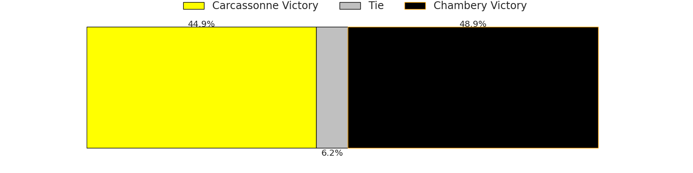

#### Suresnes V Bourgoin-Jallieu on 2027/02/12

Average Margin: Suresnes by 4.7

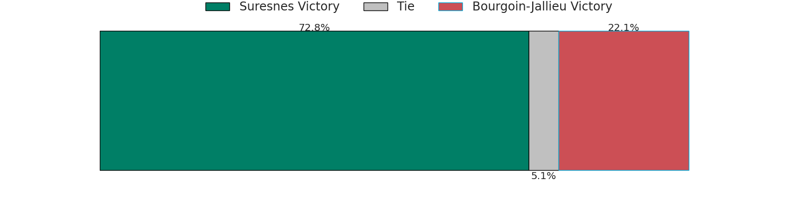

#### Vienne V Marcq-en-Baroeul on 2027/02/13

Average Margin: Marcq-en-Baroeul by 4.7

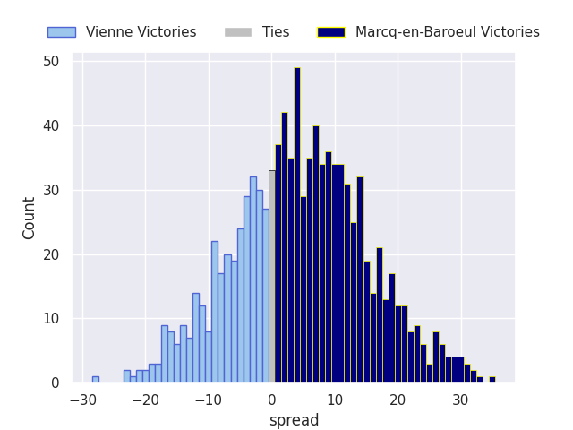

#### Rennes V US Bressane on 2027/02/13

Average Margin: Rennes by 7.0

### Week 20
#### Suresnes V Rennes on 2027/02/19

Average Margin: Suresnes by 8.0

#### Rouen V US Bressane on 2027/02/19

Average Margin: Rouen by 14.8

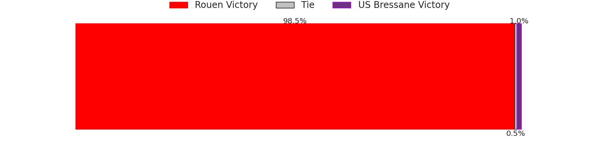

#### Chambery V Mont-de-Marsan on 2027/02/19

Average Margin: Chambery by 12.3

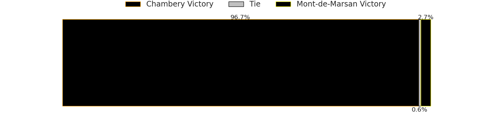
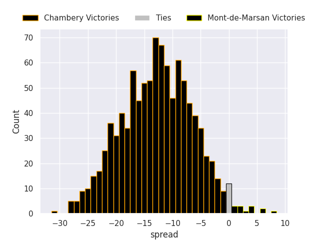

#### Perigueux V Carcassonne on 2027/02/20

Average Margin: Perigueux by 6.2

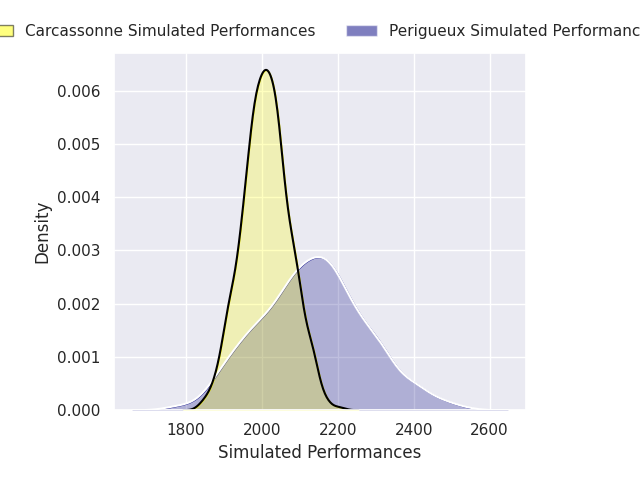

#### Massy V Vienne on 2027/02/20

Average Margin: Massy by 8.6

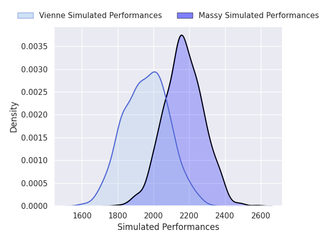

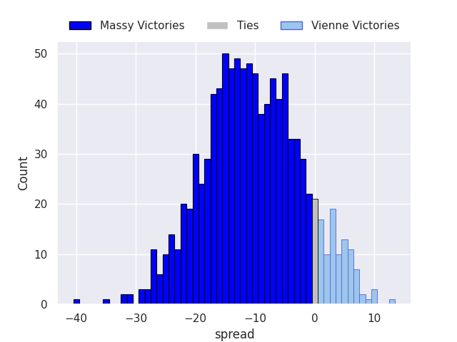

#### Bourgoin-Jallieu V Orleans on 2027/02/20

Average Margin: Bourgoin-Jallieu by 3.6

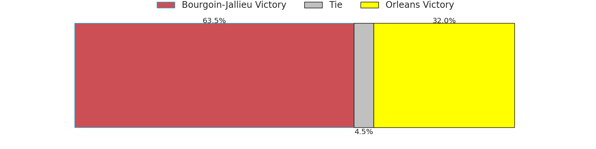

#### Marcq-en-Baroeul V Albi on 2027/02/20

Average Margin: Albi by 1.4

### Week 21
#### Mont-de-Marsan V Perigueux on 2027/02/26

Average Margin: Mont-de-Marsan by 6.0

#### Carcassonne V Bourgoin-Jallieu on 2027/02/26

Average Margin: Carcassonne by 9.6

#### Orleans V Suresnes on 2027/02/26

Average Margin: Orleans by 10.8

#### Albi V Massy on 2027/02/26

Average Margin: Albi by 3.2

#### US Bressane V Marcq-en-Baroeul on 2027/02/26

Average Margin: US Bressane by 0.3

#### Rennes V Rouen on 2027/02/27

Average Margin: Rouen by 2.8

#### Vienne V Chambery on 2027/02/27

Average Margin: Chambery by 16.4

### Week 22
#### Suresnes V Carcassonne on 2027/03/05

Average Margin: Suresnes by 0.8

#### Orleans V Rennes on 2027/03/05

Average Margin: Orleans by 13.5

#### Chambery V Albi on 2027/03/05

Average Margin: Chambery by 11.3

#### Marcq-en-Baroeul V Rouen on 2027/03/05

Average Margin: Rouen by 0.5

#### Bourgoin-Jallieu V Mont-de-Marsan on 2027/03/06

Average Margin: Bourgoin-Jallieu by 3.7

#### Massy V US Bressane on 2027/03/06

Average Margin: Massy by 18.8

#### Perigueux V Vienne on 2027/03/06

Average Margin: Perigueux by 7.1

### Week 23
#### Albi V Perigueux on 2027/03/19

Average Margin: Albi by 6.4

#### Mont-de-Marsan V Suresnes on 2027/03/19

Average Margin: Mont-de-Marsan by 9.8

#### Rouen V Massy on 2027/03/19

Average Margin: Rouen by 1.3

#### US Bressane V Chambery on 2027/03/19

Average Margin: Chambery by 11.6

#### Carcassonne V Orleans on 2027/03/19

Average Margin: Carcassonne by 6.5

#### Vienne V Bourgoin-Jallieu on 2027/03/20

Average Margin: Bourgoin-Jallieu by 5.5

#### Rennes V Marcq-en-Baroeul on 2027/03/20

Average Margin: Rennes by 2.1

### Week 24
#### Orleans V Mont-de-Marsan on 2027/03/26

Average Margin: Orleans by 6.9

#### Massy V Marcq-en-Baroeul on 2027/03/26

Average Margin: Massy by 13.6

#### Chambery V Rouen on 2027/03/26

Average Margin: Chambery by 12.3

#### Carcassonne V Rennes on 2027/03/26

Average Margin: Carcassonne by 13.2

#### Suresnes V Vienne on 2027/03/27

Average Margin: Suresnes by 1.5

#### Bourgoin-Jallieu V Albi on 2027/03/27

Average Margin: Bourgoin-Jallieu by 2.7

#### Perigueux V US Bressane on 2027/03/27

Average Margin: Perigueux by 17.0

### Week 25
#### US Bressane V Bourgoin-Jallieu on 2027/04/09

Average Margin: Bourgoin-Jallieu by 1.5

#### Mont-de-Marsan V Carcassonne on 2027/04/09

Average Margin: Mont-de-Marsan by 5.5

#### Albi V Suresnes on 2027/04/09

Average Margin: Albi by 9.9

#### Rouen V Perigueux on 2027/04/09

Average Margin: Rouen by 4.8

#### Marcq-en-Baroeul V Chambery on 2027/04/09

Average Margin: Chambery by 7.3

#### Rennes V Massy on 2027/04/10

Average Margin: Massy by 6.3

#### Vienne V Orleans on 2027/04/10

Average Margin: Orleans by 8.8

### Week 26
#### Mont-de-Marsan V Rennes on 2027/04/17

Average Margin: Mont-de-Marsan by 12.5

#### Bourgoin-Jallieu V Rouen on 2027/04/17

Average Margin: Bourgoin-Jallieu by 3.9

#### Chambery V Massy on 2027/04/17

Average Margin: Chambery by 8.7

#### Perigueux V Marcq-en-Baroeul on 2027/04/17

Average Margin: Perigueux by 12.1

#### Suresnes V US Bressane on 2027/04/17

Average Margin: Suresnes by 11.4

#### Carcassonne V Vienne on 2027/04/17

Average Margin: Carcassonne by 5.9

#### Orleans V Albi on 2027/04/17

Average Margin: Orleans by 5.2

