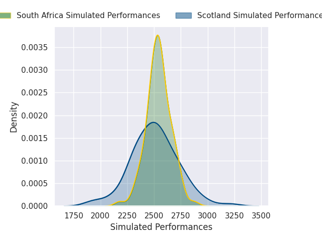
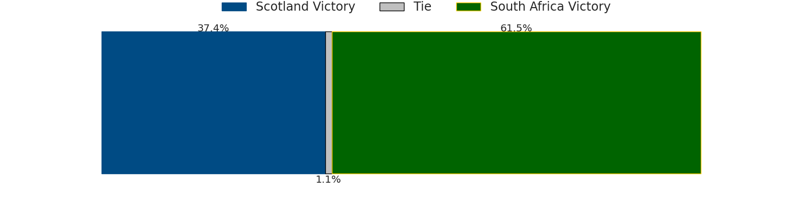
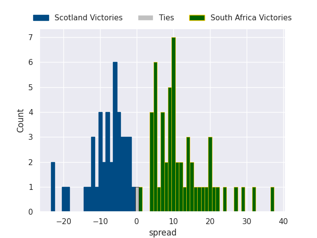

## Team Rankings

## Standings
### Current Standings
#### North

| Club     |   Played |   Wins |   Point Differential |   Losing Bonus Points |   Try Bonus Points |   Competition Points |
|:---------|---------:|-------:|---------------------:|----------------------:|-------------------:|---------------------:|
| France   |        4 |      3 |                   78 |                     1 |                  4 |                   17 |
| England  |        4 |      3 |                   71 |                     0 |                  3 |                   15 |
| Ireland  |        4 |      3 |                   29 |                     0 |                  3 |                   15 |
| Scotland |        4 |      2 |                  -11 |                     0 |                  3 |                   11 |
| Wales    |        4 |      2 |                  -35 |                     0 |                  2 |                   10 |
| Italy    |        4 |      0 |                 -153 |                     0 |                    |                    0 |

#### South

| Club         |   Played |   Wins |   Point Differential |   Losing Bonus Points |   Try Bonus Points |   Competition Points |
|:-------------|---------:|-------:|---------------------:|----------------------:|-------------------:|---------------------:|
| South Africa |        4 |      4 |                  140 |                     0 |                  4 |                   20 |
| New Zealand  |        4 |      4 |                   73 |                     0 |                  4 |                   20 |
| Australia    |        4 |      1 |                    6 |                     1 |                  3 |                    8 |
| Argentina    |        4 |      1 |                  -32 |                     1 |                  2 |                    7 |
| Japan        |        4 |      1 |                  -33 |                     1 |                    |                    5 |
| Fiji         |        4 |      0 |                 -133 |                     0 |                    |                    0 |

### Projected Remaining Table
#### North

| Club     |   To Play |   Projected Wins |   Projected Differential |   Projected Losing Bonus Points | Projected Try Bonus Points   |   Projected Competition Points |
|:---------|----------:|-----------------:|-------------------------:|--------------------------------:|:-----------------------------|-------------------------------:|
| Scotland |         2 |            1.591 |                   20.111 |                           0.242 |                              |                          6.724 |
| France   |         2 |            1.549 |                   20.382 |                           0.229 |                              |                          6.523 |
| Ireland  |         2 |            1.456 |                   23.346 |                           0.27  |                              |                          6.2   |
| England  |         2 |            1.404 |                   20.084 |                           0.273 |                              |                          5.969 |
| Italy    |         2 |            0.962 |                    0.123 |                           0.451 |                              |                          4.435 |
| Wales    |         2 |            0.537 |                  -14.128 |                           0.428 |                              |                          2.684 |

#### South

| Club         |   To Play |   Projected Wins |   Projected Differential |   Projected Losing Bonus Points | Projected Try Bonus Points   |   Projected Competition Points |
|:-------------|----------:|-----------------:|-------------------------:|--------------------------------:|:-----------------------------|-------------------------------:|
| New Zealand  |         2 |            1.463 |                   15.182 |                           0.279 |                              |                          6.227 |
| South Africa |         2 |            0.845 |                   -3.312 |                           0.49  |                              |                          4.052 |
| Australia    |         2 |            0.764 |                   -5.466 |                           0.494 |                              |                          3.722 |
| Argentina    |         2 |            0.705 |                  -12.175 |                           0.311 |                              |                          3.239 |
| Fiji         |         2 |            0.313 |                  -28.364 |                           0.322 |                              |                          1.624 |
| Japan        |         2 |            0.088 |                  -35.783 |                           0.24  |                              |                          0.63  |

### Projected Total Table
#### North

| Club     |   Played |   Wins |   Point Differential |   Losing Bonus Points |   Try Bonus Points |   Competition Points |
|:---------|---------:|-------:|---------------------:|----------------------:|-------------------:|---------------------:|
| France   |        6 |  4.549 |               98.382 |                 1.229 |                  4 |               23.523 |
| Ireland  |        6 |  4.456 |               52.346 |                 0.27  |                  3 |               21.2   |
| England  |        6 |  4.404 |               91.084 |                 0.273 |                  3 |               20.969 |
| Scotland |        6 |  3.591 |                9.111 |                 0.242 |                  3 |               17.724 |
| Wales    |        6 |  2.537 |              -49.128 |                 0.428 |                  2 |               12.684 |
| Italy    |        6 |  0.962 |             -152.877 |                 0.451 |                    |                4.435 |

#### South

| Club         |   Played |   Wins |   Point Differential |   Losing Bonus Points |   Try Bonus Points |   Competition Points |
|:-------------|---------:|-------:|---------------------:|----------------------:|-------------------:|---------------------:|
| New Zealand  |        6 |  5.463 |               88.182 |                 0.279 |                  4 |               26.227 |
| South Africa |        6 |  4.845 |              136.688 |                 0.49  |                  4 |               24.052 |
| Australia    |        6 |  1.764 |                0.534 |                 1.494 |                  3 |               11.722 |
| Argentina    |        6 |  1.705 |              -44.175 |                 1.311 |                  2 |               10.239 |
| Japan        |        6 |  1.088 |              -68.783 |                 1.24  |                    |                5.63  |
| Fiji         |        6 |  0.313 |             -161.364 |                 0.322 |                    |                1.624 |

### Projected Playoff Results

|              | Reach Final   | Win Final   |
|:-------------|:--------------|:------------|
| Wales        | 100.0 %       | 78.3 %      |
| Scotland     | 100.0 %       | 75.9 %      |
| England      | 100.0 %       | 67.3 %      |
| Ireland      | 100.0 %       | 65.9 %      |
| Italy        | 100.0 %       | 65.0 %      |
| France       | 100.0 %       | 58.8 %      |
| New Zealand  | 100.0 %       | 51.5 %      |
| South Africa | 100.0 %       | 44.8 %      |
| Fiji         | 100.0 %       | 34.8 %      |
| Argentina    | 100.0 %       | 20.2 %      |
| Japan        | 100.0 %       | 20.0 %      |
| Australia    | 100.0 %       | 17.5 %      |

## Completed Match Review

| Model | Percent Correct Predictions | Spread Error |
| ------ | ------ | ------ |
| Club Level | 68.3% | 12.1 |
| Player Level: Lineup | nan% | nan |
| Player Level: Minutes | nan% | nan |

## Future Predictions
### Week 5
#### France V South Africa on 2026/11/13

Average Margin: France by 3.1

#### England V Japan on 2026/11/14

Average Margin: England by 21.5

#### Ireland V Fiji on 2026/11/14

Average Margin: Ireland by 23.2

#### Italy V Argentina on 2026/11/14

Average Margin: Argentina by 5.1

#### Wales V New Zealand on 2026/11/14

Average Margin: New Zealand by 13.8

#### Scotland V Australia on 2026/11/15

Average Margin: Scotland by 5.8

### Week 6
#### Scotland V Japan on 2026/11/21

Average Margin: Scotland by 14.3

#### Wales V Australia on 2026/11/21

Average Margin: Australia by 0.3

#### England V New Zealand on 2026/11/21

Average Margin: New Zealand by 1.4

#### Italy V Fiji on 2026/11/21

Average Margin: Italy by 5.2

#### Ireland V South Africa on 2026/11/21

Average Margin: Ireland by 0.2

#### France V Argentina on 2026/11/21

Average Margin: France by 17.2

### Week 7
#### France V South Africa on 2026-11-26

Average Margin: France by 4.7

#### Wales V Fiji on 2026-11-26

Average Margin: Wales by 10.0

#### Wales V Australia on 2026-11-26

Average Margin: Wales by 5.0

#### Wales V Japan on 2026-11-26

Average Margin: Wales by 13.3

#### Wales V Argentina on 2026-11-26

Average Margin: Wales by 2.7

#### Scotland V Japan on 2026-11-26

Average Margin: Scotland by 14.3

#### Ireland V Japan on 2026-11-26

Average Margin: Ireland by 14.7

#### Scotland V Australia on 2026-11-26

Average Margin: Australia by 1.7

#### Scotland V Argentina on 2026-11-26

Average Margin: Scotland by 8.7

#### France V Argentina on 2026-11-26

Average Margin: France by 15.6

#### England V Japan on 2026-11-26

Average Margin: England by 24.5

#### France V Australia on 2026-11-26

Average Margin: France by 14.1

#### Ireland V Argentina on 2026-11-26

Average Margin: Ireland by 11.9

#### England V Argentina on 2026-11-26

Average Margin: England by 16.5

#### England V Australia on 2026-11-26

Average Margin: England by 12.9

#### Ireland V Australia on 2026-11-26

Average Margin: Ireland by 11.2

#### Scotland V South Africa on 2026-11-26

Average Margin: Scotland by 1.0

#### Ireland V South Africa on 2026-11-26

Average Margin: South Africa by 1.9

#### England V New Zealand on 2026-11-26

Average Margin: England by 2.6

#### Ireland V New Zealand on 2026-11-26

Average Margin: New Zealand by 1.7

#### England V South Africa on 2026-11-26

Average Margin: England by 0.8

#### France V New Zealand on 2026-11-26

Average Margin: France by 1.0

#### Italy V Fiji on 2026-11-26

Average Margin: Italy by 4.8

#### Italy V Japan on 2026-11-26

Average Margin: Japan by 2.8

